# Refine the ABOM data structures and algorithms

ABOM's cost is not spread evenly. Almost every large win this repository has had came from a data
*shape* problem that looked like a performance problem: a correlated subquery evaluated per row
(17.7s to 0.045s), a recursive CTE forming a cross product (36s), a process started per call
instead of once (188x). None of them were found by profiling, and none were guessed. They were
found by asking the database and the pipeline what they were actually doing.

This skill is that question, asked the same way every time, so that two reviews six weeks apart
are comparable.

**It measures and proposes. It does not implement.** Proposals go to `codeql-abom-dev-test`, and
this skill comes back afterwards to check whether the prediction held.

## When to run it

- On a cadence, after a feature cycle has added structures nobody has measured.
- When something a person waits on got slower and nobody knows why.
- When a scale question has to be answered honestly: *will this hold at 10,000 repositories?*
- Not while discovery is crawling. See phase 0.

## The loop

```mermaid
flowchart LR
  Q["0 · quiet<br/>snapshot"] --> C["1 · census<br/>what is the shape"]
  C --> K["2 · cost<br/>what does it cost now"]
  K --> G["3 · growth<br/>what will it cost"]
  G --> D["4 · diagnose<br/>against known signatures"]
  D --> P["5 · propose<br/>predicted before/after"]
  P -->|hand off| I["codeql-abom-dev-test"]
  I -->|re-measure| K
  P -->|"top gain < ~20%"| X["close the sweep"]
  style X fill:#1d3d2d
```



Phases 1 to 3 are measurement and must be finished before phase 4 begins. Diagnosing while still
measuring is how a review turns into a hunt for evidence supporting the first thing you noticed.

---

## Phase 0 — Quiet the machine and take a snapshot

```bash
make status          # discovery must be stopped
```

Every `codeql` invocation shares one local compilation cache and competes for every core. A crawl
in flight makes every timing in this review meaningless, and worse, plausibly meaningless — the
numbers look fine and rank the wrong things first.

```bash
sqlite3 -readonly "file:$ABOM_DB?immutable=1" ".backup /tmp/abom-review.db"
```

**`.backup`, never `cp`.** The database is in WAL mode, so a file copy drops everything committed
since the last checkpoint and you spend the review measuring a database that never existed.

**Open it with `immutable=1`, not `mode=ro`.** A fresh `.backup` has no `-shm` file, a read-only
connection may not create one, and `mode=ro` therefore fails with `unable to open database file`
on a snapshot that is perfectly good. It appears to work against the live database only because
the running server already made the `-shm` — so the form that looks correct is the trap.

**Record your snapshot locally**, and put its numbers in the review rather than reading them from
here: repository count, node and edge counts, findings, byte size, and the date. Every number in
the review is relative to that, and a review that does not say which data it measured cannot be
compared to the next one.

```bash
sqlite3 -readonly "file:$SNAP?immutable=1" "
SELECT (SELECT count(*) FROM repository)     AS repositories,
       (SELECT count(*) FROM abom_node_live) AS nodes,
       (SELECT count(*) FROM abom_edge_live) AS edges,
       (SELECT count(*) FROM abom_finding)   AS findings,
       (SELECT count(*) FROM abom_frontier)  AS queued,
       (SELECT count(*) FROM abom_advisory)  AS advisories;"
```

No figures are published here, on purpose. A table of remembered constants gets compared against
instead of measured, and it outlives the data it described.

**Check whether anything has been pruned.** Where `abom_node` and `abom_node_live` differ, **every
measurement uses the `_live` views** — a query benchmarked against base tables is timing work the
application never does.

---

## Phase 1 — Census: what shape is the data actually in

Cost follows from shape, and the shape is rarely what the schema suggests. Take all of it; the
cheap ones are the ones that surprise.

Run the commands in [references/measurement-protocol.md](./references/measurement-protocol.md).
They cover:

- **Row counts and byte counts per table**, including index bytes as a share of the whole. An
  index nobody uses is write cost with no read gain, and this schema carries 24 of them.
- **Degree distribution** on `abom_edge_live`, in and out. Report the max, the p99, the mean, and
  the count of nodes above 100. Hubs decide whether a traversal is linear or quadratic.
- **Connected components** and the size of the largest. A graph that is mostly one component and a
  graph that is 400 islands want different algorithms and different default views.
- **Null rates on every join key** — `abom_node.repository_row_id`, `container_node_row_id`,
  `abom_edge.repository_row_id`, `abom_frontier.resolved_sha`, `abom_query_run.db_commit`. A join
  on a key that can be empty joins everything, and this has already bitten.
- **Cardinality and skew of every predicated column**: `node_kind`, `origin`, `boundary`,
  `edge_kind`, `is_external`, `rule_id`, `provider`, `severity`. An index on a column with three
  values and a 95/4/1 split will not be used, and should not be proposed.
- **Selectivity of each filter the product actually offers**, measured as *nodes kept* and *edges
  surviving between kept nodes*. This is the measurement most likely to change a design, for the
  reason in signature 4.
- **Depth histogram** of the dependency closure. Transitive cost is exponential in depth and
  linear in breadth, and knowing which one this corpus has decides whether to optimize the
  traversal or the fan-out.

Write the census down even where nothing looks wrong. Phase 3 needs it at four corpus sizes, and
a census taken only when something looks suspicious cannot produce a curve.

---

## Phase 2 — Cost: what it costs today

### The query planner is flying blind, and confirming that is step one

```bash
sqlite3 -readonly "file:/tmp/abom-review.db?immutable=1" \
  "SELECT count(*) FROM sqlite_master WHERE name='sqlite_stat1';"
```

On the reference corpus this answers **0**. There are no statistics, so SQLite is planning every
join on defaults rather than on this corpus's actual distributions. `ANALYZE` runs only inside
compaction, beside `VACUUM`, so a database that has never been compacted has never been analyzed.

Measure both states and report them separately; **never compare a timing taken before `ANALYZE` to
one taken after**.

**Do not expect it to help.** This was written predicting `ANALYZE` would be the cheapest available
win. The first sweep measured it on the worst query in the system and found **1.68 s to 1.57 s,
inside the spread of the before-runs, with a byte-identical plan**. Where cost comes from query
*shape* rather than from plan choice, statistics change nothing. Run it, record it, and move on.

### Then read the plans

```bash
.github/skills/refine-abom-data-structures-and-algorithms/scripts/query-plans.sh \
  /tmp/abom-review.db /tmp/abom-review-sql
```

`EXPLAIN QUERY PLAN` appears in exactly **two** Go test files in this repository —
`internal/store/graphnodecost_test.go` and `internal/store/queryrunindex_test.go` — each guarding
one query. Against 24
indexes and every read path in `internal/store`, that is two known-good plans and the rest
unexamined. **A systematic sweep of the plans is the highest-yield hour in this review**, and
`db/data-efficiency.md` already records the precedent: reading the plan, rather than reasoning about
what had changed, is what found the per-node correlated subquery.

What to flag, in order of severity:

| In the plan | Means |
| --- | --- |
| `SCAN` on the inner side of a join | a full table per outer row. This is the 393x shape |
| `CORRELATED SCALAR SUBQUERY` | executed per row of the outer query |
| `USE TEMP B-TREE FOR ORDER BY` | the sort is not served by an index |
| `MATERIALIZE` on a CTE joined more than once | may be right; check it is not being rebuilt |
| `SEARCH ... USING INDEX` where the index is not the one you expected | often a covering-index opportunity, sometimes a missing one |
| a join predicate wrapped in a function or concatenation | no index can serve it. `AdvisoriesByReach` joins on `owner \|\| '/' \|\| repo` |

### Then time the paths a person waits on

Endpoint wall time, cold and warm, from the resident server rather than a new process each time —
process startup has already been measured at 0.75s against 0.004s of actual work, so a
per-invocation harness would attribute 99% of the cost to the wrong place.

Decompose every payload: bytes total, bytes gzipped, bytes per node, and bytes that are
**redundant** — repeated JSON keys, edges implied by a field already present on the node, fields no
consumer reads. The Explorer payload has measured 818 bytes per node with 13 repeated keys, and
30% of its edges were containment edges derivable from the nodes themselves.

### And the traversals

`internal/graph` holds the in-memory work: `closure.go`, `supplychain.go`, `reach.go` and
`exposure.go`. For each, state the complexity in terms of the census
numbers — nodes, edges, max degree, depth — and then measure it, because the two disagreeing is
itself the finding. Count allocations and map builds, not only time: seven maps built over the
same node set is a structure problem that a faster machine hides.

---

## Phase 3 — Growth: what it will cost, and what breaks first

**A 10,000-repository corpus cannot be staged here.** Crawling one costs weeks of API budget and
compute. So scale claims are made by measuring what can be measured and fitting a curve — never by
asserting that something "should scale".

```bash
.github/skills/refine-abom-data-structures-and-algorithms/scripts/subsample-corpus.sh \
  /tmp/abom-review.db /tmp/abom-scale 10 25 50 100
```

The script builds corpora at each fraction **preserving closure**: a dependency node reached by a
surviving workflow survives even though its own repository was not sampled. Sampling without that
shrinks the graph faster than the repository count and produces a flattering exponent that is
entirely an artifact of the sampling.

At each size, take the phase 1 census and the phase 2 timings, then:

$$\log(\text{cost}) = a + b \cdot \log(\text{size})$$

Report $b$, the exponent, per stage — with the four points it was fitted from, so a reader can see
whether it is a line or a hope. Then extrapolate to 10,000 and 100,000 repositories and **state the
confidence and the extrapolation factor**. Four points spanning one order of magnitude, projected
two orders out, is a weak claim and must be labeled one.

The deliverable is not the exponents. It is an ordered list: **what breaks first, and at what
corpus size** — the first stage to exceed a threshold somebody cares about, then the second.

Three things invalidate this phase silently. They are in
[references/measurement-protocol.md](./references/measurement-protocol.md) with the others, and
these three are the ones that have actually caught people:

- **The page-cache cliff.** The cache is 256 MiB. While the whole database fits inside it, every
  read is from memory and every curve looks linear. **Report database size against cache size at
  every sample point** and mark where the crossing would fall. A growth curve measured entirely
  below the cliff says nothing about life above it.
- **Serialized reads.** `MaxOpenConns(1)` means concurrent requests queue. Single-request timing
  cannot see that, and request queueing is what organization scale hits before it hits query cost.
  If you have not measured concurrently, say that you have not.
- **Two durability modes.** Ingest opens with `synchronous = OFF`, serving with `NORMAL`. Timings
  are not comparable across them. Say which mode produced each number.

---

## Phase 4 — Diagnose

Now, and not before, work through
[references/failure-signatures.md](./references/failure-signatures.md). It catalogs the data-shape
failures this repository has already paid for, each with its symptom, how to detect it, what it
cost, and what fixed it.

For each measurement that stands out, name the signature it matches, or record that it matches
none — a new signature is a contribution and belongs in the catalog with its measurement.

A finding is only a finding when it names the structure responsible. "The Explorer is slow" is not
a finding. "The Explorer ships 30% of its edges to describe containment that each node's own
`container` field already states" is.

---

## Phase 5 — Propose

Every proposal carries four things, and one without them is an opinion:

1. **The measurement** that identified it, with its units and the corpus it came from.
2. **A predicted before and after**, in the units someone waits in.
3. **The measurement that would falsify the prediction** — stated in advance, so the re-measure
   after implementation can come out negative and be believed.
4. **The cost of the change**, including what it makes worse. An index is paid for on a serialized
   write path during a write-heavy ingest; a cache is paid for in staleness; a denormalized count
   is paid for in a second source of truth that can disagree with the first.

Rank by

$$\frac{\text{measured cost} \times \text{confidence}}{\text{effort}}$$

and be explicit that confidence is lower for anything resting on an extrapolation.

Then hand off to `codeql-abom-dev-test` with the plan entry, and return afterwards to run phase 2
again on the same corpus. **A prediction nobody checked is how a review's credibility ends.**

---

## The output document

A sweep produces three kinds of output, and they go to three different places.

- **What is still to do** goes to `plans/db/data-efficiency.md` as pending items, and is ranked into
  `plans/next.md`. Keep it to the open work: the plan is a queue, not a logbook.
- **A rule the next author must not break** stays in the plan that found it — for example that a
  function on an indexed column defeats the index, or that a frame-rate probe must prove the thing
  it timed actually moved. It moves to a skill under `.github/skills/**` only when the plan retires
  and the rule still changes what somebody does. `.github/instructions/**` is fixed and never
  receives it.
- **The reasoning**, including predictions that did not hold, goes to `plans/implemented.md`, which is
  git-ignored. Those are the most valuable rows there are, and they are also exactly what nobody
  wants to read in a tracked plan a year later.

Do not write a per-review history table into the plan. Git holds what changed and when.

## Knowing when to stop

The first sweep should find large, structural things, and the third should not. Diminishing returns
are the expected outcome, not a failure, and the review has to be able to say so rather than
manufacturing work.

**Close the sweep when the best remaining proposal predicts under about 20% improvement on a path
a person or the crawl actually waits on**, or when the predicted gain is inside measurement noise.
Record the closing number in `plans/implemented.md`, and reopen at the next major feature cycle —
because new structures arrive unmeasured, and the closing number is what the next review starts
from.

Two ways to get this wrong. Continuing past the point of value, producing micro-optimizations that
cost review time and add risk. And closing early because the remaining items look hard — effort
belongs in the ranking denominator, not in the decision to stop measuring.

## What must never be proposed

- **An optimization with no measurement behind it.** Both a renderer rewrite and a service split
  were proposed here from plausible reasoning, and measurement killed both.
- **Anything that makes absent indistinguishable from zero.** A node nobody has measured must not
  acquire a reach of 0, however much cheaper that makes the read.
- **Hard deletion in place of tombstones.** `removed_at` is what makes the delta cursor possible.
- **A denormalized value with nothing named to keep it honest.** If a count is cached, say what
  recomputes it and what test catches it drifting.
- **A second writer**, in any form, including "just for this one background job".
- **A verdict computed anywhere.** Precomputing an advisory match into a `vulnerable` column moves
  a judgement into the storage layer and is the specific thing the architecture forbids.
- **"Fixing" data that contradicts an assumption.** `actions/download-artifact@v8` looked like
  corruption and was real. Verify the world before proposing a repair.

## Verification

A review is complete when:

- Every number in it names the corpus and the durability mode it came from.
- Every scale claim states an exponent, the points it was fitted from, and a confidence.
- At least one proposal names the measurement that would falsify it.
- `PRAGMA integrity_check` on the snapshot is clean, and the live database was never opened for
  writing.
- The previous review's predictions have been checked, including the ones that failed.
