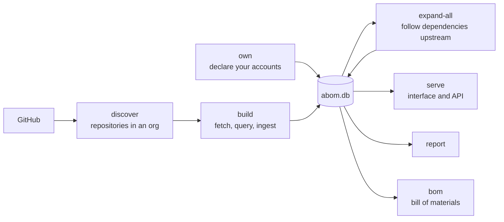

# codeql-abom

An Actions Bill of Materials for a GitHub organization, built from CodeQL results.

Self-hosted, and meant for a central security team responsible for GitHub Actions across one
GitHub organization. It connects dependency source evidence, CodeQL findings, ownership and reach,
including findings about private code that cannot travel the public advisory route.

**[Why ABOM exists](docs/abom-value-proposition.md)** - how ABOM builds on native GitHub capabilities
and which organization-wide questions it answers.
**[How it works](docs/architecture.md)** — the pipeline, the data model, and the rules that shape
them. **[Vision](docs/vision.md)** — where it is going and why. **[Roadmap](docs/roadmap.md)** —
what is next.

`codeql-abom` answers questions a list of dependencies cannot:

- **What is the blast radius of an action?** How many repositories reach it, directly and
  through intermediaries.
- **What depends on this workflow?** Every repository, with the exact `uses:` references.
- **What should we fix first?** The most severe, then the widest reach, and nothing else.
- **What breaks if we bump this?** Which repositories are affected, split into those that name
  the action themselves and those that reach it through someone else's.
- **How are references pinned?** Per owner, repository, workflow and individual `uses:` line.



## What it is not

It never forms its own security verdict. CodeQL rule IDs are the only source of one, and every
claim traces back to the query or advisory that made it. If `actions/unpinned-tag` did not flag
a reference, this tool will not tell you it is safe — it will tell you the rule did not look.

Coverage, unresolved dependencies and unplaceable findings are reported as first-class output.
Silence about what was not analyzed reads as completeness, and would be a lie.

## Native Actions lockfiles

**Native lock-aware resolution is ABOM's target baseline; its ingestion is not built yet.**
GitHub's [gh-actions-lock](https://github.com/github/gh-actions-lock) retains symbolic references
while selecting immutable commits for onboarded workflows. ABOM will consume that selection at
the analyzed revision using GitHub's [shared parser](https://github.com/github/actions-lockfile),
preserving the declared ref, lock context and actually analyzed commit separately. A live tag
lookup must not replace a locked choice, and a broken lock must not silently become a live lookup.

[Tool adoption](plans/tools/actions-lock.md) and [contextual resolution](plans/db/actions-lockfile.md)
are distinct planned efforts. Native lock updates, runner enforcement, Dependency Graph ingestion
and advisory outcomes require [separate verification](plans/api/dependency-graph-crosscheck.md).
`abom-check` remains a planned verdict client; new submission modes are deferred while that native
coverage is measured. Existing guarded manual submission is retained, not automatically retired.

## Quick start

```bash
make build

# Find repositories in an organization that have CodeQL databases.
./bin/codeql-abom discover --org <name> --db abom.db

# Fetch, query and ingest them.
./bin/codeql-abom build --db abom.db

# Follow dependencies upstream, then refresh every aggregate.
./bin/codeql-abom expand-all --db abom.db

# The same crawl, retaining fetched checkouts between runs: a commit is cloned once however
# many references name it, bounded by --cache-max-mb with the least recently used evicted first.
./bin/codeql-abom expand-all --db abom.db --cache-dir .abom/cache

# Recompute the derived tables without crawling, which is what an upgrade needs.
./bin/codeql-abom refresh --db abom.db

# Read the result.
./bin/codeql-abom report --db abom.db
./bin/codeql-abom serve --db abom.db --ui-dir <published-wwwroot>
```

`codeql-abom --help` lists every subcommand, and `make start` builds both halves and serves them.

## Confirming what is yours

Most figures split into what you can change and what you cannot, once ABOM knows which accounts
are yours. It never asks you: it reads the answer from an authenticated
[`gh`](https://cli.github.com) session.

```bash
gh auth login                                   # once, with the read:org scope
./bin/codeql-abom accounts --db abom.db --refresh
./bin/codeql-abom own --db abom.db --org <name> # declare what you are responsible for
```

An account counts because GitHub says you belong to it, never because it was typed in. That
matters because holding an analyzed repository proves nothing about who can change it: `actions`
owns `actions/cache`, which is reached by many organizations and controlled by none of them.

Until an identity is verified, every figure is reported undivided — which is not a claim that
you own nothing. If `gh` is missing, logged out, or lacks `read:org`, the interface says so and
names the command that fixes it.

## Layout

| Path | |
| --- | --- |
| `cmd/codeql-abom` | The CLI |
| `internal/store` | SQLite. The only package that writes SQL |
| `internal/graph`, `ingest`, `expand` | Derivation from CodeQL results |
| `internal/serve` | HTTP API |
| `internal/submit` | Dependency graph snapshots sent to GitHub |
| `ui` | Blazor WebAssembly interface |
| `ql/actions/graph-extraction` | The CodeQL queries that produce the graph |
| `ql/actions/findings` | The suite whose results become findings |
| `ql/actions/selfcheck` | Our own workflows, analyzed by our own queries |
| [`docs/`](docs/architecture.md) | How it works, why it exists, and where it is going |
| [`plans/`](plans/next.md) | What is next, and the reasoning behind it |

## Development

```bash
make verify      # corruption, gofmt, vet, lint, Go tests, browser tests, queries, interface
make selfcheck   # run our own analysis over our own workflows
```

Requires Go (see `go.mod`), .NET 10, Node, and the CodeQL CLI at the version in
`.codeql-version`.

## Acknowledgements

GitHub's [gh-actions-lock](https://github.com/github/gh-actions-lock) and
[actions-lockfile](https://github.com/github/actions-lockfile) provide the native pinning tool and
shared format that ABOM's planned resolution will reuse, rather than reimplement.

Jesse Houwing's
[actions-dependency-submission](https://github.com/jessehouwing/actions-dependency-submission)
is valuable prior art for fork and mirror resolution, host-aware GitHub access, container
declarations and workflow-level dependency submission. Its implementation and tests inform ABOM's
[planned work](plans/next.md), including the future `abom-check` client, following
[issue #18](https://github.com/advanced-security/codeql-abom/issues/18). The relevant plans cite
specific source revisions and distinguish those ideas from capabilities ABOM already implements.
His [request for native lock-backed reporting](https://github.com/github/gh-actions-lock/issues/122)
also informs the capability comparison before any expansion of ABOM's publisher.

## License

MIT. See [LICENSE](LICENSE).
