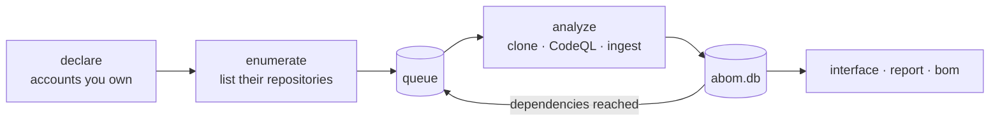

# codeql-abom

An Actions Bill of Materials for a GitHub organization, built from CodeQL results.

Self-hosted, and meant for a central security team responsible for GitHub Actions across one
GitHub organization. It connects dependency source evidence, CodeQL findings, ownership and reach,
including findings about private code that cannot travel the public advisory route.

## GETTING STARTED

**ABOM is unreleased. Building from source is the only supported installation.** GitHub Release
downloads and Helm deployment are not available.

To try ABOM without an organization, run a [Demo](docs/demo.md) from an archive of this
repository: `make demo-check`, then `make demo`. Or
[open one in a Codespace](https://codespaces.new/advanced-security/codeql-abom?quickstart=1), where
every Codespace of this repository is a Demo; [the guide](docs/demo.md#run-a-demo-in-a-codespace)
says how to sign in for Copilot authoring.

1. Follow [source setup](docs/deployment/source.md) to install the prerequisites, CodeQL and its
   query packs, and to confirm GitHub and Git access to your organization.
2. From the checkout, run `make start` and open <http://127.0.0.1:8099>.
3. In **Settings**, which asks gh for your accounts as it opens, declare your organization and
   **Save**. ABOM lists and queues its repositories; nothing is analyzed yet.
4. Review what was listed, then press **Start analysis**. `make stop` stops the server.

[Deployment options](docs/deployment/index.md) · [Configuration](docs/deployment/configuration.md) ·
[Operations and troubleshooting](docs/deployment/operations.md)

## About ABOM

**[Why ABOM exists](docs/abom-value-proposition.md)** - how ABOM builds on native GitHub capabilities
and which organization-wide questions it answers.
**[How it works](docs/architecture.md)** — the pipeline, the data model, and the rules that shape
them. **[Vision](docs/vision.md)** — where it is going and why. **[Roadmap](docs/roadmap.md)** —
what is next.

`codeql-abom` answers questions a list of dependencies cannot:

- **What is the blast radius of an action?** How many repositories reach it, directly and
  through intermediaries.
- **What depends on this workflow?** Every repository, with the exact `uses:` references.
- **What should we fix first?** The most severe, then the widest reach, and nothing else.
- **What breaks if we bump this?** Which repositories are affected, split into those that name
  the action themselves and those that reach it through someone else's.
- **How are references pinned?** Per owner, repository, workflow and individual `uses:` line.



## What it is not

It never forms its own security verdict. CodeQL rule IDs are the only source of one, and every
claim traces back to the query or advisory that made it. If `actions/unpinned-tag` did not flag
a reference, this tool will not tell you it is safe — it will tell you the rule did not look.

Coverage, unresolved dependencies and unplaceable findings are reported as first-class output.
Silence about what was not analyzed reads as completeness, and would be a lie.

## Native Actions lockfiles

**Native lock-aware resolution is ABOM's resolution baseline, and it is built.**
GitHub's [gh-actions-lock](https://github.com/github/gh-actions-lock) retains symbolic references
while selecting immutable commits for onboarded workflows. ABOM reads that selection at the
analyzed revision with GitHub's [shared parser](https://github.com/github/actions-lockfile),
analyzes the commit it selects, and keeps the declared ref, lock context and analyzed commit
separately on every surface. A live tag lookup never replaces a locked choice, and a broken lock
never silently becomes one. See [how it works](docs/architecture.md#locks).

[Tool adoption](plans/tools/actions-lock.md) is a distinct planned effort. Native lock updates, runner enforcement, Dependency Graph ingestion
and advisory outcomes require [separate verification](plans/api/dependency-graph-crosscheck.md).
`abom-check` remains a planned verdict client; new submission modes are deferred while that native
coverage is measured. Existing guarded manual submission is retained, not automatically retired.

## Layout

| Path | |
| --- | --- |
| `cmd/codeql-abom` | The CLI |
| `internal/store` | SQLite. The only package that writes SQL |
| `internal/graph`, `ingest`, `expand` | Derivation from CodeQL results |
| `internal/serve` | HTTP API |
| `internal/submit` | Dependency graph snapshots sent to GitHub |
| `ui` | Blazor WebAssembly interface |
| `ql/actions/graph-extraction` | The CodeQL queries that produce the graph |
| `ql/actions/findings` | The suite whose results become findings |
| `ql/actions/selfcheck` | Our own workflows, analyzed by our own queries |
| [`docs/`](docs/architecture.md) | How it works, why it exists, and where it is going |
| [`plans/`](plans/next.md) | What is next, and the reasoning behind it |

## Requirements

ABOM runs on macOS or on Linux with glibc, and needs these on `PATH`:

- Git, GNU Make, curl and a C compiler, because SQLite needs CGO
- Go 1.21 or later, which downloads the toolchain the [Makefile](Makefile) pins
- The .NET 10 SDK, which builds the interface
- The GitHub CLI, signed in to an account that can read your organization
- The CodeQL CLI at the version in [`.codeql-version`](.codeql-version)
- Graphviz, whose `dot` draws the interface's figures

[Source setup](docs/deployment/source.md#prerequisites) says how to install each one.
[Optional features](docs/deployment/configuration.md#optional-features), such as Copilot authoring,
need more. Development also needs Python 3, Node, Playwright, golangci-lint, the `gh actions-lock`
extension and a running Docker daemon.

## Development

```bash
make verify      # corruption, gofmt, vet, lint, Go tests, browser tests, queries, interface
make selfcheck   # run our own analysis over our own workflows
```

## Background

The [roadmap](docs/roadmap.md) says where ABOM is going next, [plans/next.md](plans/next.md) ranks
the work under way, and [issues](https://github.com/advanced-security/codeql-abom/issues) track
bugs and feature requests.

Contributions are welcome. Read [CONTRIBUTING.md](CONTRIBUTING.md) before opening a pull request.
This project is released with a [Contributor Code of Conduct](CODE_OF_CONDUCT.md), and by
participating in it you agree to abide by its terms.

## Acknowledgements

ABOM is built on GitHub's [CodeQL](https://github.com/github/codeql), whose Actions query tests are
most of ABOM's fixture corpus. The [GitHub Advisory Database](https://github.com/advisories)
supplies the advisories the corpus is tested against. [NOTICE](NOTICE) gives the licenses of
everything ABOM includes from others.

GitHub's [gh-actions-lock](https://github.com/github/gh-actions-lock) and
[actions-lockfile](https://github.com/github/actions-lockfile) provide the native pinning tool and
shared format that ABOM's lock-aware resolution reuses.

Jesse Houwing's
[actions-dependency-submission](https://github.com/jessehouwing/actions-dependency-submission)
is valuable prior art for fork and mirror resolution, host-aware GitHub access, container
declarations and workflow-level dependency submission. Its implementation and tests inform ABOM's
[planned work](plans/next.md), including the future `abom-check` client, following
[issue #18](https://github.com/advanced-security/codeql-abom/issues/18). The relevant plans cite
specific source revisions and distinguish those ideas from capabilities ABOM already implements.
His [request for native lock-backed reporting](https://github.com/github/gh-actions-lock/issues/122)
also informs the capability comparison before any expansion of ABOM's publisher.

## License

This project is licensed under the terms of the GitHub CodeQL Terms and Conditions. Please refer to
the [LICENSE](./LICENSE) file for the full terms. Material from others keeps its own license, which
[NOTICE](NOTICE) lists.

## Maintainers

ABOM is maintained by GitHub's CodeQL Expert Services team. [CODEOWNERS](CODEOWNERS) lists the
maintainers who review changes.

## Support

Report bugs and request features in
[issues](https://github.com/advanced-security/codeql-abom/issues), after searching for an existing
one, and ask questions in
[Discussions](https://github.com/advanced-security/codeql-abom/discussions). ABOM is under active
development and maintained by GitHub staff, who will do their best to respond in a timely manner.
Support is limited to these channels, as [SUPPORT.md](SUPPORT.md) says. Report a security
vulnerability as [SECURITY.md](SECURITY.md) describes, never in a public issue.
