# Why ABOM exists

For a security team responsible for GitHub Actions across one GitHub organization.

GitHub already ships two of the three things such a team needs. Dependabot watches dependencies
against the advisory database, and code scanning surfaces static analysis results to the
developers who can act on them. What is missing is in between, and it is missing for reasons that
are documented rather than accidental. This page states those reasons, because they are what
justifies a separate tool.

```mermaid
flowchart LR
  WF["workflows in<br/>.github/workflows/"] --> SA["GitHub static analysis"]
  SA --> DIR["direct uses:<br/>references"]
  SA -. "Actions: static transitive<br/>NOT SUPPORTED" .-> MISS["what those actions<br/>themselves use"]
  DIR --> PIN{"pinned how?"}
  PIN -->|"semantic version tag"| AL["Dependabot alert"]
  PIN -->|"commit SHA"| NOAL["no alert:<br/>semver only"]
  style MISS fill:#3d1d1d
  style NOAL fill:#3d1d1d
```

Those two dark boxes are the gap. The rest of this page is how each one is closed, and what ABOM
refuses to do while closing it.

## The Actions dependency graph stops at the first hop

GitHub parses a repository's workflows for dependencies. Its documentation is specific about
where it looks: workflows "must be located in the `.github/workflows/` directory of a repository
to be recognized as manifests", and what it reads there are the references written as
`jobs[*].steps[*].uses` or `jobs.<job_id>.uses`.

It does not look *inside* those dependencies. GitHub's own table of supported ecosystems marks
GitHub Actions workflows as **not supported** for static transitive dependencies. A composite
action your workflow calls may itself call three more actions, and a reusable workflow may call a
composite action that calls another — none of which appear anywhere in the dependency graph.

This is the ordinary shape of a supply-chain compromise. The action a team reviewed and pinned is
rarely the one that turns out to be malicious; the one two hops beneath it is, and nothing native
names it.

ABOM builds that closure with CodeQL and contributes it through the dependency submission API,
and dependencies submitted that way receive Dependabot alerts.

**What follows the alert is not yet established, and this page will not promise it.** GitHub
documents that it "will automatically open pull requests to update the parent dependency, if an
update is available" — the parent being the right target, since it is the thing a consuming
repository can actually change. But GitHub also states, of the submission API, that when an alert
is detected in a transitive dependency Dependabot "isn't able to find the vulnerable dependency in
the repository, and therefore won't create a security update for that alert", and that version
updates open one only where the parent is explicitly declared in a manifest. For Actions the parent
**is** explicitly declared — it is the `uses:` line — so the condition looks satisfied. That is an
inference, and it has not been measured. Treat the alert as the deliverable until it has been.

## A commit-pinned action gets no Dependabot alert

GitHub states the limitation twice, in the ecosystem reference and again under Dependabot's own
limitations:

> For GitHub Actions, alerts are only generated for actions that use semantic versioning, not SHA
> versioning.

Pinning an action to a full commit SHA is the standard hardening advice, because a tag can be moved
and a commit cannot. **This is not an argument against pinning, and the limitation is narrower than
it first reads.** What stops is *alerting*, not Dependabot: version updates support commit-pinned
actions explicitly, keeping the trailing `# v4.2.2` comment current and falling back to the latest
commit where a pin matches no tag. So a rigorously pinned organization still gets bump pull
requests; what it loses is **advisory matching**, because a commit carries no version to compare
against an advisory's range.

ABOM closes this because it already knows the answer. Resolving an action at a tag to the commit
it points at is something the crawl does as a matter of course, so the mapping from commit back to
released version is a byproduct rather than new work. Where that mapping was actually measured,
the submitted package URL names the version instead of the commit, and the dependency becomes
matchable against an advisory again.

The qualifier matters and is deliberate. A version is submitted only when something observed it —
never on the strength of a `# v4.2.2` comment beside the pin, which records what an author
intended rather than what the commit is. ABOM writes into a real organization's dependency graph,
and a version nobody verified would put a dependency there that the repository does not have.

## The snapshot carries a graph, never a verdict

It is worth being explicit about what the dependency submission API does not accept, because it
shapes the whole design. There is no field for a vulnerable range, and none for a fixed version.
The `metadata` object is "user-defined metadata to store domain-specific information limited to 8
keys with scalar values", and nothing consumes it for advisory matching.

GitHub performs the matching itself, against the package URL. So the only lever any submitting
tool has on remediation quality is **the accuracy of the dependency and of its version** — which
is exactly what the two sections above are about.

This suits ABOM, because it is what ABOM's own architecture already required: advisories enrich,
they never adjudicate. A tool that cannot submit a verdict cannot be tempted to invent one.

## Findings about private code cannot travel the advisory route

An organization's own actions and reusable workflows are frequently private, and are exactly the
code a central security team most wants to hold to a standard. There is no mechanism to alert on
them through Dependabot.

Repository security advisories exist for maintainers of **public** repositories, and publishing
one pushes it to the public GitHub Advisory Database — that is what makes Dependabot able to act
on it. There is no organization-private equivalent. Any finding about private code that a team
wanted Dependabot to raise would have to be disclosed publicly first, which is plainly not an
option.

So findings take a different path, and ABOM is that path. It runs CodeQL suites over the actions
and workflows it discovers — including private ones — and holds the results with the graph they
belong to.

## Why the two halves belong in one tool

They answer the same question from opposite ends, and no single native surface holds both.

- The **graph** half lands natively, and should: once ABOM has contributed the closure, a
  developer sees a Dependabot alert in their own repository, against a dependency they had no
  visibility of before. Nothing about that requires them to learn a new tool.
- The **findings** half lands centrally. ABOM's interface is where a security team reviews what
  its queries found across the whole estate — dependency management, code security, code quality,
  and patterns of use across public and private actions alike — before any of it reaches a
  developer's queue. Review at that size is only possible if the team can narrow to a scope that
  means something to them and then act on what it selected, which is why the scope is a named,
  saved predicate and the actions belong to the selection rather than to a page. Central review is
  the first half of a job whose second half — the path from a reviewed finding to an assigned fix —
  is [in the vision](vision.md) and is not built yet.

There is also a gap in native org-scale reporting that makes the central view necessary rather
than merely convenient: GitHub notes that dependencies contributed through the submission API
"are shown in dependency review, but are *not* available in your organization's dependency
insights". The transitive Actions dependencies ABOM contributes are therefore visible per
repository and absent from the organization-wide view. Producing that view stays ABOM's job.

## What ABOM will not do

- **It forms no security verdict of its own.** CodeQL rule IDs and published advisories are the
  only sources of one, and every claim traces back to the query or advisory that made it. A rule
  that did not flag something is reported as a rule that did not look, not as a clean bill.
- **It never publishes an advisory for private code**, for the reason above.
- **It states what was not analyzed.** Coverage gaps, unresolved dependencies and findings that
  could not be attached to a dependency are first-class output, because silence about what was
  not examined reads as completeness.

## Reading on

- [`README.md`](../README.md) — what it is and how to run it.
- [the vision](vision.md) — where this goes, including the path from a reviewed finding to an
  assigned fix.
- `plans/` — the reasoning behind each piece of work, including what measurement refuted.
