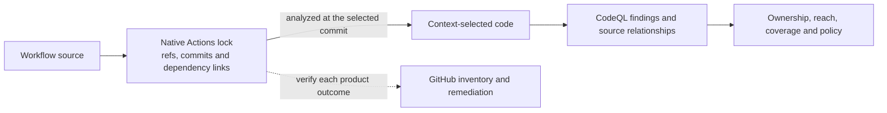

# Why ABOM exists

For a security team responsible for GitHub Actions across one GitHub organization.

GitHub supplies dependency management, code scanning and now native Workflow Dependency Pinning.
ABOM should consume those capabilities, not compete with them. Its role is to connect the code a
workflow selects with source-level findings, ownership, reach and operator policy across an
organization, including private actions and explicit coverage gaps.

**Native lock-aware resolution is the design baseline, and half of it is built.** The crawl reads
each lock at the analyzed commit and analyzes the commit it selects beside the declared reference;
what ABOM reports still describes the declared reference. The
[resolution plan](../plans/db/actions-lockfile.md) closes that gap before extended closure
analysis is built.

## Immutable execution and version context belong together

A symbolic ref expresses what the workflow requested. Its governing lock selects the commit to
run. A verified release association supplies version context for advisory interpretation. These
facts should travel together, not compete for one field. Full-version tags remain mutable; an
immutable lock binding is not the same as trusting a tag never to move.

GitHub's [native tool](https://github.com/github/gh-actions-lock/blob/v0.1.6/README.md) records
transitive pins and describes execution-time enforcement for onboarded workflows. Its
[shared format and Go parser](https://github.com/github/actions-lockfile/blob/go/v0.0.4/README.md)
carry commits, symbolic refs, dependency links and numeric repository identities. This is native
transitive evidence, so claiming that no native surface names it is no longer defensible.

ABOM's planned consumer reads the lock at the analyzed root revision. Two repositories that lock
the same tag differently must retain different selected code. Live tag measurements can describe
drift but cannot change either selection. Missing native coverage stays visible; broken locks do
not silently fall back to another graph. Parsing a lock does not prove identity, reachability,
platform enforcement or code safety.

## Native product coverage must be measured

Dependabot's [lock update integration](https://github.com/dependabot/dependabot-core/blob/main/github_actions/lib/dependabot/github_actions/lockfile/cli_engine.rb)
already invokes the native CLI in source. That is distinct from proving lock-backed transitive
Dependency Graph inventory, SBOM export, Dependency Review, advisory alerts or security-update
pull requests on a particular deployed platform. Each needs its own evidence at known revisions.

Jesse Houwing's [upstream request #122](https://github.com/github/gh-actions-lock/issues/122) asks
for lockfile-based Dependency Graph reporting and references his
[actions-dependency-submission](https://github.com/jessehouwing/actions-dependency-submission)
action. It is useful coordination context, not a delivery commitment. The
[native comparison](../plans/api/dependency-graph-crosscheck.md) will distinguish those capabilities
without contaminating the baseline with packages from a custom submission.

ABOM retains its existing guarded synthetic-path submission, but **expansion is deferred**.
The planned `abom-check` client reports verdicts rather than publishing dependencies. If native
coverage replaces a use case, retire redundant work deliberately, including release of historical
snapshots where needed. If a gap remains, demonstrate it before building a fallback. No accepted
payload or readable version string alone proves an advisory alert.

## Findings about private code cannot travel the advisory route

An organization's own actions and reusable workflows are frequently private, and are exactly the
code a central security team most wants to hold to a standard. There is no mechanism to alert on
them through Dependabot.

Repository security advisories exist for maintainers of **public** repositories, and publishing
one pushes it to the public GitHub Advisory Database — that is what makes Dependabot able to act
on it. There is no organization-private equivalent. Any finding about private code that a team
wanted Dependabot to raise would have to be disclosed publicly first, which is plainly not an
option.

So findings take a different path, and ABOM is that path. It runs CodeQL suites over the actions
and workflows it discovers — including private ones — and holds the results with the graph they
belong to.

## What ABOM adds

The native lock graph answers which repository commits are selected. CodeQL's source graph also
records which job or step declares a relationship, conditions and permissions, and where a query
reported a finding. A lock does not replace that analysis or enumerate image contents and arbitrary
runtime downloads.

- **Organization-wide context:** relate selected code to ownership, direct versus transitive reach,
  business-unit scope and the person who can change a dependency.
- **Source-linked findings:** ABOM's interface is where a security team reviews what
  its queries found across the whole estate — dependency management, code security, code quality,
  and patterns of use across public and private actions alike — before any of it reaches a
  developer's queue. Review at that size is only possible if the team can narrow to a scope that
  means something to them and then act on what it selected, which is why the scope is a named,
  saved predicate and the actions belong to the selection rather than to a page. Central review is
  the first half of a job whose second half — the path from a reviewed finding to an assigned fix —
  is [in the vision](vision.md) and is not built yet.
- **Explainable policy and coverage:** apply the operator's adopted rules to stored evidence,
  reporting unanalysed code, missing locks and unknown verification rather than presenting silence
  as a complete or safe result. Integrate native reporting as it evolves instead of treating a
  current product limitation as a permanent reason for a separate implementation.

## What ABOM will not do

- **It forms no security verdict of its own.** Security findings trace to CodeQL rule IDs;
  published advisories and native verification diagnostics remain attributed evidence. None becomes
  an invented vulnerable or safe flag. A rule that did not flag something is not a clean bill.
- **It does not replace native pinning tooling.** GitHub owns lock generation, verification and
  updates. ABOM's reader neither relocks dependencies nor accepts moved refs as a side effect.
- **It never publishes an advisory for private code**, for the reason above.
- **It states what was not analyzed.** Coverage gaps, unresolved dependencies and findings that
  could not be attached to a dependency are first-class output, because silence about what was
  not examined reads as completeness.

## Reading on

- [`README.md`](../README.md) — what it is and how to run it.
- [the vision](vision.md) — where this goes, including the path from a reviewed finding to an
  assigned fix.
- [plans/next.md](../plans/next.md) - implementation order and the reasoning behind each workstream.
