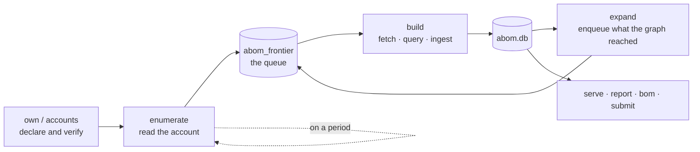

# How ABOM works

What the system currently does, in the order it does it, and the rules that shape the data. For
*why* the project exists, see [the value proposition](abom-value-proposition.md). For the words the
interface and API use, see [the vocabulary](vocabulary.md). For where it is going, see
[the vision](vision.md). For what is not built yet, see [the roadmap](roadmap.md).

## The pipeline

Each stage writes only what it measured, and every stage is resumable — the queue and the ledger
together mean a run that dies halfway does not repeat the work it already finished.

**It is one loop, and it runs itself.** The supervisor reads the declared accounts on a period,
queues what it found, analyzes, expands, and reads again; a first crawl and a maintenance crawl are
the same code differing only in whether anything has been read before. `serve --expand` on an empty
database is the whole bootstrap. Whether discovery should be running is stored, so a restart
resumes a crawl that was running and leaves a paused one paused.

**Reads are conditional, and paced by the budget rather than a guess.** Requests carry
`If-None-Match` against stored validators, so an unchanged answer costs a round trip and no quota.
The rate limit is read from every response — not only from the 403 that means it has already run
out — and requests are spaced only once the budget is genuinely running low.

**Ownership is declared, never inferred.** Nothing happens until an operator claims an account.
Membership comes from an authenticated `gh` session and decides nothing on its own: holding an
analyzed repository proves nothing about who can change it.

**Discovery is a closure, not a crawl of everything.** Nothing enters the graph that the owned set
does not reach. The walk is inductive — owned roots, plus what they reach — so the boundary is a
consequence of the declaration rather than a separate configuration.

**Analysis is queued per dependency *and* reference.** `actions/checkout@v4` and
`actions/checkout@v5` are different work, because they are different commits.

**A commit is fetched once, however many references name it.** Retained checkouts are keyed on the
commit and the sparse filter they were fetched under, at `${CacheDir}/${owner}/${repo}/${sha}/`,
never on the reference — a tag moves, and a cache keyed on one would serve the old tree forever
with nothing to say it had. Reuse says only that the bytes are already here: whether the analysis
runs is still the ledger's decision, so a hit is never a skip. Retention is off until a directory
is named, and bounded by a ceiling that evicts the least recently used first.

**Expansion follows the graph outward.** Edges produced by one analysis name dependencies that are
enqueued for the next, which is how the transitive closure is built one measured hop at a time.

## What produces the data

CodeQL, and nothing else. The queries live in `ql/actions/`:

| Pack | Produces |
| --- | --- |
| `graph-extraction` | Nodes, edges and observations — the structure |
| `findings` | SARIF results that become findings |
| `selfcheck` | Our own workflows, analyzed by our own queries |

Queries are **resolved at runtime, never compiled in**, and each is routed by its own
`@kind` metadata rather than by filename — so renaming a query cannot change where its results go.
Four result shapes are accepted: edges, observations, `@kind graph`, and SARIF. Anything else is
refused rather than guessed at.

A tier binds to a suite in `abom_tier_suite`, editable while the server runs. An empty binding is
legitimate and means "do not analyze this tier", which is why `abom_tier_configured` exists to tell
it apart from a tier nobody has configured.

An account is read over **GraphQL where it answers, REST where it does not**, and both routes answer
the same three questions — what is new, what changed, what is gone. GraphQL is preferred because one
call returns a hundred repositories with their marks, their custom properties and their default
branch for a single point, against a REST budget it does not share. `abom_enumeration_state.route`
records which route produced a listing, because the two do not agree about everything.

## The data model

Everything is one SQLite file. `internal/store` is the only package that writes SQL.

### Ownership and identity

| Table | |
| --- | --- |
| `abom_owned_org`, `abom_owned_scope`, `abom_owned_include` | What the operator declared, and how it arrived |
| `abom_account` | What `gh` reports about membership, with the token scopes that made the answer possible |
| `repository` | Every repository seen, with `origin` recording how it entered |

### The queue

| Table | |
| --- | --- |
| `abom_frontier` | The work queue, keyed by dependency and reference, carrying depth and state |
| `abom_database_catalog` | Which repositories have a CodeQL database |
| `abom_tier_suite`, `abom_tier_configured`, `abom_suite_query` | Which queries run against which tier |
| `abom_cycle_spend` | What each crawl cycle cost |

### Evidence — the ledger

| Table | |
| --- | --- |
| `abom_query_run`, `abom_query_run_ref` | One row per analysis: the resolved commit, pack digest and CLI version that produced it |
| `abom_ingest_ledger` | What has already been read, so it is not read twice |
| `abom_ref_resolution` | Which commit a tag or branch pointed at, when it was measured |
| `abom_commit_content`, `abom_protected_branch` | Content equivalence, and which branches GitHub protects |

### The graph — a projection of the evidence

| Table | |
| --- | --- |
| `abom_node`, `abom_edge` | Actions, workflows, repositories and images, and the `uses:` relationships between them |
| `abom_containment` | What holds what — a repository's own files, an account's repositories. A table of its own because containment is drawn rather than declared |
| `abom_observation` | Facts a query stated about a subject, keyed by the statement rather than the run. Every job-level fact — permissions, triggers, runner, privilege — attaches to a `job` node, never to the workflow above it |
| `abom_graph_generation` | Generation and epoch, so a client can ask for a delta. Nodes, edges and containment each keep their own watermark |
| `abom_surface` | A denormalized read model that is **declared and not written to**. The observation table is the only source for these facts |

An edge carries its own identity and four derived facts. `edge_key` is the source location that
declares the reference, which is what a selection or a removal names; `ref_style`, `advisory_route`,
`finding_route` and `owned_depth` are filled by `DeriveEdgeFacts` from rows already stored. Each is
tri-state, and NULL means *not computed* rather than false or zero.

Containment is stored rather than synthesized. `org-contains` and `repo-contains` are drawn so a
repository is not an island, but nothing declares them, so they have no `edge_key` and no row in
`abom_edge` — which is joined by reach, exposure, blast radius, the bill of materials, pinning and
pruning, none of whose numbers may move because a drawing aid became storable. `DeriveContainment`
writes the table from the unfiltered projection; the canvas reads it and draws the subset whose
nodes survive the request. A filter therefore narrows what is drawn and can never add a holding
nothing states.

Containment *within* a file is recorded two ways, and they answer different questions.
`container_node_row_id` is the file a node was declared in, so a workflow contains both its jobs and
its steps by that link. A step's parent **job** is carried by `job_id` with `step_index`, and the
node key spells it out: `step:owner/repo:path:JOB:INDEX` against `job:owner/repo:path:JOB`. A
workflow is never an edge source; edges leave its steps and its jobs.

### Findings

| Table | |
| --- | --- |
| `abom_finding`, `abom_finding_node` | A result, and the nodes it attaches to |
| `abom_finding_sighting` | Which run reported which finding, which is the only way staleness is observable |
| `rule`, `alert`, `abom_alert_link` | Rule metadata and the link to GitHub's own alerts |

### Derived and external

| Table | |
| --- | --- |
| `abom_blast_radius`, `abom_exposure` | Reach, recomputed wholesale rather than incrementally |
| `abom_advisory`, `abom_advisory_package` | GHSA records, stored as attributed external statements |
| `abom_submission` | What was sent to GitHub, because GitHub offers no way to ask |
| `abom_saved_view` | Named predicates, read by the API and the CLI |
| `abom_http_cache` | Validators GitHub gave for a URL, so an unchanged answer costs no quota |
| `abom_discovery_state` | Whether the operator wants discovery running, so a restart does not decide |

#### Two structural properties

**The ledger is evidence; the graph is a projection.** Pruning a node does not delete the analysis
that found it. `abom_query_run` and `abom_finding` survive a prune, so the graph can be rebuilt and
a removed node can legitimately come back.

**The graph tables are append-only.** Removal is a tombstone (`removed_at`), and only compaction
deletes. That keeps row ids monotonic, which is what makes a delta cursor valid at all.

## Reachability

Reachability is **step-level and condition-aware** — "does anything you run actually arrive at this
step, through whom, and guarded by what" — rather than a version match against a package list.
Hop counts mean: `0` the node lives in the repository, `1` the repository names it directly, `N` it
is reached through `N` intermediaries.

Conditions on a step are reported **verbatim and never evaluated**. `github.ref == 'main'` is a fact
about the workflow; whether it holds at a given moment is not something static analysis settles.

Job ordering from `needs:` is ingested as its own relation. It is deliberately not taken from the
CodeQL Actions CFG, which is an AST pre-order walk that never consults `needs:` and would therefore
assert an order between jobs that actually run in parallel.

## Reading the data out

| Surface | |
| --- | --- |
| HTTP API | The whole capability set. Reads are open; anything that writes is guarded at the endpoint |
| Dashboard | Where to start: each entry opens the Inventory already narrowed to it |
| Inventory | Which things match, in tabs that are named views, reprojected by a unit switch |
| Explorer | A force-directed graph over a scoped closure |
| Settings | What the operator claims, and what discovery runs: analysis is started here and each tier is bound to its suites here |
| `report` | Terminal summary |
| `bom` | CycloneDX 1.6 and SPDX 2.3, with purls |
| `submit` | A dependency snapshot sent to GitHub's submission API |

**Four surfaces, one scope.** A security team asks one question in two shapes — *which things match
this*, and *what do they touch* — so a table and a graph are two renderings of one scope object,
which owns the predicate and the selection and round-trips both through the address. An action then
belongs to the scope rather than to a page: export a bill of materials for these, open these in the
graph. A fifth navigation entry is a finding, not a feature — a page per question has to invent its
own scope, and an operator who narrowed somewhere else cannot carry that narrowing to it. A question
that becomes a unit takes its address with it: the page and its route are deleted rather than left
forwarding, because a redirect is a second name for one thing and this is not a published tool.

**A unit is a shape, not a scope.** Inventory reprojects one scope as actions, workflows, jobs,
repositories, advisories, relationships or coverage, each asking its own endpoint for its own
columns. A unit only exists once its columns are its own: listing repositories as nodes drew six
absent measurements as zeroes for all 193 of them, which is the same rule the graph follows about
an unmeasured node. A relationship's columns are what declares it, what it crosses, how its
reference is written, and what was reported against the line itself — a rule fires on a `uses:`
line, and no unit of nodes lists the steps those lines are. Containment is absent from it by
construction: nothing declares a repository holding its own files, so there is no line to go and
edit and no total for it to inflate.

**A listing states what it is not showing.** It reports the size of the match beside the size of the
page, orders across the whole match on the server rather than within the page, and when a findings
term matched nodes of a kind outside the view it says so and offers them — every
`actions/unpinned-tag` finding sits on a `step` or `job` node, so the most important rule in a
typical corpus answers zero among the dependency kinds, and a zero that means "measured elsewhere"
is otherwise indistinguishable from "nothing is wrong".

**One filter language, several consumers.** A view is a predicate — scope, kinds, findings, rules,
origins, reach, reference style — serialized as text, and the Explorer, the API and the CLI all
parse the same string. Predicates that cut along the graph's structure are applied in SQL;
predicates that cut across it are applied after the query, because a closure is edge-closed by
construction and an arbitrary node filter is not.

**A term is applied or refused by name, never dropped.** Each consumer declares the terms it
enforces, and every term in the language is enforced by at least one of them. A predicate carrying a
term this surface cannot apply still travels, because widening somebody else's question in passing
is worse than admitting the surface does not narrow by it — and the refusal names the term, which is
the only thing that tells a reader which surface does answer it. A term means one thing everywhere:
`repositories` is the repository a finding sits in on both the listing and the set path, and "which
dependencies does this repository use" is a different question with a different term.

**A scope can be kept.** The catalog is the built-in questions merged with whatever the operator
named and saved, offered through one endpoint so a caller asking "what can I ask" consults one
place. A built-in is code and cannot be overwritten or deleted. A saved view carries the terms the
listing cannot draw, so a tab that will refuse itself says so before it is clicked rather than
after.

**A container is a boundary, and `Group by` decides what a filter costs.** The Explorer draws each
group as a shape around its members rather than a point beside them, and withholds any boundary that
would enclose somebody else's node, saying how many it withheld. Because an edge needs both of its
ends, a filter that removes what it did not match removes the relationships too — so a grouped view
removes, keeping its boundaries honest, and an ungrouped one greys instead, keeping every
relationship on screen. The reader picks which, and each option says so.

**The Explorer arrives at the closure of what you own.** Not the whole corpus: drawn over everything
the crawl walked through it is a starburst nothing can be followed through. The arrival is that
closure filtered to what carries a finding, and a page handing over a node arrives focused on it,
resolved to whichever per-reference nodes the graph holds for that name. Naming a node suspends the
arrival filters, because otherwise the neighborhood the reader asked for is deleted by the filter
that got them there.

**The bill of materials is a document, not a listing.** It is reached from the scope it describes,
and states its own coverage, direct-versus-indirect depth, "not examined" as distinct from "none
found", and that advisories are reported against a repository rather than evaluated against the
references in use. Those are claims no listing makes, which is why it is a rendering of its own
rather than a unit.

**Purls are the join key.** `pkg:githubactions/{owner}/{name}[/{subpath}]@{version}`, matching what
GitHub emits, is what lets a component in an ABOM export correspond to anything outside it.

**A rule can be tried before it bites.** A policy is a predicate, a scope — organization, business
unit or one repository — and a state. It arrives as a draft and is adopted only against a
simulation: an evaluation over stored state that reports what the rule matches, what it would
refuse, what a waiver excuses and what it could not see. Simulation and the gate share one
evaluation, so they cannot disagree. Exclusions and exceptions are enumerated per repository and
never written as patterns, an exception carries an expiry that is read at evaluation time, and
`/api/policy-waivers` lists every one of them on demand.

## How it is tested

Four layers, each blind to what the next one sees: `make test` for Go, `make ui-test` (bUnit) for
markup and state, `make e2e` (Playwright) for geometry and the real API contract in a browser, and
a screenshot pass for density, colour and hierarchy. A green layer says nothing about the others —
bUnit has no CSS engine, so a grid overflowing by 288px is green everywhere until a browser lays
it out.

**Two sets of data, two jobs, not interchangeable.** A crawled organization answers *did this
change the real numbers*, and only exists where somebody has a token and has waited. The shared
fixture set answers *does this still work where nobody has crawled anything*: `make corpus` replays
recorded CodeQL output, so it needs no CLI, no network and no token, and it is the only one that
can gate a pull request. The browser suite gates on both an empty database and the fixture set,
because a defect visible only when there is data is exactly the class the empty run cannot see.

The fixture set is ABOM's org-level answer to a per-query unit test. Rather than an `.expected`
file beside each query, the whole set of findings is mapped onto one fixed dependency graph: **30
repositories across three accounts, 1,600 nodes, 900 edges, 1,632 findings covering 29 of the 35
rules the default suite can report**, four advisories that all reach something, and one repository
that is deliberately clean. Most of it is imported from GitHub's own Actions query tests by
`scripts/import-actions-test-fixtures.sh`, because the trees known to produce a finding are the
ones CodeQL tests its own queries with. The six rules nothing exercises are listed with reasons in
`cmd/abom-corpus`, and the test fails both when a rule is unexplained and when a listed one starts
firing.

## What the design refuses

These are invariants, not preferences. They are enforced in
[`.github/instructions/architecture.instructions.md`](../.github/instructions/architecture.instructions.md)
and the tests named there.

- **A security verdict comes only from a CodeQL rule id.** If a rule did not flag a reference, ABOM
  says the rule did not look — never that the reference is safe.
- **Advisories enrich; they never adjudicate.** A GHSA is an attributed external statement, stored
  beside the observed references rather than resolved into a verdict about them.
- **A finding is evidence attached to a node, never a verdict about it.**
- **An absent measurement is not a measurement of zero.** A node nothing has measured is a coverage
  gap, and must not be drawn, aggregated or exported as a measured zero.
- **A person chooses every alert.** Nothing writes to another repository's security surface on a
  timer or by inference.
- **Say what was excluded.** A scoped view states what it left out. A bounded query that silently
  drops the rest turns a performance fix into a coverage lie.
