# How ABOM works

What the system currently does, in the order it does it, and the rules that shape the data. For
*why* the project exists, see [the value proposition](abom-value-proposition.md). For the words the
interface and API use, see [the vocabulary](vocabulary.md). For where it is going, see
[the vision](vision.md). For what is not built yet, see [the roadmap](roadmap.md).

## The pipeline

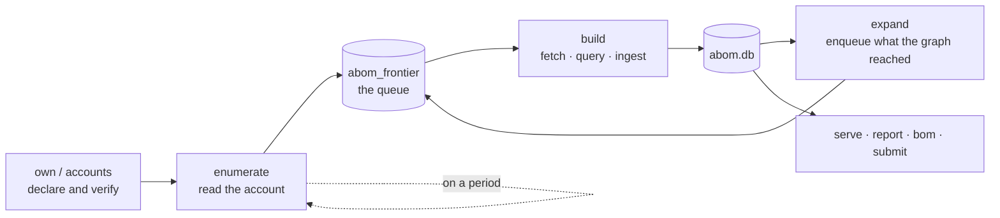

Each stage writes only what it measured, and every stage is resumable — the queue and the ledger
together mean a run that dies halfway does not repeat the work it already finished.

**It is one loop, and it runs itself.** The supervisor reads the declared accounts on a period,
queues what it found, analyzes, expands, and reads again; a first crawl and a maintenance crawl are
the same code differing only in whether anything has been read before. `serve --expand` on an empty
database is the whole bootstrap. Whether discovery should be running is stored, and a restart does
not act on it unless the operator asked it to: a crawl clones repositories and runs CodeQL on every
core, and a process restarting is not somebody requesting that. The crawl's state is on the
navigation bar of every page, because it is the one thing here that runs with nobody watching.

**Reads are conditional, and paced by the budget rather than a guess.** Requests carry
`If-None-Match` against stored validators, so an unchanged answer costs a round trip and no quota.
The rate limit is read from every response — not only from the 403 that means it has already run
out — and requests are spaced only once the budget is genuinely running low.

**Ownership is declared, never inferred.** Nothing happens until an operator claims an account.
Membership comes from an authenticated `gh` session and decides nothing on its own: holding an
analyzed repository proves nothing about who can change it.

**Discovery is a closure, not a crawl of everything.** Nothing enters the graph that the owned set
does not reach. The walk is inductive — owned roots, plus what they reach — so the boundary is a
consequence of the declaration rather than a separate configuration.

**Analysis is queued per dependency *and* reference.** `actions/checkout@v4` and
`actions/checkout@v5` are different work, because they are different commits.

**A commit is fetched once, however many references name it.** Retained checkouts are keyed on the
commit and the sparse filter they were fetched under, at
`${CacheDir}/${owner}/${repo}/${sha}-${filter}/`, never on the reference — a tag moves, and a cache
keyed on one would serve the old tree forever with nothing to say it had. The filter is in the path
because the same commit under two filters is two different sets of files, and it is in the run key
because a run against the narrow tree has not answered for the wide one. Reuse says only that the
bytes are already here: whether the analysis runs is still the ledger's decision, so a hit is never
a skip. Retention is off until a directory is named, bounded by a ceiling that evicts the least
recently used first, readable only by its owner, and claimed by one process at a time.

**An analysis runs again only when its identity changed.** A unit of work is one query against one
database, and both are content-addressed: the repository, the resolved commit, the checkout filter,
the analysis mode,
the query, the pack and its content digest, and the CodeQL that evaluated it. Match them all and
CodeQL is deterministic, so nothing needs to run. This is a separate decision from where the bytes
came from, which is why a cache hit is not a skip. It is also only half of an incremental crawl:
recognizing an unchanged pair is done, and putting back the work that a change *did* touch selects
on fewer of those dimensions than the identity holds.

**A result names the CodeQL that produced it, extraction included, and nothing recorded under one
CodeQL answers for another.** Test results are kept per CLI, a printed tree and a run name theirs,
and a held database is reused only by the CodeQL that built it, read from its
`creationMetadata.cliVersion`; another's is rebuilt. A run's size before Run is resolved against
the CodeQL running now for the same reason: a held database another CodeQL built, or one whose row
records none, counts as one the run builds, and says which CodeQL built it. The executor still
reads the database's own metadata, because a row can be wrong about the file. After an upgrade,
every authoring mark reads
as stale until somebody runs it again: re-running is a person's act and never automatic. One CodeQL
runs at a time, and nobody chooses which. A server that cannot read its CodeQL's version still
serves the catalog, and says nothing on record is known to be current.

**Expansion follows the graph outward.** Edges produced by one analysis name dependencies that are
enqueued for the next, which is how the transitive closure is built one measured hop at a time.

## What produces the data

CodeQL, and nothing else. The queries live in `ql/actions/`:

| Pack | Produces |
| --- | --- |
| `graph-extraction` | Nodes, edges and observations — the structure |
| `findings` | SARIF results that become findings |
| `selfcheck` | Our own workflows, analyzed by our own queries |

Queries are **resolved at runtime, never compiled in**, and each is routed by its own
`@kind` metadata rather than by filename — so renaming a query cannot change where its results go.
Four result shapes are accepted: edges, observations, `@kind graph`, and SARIF. Anything else is
refused rather than guessed at.

A tier binds to a suite in `abom_tier_suite`, editable while the server runs. An empty binding is
legitimate and means "do not analyze this tier", which is why `abom_tier_configured` exists to tell
it apart from a tier nobody has configured.

**An organization's own questions are its own queries.** The operator names a directory and ABOM
scaffolds a CodeQL pack in it: their queries resolve by name, run over the retained databases and
appear in the catalog with their source read from the pack. Writing one is not scheduling work —
the development suite is offered to a run, which is something a person presses, and never to a tier
binding, which would put a saved file in front of the whole corpus. Deploying a version is what
moves it into a suite a tier may bind. The directory is a pack the operator's own tooling opens:
ABOM drives the loop and holds the catalog, and never becomes the editor.

**A query version has a lifecycle, and three rungs of it are earned.** A version is identified by a
content hash over the query and every library it imports, so editing a library changes it. Stages
run `dev`, `test`, `extended-test`, `review`, `deploy`; each advance records who made it. `test` is
refused unless that version's own tests — the `.qlref` files naming it, never the whole directory —
pass, and `extended-test` unless every step the version carries does — all but the target, which
belongs to a request. `review` is refused unless a finished comparison of a run of that exact
version, whose results came from the CodeQL the server runs, compared at least one repository with
the alerts code scanning holds — over any scope somebody chose, which proves the query was looked
at before it bites; the refusal names the nearest miss, and the catalog states it on the row before
anybody presses. Each step is derived from evidence on
disk or in `abom_query_test`, served by the API and never computed in the browser. ABOM computes
readiness and never advances anything itself.

| Step | Evidence |
| --- | --- |
| Target | the operator's selection of an existing id, or the agent's recorded decision |
| Help | `src/<Name>.md` beside the query, non-empty |
| Expected | `test/<Name>/<Name>.expected`; empty is a warning, since a non-compliant example must yield a line |
| Test database | `<dir>.testproj` finalized and newer than every test source; a failed extraction leaves one unfinished |
| AST | the newest tree `PrintAST` printed from fixtures with the digest on disk |
| Compiles | the compilation stage of a test run of this version; a warning when the pack's lock resolved another `actions-all` |
| Tests | `codeql test run` of this version over these tests, and an earlier version's failure on a mark over the same fixtures |

A warning is evidence gone stale, never a guess. A directory holding no tests is not a pass: the CLI
exits cleanly over one, so the verdict is read from the count and never from the exit status.

The marks are drawn on a request and on the working copy of the operator's own query, and nowhere
else: an upstream query's tests belong to the pack that ships it. A request and the catalog row of
its query link to each other, and `request=` and `query=` open that row the way `run=` opens a run.
What advancing to `extended-test` would be refused with is stated in the stage control before
anybody presses it.

**A test fails first, and ABOM can tell that it did.** A scaffolded test passes the query's output
through the inline-expectations postprocess, so `# $ Alert` on a fixture line is an expectation: a
marked line the query does not report is a missing result, and an unmarked one it reports is
unexpected. The stub ABOM scaffolds reports nothing, so its first run fails on the marks. The tests
step passes only once an earlier version failed on a marked result over the same fixtures, and a
session's first edit to its query waits for that run. Accepting a report that lists failed
expectations would make the test pass, because the CLI compares text, so such an `.expected` fails
its step and the review refuses to accept one.

```mermaid
flowchart LR
    FIX["fixture<br/># $ Alert"] --> STUB["stub query<br/>reports nothing"]
    STUB -->|"codeql test run"| MISS["1 expected result missing<br/>kept per version and CLI"]
    MISS -->|"the query may now change"| REAL["the query written"]
    REAL -->|"report accepted by a person"| PASS["passes: version X failed first"]
    ACC["a report listing<br/>failed expectations"] -. "accepting it would pass" .-> PASS
    style ACC fill:#3d2d1d
```

**One `codeql/actions-all` answers for authoring and execution.** ABOM's packs, the operator's
scaffolded packs and ql-mcp's tools pack pin the same version, `make check-versions` fails when
they disagree, and the compiles step warns when the operator's lock resolved another.

**ABOM installs the pack it scaffolded.** The CLI compiles no query and no test in a pack whose
dependencies were never installed, even when the package cache holds every one. So before anything
compiles in the operator's pack, ABOM runs `codeql pack install` in it and then in its test pack,
wherever either has no `codeql-pack.lock.yml`:

- before a Test, and before an approval's test run;
- before a run or a crawl round digests one of the pack's queries, because the lock is part of what
  a pack digest covers;
- when a session starts, before the agent has control, since a session cannot install packs.

It holds the CodeQL lock while it installs. It never replaces a lock file or runs `pack upgrade`:
a lock file is the operator's to move. Where both exist it does nothing and does not wait for
CodeQL, so a Test never queues behind a crawl to learn that nothing was needed. A failed install
is the answer, with the CLI's reason: a Test answers with it, a round stops with it as discovery's
last error, a run is refused with it before any member is analyzed, and a
session ends failed with it before its agent starts.

```mermaid
flowchart LR
    ACT["Test, approval,<br/>run, round, session"] --> Q{"a lock in the pack<br/>and its test pack?"}
    Q -->|"both"| GO["compile"]
    Q -->|"either missing"| INS["codeql pack install<br/>under the CodeQL lock"]
    INS -->|"installed"| GO
    INS -->|"failed"| WHY["the CLI's reason<br/>is the answer"]
    Q -. "never" .-> UP["pack upgrade"]
    style UP fill:#3d2d1d
```

**A request's target is selected, never typed**, and says who chose it: *selected by you* or
*decided by the agent*. A request asked from a run carries the picked results as evidence — a
finding that should not have fired, or a repository where nothing fired that should have — each
checked against the run and the query when it is filed.

**An agent can write the query a request asks for, inside bounds ABOM sets.** A person starts a
session from the request. ABOM drives the Copilot CLI through the Copilot SDK, with ql-mcp as the
only tool server. Every tool call passes through ABOM's own callbacks before and after it runs.

- Writes are confined to the target's source, help and test fixtures.
- There is no shell.
- Nothing the CLI would load from the machine is loaded.
- A call that cannot be recorded is refused.

The session holds the machine-wide CodeQL lock for its lifetime, and is refused while discovery
crawls. Its timeline, what it spent and every tree `PrintAST` printed are kept, append-only, and
shown on the request. What the agent says it did is never a mark. Every step is re-derived from the
files and from ABOM's own records.

**No session writes `.expected`; an operator's approval does, through ABOM.** The request shows what
the query reported beside its two examples. Approving it:

1. records who approved which report, before anything changes;
2. runs `codeql test accept` for the tests that reported it;
3. runs the version's own tests, so compiling and passing come from ABOM's run and never the agent's.

The approval names the report as it was read, so a report that changed since is refused. A
rejection keeps its reason, and the next session starts from it. A tree digests the fixtures alone,
so accepting a report leaves the AST step current.

**ABOM prints a query's tree itself, so a query written by hand can earn every step.** A custom
catalog row's AST mark runs `PrintAST` from `advanced-security/ql-mcp-actions-tools-src` 2.27.1,
the pinned pack ql-mcp runs. It runs over the query's test database, under the CodeQL lock, and
names the fixtures through the same data extension ql-mcp writes. A database older than its
fixtures is refused, because its tree would describe code that is gone. The tree is kept the way a
session's is, and names who asked in place of a session.

**An agent can draft a request from a run's picked results, and files nothing.** A drafting session
is offered ABOM's tools and nothing else:

- the picked results, with the code around each, read from the database the run analyzed;
- a file of a picked repository, and no other;
- a place to keep its draft.

It has no files, no shell, no ql-mcp and no CodeQL, so it needs no lock. The operator uses the draft
or not, and saving the request is still theirs.

A tool's refusal is its answer. The SDK shows the model a handler's error only as *Tool execution
failed*, so ABOM's tools return why they refused as what the agent reads.

**A crawl is not a feedback loop.** Keeping an organization current and answering the question
somebody arrived with are different shapes, so a scope also resolves to a set of databases and a run
can be asked for over it. A run records what it asked before it spends anything, is stoppable, and
ingests its results into the tables the crawl writes — a result that landed anywhere else would need
every reader taught about a second source. A member with no database gets one built the way the
crawl builds one, at the commit on record or, where nothing names one, at the default branch, and is
recorded at the database it was analyzed against. Only what the crawl would build is built: a
regular database, for a repository ABOM tracks, since ingesting any other would enter it as a seed.
A member whose evaluation is already stored under the same run key is skipped and carries that
answer, naming the run that produced it; editing a query changes its version, so tuning is never
skipped, and a pack is digested afresh for every run, every round and every requeue, so one edited
while the server runs is keyed as it is now. A run that cannot start — a query no suite offers, a
pack that cannot be installed, nowhere to write — is refused, says why on the run, and is tried
again when somebody runs it again; one stopped while it prepares is canceled. Nothing a run
produces leaves the machine.

**A run is a reader with a different plan, not a second writer.** It claims no frontier row and
marks nothing analyzed that the crawl would reach, finished or stopped, so the crawl resumes where
it would have. It is built from the runner the crawl holds and builds through the crawl's own
expander, so the two contend for one machine-wide lock, one checkout cache, one database cache and
one rate limit rather than racing. A run and a crawl round over the same repository and commit, in
either order or at once, store what either would have stored alone: a finding both report is one
finding, whoever stored it first. A stop keeps what was already analyzed, and the member in flight
goes back to pending; only a run this process started can be stopped, since reporting a
cancellation that never happened is worse than refusing. A run nobody asked for is a defect: no
schedule, sweep or retry starts one, and one cannot be recorded without who asked. A run never
analyzes a query's test database, which is its own fixture. Counts come from the SARIF document,
never from rows written — a rule that has fired here before stores nothing new — and a member that
has not run has no count rather than a zero. A lane of one query is that query and carries its own
version, not a hash of a one-element set. Attribution to nodes runs once, when a run completes,
because the join is over the whole table.

**A database is extracted once, not once per question.** Retained CodeQL databases are keyed on the
tuple a run is keyed on, so the cache and the ledger cannot disagree about which database answered.
Retention is opt-in until its occupancy over a full crawl is measured. Reuse skips the extraction
and never the analysis: whether a query needs to run again stays a ledger decision.

An account is read over **GraphQL where it answers, REST where it does not**, and both routes answer
the same three questions — what is new, what changed, what is gone. GraphQL is preferred because one
call returns a hundred repositories with their marks, their custom properties and their default
branch for a single point, against a REST budget it does not share. `abom_enumeration_state.route`
records which route produced a listing, because the two do not agree about everything: REST reports
a `default_branch` for a repository with no branches, because it is a setting, where GraphQL
answers `defaultBranchRef: null`.

| Question | How | Cost |
| --- | --- | --- |
| What is new? | Order by creation, descending; stop below the newest known | The new prefix |
| What changed? | Order by push, descending; stop below the last read | The moved prefix |
| What is gone? | **A full listing. Nothing else.** | Every page |

- **The sorted walk follows `pushedAt`, never `updatedAt`.** Neither contains the other: 17 of 27
  repositories on the reference organization carried a `pushedAt` later than their `updatedAt`.
- **A sweep is two walks, so it costs at least two reads.** An account of one or two pages is read
  whole instead (`enumerate.sweepWorthIt`), which costs less and still sees deletions; the saving
  starts at three pages. A full listing still comes round on its period, a day by default, whatever
  the sweeps found.
- **A walk ordered by activity is unstable.** A push landing mid-walk reorders the pages still to
  come, so a sweep may see one repository twice and miss another; the next full listing repairs it.
- **A GraphQL query is bounded, and the bounds bite quietly.** `first` is capped at 100, a query
  GitHub cannot answer in ten seconds is terminated and charged against the next hour, and
  secondary limits cap GraphQL at 2,000 points a minute, so separate budgets are not separate
  clients.

**Listing an account does not probe its databases.** The crawler records and queues declared
repositories without asking whether GitHub holds a CodeQL database for them. The explicit
`discover` command asks that separate question: its GraphQL listing includes default-branch
workflow files, and Actions probes skip repositories with measured absence of those files.
Unknown evidence, REST fallback and other languages still probe. A skipped repository is reported
as unprobed, receives no negative catalog measurement and keeps any earlier evidence and its age;
it remains eligible for ABOM's own analysis. Requests and GraphQL points are reported separately.

**A full listing and a check for changes are different evidence.** Settings shows each account's
last route, last full listing, last incremental read and newest observed creation and push.
Missing times say *not recorded*, and an open page refreshes them without replacing unsaved edits.
Only a full listing can establish absence, so only one says nothing is missing.

**A repository a full listing no longer names is missing, and no longer yours; nothing is removed
for it.** A declared account covers what the account holds, so a declared repository its full
listing does not name stops rooting the declared closure, the queue stops claiming it, and a preview
of a declaration does not count it as entering. Settings names it beside that listing with when it
went missing, kept across later listings, for as long as the declaration covers it. Seeing
it in any later listing, a sweep's included, makes it yours again with nothing to rebuild; a sweep
that does not reach it, and a read that failed, record nothing. Its ledger and its repository row
stay. What it alone reached is what no longer belongs, which the prune in Settings states and offers
to take out of view — it is never removed inside an enumeration, which runs on a timer, because a
listing can under-report without failing: one read without a token found 91 of 181 repositories
and said nothing. A seeded repository no declared account covers is treated the same way: it is
outside the closure, kept until somebody accepts the prune that says what removing it takes.

## The data model

Everything is one SQLite file. `internal/store` is the only package that writes SQL.

### Ownership and identity

| Table | |
| --- | --- |
| `abom_owned_org`, `abom_owned_scope`, `abom_owned_include` | What the operator declared, and how it arrived |
| `abom_enumeration_state`, `abom_repository_absence` | When each account was last listed whole and read for changes, by which route and to which marks, and the declared repositories a full listing no longer names, since when |
| `abom_account` | What `gh` reports about membership, with the token scopes that made the answer possible |
| `repository` | Every repository seen, with `origin` recording how it entered |

### The queue

| Table | |
| --- | --- |
| `abom_frontier` | The work queue, keyed by dependency and reference, carrying depth and state |
| `abom_database_catalog` | Which repositories have a CodeQL database |
| `abom_tier_suite`, `abom_tier_configured`, `abom_suite_query` | Which queries run against which tier |
| `abom_cycle_spend` | What each crawl cycle cost |

### Locks

A workflow can name `owner/action@v1` while its native Actions lockfile selects an older commit
than `v1` names today, and two consumers can lock one tag to different commits. ABOM reads the
lock from the tree at the analyzed commit with GitHub's parser, never from the repository's
current state, and analyzes what it selects.

**Which lock governs which step.** A workflow's own steps are governed by its repository's lock,
for that workflow only; so are the steps of the repository's own composites, by the lock of each
workflow that reaches them. Somebody else's composite is governed by its **caller's** lock, for
that caller only: GitHub's tool records a composite's nested pins in the caller's lock and never
reads the callee's. A workflow entry lists the pins the workflow and its own composites name, not a
closure; what a remote composite pulls in is reachable through its entry's `uses:` alone. Only a
lock read at a commit the queue currently resolves to governs anything. One definition of this,
`lockGovernedQuery`, answers discovery and every reader.

**What is queued.** The selected commit is queued as its own row, beside the declared ref rather
than instead of it: the declared ref is still what an unlocked consumer runs, what a relock would
move to, and what every count describes as written. When the two name one commit, the second row
costs no evaluation. A full commit id is never drift-probed, because it cannot move and a probe of
one finds no ref by that name.

**What reads it.** Wherever a reader says what runs, the lock's answer stands beside the reference
as written, never in its place:

- the queue names whose lock chose a commit;
- a node page lists the commits locks select behind each declared reference, and each repository
  naming it says what its lock did — locked it, has no lockfile, does not list these uses, was
  refused, or was never read, which is unknown rather than unlocked;
- a relationship names the commit its declaring line's lock selects and through which workflow or
  caller pin, and each drawn line carries the commits behind it;
- the bill of materials names, beside each reference, the commits its roots' locks select, in both
  export formats;
- the submission closure follows the commit a root's lock selects, down every route it governs —
  through composite actions and into called reusable workflows' jobs and steps — and submits that
  commit, named by its measured version where one exists;
- exposure admits a consumer only through the commit it runs: its own lock's choice, or what its
  reference resolved to, and a caller's lock binds the route to that caller.

Both walks take a dependency's children from every regular run that sighted the edge, not only the
latest: an edge two analyzed commits share is one row. Reach and the owned closure stay
component-level by design: they already union every analyzed version's edges, so a locked commit
enters them through its own analysis.

**Unreadable and changed locks.** A lock with one malformed entry is unsupported as a whole and
selects nothing, and a digest of the wrong length or alphabet selects nothing whatever the parser
allowed. Each reading records the parser release and interpretation that made it; a start under a
different one requeues every commit that has a lockfile, and re-reading one repeats the checkout
and no evaluation.

**Verification.** GitHub's own `gh actions-lock` verification runs only when somebody asks — `POST
/api/locks/verify`, `codeql-abom verify-lock`, or *check lock* on a node page — and never in a
read. It runs no-fix, on a copy of the tree made a repository of its own (the tool reads `$/`
actions through git), and is not believed if it changed that copy. A network check of one commit
is not repeated within the hour and a day has a ceiling. What the tool says is kept verbatim and
appended: **passed**, **warnings**, **failed**, **inconclusive** — a category this build does not
know, or reachability the tool could not confirm — and **error**, for a tool that gave no report.
None of them is a statement that a workflow is safe.

**Policy.** A requirement for native locking is a policy like any other, over the rules the crawl
already runs — `abom/actions/uncovered-action-ref` and `abom/actions/actions-lock-missing-for-workflow`
— simulated before it binds and refusing by rule ID, because a verdict comes only from a rule. ABOM's
reading of a lock and GitHub's verification are evidence beside it, never a term of one. On the
shared corpus the uncovered-reference rule fires exactly where the reading leaves a reference
without a usable lock.

Observing the runner enforce a nested pin is not done here; it needs an approved target, and the
tooling plan in `plans/tools/actions-lock.md` owns it.

### Evidence — the ledger

| Table | |
| --- | --- |
| `abom_query_run`, `abom_query_run_ref` | One row per evaluation: the resolved commit, checkout filter, analysis mode, pack digest and CLI version that produced it, and what recorded it — the crawl, a run, or a replayed recording |
| `abom_query_run_rule` | The rules one evaluation ran, each with its own query version, pack and source. A lane runs a whole suite in one invocation, so this, not the evaluation, says where a finding's rule came from |
| `abom_ingest_ledger` | What has already been read, so it is not read twice |
| `abom_ref_resolution` | Which commit a tag or branch pointed at, when it was measured |
| `abom_commit_content`, `abom_protected_branch` | Content equivalence, and which branches GitHub protects |
| `abom_lock_coverage`, `abom_lock_dependency`, `abom_lock_use`, `abom_lock_workflow_pin` | What a repository's Actions lockfile said at one commit: coverage per workflow — not onboarded, empty, covered, or unsupported with the parser's reason — what each pin selects with the numeric ids it records, the DAG of what a composite pulls in, the pins each workflow names, and which reader read it. Asserted by the lock, verified by nothing |
| `abom_lock_verification` | Each run of GitHub's lock verification somebody asked for, appended: the commit, mode, tool and lockfile versions, outcome, and every finding as the tool wrote it |

### Analysis modes

Every run writer states `regular` or `extended`; absent and unsupported modes are refused.
Regular means one repository's checkout. Extended means an owned repository with its staged
dependency closure, not a promise that every finding crosses a repository boundary. The shape
belongs to the run, never to the query. Existing runs backfill to regular because that is the
only shape their writers built; regular run keys remain unchanged.

Edges and findings retain one identity across shapes. `abom_edge_sighting` and
`abom_finding_sighting` record their producing runs; mode reads join that evidence rather than
letting the latest writer choose membership. Regular provenance is preserved when an extended
run observes the same row. Conflicting cross-mode edge targets or references are refused rather
than replacing regular evidence. Historical unattributed rows remain in regular totals without
inventing a run or a displayed provenance label.

Existing reach, blast radius, coverage, pinning, BOM, submission and derived-route totals read
regular evidence. `mode=` selects evidence on the policy/match path, graph and supported Inventory
units (dependencies and relationships); unsupported listings and documents refuse it by name.
Inventory and Explorer expose the selection and preserve it in shared URLs. Findings in the BOM
state their recorded shapes; a shared defect is labeled mixed, not duplicated. Extended views
identify the regular coverage and reach measurements that remain alongside them.

### The graph — a projection of the evidence

| Table | |
| --- | --- |
| `abom_node`, `abom_edge` | Actions, workflows, repositories and images, and the `uses:` relationships between them |
| `abom_edge_sighting` | Each run that observed a shared edge, without creating a second edge identity |
| `abom_containment` | What holds what — a repository's own files, an account's repositories. A table of its own because containment is drawn rather than declared |
| `abom_observation` | Facts a query stated about a subject, keyed by the statement rather than the run. Every job-level fact — permissions, triggers, runner, privilege — attaches to a `job` node, never to the workflow above it |
| `abom_graph_generation` | Generation and epoch, so a client can ask for a delta. Nodes, edges and containment each keep their own watermark |
| `abom_surface` | A denormalized read model that is **declared and not written to**. The observation table is the only source for these facts |

An edge carries its own identity and four derived facts. `edge_key` is the source location that
declares the reference, which is what a selection or a removal names; `ref_style`, `advisory_route`,
`finding_route` and `owned_depth` are filled by `DeriveEdgeFacts` from rows already stored. Each is
tri-state, and NULL means *not computed* rather than false or zero.

Containment is stored rather than synthesized. `org-contains` and `repo-contains` are drawn so a
repository is not an island, but nothing declares them, so they have no `edge_key` and no row in
`abom_edge` — which is joined by reach, exposure, blast radius, the bill of materials, pinning and
pruning, none of whose numbers may move because a drawing aid became storable. `DeriveContainment`
writes the table from the unfiltered projection; the canvas reads it and draws the subset whose
nodes survive the request. A filter therefore narrows what is drawn and can never add a holding
nothing states.

Containment *within* a file is recorded two ways, and they answer different questions.
`container_node_row_id` is the file a node was declared in, so a workflow contains both its jobs and
its steps by that link. A step's parent **job** is carried by `job_id` with `step_index`, and the
node key spells it out: `step:owner/repo:path:JOB:INDEX` against `job:owner/repo:path:JOB`. A
workflow is never an edge source; edges leave its steps and its jobs.

### Findings

| Table | |
| --- | --- |
| `abom_finding`, `abom_finding_node` | A result, and the nodes it attaches to |
| `abom_finding_sighting` | Which run reported which finding, which is the only way staleness is observable |
| `abom_query_metadata` | Every pair `codeql resolve metadata` returns for a query version |

**A finding is traced to every evaluation that reported it.** Its sightings name them. Each says
what it invoked, in which shape, over which commit, under which CodeQL and what recorded it, and
`abom_query_run_rule` gives the version, pack and **source** of the rule's own query in that
evaluation: `upstream`, `abom`, `custom`, or `mixed` where two packs supplied one rule id at once.
One defect reported through two copies of a rule answers to both. An evaluation recorded before its
rules were kept is named only where that is exact — one pack supplied everything it ran, so every
rule it reported is that pack's, and the version is known only when it ran that one query. A lane
that drew on several packs stays *not recorded* until something evaluates it again. `source=`
narrows the set path, the dependencies listing and a run; a finding with no recorded source matches
no source, and an answer narrowed by one counts the matches it could not answer for.

**A finding's severity is the rule's own, in two parts.** `severity` is the level the result
reported — `error`, `warning`, `recommendation` — and `security_severity` the rule's
`@security-severity` score, NULL where the rule declares none. The server bands a score the way
code scanning does — critical from 9.0, high from 7.0, medium from 4.0, low above zero — and a
finding with no score is **unknown**, never low. One banding, in Go and in the SQL generated from
the same floors, is sent with each finding, so neither the browser nor the interface thresholds a
score; a zero stored before absence was written as NULL bands as unknown too.

**Every count of findings says at what severity.** Each Inventory unit, the node page's rules, a
run's results, the bill of materials and the home page count their findings per band, most severe
first, and the bands sum to the total with the unknown named. `securitySeverity=critical,high` asks
for findings in those bands beside `severity`, which asks for the level, and both are read per
finding on the set path, the listing, the graph and a policy. `sort=severity` orders the listing by
whether a row carries a finding, then whether anything reaches it, then its worst band, then its
reach: severity outranks depth, and a finding nothing reaches sorts after every one something does,
because that absence is the most important fact about it. The advisories unit follows the same
order — published severity, then reach, an unrated advisory after every rated one — and a row's
rank is its place in the whole match rather than a number combining the two. A graph delta
carries each changed node's findings with their bands, so an Explorer filtered by severity keeps
up with a crawl.

**A query version's declared metadata is recorded whole.** Every pair `codeql resolve metadata`
returns — name, kind, precision, level, score, tags and anything else the query declares — is kept
per version when a round resolves its suite, when a run resolves what it asked for, and when a
working copy's tests run. The catalog shows a version's declared band before it has reported
anything; a table or graph query declares none and shows none, and a version nothing has resolved
says *not read yet* rather than *declares nothing*.

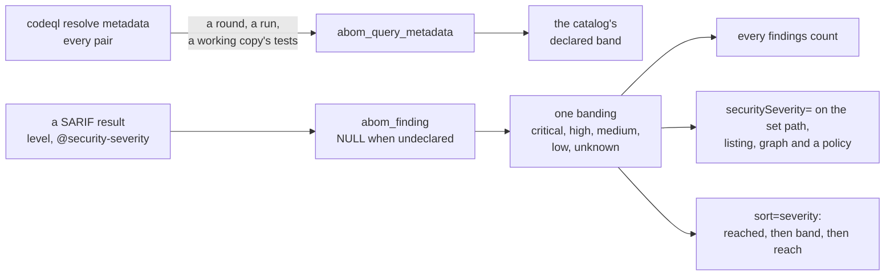

```mermaid
flowchart LR
    F["abom_finding"] -->|"abom_finding_sighting"| E["abom_query_run<br/>invoked, shape, commit,<br/>CodeQL, recorded by"]
    E --> R["abom_query_run_rule<br/>the rule's version,<br/>pack and source"]
    E -->|"query_run_id"| M["abom_analysis_member<br/>run N"]
    R --> S["source= on the set path,<br/>the listing and a run"]
    L["a lane of several packs,<br/>recorded before rules were kept"] -. "never attributed" .-> R
    style L fill:#3d2d1d
```

### Queries and what was asked of them

| Table | |
| --- | --- |
| `abom_suite_query` | What a round's resolution found in each suite: query id, version, kind and the pack that supplied it |
| `abom_query_stage` | How far somebody has taken a query version, and who advanced it |
| `abom_query_test` | What that version's own tests made of it under one CodeQL, the stage they reached, how many marked results were missed or unexpected, and digests of the test files and of the fixtures alone, which is what the `test` stage reads |
| `abom_query_request` | What somebody asked a query to catch or stop catching, with a `COMPLIANT` and a `NON_COMPLIANT` example, the target and who chose it |
| `abom_query_request_evidence` | The run results a request was asked from: a false alarm names a finding or a result a held run kept, a missed detection a repository |
| `abom_authoring_session` | An agent session somebody started on a request, or on a run's picked results to draft one. Whether it finished, was stopped, failed or was interrupted by a restart, and what it spent as the CLI reported it |
| `abom_authoring_event` | Every tool call a session made or was refused, recorded before it ran, with the decision and the reason. Append-only |
| `abom_authoring_ast` | What `PrintAST` printed over a query's test database, by a session or by ABOM at somebody's asking, with a digest of the fixtures it was printed from and the CodeQL that printed it. Append-only |
| `abom_authoring_review` | An operator's approval or rejection of what a query reported, with the report as they read it. Append-only |
| `abom_request_draft` | A request a drafting session proposed, which nobody has filed. Append-only |
| `abom_analysis_run`, `abom_analysis_member`, `abom_analysis_query` | A run somebody asked for: which versions, which scope and the named scope it was chosen by, the CodeQL it ran under, when each start began, why it could not start when it could not, and what became of every repository in it. A member names the evaluation that reported its findings, so they can be listed one at a time |
| `abom_held_result` | What a run with findings off kept in each repository, one row per result, carrying every column a finding does and apart from `abom_finding` |
| `abom_held_conversion` | Who converted a held result to a finding, when, and from which run, keyed by the finding |
| `abom_analysis_result` | What each query in a run found in each repository. A member counted before this existed has a total and no split |
| `abom_comparison`, `abom_comparison_member` | A run set against the code scanning alerts, who asked and under which CodeQL its results came, and per repository whether it was compared or why not, the commit and CodeQL GitHub's analysis describes, the default branch as read and how the commit analyzed relates to it |
| `abom_comparison_result`, `abom_comparison_alerts` | Each result compared with the alert that stands for it, and how many alerts GitHub held per rule and state, kept whole rather than pointing at the run's rows |
| `abom_local_database` | A retained CodeQL database, keyed the way a run is: repository, commit, source filter and mode |

### Derived and external

| Table | |
| --- | --- |
| `abom_blast_radius`, `abom_exposure` | Reach, recomputed wholesale rather than incrementally |
| `abom_advisory`, `abom_advisory_package` | GHSA records, stored as attributed external statements |
| `abom_submission` | What was sent to GitHub, because GitHub offers no way to ask |
| `abom_saved_view` | Named predicates, read by the API and the CLI |
| `abom_http_cache` | Validators GitHub gave for a URL, so an unchanged answer costs no quota |
| `abom_discovery_state` | Whether the operator wants discovery running, so a restart does not decide |
| `abom_discovery_startup` | Whether a restart may act on that. Its own row because "running" has no value meaning nobody has said |

#### Two structural properties

**The ledger is evidence; the graph is a projection.** Pruning a node does not delete the analysis
that found it. `abom_query_run` and `abom_finding` survive a prune, so the graph can be rebuilt and
a removed node can legitimately come back.

**The graph tables are append-only.** Removal is a tombstone (`removed_at`), and only compaction
deletes. That keeps row ids monotonic, which is what makes a delta cursor valid at all.

## Reachability

Reachability is **step-level and condition-aware** — "does anything you run actually arrive at this
step, through whom, and guarded by what" — rather than a version match against a package list.
Hop counts mean: `0` the node lives in the repository, `1` the repository names it directly, `N` it
is reached through `N` intermediaries.

Conditions on a step are reported **verbatim and never evaluated**. `github.ref == 'main'` is a fact
about the workflow; whether it holds at a given moment is not something static analysis settles.

Job ordering from `needs:` is ingested as its own relation. It is deliberately not taken from the
CodeQL Actions CFG, which is an AST pre-order walk that never consults `needs:` and would therefore
assert an order between jobs that actually run in parallel.

## Reading the data out

| Surface | |
| --- | --- |
| HTTP API | The whole capability set. Reads are open; anything that writes is guarded at the endpoint |
| Dashboard | Where to start: each entry opens the Inventory already narrowed to it |
| CodeQL | The queries findings come from: requests, the catalog of versions and stages, runs and their results per repository and query, what those results would add to the alerts developers already see, and which suites each tier runs |
| Inventory | Which things match, in tabs that are named views, reprojected by a unit switch. Repositories chosen here are what a run is asked over |
| Explorer | A force-directed graph over a scoped closure |
| Settings | What the operator claims, and what discovery does: analysis is started and requeued here |
| `report` | Terminal summary |
| `bom` | CycloneDX 1.6 and SPDX 2.3, with purls |
| `submit` | A dependency snapshot sent to GitHub's submission API |

**Four surfaces over one scope, and one over the queries.** A security team asks one question in
two shapes — *which things match this*, and *what do they touch* — so a table and a graph are two
renderings of one scope object, which owns the predicate and the selection and round-trips both
through the address. An action then belongs to the scope rather than to a page: export a bill of
materials for these, open these in the graph, run queries on these. CodeQL is the one surface
whose unit is not a node: a finding exists only once a query has run, so it comes first, and its
requests, catalog, runs and suites are tabs of it rather than pages. Another navigation entry is a
finding, not a feature — a page per question has to invent its own scope, and an operator who
narrowed somewhere else cannot carry that narrowing to it. A question that becomes a unit takes its
address with it: the page and its route are deleted rather than left forwarding, because a redirect
is a second name for one thing and this is not a published tool.

**A run is asked over repositories somebody chose.** The selection travels as `repositories=`,
which resolves each name to its retained database, one it could be rebuilt from, or a named gap —
whether or not anything was ever found there, because a new query has found nothing anywhere yet.
Combined with a findings term it narrows that term instead. A scope — a named one, or every row
the Repositories unit lists, chosen at once — covers exactly what that unit lists for it, so a
run's population is a tab a reader can open and count; names and findings narrow a scope and
never widen it, and a term that chooses no repository is refused by name. The size is stated
before Run from the run's own resolution, and a run records the question a name resolved to
rather than the name. Each member records what every query in the run found in it, so a query's
own count is never its run's total. A run the server stopped under is `interrupted` on the next
start: not canceled, since nobody asked, and not `running`, since nothing is.

**One draft, on two pages.** The versions a run is drafted with are one draft, held in memory, that
the catalog adds to and the Inventory reads: on the Inventory it runs over repositories chosen
there, and on the CodeQL page over a named scope chosen in the draft, through the same named-scope
control the other pages host, with the scopes a run refuses disabled and their terms named. A run
chosen that way is asked for by the scope's name, so the server resolves it and records the name
beside the question it resolved to — how it was chosen, never what it covers. *Keep* there names
the scope the draft holds, which is none until one is chosen, whatever another page left in force.
The findings a run reports are exactly the ones stored at the commits it analyzed; the Inventory
counts a repository at every reference it is used at, so it can list more.

**What a run has left is its own.** While a run is pending or running, the members it has not
reached in this start come first — the one running, then what waits — counted by the server, since
a run started again keeps each member's state until it is reached. A time remaining is the average
time this start's finished members took, from when each was first moved to running to when it
stopped, times what is left: absent until one finishes, revised as each does, and never forecast
before Run from other queries over other repositories. A member skipped without running keeps an
earlier start's beginning, so it sets no pace.

```mermaid
flowchart LR
    CAT["CodeQL catalog row"] -->|"adds its version"| DRAFT["one run draft"]
    INV["Inventory: repositories<br/>chosen, or a scope's all"] -->|"repositories= or the scope"| DRAFT
    NAMED["a named scope chosen<br/>in the draft on the CodeQL page"] -->|"view=name"| DRAFT
    DRAFT -->|"GET /api/databases:<br/>size, against this CodeQL"| PRE["the run's own resolution"]
    DRAFT -->|"POST /api/runs"| RUN["abom_analysis_run:<br/>the question, the name beside it"]
    PRE ---|"the same set"| RUN
    RUN -->|"while under way"| LEFT["still to do, first;<br/>a time from this start's pace"]
    LEFT -. "never" .-> FORECAST["a forecast before Run"]
    style FORECAST fill:#3d1d1d
```

**A run's findings are on or off, for the whole run.** On, what its queries report is ingested
into the tables the crawl writes, as the crawl's is. Off, each repository is built and analyzed the
same way, and what it reported — a count per rule and every result — is held apart under an
evaluation marked as held, which no run, crawl or content match skips on and the staleness sweep
never reads as the newest word. The draft suggests the setting from what its queries are: on only
when every one is a version an upstream pack published, the version somebody put at `deploy`, or
one a tier's suite resolved to, and off for anything still being refined; one switch overrides it
for that run, and a caller that says nothing gets the suggestion. A held run says first how many of
the scope's repositories it covers. Somebody named then converts all of it, one repository, or
the results they chose: each becomes the finding adopting the query would have stored, sighted
under the evaluation that reported it and attributed to nodes, with who converted it and from
which run; a result converted twice is counted once. A false alarm for a request is picked from
what a held run kept as it is from findings.

```mermaid
flowchart LR
    DRAFT["one draft:<br/>versions and repositories"] -->|"findings on"| FIND["findings, which<br/>every surface reads"]
    DRAFT -->|"findings off"| HELD["abom_held_result,<br/>under a held evaluation"]
    HELD -->|"converted by somebody named:<br/>the run, a repository, chosen results"| FIND
    HELD -->|"picked"| EVIDENCE["a request's evidence"]
    HELD -. "never" .-> SKIP["an answer a run,<br/>the crawl or the sweep reads"]
    style SKIP fill:#3d1d1d
```

**A run's results are set against the alerts developers already see.** A comparison is asked of
a finished run, findings on or off, and reads, for each repository the run has results for, the
CodeQL alerts code scanning holds now in every state, the newest Actions analysis of the default
branch among its newest page of analyses — never a pull request's — and the default branch. It creates nothing: no alert, no finding and no write to
GitHub, only a count and a list kept against the run, whole, so analyzing the run again does not
change what it said. What it counts is the delta. A result stands for an alert reported by the same
rule at the same path, line and column, or on the same line where no alert is at the exact place,
one alert to a result: open and dismissed alerts add nothing, a fixed one reopens, and what no
alert stands for is new. Open alerts no result stood for are counted beside it, because what the
repository already runs keeps raising them.

- **It reads a regular run only.** Default Setup builds one repository's own checkout, so a
  comparison asked of an extended run is refused where it is asked, naming the shape; the run
  itself stays legitimate.
- **It carries its condition, its merge and its boundary.** Alerts appear only where Actions
  analysis runs; a pack added through `github-codeql-config-file` merges with what Default Setup
  generates, so new is counted over every CodeQL alert the repository holds; and it is exact only
  where the commit and the CodeQL analyzed are the ones GitHub's alerts describe.
- **It names what it did not compare.** A repository the run has no results for, one it counted
  before members kept their evaluation, one code scanning never analyzed, one whose code scanning
  holds no Actions analysis ABOM can recognize, and one whose alerts or analyses GitHub did not
  give are each listed with why and left out of the count.
- **It states staleness beside each count.** The commit analyzed is current, behind by a counted
  number of commits, ahead, diverged, or unknown where the default branch could not be read — never
  current by default.

A comparison reads through the GitHub client every other read shares, so it is paced and cached
with them, and it runs off the request: one left running when the server stopped is `interrupted`
on the next start, keeping what it read. It reads every member's results before it reads GitHub,
and a run is neither analyzed again while its comparison reads nor compared while it runs, so the
results compared are the ones the recorded CodeQL produced.

```mermaid
flowchart LR
    RUN["a finished regular run,<br/>findings on or off"] --> CMP["abom_comparison:<br/>new, reopens, already alerted"]
    ALERTS["code scanning alerts<br/>and analyses, read now"] --> CMP
    HEAD["the default branch,<br/>read now"] -->|"staleness"| CMP
    EXT["an extended run"] -. "refused, naming the shape" .-> CMP
    CMP -->|"compared, same CodeQL"| REVIEW["the review rung"]
    CMP -. "never" .-> WRITE["an alert, a finding,<br/>or a write to GitHub"]
    style EXT fill:#3d1d1d
    style WRITE fill:#3d1d1d
```

**A unit is a shape, not a scope.** Inventory reprojects one scope as actions, workflows, jobs,
repositories, advisories, relationships or coverage, each asking its own endpoint for its own
columns. A unit only exists once its columns are its own: listing repositories as nodes drew six
absent measurements as zeroes for all 193 of them, which is the same rule the graph follows about
an unmeasured node. A relationship's columns are what declares it, what it crosses, how its
reference is written, and what was reported against the line itself — a rule fires on a `uses:`
line, and no unit of nodes lists the steps those lines are. Containment is absent from it by
construction: nothing declares a repository holding its own files, so there is no line to go and
edit and no total for it to inflate.

**A listing states what it is not showing.** It reports the size of the match beside the size of the
page, orders across the whole match on the server rather than within the page, and when a findings
term matched nodes of a kind outside the view it says so and offers them — every
`actions/unpinned-tag` finding sits on a `step` or `job` node, so the most important rule in a
typical corpus answers zero among the dependency kinds, and a zero that means "measured elsewhere"
is otherwise indistinguishable from "nothing is wrong".

**One filter language, several consumers.** A view is a predicate — scope, kinds, findings, rules,
origins, reach, reference style — serialized as text, and the Explorer, the API and the CLI all
parse the same string. Predicates that cut along the graph's structure are applied in SQL;
predicates that cut across it are applied after the query, because a closure is edge-closed by
construction and an arbitrary node filter is not.

**One predicate resolves two ways: to nodes, and to databases.** *Which things match this* and
*which databases would have to be analyzed to settle it* are the same scope asked of different
objects, so they are one language rather than two. The database resolution is a run's, and applies
the set path's terms and the Repositories unit's, since a run covers repositories. It
returns a repository, a commit and an analysis mode per entry, each marked retained, buildable or
unavailable, and reports the repositories it could not resolve as a stated gap — a set that quietly
omitted them would mean something narrower than it says exactly where that matters most. It builds
nothing: seeing the size of a thing is separate from spending it. A mode with no databases behind it
resolves to an empty set and the reason, never to the other mode's.

**A term is applied or refused by name, never dropped.** Each consumer declares the terms it
enforces, and every term in the language is enforced by at least one of them. A predicate carrying a
term this surface cannot apply still travels, because widening somebody else's question in passing
is worse than admitting the surface does not narrow by it — and the refusal names the term, which is
the only thing that tells a reader which surface does answer it. A term means one thing everywhere:
`repositories` is the repository a finding sits in on both the listing and the set path, and "which
dependencies does this repository use" is a different question with a different term. A surface
that answers some values of a term refuses the others by name: the workflow and job units narrow by
`flags=findings` and refuse `advisory` and `unanalyzed`, which they used to drop. The focus walk
`/api/graph` refuses the property terms on purpose — it is one node's neighborhood under a budget,
no interface calls it, and "what this node reaches within my unit" is `/api/graph/full` with
`properties` and a focus drawn over it.

**The graph applies a term on one side or the other, and says which.** The server applies what
decides which nodes and edges exist — `scope`, `mode`, `steps`, the property terms, `boundary`,
`edgeKinds`, and `origins`, `minReach`, `ref` and `flags=unanalyzed` when sent them. The finding
terms, `kinds`, `q`, `edges` and `flags=findings`/`advisory` it hands to whoever draws it, because
applied per node they sever most of their own match's edges, and `clientApplied` on the payload
names them for a caller that is not the Explorer. The Explorer sends the first set except the four
it also filters itself over one payload — an interaction costs no round trip — and
`specs/graphterms.spec.mjs` measures, per term, that the server and the browser select the same
nodes. The finding terms are applied per finding: each node carries its distinct (rule, provider, level,
band) combinations whole, so `rules=A&severity=error` keeps a node only where one finding is
both, exactly as the set path reads it. A term the graph applies on neither side — `repositories`,
`source` — is refused on the page, which then draws nothing rather than the wider picture.

```mermaid
flowchart LR
    SCOPE["a scope the Explorer<br/>is drawing"] -->|"scope, mode, steps, properties,<br/>boundary, edgeKinds"| SERVER["/api/graph/full"]
    SERVER -->|"payload, each node carrying<br/>(rule, provider, level, band)"| BROWSER["the browser filter"]
    SCOPE -->|"origins, minReach, ref, flags,<br/>kinds, q, edges, rules, notRules,<br/>provider, severity, securitySeverity"| BROWSER
    SCOPE -->|"repositories, source"| REFUSED["refused on the page"]
    SCOPE -. "drawn without a term it carries" .-> WIDER["a wider picture"]
    style WIDER fill:#3d1d1d
```

**Silence means the question was not asked, on every consumer.** An absent term never reads as a
consumer's own default, so `?scope=owned` and the "What you own" scope draw the same picture. For an
allow-list that means every value rather than none, and the language has no spelling for a
deliberately emptied list: switching every kind off does not survive a reload, and the Explorer
says so. A list term whose members are fixed in code — `kinds`, `origins`, `flags`, `edges`,
`edgeKinds`, `source` — refuses one it does not have and refuses the whole term, because keeping the
recognized members answers a narrower question than was written.

**The control that offers a filter reads the language.** The terms, what to call them, how each
writes its value, which surfaces apply it and what values it can take are all served from the same
declarations that enforce them, so a term added to the language reaches every control and one
removed from it stops being offered. A browser keeping its own list is a second declaration, and
the one that falls behind offers a filter the server refuses by name. Which values a term can take
is answered from the language where it declares them and from the corpus where it does not — the
first is what the term allows, the second is only what something happened to use, and a refusal is
checked against the first. A corpus-derived list also says how much it cannot speak for, and so
does an answer narrowed by it: a provider or a source that nothing recorded is counted beside the
match (`unprovided`, `unsourced`) rather than relabeled, because the only provider on offer covers
an eighth of the findings on record.

**A scope can be kept, and it is its predicate, never the page it was kept on.** The catalog is the
built-in questions merged with whatever the operator named and saved, offered through one endpoint
so a caller asking "what can I ask" consults one place. A built-in is code and cannot be overwritten
or deleted. The Inventory, the Explorer and the CodeQL page's run draft host one control over it —
every named scope, *Keep* for the one on screen, *Forget* for one the operator kept — and opening
one replaces the scope on screen
whole rather than merging into it. For every surface the language names, the catalog answers which
of a scope's terms that surface cannot apply, so a scope a page would refuse is disabled there with
the terms named, before it is chosen rather than after. A scope kept on the Explorer also carries how
it was drawn — view, grouping, depth, direction, the layout switches and the node in focus — stored
as opaque text beside the predicate rather than inside it, because a drawing is not a filter and a
server that parsed it would be deciding what the interface may show. Nothing saved there means
"draw it however you would anyway", which is not the same as every default.

```mermaid
flowchart LR
    VIEWS["abom_saved_view<br/>and the built-ins"] -->|"GET /api/views:<br/>predicate, picture,<br/>refusal per surface"| CTRL["one control:<br/>open, Keep, Forget"]
    CTRL -->|"hosted by"| INV["each Inventory unit"]
    CTRL -->|"hosted by"| EXP["the Explorer"]
    CTRL -->|"hosted by"| CQL["the CodeQL page's<br/>run draft"]
    INV -->|"Keep: the predicate"| VIEWS
    EXP -->|"Keep: the predicate<br/>and the picture"| VIEWS
    CQL -->|"Keep: the scope<br/>the draft holds"| VIEWS
    CTRL -. "a scope its page refuses" .-> OPEN["opened there"]
    style OPEN fill:#3d1d1d
```

**A container is a boundary, and `Group by` decides what a filter costs.** The Explorer draws each
group as a shape around its members rather than a point beside them, and withholds any boundary that
would enclose somebody else's node, saying how many it withheld. Because an edge needs both of its
ends, a filter that removes what it did not match removes the relationships too — so a grouped view
removes, keeping its boundaries honest, and an ungrouped one greys instead, keeping every
relationship on screen. The reader picks which, and each option says so.

**The Explorer draws a scope somebody chose.** Not the whole corpus: drawn over everything the
crawl walked through it is a starburst nothing can be followed through. Nor one it picks on the
reader's behalf — how large any predicate draws is decided by the corpus, so an automatic arrival
scope is a promise about size that a larger account breaks. A reader picks a named view, builds one
with the filter control, or arrives from another surface with terms already in the address, and a
page handing over a node arrives focused on it, resolved to whichever per-reference nodes the graph
holds for that name. Naming a node suspends the scope's filters, because otherwise the
neighborhood the reader asked for is deleted by the filter that got them there. Above a few hundred
nodes the view refuses and says how many, rather than drawing a hairball.

**The bill of materials is a document, not a listing.** It is exported from the scope it describes,
and refuses the terms it cannot apply by name rather than widening quietly to the whole
organization. It reports advisories against a repository rather than evaluating them against the
references in use — a distinction no listing draws, which is why it is a rendering of its own.

**Purls are the join key.** `pkg:githubactions/{owner}/{name}[/{subpath}]@{version}`, matching what
GitHub emits, is what lets a component in an ABOM export correspond to anything outside it.

**A rule can be tried before it bites.** A policy is a predicate and a state, and what it is bound
to — a business unit, one repository — is a term of that predicate, `properties` or `repositories`,
evaluated by the path every other answer takes over the repositories the operator owns. It arrives
as a draft and is adopted only against a
simulation: an evaluation over stored state that reports what the rule matches, what it would
refuse, what a waiver excuses and what it could not see. Simulation and the gate share one
evaluation, so they cannot disagree. A scope once stored beside the predicate is written into it
when the server starts, keeping its adoption, and one that cannot be — a unit scope with no
`--group-property`, or a predicate contradicting its scope — is refused by name until it is. Exclusions and exceptions are enumerated per repository and
never written as patterns, an exception carries an expiry that is read at evaluation time, and
`/api/policy-waivers` lists every one of them on demand.

**A policy is about findings or about advisories, and says how either is reached.**
`advisorySeverity=critical,high,medium,low,unrated` asks about live advisories at the severity GitHub
published — `moderate` reads as medium, and none published is unrated — through the exposure the
Advisories unit reads, so a policy and that unit agree about who an advisory reaches. It reports
what GitHub published and never whether a reference falls inside the range. `reached=direct,
transitive` charges a match to the repositories that reach it, directly or through an intermediary,
instead of to where a finding was found; for a finding that is the node it sits on or the composite
action holding it, and `repositories` and the property terms then narrow the reaching repository.
Without it nothing moves: a finding is charged to where it was found, as every policy on record
already was. One predicate carrying a finding term and an advisory term is refused by name, because
read as one node it matches almost nothing and read as either it enforces a question nobody wrote.
The OR is a policy of its own: `policies=A,B` names other policies and nothing else, refuses what any
of them refuses, counts their evidence once each, and applies each member's waivers and its own. A
superset naming a policy that does not exist, or one that names it back, is refused where it is
written and again where it is read, and editing a policy returns every superset naming it to draft.
An outcome says what it counted — findings, advisories or policies — and one about advisories counts
those at the severities asked that nothing reaches, beside what it would refuse. The match endpoint,
the Advisories unit and a policy apply the two terms; the graph, the listings and a run refuse them.

```mermaid
flowchart LR
    F["finding terms<br/>rules, severity, securitySeverity…"] --> FS["findings, charged to<br/>where they were found"]
    A["advisorySeverity"] --> AS["live advisories, charged to<br/>who reaches them"]
    R["reached=direct,transitive"] -. "charges either to<br/>who reaches it" .-> FS
    R -.-> AS
    F -. "both in one predicate" .-> X["refused by name"]
    A -.-> X
    FS --> P["a policy"]
    AS --> P
    P -->|"policies=A,B"| S["a superset:<br/>refuses what any refuses"]
    style X fill:#3d1d1d
```

## How it is tested

Four layers, each blind to what the next one sees: `make test` for Go, `make ui-test` (bUnit) for
markup and state, `make e2e` (Playwright) for geometry and the real API contract in a browser, and
a screenshot pass for density, colour and hierarchy. A green layer says nothing about the others —
bUnit has no CSS engine, so a grid overflowing by 288px is green everywhere until a browser lays
it out.

**Two sets of data, two jobs, not interchangeable.** A crawled organization answers *did this
change the real numbers*, and only exists where somebody has a token and has waited. The shared
fixture set answers *does this still work where nobody has crawled anything*: `make corpus` replays
recorded CodeQL output, so it needs no CLI, no network and no token, and it is the only one that
can gate a pull request. The browser suite gates on both an empty database and the fixture set,
because a defect visible only when there is data is exactly the class the empty run cannot see.

The fixture set is ABOM's org-level answer to a per-query unit test. Rather than an `.expected`
file beside each query, the whole set of findings is mapped onto one fixed dependency graph: **30
repositories across three accounts, 1,600 nodes, 900 edges, 1,632 findings covering 29 of the 35
rules the default suite can report**, four advisories that all reach something, and one repository
that is deliberately clean. Most of it is imported from GitHub's own Actions query tests by
`scripts/import-actions-test-fixtures.sh`, because the trees known to produce a finding are the
ones CodeQL tests its own queries with. The six rules nothing exercises are listed with reasons in
`cmd/abom-corpus`, and the test fails both when a rule is unexplained and when a listed one starts
firing.

The fixture set also carries an operator's query pack, laid out beside the database and served
with `--custom-ql-dir` by `make e2e-corpus`. Its four queries leave a mark in every state, from a
stub nobody has worked on to one that failed first and passes. Their requests include one an
agent's finished session worked, with the calls the gate refused and the tree it printed. The
test runs and the tree are replayed from what CodeQL recorded, through the same functions the
server records with; the recording is refused when it describes other files than the ones laid
out. So a seeded session needs no agent, and the pack needs no CLI.

## What the design refuses

These are invariants, not preferences. They are enforced in
[`.github/instructions/architecture.instructions.md`](../.github/instructions/architecture.instructions.md)
and the tests named there.

- **A security verdict comes only from a CodeQL rule id.** If a rule did not flag a reference, ABOM
  says the rule did not look — never that the reference is safe.
- **Advisories enrich; they never adjudicate.** A GHSA is an attributed external statement, stored
  beside the observed references rather than resolved into a verdict about them.
- **A finding is evidence attached to a node, never a verdict about it.**
- **An absent measurement is not a measurement of zero.** A node nothing has measured is a coverage
  gap, and must not be drawn, aggregated or exported as a measured zero.
- **A person chooses every alert.** Nothing writes to another repository's security surface on a
  timer or by inference. A comparison with the alerts reads them and writes nothing back.
- **Say what was excluded.** A scoped view states what it left out. A bounded query that silently
  drops the rest turns a performance fix into a coverage lie.

The authoring sessions add six more, held by the tests in `internal/harness`:

- **No agent in the execution lane.** Runs, the crawl and tier bindings are reproducible from query
  version, database, CLI version and pack digests. An agent writes one query's files in the
  operator's pack, or a draft nobody has filed, and nothing else.
- **What an agent reports is not evidence.** A step an agent says it finished and ABOM cannot see
  is pending.
- **A session is started by a person, and a call is recorded before it runs or it does not run.**
  A check that breaks refuses; confinement that allows when its own check fails is not confinement.
- **Nothing the machine configures reaches a session.** The operator's own Copilot instructions,
  skills, hooks, MCP servers and memory are each a way for something other than ABOM to widen the
  bounds. The Copilot CLI is a configured path, never the first `copilot` on `PATH`, which on a
  workstation running VS Code is an editor's shim.
- **The CLI's state and credentials stay out of reach.** A session's Copilot home is denied to the
  agent and removed when the session ends. A path in a tool's output is followed only inside the
  session's own scratch.
- **A pack an agent wrote is untrusted output.** ABOM runs its QL later, and a dependency an agent
  added would be a supply-chain path, so a session cannot install packs and dependencies are
  reviewed at `review`.
