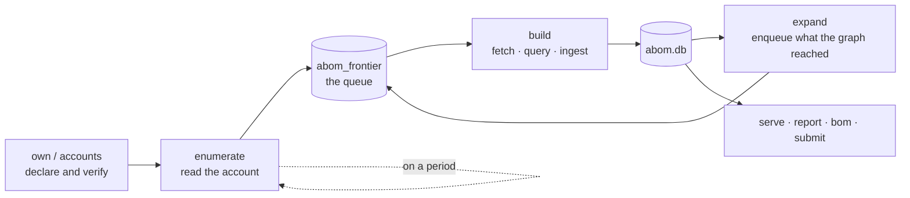

# How ABOM works

What the system currently does, in the order it does it, and the rules that shape the data. For
*why* the project exists, see [the value proposition](abom-value-proposition.md). For the words the
interface and API use, see [the vocabulary](vocabulary.md). For where it is going, see
[the vision](vision.md). For what is not built yet, see [the roadmap](roadmap.md).

## The pipeline

Each stage writes only what it measured, and every stage is resumable — the queue and the ledger
together mean a run that dies halfway does not repeat the work it already finished.

**It is one loop, and it runs itself.** The supervisor reads the declared accounts on a period,
queues what it found, analyzes, expands, and reads again; a first crawl and a maintenance crawl are
the same code differing only in whether anything has been read before. `serve --expand` on an empty
database is the whole bootstrap. Whether discovery should be running is stored, so a restart
resumes a crawl that was running and leaves a paused one paused.

**Reads are conditional, and paced by the budget rather than a guess.** Requests carry
`If-None-Match` against stored validators, so an unchanged answer costs a round trip and no quota.
The rate limit is read from every response — not only from the 403 that means it has already run
out — and requests are spaced only once the budget is genuinely running low.

**Ownership is declared, never inferred.** Nothing happens until an operator claims an account.
Membership comes from an authenticated `gh` session and decides nothing on its own: holding an
analyzed repository proves nothing about who can change it.

**Discovery is a closure, not a crawl of everything.** Nothing enters the graph that the owned set
does not reach. The walk is inductive — owned roots, plus what they reach — so the boundary is a
consequence of the declaration rather than a separate configuration.

**Analysis is queued per dependency *and* reference.** `actions/checkout@v4` and
`actions/checkout@v5` are different work, because they are different commits.

**Expansion follows the graph outward.** Edges produced by one analysis name dependencies that are
enqueued for the next, which is how the transitive closure is built one measured hop at a time.

## What produces the data

CodeQL, and nothing else. The queries live in `ql/actions/`:

| Pack | Produces |
| --- | --- |
| `graph-extraction` | Nodes, edges and observations — the structure |
| `findings` | SARIF results that become findings |
| `selfcheck` | Our own workflows, analyzed by our own queries |

Queries are **resolved at runtime, never compiled in**, and each is routed by its own
`@kind` metadata rather than by filename — so renaming a query cannot change where its results go.
Four result shapes are accepted: edges, observations, `@kind graph`, and SARIF. Anything else is
refused rather than guessed at.

A tier binds to a suite in `abom_tier_suite`, editable while the server runs. An empty binding is
legitimate and means "do not analyze this tier", which is why `abom_tier_configured` exists to tell
it apart from a tier nobody has configured.

## The data model

Everything is one SQLite file. `internal/store` is the only package that writes SQL.

### Ownership and identity

| Table | |
| --- | --- |
| `abom_owned_org`, `abom_owned_scope`, `abom_owned_include` | What the operator declared, and how it arrived |
| `abom_account` | What `gh` reports about membership, with the token scopes that made the answer possible |
| `repository` | Every repository seen, with `origin` recording how it entered |

### The queue

| Table | |
| --- | --- |
| `abom_frontier` | The work queue, keyed by dependency and reference, carrying depth and state |
| `abom_database_catalog` | Which repositories have a CodeQL database |
| `abom_tier_suite`, `abom_tier_configured`, `abom_suite_query` | Which queries run against which tier |
| `abom_cycle_spend` | What each crawl cycle cost |

### Evidence — the ledger

| Table | |
| --- | --- |
| `abom_query_run`, `abom_query_run_ref` | One row per analysis: the resolved commit, pack digest and CLI version that produced it |
| `abom_ingest_ledger` | What has already been read, so it is not read twice |
| `abom_ref_resolution` | Which commit a tag or branch pointed at, when it was measured |
| `abom_commit_content`, `abom_protected_branch` | Content equivalence, and which branches GitHub protects |

### The graph — a projection of the evidence

| Table | |
| --- | --- |
| `abom_node`, `abom_edge` | Actions, workflows, repositories and images, and the `uses:` relationships between them |
| `abom_observation` | Facts a query stated about a subject, keyed by the statement rather than the run |
| `abom_graph_generation` | Generation and epoch, so a client can ask for a delta |
| `abom_surface` | Denormalized read model |

### Findings

| Table | |
| --- | --- |
| `abom_finding`, `abom_finding_node` | A result, and the nodes it attaches to |
| `abom_finding_sighting` | Which run reported which finding, which is the only way staleness is observable |
| `rule`, `alert`, `abom_alert_link` | Rule metadata and the link to GitHub's own alerts |

### Derived and external

| Table | |
| --- | --- |
| `abom_blast_radius`, `abom_exposure` | Reach, recomputed wholesale rather than incrementally |
| `abom_advisory`, `abom_advisory_package` | GHSA records, stored as attributed external statements |
| `abom_submission` | What was sent to GitHub, because GitHub offers no way to ask |
| `abom_saved_view` | Named predicates, shared by the Explorer, the API and the CLI |
| `abom_http_cache` | Validators GitHub gave for a URL, so an unchanged answer costs no quota |
| `abom_discovery_state` | Whether the operator wants discovery running, so a restart does not decide |

#### Two structural properties

**The ledger is evidence; the graph is a projection.** Pruning a node does not delete the analysis
that found it. `abom_query_run` and `abom_finding` survive a prune, so the graph can be rebuilt and
a removed node can legitimately come back.

**The graph tables are append-only.** Removal is a tombstone (`removed_at`), and only compaction
deletes. That keeps row ids monotonic, which is what makes a delta cursor valid at all.

## Reachability

Reachability is **step-level and condition-aware** — "does anything you run actually arrive at this
step, through whom, and guarded by what" — rather than a version match against a package list.
Hop counts mean: `0` the node lives in the repository, `1` the repository names it directly, `N` it
is reached through `N` intermediaries.

Conditions on a step are reported **verbatim and never evaluated**. `github.ref == 'main'` is a fact
about the workflow; whether it holds at a given moment is not something static analysis settles.

Job ordering from `needs:` is ingested as its own relation. It is deliberately not taken from the
CodeQL Actions CFG, which is an AST pre-order walk that never consults `needs:` and would therefore
assert an order between jobs that actually run in parallel.

## Reading the data out

| Surface | |
| --- | --- |
| HTTP API | The whole capability set. Reads are open; anything that writes is guarded at the endpoint |
| Explorer | A force-directed graph over a scoped closure, with saved views |
| `report` | Terminal summary |
| `bom` | CycloneDX 1.6 and SPDX 2.3, with purls |
| `submit` | A dependency snapshot sent to GitHub's submission API |

**One filter language, three consumers.** A view is a predicate — scope, kinds, findings, rules,
origins, reach, reference style — serialized as text, and the Explorer, the API and the CLI all
parse the same string. Predicates that cut along the graph's structure are applied in SQL;
predicates that cut across it are applied after the query, because a closure is edge-closed by
construction and an arbitrary node filter is not.

**Purls are the join key.** `pkg:githubactions/{owner}/{name}[/{subpath}]@{version}`, matching what
GitHub emits, is what lets a component in an ABOM export correspond to anything outside it.

## What the design refuses

These are invariants, not preferences. They are enforced in
[`.github/instructions/architecture.instructions.md`](../.github/instructions/architecture.instructions.md)
and the tests named there.

- **A security verdict comes only from a CodeQL rule id.** If a rule did not flag a reference, ABOM
  says the rule did not look — never that the reference is safe.
- **Advisories enrich; they never adjudicate.** A GHSA is an attributed external statement, stored
  beside the observed references rather than resolved into a verdict about them.
- **A finding is evidence attached to a node, never a verdict about it.**
- **An absent measurement is not a measurement of zero.** A node nothing has measured is a coverage
  gap, and must not be drawn, aggregated or exported as a measured zero.
- **A person chooses every alert.** Nothing writes to another repository's security surface on a
  timer or by inference.
- **Say what was excluded.** A scoped view states what it left out. A bounded query that silently
  drops the rest turns a performance fix into a coverage lie.
