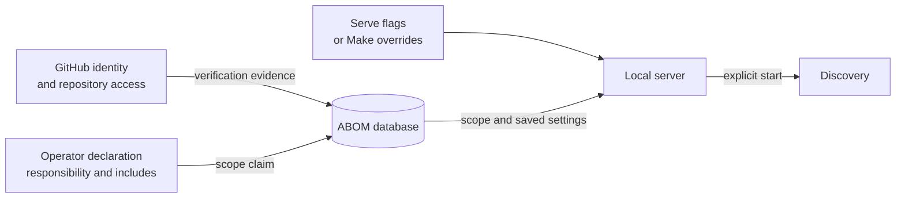

# Configure a source installation

Run ABOM from its checkout, under the operating-system account that owns its credentials and state.
The supported onboarding path is [source setup](source.md); these settings describe that local
deployment, not a released installer or cluster service.



## Authentication

Use an authenticated GitHub CLI session for interactive setup:

```bash
gh auth login --hostname github.com --git-protocol https --scopes read:org
gh auth setup-git --hostname github.com
gh auth status --hostname github.com
```

The normal GitHub CLI login requests repository access. Private repositories and organizations
with SSO also require the corresponding access and authorization. The `read:org` scope lets ABOM
interpret the membership list; do not grant organization administration merely to read it. If an
existing session lacks this scope, use `gh auth refresh --hostname github.com --scopes read:org`.

There are separate credential paths to check:

| Consumer | Credential source |
| --- | --- |
| ABOM's GitHub API reader | With a GitHub App, its installation tokens. Without one, the first non-empty `GITHUB_TOKEN`, then `GH_TOKEN`, then `gh auth token`; without any, public reads may still work and private coverage can be absent. |
| Ownership verification | With a GitHub App, where it is installed. Without one, `gh api user` and membership reads under the identity the GitHub CLI selects; reading a member's security manager role needs the `admin:org` scope, and without it the role is reported as unknown. |
| Copilot sessions | With a GitHub App, a token it mints for each session, holding only Copilot requests. Without one, `gh auth token`. |
| Dependency snapshots and default setup writes | With a GitHub App, none: the App asks for no write, and a server given `--submit-targets`, `--enable-targets` or `--enable-accounts` beside one refuses to start. Without one, the same token as the reader. |
| Private Git checkouts | Git's credential configuration; `gh auth setup-git` installs the GitHub CLI helper for HTTPS. An API token alone does not configure Git. |

The batch database-download path also needs permission to read the repository's code-scanning
databases. Source access and code-scanning access are separate checks. Onboarding does not require
dependency-submission or alert-publication authority.

Avoid exporting different values for `GITHUB_TOKEN` and `GH_TOKEN`: the GitHub CLI's precedence can
select a different identity from ABOM's reader. Prefer the stored CLI session for interactive use.
For an unattended local process, supply a supported token through its secret environment and test
identity, membership and private-clone access under that same account. Do not log token values or
put them in flags, tracked JSON, shell examples or process arguments.

The server reads its API token once, when it starts. After `gh auth login`, `gh auth refresh` or a
change to its token environment, run `make restart`. Until then, **Check with gh** can report the
new identity while repository listings still use the old token, or none, and silently miss private
repositories.

ABOM's Git commands never prompt: it disables terminal prompts and any inherited askpass program,
such as the one VS Code terminals set. A credential helper, such as the one `gh auth setup-git`
installs, or an SSH key used through a Git URL rewrite, still works. Check access with the
`git ls-remote` command in [source setup](source.md#configure-authentication).

Fine-grained and App tokens may not report classic OAuth scopes. Missing scope evidence means
unknown completeness, not that the operator belongs to no organization.

A process with a GitHub App configured reads no person's token for anything, and writes nothing.
Its Copilot sessions need the App's organization Copilot Requests permission, approved by the
installation; until then each session is refused with the missing grant named, and Settings →
*Agent sessions* says so. Copilot requests are billed to the
App's own organization unless `--authoring-org` names another it is installed on, whose policy must
allow Copilot requests from GitHub App installations. An installation is offered fewer models than
a person; a session whose `--authoring-model` is not among them runs on the runtime's own choice, and
its record names the model that ran.

The API URL defaults to GitHub.com. `--api-url` overrides `GITHUB_API_URL` for that reader.
Source checkouts use the corresponding GitHub host; ownership verification follows the `gh`
session. GHES deployment is not qualified. Keep submission targets unset during onboarding;
reading a repository is not authority to publish a dependency snapshot or alert to it.

## Remote-source eligibility

ABOM checks remote downloads on a best-effort basis. Public repositories are accepted without
license inspection; private/internal repositories must be within declared ownership.

Enabled Code Security/GHAS or scanning configuration, recorded analyses, or successful
code-scanning access provide sufficient evidence. Alerts and an Actions database are not required.
Explicit disablement skips the download, and so does eligibility GitHub cannot confirm, such as a
permission the App lacks; a read that failed transiently is asked again. See
[retry guidance](operations.md#source-policy-refusals-and-retry).

Local source and cached databases remain trusted, and custom query/library development is
unrestricted by these checks. Use synthetic or anonymized test fixtures.

## Database backends

`--db` accepts a SQLite path or a PostgreSQL URL and defaults to `ABOM_DB`. Keep connection
passwords in the environment rather than process arguments:

```bash
export ABOM_DB="$(cat /secure/abom-primary-dsn)"
./bin/codeql-abom serve --addr 127.0.0.1:8099 --app-dir /secure/github-app
```

A PostgreSQL deployment starts from its own crawl; ABOM does not import a SQLite database into it.
The coordinator initializes its schema and needs schema-owner permissions. A network database has
no adjacent directory, so name a configured GitHub App with `--app-dir`, and a publisher App with
`--publisher-app-dir`, rather than expecting either to be discovered beside the URL. Use verified TLS for non-loopback database connections. Application
errors redact connection passwords and URL parameters.

One coordinator holds the database-backed discovery lease. It renews the lease while running and
cancels work if ownership is lost; fenced transactions reject writes from a former owner. A
second coordinator must wait or retry after the lease expires, not reclaim the first one's work.
Successful ingestion attempts have durable, content-bound receipts so replay cannot import them
twice or change their evidence.
The lease lasts 30 seconds and is renewed every 10 seconds. A database copy can contain a live
lease from its source; wait for that copied lease to expire before starting a coordinator on it.
Startup refuses a competing coordinator; it does not turn that process into an automatic standby.
Run readers explicitly and let process orchestration retry coordinator startup after a failure.

### Read replicas

An optional `ABOM_READ_REPLICA` or `--read-replica` names a physical PostgreSQL standby belonging
to the same database and schema. Graph and inventory reads use it when eligible. Responses state
`X-Abom-Read-Source` and `X-Abom-Replica-Lag-Ms`; unknown or excessive lag uses the primary rather
than pretending the replica is current. The default `--replica-max-lag=0` requires WAL catch-up;
an operator may explicitly allow a bounded lag for ordinary reads.

Controls and their immediate responses use the primary. A control response sets an HTTP-only
consistency cookie: subsequent reads stay on the primary until the standby has replayed that
write. Cookie-aware API clients preserve the same guarantee as the browser.

`serve --reader-only` starts an independently scalable API reader without running migrations,
acquiring the coordinator lease, receiving events, or starting analysis. Give it read-only
database credentials and an already initialized schema. It refuses mutation requests; route
controls and live execution/authoring endpoints to the coordinator. Data reads may use the
standby while consistent readbacks use its read-only connection to the primary.

Consistency checks use native, isolated snapshots on either backend. PostgreSQL checks require
permission to create and remove their temporary schemas; they do not convert the graph into a
SQLite file or mutate the source while deriving comparisons.

## Ownership

Declare ownership in Settings → **Accounts**, as [source setup](source.md#start-and-declare-your-scope)
describes. Saving there lists the declared accounts' repositories and queues them without
analyzing anything, so you can review the scope before pressing **Start analysis**.

The command line can declare instead, with the server stopped because it opens the database
directly:

```bash
mkdir -p .abom/db
./bin/codeql-abom own --db .abom/db/abom.db --org YOUR_ORG
```

`own` records the declaration but lists nothing. The repositories are then listed by the first
discovery cycle, which goes straight on to analyze them, so there is no review step. Use a
restricted declaration if you declare this way.

`own` is held to the rule Settings offers by. Before it writes, it asks who is declaring — through
the App beside the database, or `gh` — and records the answer, as `accounts --refresh` does. An
account reported with a role that cannot declare it is refused: a member who is not its owner,
admin or security manager may declare, with `--include`, only the repositories they administer or
maintain, and `own` reads that role before writing. A role that could not be read makes nothing
eligible, and the refusal says so; a member who is a security manager needs a `gh` token with
`admin:org` for that role to be read (`gh auth refresh -s admin:org`). An account GitHub does not
report stays declarable, because ownership is stated rather than inferred; one a complete
membership list contradicts roots nothing. If GitHub cannot be reached, `own` says so and judges the
declaration against the accounts last verified. Saving a declaration again, or narrowing it, judges
only what it newly claims; Settings reports whether the role behind what is already declared still
supports it. A declaration is a claim of responsibility, not proof of license eligibility.

Every declaration, from `own`, Settings or a local file, is a decision signed with the key in
`authz/` beside the database and logged. A PostgreSQL database, or a key kept anywhere else, names
that directory with `ABOM_AUTHZ_DIR`, which every command reads; `serve`, `own` and `audit` also
take `--authz-dir`. A command refuses rather than make a new key beside a log another key signed. A
declaration no decision holds for drives nothing until it is
confirmed: press **Confirm** in Settings → **Accounts**, or run the same `own` command again. In a pod,
`own` reads as the App `ABOM_APP_DIR` names, and its decision names the pod's ServiceAccount.

On standard error `own` names each enabled declaration discovery cannot act on: one a complete membership list
leaves out, which roots nothing, and, when the App beside the database verified the identity, one
the App is not installed on, which discovery cannot list. A refused declaration exits non-zero and
writes nothing.

To restrict the organization to explicitly named base repositories, repeat `--include`:

```bash
./bin/codeql-abom own --db .abom/db/abom.db --org YOUR_ORG \
  --include YOUR_ORG/REPOSITORY
```

To cover the repositories that carry custom property values, repeat `--property`, each a JSON
object naming one property scope:

```bash
./bin/codeql-abom own --db .abom/db/abom.db --org YOUR_ORG \
  --property '{"org": "YOUR_ORG", "match": [{"name": "team", "value": "payments"}]}'
```

A repository is covered when it carries every term in one scope; separate scopes, and any
`--include`, each cover on their own. A value is compared exactly and may hold any character, which
is why a scope is JSON rather than a delimited string. Only a property that organization owners and
admins alone can set may scope ownership, so one repository administrators can set is refused. A
scope is held, counting nothing, until the organization's schema has been read, which the next
listing does. A scope naming the organization's default covers every repository that never chose a
value, including repositories created later; `own` and Settings say so beside it.

This replaces the declaration; it does not append to the previous one. Includes select owned
roots, not a prohibition on following their dependencies. Personal accounts require an explicit
`--user` declaration; they are never assumed. Use the interface for changes while serving rather
than opening a second database writer.

An optional untracked `abom.local.json` in the working directory can initialize an empty declaration:

```json
{
  "own": {
    "orgs": ["YOUR_ORG"],
    "includes": ["YOUR_ORG/REPOSITORY"],
    "properties": [
      {"org": "YOUR_ORG", "match": [{"name": "team", "value": "payments"}]}
    ]
  }
}
```

Only include the `includes` or `properties` property when you intend that restriction; each
`properties` entry is the object `--property` takes. `--declare-file` selects
another file. This is a declaration channel, not a general application configuration file. It is
read at startup, missing files are allowed, and malformed files are refused. What it declares is
judged against the accounts last verified as anything `own` writes is. A declaration the role on
record cannot support is not applied: the server says why and starts with nothing declared, so the
interface is there to make one the role supports. A valid file does not
replace an existing declaration. Clearing the declaration while leaving this file configured
can restore it at the next startup. Like `own`, a file-based declaration lists nothing until
discovery starts.

## Paths and startup

The [Makefile](../../Makefile) supplies source-install defaults. These are Make variables, not
environment variables that the executable automatically interprets:

| Make override | Default relative to the checkout | Purpose |
| --- | --- | --- |
| `ABOM_TMP` | `.abom/` | Parent of the default runtime paths; not all of its contents are disposable. |
| `ABOM_DB` | `.abom/db/abom.db` | Durable SQLite path or PostgreSQL URL; supply URL credentials through the environment. |
| `ABOM_AUTHZ_DIR` | `authz/` beside a SQLite `ABOM_DB` | Decision key and trust bundle; required for a PostgreSQL `ABOM_DB` to declare or act on a declaration. |
| `ABOM_AUTHZ_KMS_KEY` | unset | An AWS KMS key (`ECC_NIST_P256`, `SIGN_VERIFY`) decisions are signed with instead of the key in `ABOM_AUTHZ_DIR`, whose bundle still verifies them. Naming a new key retires every key trusted before it. |
| `ABOM_WORK` | `.abom/work/` | Checkout and analysis work area; may also contain run/authoring artifacts. |
| `ABOM_UI` | `.abom/ui/` | Generated published UI; `make start` rebuilds it. |
| `ABOM_LOG` | `.abom/logs/serve.log` | Background-server output. |
| `ABOM_PID` | `.abom/serve.pid` | Source lifecycle PID file. |
| `ABOM_ADDR` | `127.0.0.1:8099` | Local HTTP address. |
| `ABOM_SERVE_FLAGS` | Empty | Additional `serve` flags. |

For state outside the checkout, supply the same overrides on every lifecycle invocation, and
point all CLI setup commands at that same database:

```bash
make start ABOM_TMP="$HOME/abom-state" ABOM_ADDR=127.0.0.1:8099
make status ABOM_TMP="$HOME/abom-state" ABOM_ADDR=127.0.0.1:8099
```

When running the executable directly, `serve` requires `--db`, defaults to `localhost:8080`, and
serves no UI unless `--ui-dir` is set. Pass `--work-dir` explicitly for a stable work location;
otherwise the server creates temporary scratch. Create the database's parent directory before
direct CLI commands. `make start` creates its required directories for you.

A new database does not start discovery automatically. `--expand` opts into startup discovery;
otherwise resuming a previous crawl also requires the stored resume-on-start setting. Keep this
choice explicit. Do not add `--expand` to installation commands merely to prove the server starts.

## Optional features

| Capability | Configuration and prerequisites |
| --- | --- |
| Retained checkouts | `--cache-dir` and `--cache-max-mb`; disabled unless a directory is supplied. Keep cache paths distinct from the database and custom queries. |
| Retained CodeQL databases | `--database-cache-dir` and `--database-cache-max-mb`; disabled unless configured. Retention helps requested analyses reuse extraction. |
| Code scanning reuse | On by default: a database or default setup analysis is taken only where it is what ABOM would produce. `--code-scanning-reuse=false` builds and evaluates everything. `--code-scanning-wait` (10 minutes; `0` never waits) bounds how long a push to an owned default branch waits for code scanning's own analysis of it. Nothing is taken while `LGTM_INDEX_FILTERS` is set in the server's environment. |
| Resource limits | `--expand-concurrency`, `--expand-threads`, `--expand-ram` and `--rate-limit-per-hour`. Set budgets appropriate to the host; no universal organization-size default is promised. |
| Custom queries | `--custom-ql-dir` names a writable operator pack and scaffolds it if empty. Preserve it as authored state, not as a disposable cache. |
| AI authoring | Custom-query workspace plus `--copilot-cli` or `COPILOT_CLI_PATH`, supported Copilot CLI credentials and the configured ql-mcp/Node command. It is off without an executable explicitly named. Use authoring time and credit limits. Settings → *What agent sessions run on* lists the server's own check of each dependency (`GET /api/authoring/readiness`, `?fresh=1` to probe again) and can name the CodeQL and Copilot CLIs (`PUT /api/authoring/tools/{codeql\|copilot}`). Settings takes only an absolute path to a file named `codeql` or `copilot` that no other account can change, since the server runs it as itself; name any other program with the flag or variable. A saved path is run before it is kept, and is used ahead of `--codeql`, `--copilot-cli` and `COPILOT_CLI_PATH`; an empty one returns to them. A Copilot CLI applies from the next session, a CodeQL CLI from the next start. |
| AI authoring in a cluster | With `--executor=kubernetes` each session is a Job: `--authoring-worker-{service-account,cpu,memory,timeout}` size it, `--authoring-agent-image` names the image built with `--target authoring`, `--authoring-egress-proxy` the proxy its pod reaches Copilot through, and `--ql-mcp` the ql-mcp that image runs. `--authoring-concurrency` sessions work at once and the rest wait their turn; `--authoring-credits` is 500 per session unless given. A session needs a GitHub App, which mints a Copilot token for it and revokes it when it is done. |
| Jobs' egress in a cluster | Each pool's Jobs reach out through their own listener of the egress proxy: `--worker-egress-proxy`, `--test-worker-egress-proxy`, `--run-worker-egress-proxy` and `--authoring-egress-proxy`, each a URL; a pool given none reaches out directly, as its NetworkPolicy allows. `--worker-no-proxy` names the hosts every Job reaches directly instead, such as an object store in the cluster. The chart sets them all from `egressProxy`. |
| Query export | A second GitHub App, created with `codeql-abom app create --publisher` and installed on the one repository exports go to; `serve` finds it in `github-app-publisher` beside `--db`, or in `--publisher-app-dir` (the chart's `publisherApp.secretName`). `app status --publisher` names that repository or why it is refused. Off without one. See [`infra/qlaas-repo-template/`](../../infra/qlaas-repo-template/README.md) for the repository's workflows. |
| Explicit workflow-lock verification | The `gh actions-lock` extension; use the supported tool version and contracts described by the [lock-tooling plan](../../plans/tools/actions-lock.md). It is distinct from ABOM reading lockfiles during analysis. |
| Diagnostics | `--diagnostics` enables performance endpoints. Keep these local; they are not an authenticated monitoring service. |

Use `./bin/codeql-abom serve --help` for the flag reference. Store-backed preferences and suite
bindings are configured through their existing interface controls, not guessed JSON keys.

## Network boundary

By default the service has no browser sign-in and no built-in TLS: `X-Abom-Control` and loopback
Host checks are not user identities. Without sign-in, `serve` therefore listens on loopback alone: it
refuses an `--addr` any network reaches, and `--allow-remote-control`, and says to sign people in
with `--auth` instead. `--allow-host` still names the host a port-forward presents, because the
listener stays on loopback. Do not expose it through a proxy as part of source setup.

### Sign-in

With sign-in on, every request needs a session, the interface's own files included: opening ABOM
without one goes straight to signing in, so nothing is drawn for nobody. A refused sign-in, and
signing out, land on `/auth/`, which says how it went and offers to sign in again without doing so
by itself. Each control is refused below the role its operation needs, and every decision names who
asked by an identifier their provider keeps for them: the issuer and subject, or the GitHub account
ID. What they were called is kept beside it. Whoever a record says started a run, filed a request
or adopted a policy is the person signed in; a name a script sends with `by` or `requestedBy` is
ignored. The bar shows who you are signed in as and your role, and Settings → *You* says who
vouched for you, what granted your role, what it lets you do and when the session ends. Every control
your role does not allow is offered disabled, naming the role it needs. Sessions are kept in the
database, by a digest of the cookie, so a restart or a rollout signs nobody out: one through an
identity provider lasts an hour, since its roles are read only at sign-in, one through GitHub lasts
eight hours, and either ends after two hours unused. TLS is the ingress's to terminate. Choose one
provider:

- **`--auth=oidc`**, through an OpenID Connect provider: `--oidc-issuer`, `--oidc-client-id`,
  `--oidc-redirect-url` (this deployment's `/auth/callback`) and the client secret in
  `ABOM_OIDC_CLIENT_SECRET` or `--oidc-client-secret-file`. Roles come from the claim
  `--oidc-roles-claim` names, a list or a single value, through `--oidc-role-map`:
  - Entra ID: app roles in `roles`, by default `ABOM.Viewer`, `ABOM.Analyst`, `ABOM.Operator` and
    `ABOM.Admin`. Where an MFA or conditional access policy is required, use this.
  - Okta or Keycloak: groups, with `--oidc-roles-claim=groups` and a map such as
    `abom-operators=operator`.
  - Dex with its GitHub connector: teams in `groups` as `org:team`.
- **`--auth=github`**, through the reading App: `--github-redirect-url`, added as a redirect URI
  under *Identifying and authorizing users* in the App's settings; a client secret generated there, in `ABOM_GITHUB_CLIENT_SECRET` or
  `--github-client-secret-file`; and `--github-role-map`, whose keys are `org/team` for a team's
  members, `org` for every member and `org:owners` for owners alone. Memberships are read with the
  App's `members: read` permission, which each organization's owners approve;
  `codeql-abom app installations` names an installation that has not. A change made with a role
  read more than `--github-role-refresh` ago (5 minutes) reads it again first, so someone removed
  from a team loses what it granted within that time. The token GitHub issues for signing in is used
  once, to learn who signed in, and revoked.

Every request, including reads and diagnostics, requires a loopback Host by default. A hostname
that resolves to loopback is not enough, and forwarded headers do not grant access.
With sign-in on, `--allow-remote-control` relaxes that Host restriction for reads and controls; it
does not remove the control-header or cross-site checks, or let a `--reader-only` instance accept
writes.

API mutations and linked-source reads require `X-Abom-Control: 1`. The ownership and dependency
snapshot previews are read-only POSTs and need no control header, but still enforce the Host
boundary. Only `POST /api/events/github` uses its webhook HMAC in place of these request checks;
the webhook status and other event routes are not exempt.

`make security-test` exercises these boundaries and deployed-suite input validation without
external services. It also runs in the Go Self Audit job and before `make selfcheck`.

Installation and analysis need outbound access to the repositories, GitHub APIs and package
registries they use. Optional authoring needs its provider endpoints as well. Proxy and custom-CA
requirements apply to each tool; a successful API read does not prove Git or CodeQL can connect.
