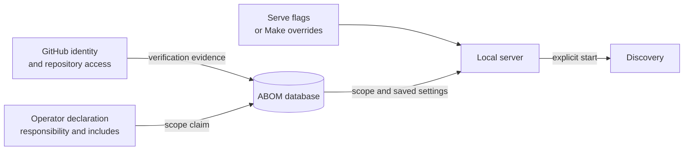

# Configure a source installation

Run ABOM from its checkout, under the operating-system account that owns its credentials and state.
The supported onboarding path is [source setup](source.md); these settings describe that local
deployment, not a released installer or cluster service.



## Authentication

Use an authenticated GitHub CLI session for interactive setup:

```bash
gh auth login --hostname github.com --git-protocol https --scopes read:org
gh auth setup-git --hostname github.com
gh auth status --hostname github.com
```

The normal GitHub CLI login requests repository access. Private repositories and organizations
with SSO also require the corresponding access and authorization. The `read:org` scope lets ABOM
interpret the membership list; do not grant organization administration merely to read it. If an
existing session lacks this scope, use `gh auth refresh --hostname github.com --scopes read:org`.

There are separate credential paths to check:

| Consumer | Credential source |
| --- | --- |
| ABOM's GitHub API reader | First non-empty `GITHUB_TOKEN`, then `GH_TOKEN`, then `gh auth token`. Without one, public reads may still work and private coverage can be absent. |
| Ownership verification | `gh api user` and membership reads under the identity the GitHub CLI selects. |
| Private Git checkouts | Git's credential configuration; `gh auth setup-git` installs the GitHub CLI helper for HTTPS. An API token alone does not configure Git. |

The batch database-download path also needs permission to read the repository's code-scanning
databases. Source access and code-scanning access are separate checks. Onboarding does not require
dependency-submission or alert-publication authority.

Avoid exporting different values for `GITHUB_TOKEN` and `GH_TOKEN`: the GitHub CLI's precedence can
select a different identity from ABOM's reader. Prefer the stored CLI session for interactive use.
For an unattended local process, supply a supported token through its secret environment and test
identity, membership and private-clone access under that same account. Do not log token values or
put them in flags, tracked JSON, shell examples or process arguments.

The server reads its API token once, when it starts. After `gh auth login`, `gh auth refresh` or a
change to its token environment, run `make restart`. Until then, **Check with gh** can report the
new identity while repository listings still use the old token, or none, and silently miss private
repositories.

ABOM's Git commands never prompt: it disables terminal prompts and any inherited askpass program,
such as the one VS Code terminals set. A credential helper, such as the one `gh auth setup-git`
installs, or an SSH key used through a Git URL rewrite, still works. Check access with the
`git ls-remote` command in [source setup](source.md#configure-authentication).

Fine-grained and App tokens may not report classic OAuth scopes. Missing scope evidence means
unknown completeness, not that the operator belongs to no organization. A GitHub App service
identity and token-refresh lifecycle are not a supported substitute for the source onboarding
session yet.

The API URL defaults to GitHub.com. `--api-url` overrides `GITHUB_API_URL` for that reader, but this
does not establish coherent host routing for Git and `gh`. Do not treat the flag as a qualified
GHES deployment option. Keep submission targets unset during onboarding; reading a repository is
not authority to publish a dependency snapshot or alert to it.

## Ownership

Declare ownership in **Settings**, as [source setup](source.md#start-and-declare-your-scope)
describes. Saving there lists the declared accounts' repositories and queues them without
analyzing anything, so you can review the scope before pressing **Start analysis**.

The command line can declare instead, with the server stopped because it opens the database
directly:

```bash
mkdir -p .abom/db
./bin/codeql-abom accounts --db .abom/db/abom.db --refresh
./bin/codeql-abom own --db .abom/db/abom.db --org YOUR_ORG
```

`own` records the declaration but lists nothing. The repositories are then listed by the first
discovery cycle, which goes straight on to analyze them, so there is no review step. Use a
restricted declaration if you declare this way.

Verification and declaration answer different questions. The interface offers accounts whose
reported role permits a declaration; a CLI declaration remains an operator claim, not proof of
permissions or license eligibility. A complete membership response can contradict a declaration;
incomplete evidence remains unknown. Confirm what the interface reports before starting work.

To restrict the organization to explicitly named base repositories, repeat `--include`:

```bash
./bin/codeql-abom own --db .abom/db/abom.db --org YOUR_ORG \
  --include YOUR_ORG/REPOSITORY
```

To cover the repositories that carry custom property values, repeat `--property`, each a JSON
object naming one property scope:

```bash
./bin/codeql-abom own --db .abom/db/abom.db --org YOUR_ORG \
  --property '{"org": "YOUR_ORG", "match": [{"name": "team", "value": "payments"}]}'
```

A repository is covered when it carries every term in one scope; separate scopes, and any
`--include`, each cover on their own. A value is compared exactly and may hold any character, which
is why a scope is JSON rather than a delimited string. Only a property that organization owners and
admins alone can set may scope ownership, so one repository administrators can set is refused. A
scope is held, counting nothing, until the organization's schema has been read, which the next
listing does. A scope naming the organization's default covers every repository that never chose a
value, including repositories created later; `own` and Settings say so beside it.

This replaces the declaration; it does not append to the previous one. Includes select owned
roots, not a prohibition on following their dependencies. Personal accounts require an explicit
`--user` declaration; they are never assumed. Use the interface for changes while serving rather
than opening a second database writer.

An optional untracked `abom.local.json` in the working directory can seed an empty declaration:

```json
{
  "own": {
    "orgs": ["YOUR_ORG"],
    "includes": ["YOUR_ORG/REPOSITORY"],
    "properties": [
      {"org": "YOUR_ORG", "match": [{"name": "team", "value": "payments"}]}
    ]
  }
}
```

Only include the `includes` or `properties` property when you intend that restriction; each
`properties` entry is the object `--property` takes. `--declare-file` selects
another file. This is a declaration channel, not a general application configuration file. It is
read at startup, missing files are allowed, and malformed files are refused. A valid file does not
replace an existing declaration. Clearing the declaration while leaving a seed file configured
can seed it again at the next startup. Like `own`, a seeded declaration lists nothing until
discovery starts.

## Paths and startup

The [Makefile](../../Makefile) supplies source-install defaults. These are Make variables, not
environment variables that the executable automatically interprets:

| Make override | Default relative to the checkout | Purpose |
| --- | --- | --- |
| `ABOM_TMP` | `.abom/` | Parent of the default runtime paths; not all of its contents are disposable. |
| `ABOM_DB` | `.abom/db/abom.db` | Durable SQLite database, with its adjacent WAL and shared-memory files. |
| `ABOM_WORK` | `.abom/work/` | Checkout and analysis work area; may also contain run/authoring artifacts. |
| `ABOM_UI` | `.abom/ui/` | Generated published UI; `make start` rebuilds it. |
| `ABOM_LOG` | `.abom/logs/serve.log` | Background-server output. |
| `ABOM_PID` | `.abom/serve.pid` | Source lifecycle PID file. |
| `ABOM_ADDR` | `127.0.0.1:8099` | Local HTTP address. |
| `ABOM_SERVE_FLAGS` | Empty | Additional `serve` flags. |

For state outside the checkout, supply the same overrides on every lifecycle invocation, and
point all CLI setup commands at that same database:

```bash
make start ABOM_TMP="$HOME/abom-state" ABOM_ADDR=127.0.0.1:8099
make status ABOM_TMP="$HOME/abom-state" ABOM_ADDR=127.0.0.1:8099
```

When running the executable directly, `serve` requires `--db`, defaults to `localhost:8080`, and
serves no UI unless `--ui-dir` is set. Pass `--work-dir` explicitly for a stable work location;
otherwise the server creates temporary scratch. Create the database's parent directory before
direct CLI commands. `make start` creates its required directories for you.

A new database does not start discovery automatically. `--expand` opts into startup discovery;
otherwise resuming a previous crawl also requires the stored resume-on-start setting. Keep this
choice explicit. Do not add `--expand` to installation commands merely to prove the server starts.

## Optional features

| Capability | Configuration and prerequisites |
| --- | --- |
| Retained checkouts | `--cache-dir` and `--cache-max-mb`; disabled unless a directory is supplied. Keep cache paths distinct from the database and custom queries. |
| Retained CodeQL databases | `--database-cache-dir` and `--database-cache-max-mb`; disabled unless configured. Retention helps requested analyses reuse extraction. |
| Code scanning reuse | On by default: a database or default setup analysis is taken only where it is what ABOM would produce. `--code-scanning-reuse=false` builds and evaluates everything. `--code-scanning-wait` (10 minutes; `0` never waits) bounds how long a push to an owned default branch waits for code scanning's own analysis of it. Nothing is taken while `LGTM_INDEX_FILTERS` is set in the server's environment. |
| Resource limits | `--expand-concurrency`, `--expand-threads`, `--expand-ram` and `--rate-limit-per-hour`. Set budgets appropriate to the host; no universal organization-size default is promised. |
| Custom queries | `--custom-ql-dir` names a writable operator pack and scaffolds it if empty. Preserve it as authored state, not as a disposable cache. |
| AI authoring | Custom-query workspace plus `--copilot-cli` or `COPILOT_CLI_PATH`, supported Copilot CLI credentials and the configured ql-mcp/Node command. It is off without an executable explicitly named. Use authoring time and credit limits. |
| Explicit workflow-lock verification | The `gh actions-lock` extension; use the supported tool version and contracts described by the [lock-tooling plan](../../plans/tools/actions-lock.md). It is distinct from ABOM reading lockfiles during analysis. |
| Diagnostics | `--diagnostics` enables performance endpoints. Keep these local; they are not an authenticated monitoring service. |

Use `./bin/codeql-abom serve --help` for the flag reference. Store-backed preferences and suite
bindings are configured through their existing interface controls, not guessed JSON keys.

## Network boundary

The local service has neither browser-user authentication nor built-in TLS. `X-Abom-Control`,
loopback Host checks and `--allow-remote-control` are not user identities. Do not expose it through
a public listener or proxy as part of source setup.

Installation and analysis need outbound access to the repositories, GitHub APIs and package
registries they use. Optional authoring needs its provider endpoints as well. Proxy and custom-CA
requirements apply to each tool; a successful API read does not prove Git or CodeQL can connect.
