# Deploy ABOM

Deployment means installing and configuring ABOM itself. **ABOM is unreleased; source installation
is the only supported deployment.** There are no supported GitHub Release archives, container
images or Helm installation instructions to use yet.

```mermaid
flowchart LR
    SOURCE["Build from source"] -->|"supported route"| LOCAL["Local ABOM<br/>API and browser UI"]
    RELEASE["GitHub Release archives"] -. "not available" .-> LOCAL
    HELM["Helm deployment"] -. "not available" .-> CLUSTER["Distributed Kubernetes execution"]
    style RELEASE fill:#3d2d1d
    style HELM fill:#3d2d1d
    style CLUSTER fill:#3d2d1d
```

## Install and configure

| Need | Guide |
| --- | --- |
| Install tools, query packs and the local application | [Build from source](source.md) |
| Authenticate, declare ownership and choose paths or optional features | [Configuration](configuration.md) |
| Start, stop, inspect, back up or troubleshoot an installation | [Operations](operations.md) |
| Understand what the resulting evidence means | [Architecture](../architecture.md) and [vocabulary](../vocabulary.md) |

The source guide targets a local GitHub.com installation for an operator responsible for an
organization. Keep the service on loopback. A GitHub credential authorizes GitHub reads; it does
not authenticate people visiting ABOM's web interface.

## Deployment boundaries

The live database is embedded SQLite with a single running owner. Do not place it on shared
network storage or run multiple server/CLI writers against it. Its WAL is part of its committed
state; copying only the main database file is not a backup.

CodeQL's license and repository authorization apply independently of installation. ABOM does not
currently enforce a base-repository Code Scanning eligibility policy. Missing coverage or failed
reads are not evidence that a repository is clean.

The [deployment plan](../../plans/tools/deployment.md) owns release archives and Kubernetes work,
including the proposed Linux/macOS amd64/arm64 release matrix. Windows is outside that workstream.
Until qualification is complete, the proposed matrix is not a certification of every operating
system, architecture or external service. Future user guides will accompany usable release and
Helm routes, not placeholders that suggest those routes already exist.
