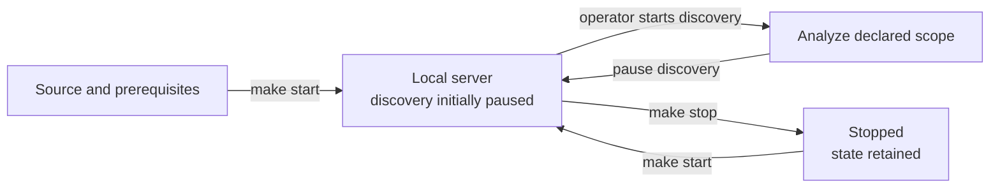

# Operate a source installation

Use these commands from the checkout and retain the same
[path and address overrides](configuration.md#paths-and-startup) used at startup. They manage a
local source installation, not an OS service or Kubernetes deployment.



## Lifecycle

| Command | Effect |
| --- | --- |
| `make start` | Build executable and UI, then start the background server. Refuses a recognized server already running. |
| `make serve` | Build and serve in the foreground instead; Ctrl+C stops that process. |
| `make status` | Show the recognized server and discovery state at the configured address. |
| `make logs` | Follow background output; Ctrl+C stops following, not serving. |
| `make stop` | Stop recognized local ABOM servers and retain their state. |
| `make restart` | Stop, rebuild and start. Discovery resumes only according to the explicit startup flag and stored resume setting. |

The source lifecycle is not an independent per-installation service manager: `make stop` scans for
matching ABOM server processes on the machine, not only its PID file. Do not use it casually on a
machine running another installation. For deliberate isolated testing, use a separate executable
name, database, work/UI paths and address, and manage that process explicitly.

Pausing discovery is different from stopping the server. Check that work has actually stopped
before running other local CodeQL tasks; the CLI shares compilation resources. Keep the server on
loopback, and do not start another writer against its database.

## Inspect the installation

```bash
make status
curl --fail http://127.0.0.1:8099/api/summary
curl --fail http://127.0.0.1:8099/api/discovery/status
```

Use your configured address in place of the default. A successful HTTP response proves serving,
not that identity, query resolution or analysis succeeded. In the interface, check declared scope,
identity evidence, discovery problems, failed or unavailable repositories and coverage alongside
finding counts. An empty new database is not a security assessment.

The local `--diagnostics` flag enables additional performance endpoints; it is not required for
installation. Do not publish them or run expensive measurements against an active crawl.

## State and backups

Preserve the database and any authored custom-query workspace. Work directories can contain run
and authoring artifacts that recorded rows refer to, so do not delete the entire state tree as a
routine cache cleanup. Distinguish retained extraction/checkouts from authored or unrecoverable
evidence. Published UI and build output can be regenerated.

SQLite uses WAL. **Do not copy only the live database file, and do not use `immutable=1` when
taking a live snapshot.** With the SQLite CLI installed, choose a new backup destination and use a
normal connection:

```bash
mkdir -p .abom/backups
sqlite3 .abom/db/abom.db '.backup .abom/backups/abom-before-change.db'
sqlite3 .abom/backups/abom-before-change.db 'PRAGMA integrity_check;'
```

Use the configured database path, not necessarily this default. Keep backups outside any tree you
intend to remove and protect them as sensitive repository evidence. `integrity_check` tests SQLite
integrity; it does not prove that external work artifacts or custom queries were backed up.

There is no supported ABOM backup/restore command yet. Do not replace a live store or assume a
file copy resets connected clients' graph cursors. The [backup/restore plan](../../plans/db/backup-and-restore.md)
owns the missing restore safeguards and epoch handling; a complete operational recovery guarantee
is not available merely because SQLite can produce a snapshot.

## Checkout updates and removal

ABOM is unreleased and has no supported release-to-release upgrade or downgrade procedure. Before
changing a working checkout, stop its server and preserve its state. Follow
[source setup](source.md) again for changed toolchain pins or query dependencies, then rebuild.
Startup migrations are not a promise that an older executable can read the resulting database.
Do not delete evidence to make an update appear successful.

`make clean` removes `bin/` and `dist/`; it does not remove `.abom/`. To retire an installation,
stop it first, preserve any evidence or queries you need, then explicitly remove only that
installation's checkout and state. No removal command here deletes shared GitHub credentials or
the machine's CodeQL package cache.

## Batch CLI reference

The service is the supported first-run path. The batch commands run the same stages by hand, with
the server stopped, and import from a different source:

```bash
./bin/codeql-abom discover --org YOUR_ORG --db .abom/db/abom.db
./bin/codeql-abom build --db .abom/db/abom.db
./bin/codeql-abom expand-all --db .abom/db/abom.db
./bin/codeql-abom refresh --db .abom/db/abom.db
./bin/codeql-abom report --db .abom/db/abom.db
```

`discover` records which repositories in the organization already have a GitHub code scanning
database for Actions, and `build` downloads and ingests those databases. That imports what code
scanning has built, not from the declared accounts' repository listing, and needs permission to
read those databases. `expand-all` follows dependencies from what is recorded. `refresh`
recomputes derived tables without crawling; it is not a migration or restore. Retain checkouts
between batch runs by adding `--cache-dir .abom/cache/checkouts` to `expand-all`.

`./bin/codeql-abom --help` lists subcommands. Use the matching `--help` before operating on an
existing corpus; direct-database CLI commands belong outside a running server's ownership.

## Troubleshooting

| Symptom | Check |
| --- | --- |
| Server refuses to start or address is occupied | Use `make status`, inspect the named process and choose a free `ABOM_ADDR`. Do not start a second writer or assume a response belongs to your new process. |
| UI missing while API works | `make start` publishes and supplies the UI. Direct `serve` needs `--ui-dir` pointing at published `wwwroot`, not the Razor source tree. |
| Query or pack cannot be found | Run from the checkout, match the CodeQL pin and rerun [workspace pack installation](source.md#install-query-dependencies). A copied executable is insufficient. |
| Database cannot open | Create its parent directory and confirm permissions, path and exclusive process ownership. A directory override for Make is not a flag passed to a direct CLI command. |
| Private repositories are missing from the listing | The server reads its token at startup, so a listing made before authenticating is incomplete. Run `make restart` after `gh auth login` or `gh auth refresh`. The next listing uses the new token: saving a changed declaration, or the first cycle after **Start analysis**. **Check with gh** succeeding does not prove the running server's reader has the same token. |
| Private repositories are unavailable | Git could not fetch them, and nothing retries them on its own. Fix access until the [`git ls-remote` check](source.md#configure-authentication) succeeds, then in **Settings**, under **How discovery runs**, press **Re-analyze unavailable**, or enter one repository under **Or one repository**. A reference built from an expression names no repository and stays unavailable. The **Unavailable** view of the Coverage unit shows why each one failed. |
| Ownership is unknown or contradicted | Check the declared account and refresh identity through the interface, or stop the server before `accounts --refresh`. A missing scope is not proof that the account has no repositories. |
| Discovery does not start | Read its stated problem: scope, missing Git/CodeQL, query path or writable work directory. New installations deliberately start stopped. |
| `serve` will not start: "this server needs Graphviz", or a figure or stable layout answers that the server cannot run Graphviz | Graphviz is required and `dot` is not on the server's `PATH`, or was removed while it ran. Install it ([prerequisites](source.md#prerequisites)), then `make restart`. |
| Host is overloaded | Pause discovery and reduce the configured concurrency/CodeQL budgets before restarting work. Do not run competing CodeQL tests or benchmarks during a crawl. |
