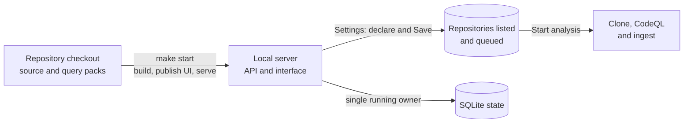

# Build and run from source

Source installation is the supported way to run ABOM. Keep the checkout: the executable resolves
ABOM's query packs from it. Copying the binary alone, or the output of `make package`, is not a
standalone analysis installation.



## Prerequisites

| Tool | Requirement |
| --- | --- |
| Git, GNU Make, curl | Fetch the checkout and run the lifecycle targets; `make start` uses curl to confirm the server answered. |
| Go and a C compiler | Go 1.21 or later: `make` pins the toolchain in the [Makefile](../../Makefile) and Go downloads it on first use. SQLite needs CGO, so install Xcode Command Line Tools on macOS or a native C toolchain on Linux, and do not disable CGO. |
| .NET SDK | The major version named by `TargetFramework` in [the UI project](../../ui/Abom.WebAssembly.csproj). `dotnet --list-sdks` shows what is installed. No extra workloads are needed. |
| GitHub CLI | [gh](https://cli.github.com/), for authentication and ownership verification. |
| CodeQL | The version in [.codeql-version](../../.codeql-version), on `PATH`. See [install CodeQL](#install-codeql). |
| Graphviz | [Graphviz](https://graphviz.org/download/), with `dot` on `PATH`: `brew install graphviz` or `apt-get install graphviz`. Every details page draws its figure with it, and the Explorer's stable layout uses it. `serve` refuses to start without it and names the version it found. |

These are the only requirements for serving and analyzing. Node, Playwright and golangci-lint are
development tools. AI authoring and explicit lock verification have
[optional dependencies](configuration.md#optional-features). Native platform qualification is still
pending, so this is not a promise that every Linux distribution or macOS version works.

The complete development gate requires a running Docker daemon, not a host PostgreSQL install.
`make test` runs both halves: `make test-sqlite` runs every package with the race detector and
the store on SQLite, and needs no Docker; `make test-postgres` runs replica routing against a
physical standby, then the store suite again on PostgreSQL, in `ABOM_TEST_SHARDS` concurrent
processes (default: one per CPU, at most 4) against one primary. CI runs the two halves as parallel jobs. The pinned PostgreSQL primary and physical
standby use disposable data and dynamically assigned loopback ports; the harness removes only its
own containers afterward. Primary readiness requires TCP: the image's temporary, socket-only
initialization server is stopped before the service starts, so it cannot authorize standby setup
or test execution. Replication-setup errors retain PostgreSQL's stderr in the test log.
`make backend-test` is another name for `make test-postgres`. An unavailable daemon is an error,
never a skipped backend.
A plain `go test` outside the harness runs the store suite on SQLite and skips the standby test.
`make script-test`
tests the harness lifecycle without starting containers; `python3 scripts/with-postgres.py probe`
checks the Docker runtime and wire protocol only.

CodeQL has its own use and distribution terms. Access to a repository or membership in an
organization is not a license grant. Use ABOM only for analysis you are authorized to perform;
ABOM does not currently enforce base-repository Code Scanning eligibility.

## Get the checkout

```bash
git clone https://github.com/advanced-security/codeql-abom.git
cd codeql-abom
```

Run the remaining commands from this directory. Keep the checkout and its query assets available
for the lifetime of the installation. Do not run two servers against the same database.

## Install CodeQL

On macOS, or Linux on x64, the `gh codeql` extension installs the pinned version and puts a
`codeql` command on `PATH`. This is how the repository's CI installs it:

```bash
gh extension install github/gh-codeql
gh codeql set-version "$(cat .codeql-version)"
mkdir -p "$HOME/.local/bin"
gh codeql install-stub "$HOME/.local/bin"
```

Add `$HOME/.local/bin` to `PATH` if it is not already there. The extension does not download Linux
arm64 builds: on that platform, download the pinned version's `linux-arm64` distribution from the
[CodeQL installation guide](https://docs.github.com/en/code-security/codeql-cli/getting-started-with-the-codeql-cli/setting-up-the-codeql-cli)
and put its `codeql` executable on `PATH`. On Apple silicon that guide asks for Xcode's command-line
tools and Rosetta 2; ABOM needs only the first, because it traces no build and the Actions extractor
runs natively. Rosetta is needed only for `make quality`'s C# check, since CodeQL ships its C#
extractor for macOS as an x86-64 binary. CodeQL needs glibc on Linux; Alpine/musl is not supported.

Confirm the version and the Actions extractor:

```bash
test "v$(codeql version --format=terse)" = "$(cat .codeql-version)" && echo "CodeQL version matches"
codeql resolve languages | grep -w actions
```

`codeql version` prints the version without the leading `v` that `.codeql-version` carries.

## Configure authentication

Follow [authentication](configuration.md#authentication) for unattended or token-based setups. For an
interactive GitHub.com installation:

```bash
gh auth login --hostname github.com --git-protocol https --scopes read:org
gh auth setup-git --hostname github.com
gh auth status --hostname github.com
```

Run these under the same operating-system account that will run ABOM, **before** starting it: the
server reads its GitHub token once, at startup. Organization SSO and repository access still have
to authorize the reads your deployment needs.

Then confirm Git can read a private repository in your organization without asking for anything.
ABOM's clones never prompt, and a repository it cannot fetch is recorded as unavailable and waits
there until you retry it:

```bash
GIT_TERMINAL_PROMPT=0 GIT_ASKPASS= git ls-remote https://github.com/YOUR_ORG/PRIVATE_REPOSITORY.git HEAD
```

A commit ID followed by `HEAD` means Git can read it. An error means analysis would record that
repository, and every private one like it, as unavailable until access is fixed and
[retried](operations.md#troubleshooting).

## Install query dependencies

Install every workspace pack, including its locked upstream dependencies:

```bash
(
  set -e
  root=$(git rev-parse --show-toplevel)
  cd "$root/ql"
  for manifest in $(find . -name codeql-pack.yml | sort); do
    codeql pack install "$(dirname "$manifest")"
  done
)
```

The parentheses keep a failure from closing your shell, and it fails outside a checkout rather
than installing nothing. This follows the repository's
[CI setup](../../.github/actions/setup-codeql/action.yml). Run it again after changing the checkout's
pack manifests or CodeQL pin; `make start` does not install query dependencies. It needs network
access to the package registry.

## Start and declare your scope

```bash
make start
```

`make start` builds the executable, publishes the UI, starts the server at <http://127.0.0.1:8099>
and returns once it answers. The first run may need to download the pinned Go toolchain and the
UI's .NET packages, so it can be slower. Discovery does not start on its own.

Open <http://127.0.0.1:8099/settings>:

1. The page asks gh which accounts you belong to as soon as it opens, and should report the
   account you authenticated as. If gh is not set up, it says what to run; **Check with gh** asks
   again.
2. Open **Accounts gh says you can declare**, which lists where gh reports you as an owner or admin,
   and press **Declare** beside your organization. **Declare an account by name** below it is for
   an account gh cannot see. To start with a few repositories, tick **only these repositories**,
   press **Choose repositories** and pick them from the account's list. To cover the repositories
   an organization marks with a custom property instead, press **Add property scope** and choose
   the values a repository must carry; only properties organization owners and admins alone can
   set are offered.
3. Press **Save**. ABOM lists the repositories under the declaration and queues them, and reports
   how many it found and anything it could not read. Nothing is analyzed yet.

If the listing is not what you expected, change the declaration and save again.

## Start analysis

Under **How discovery runs** in Settings, press **Start analysis**. The control on the top bar
starts and pauses it from any page. Analysis clones each queued repository, builds a CodeQL database
and follows what it depends on, so it uses every core it is allowed.

An empty or partial inventory means analysis has not finished, not that there are no dependencies
or findings. Follow progress on the Settings page and in the log:

```bash
make logs
```

Press Ctrl+C to stop following the log. `make stop` stops the server and keeps its state. See
[operations](operations.md) for restart, persistence and troubleshooting.

For foreground operation, use `make serve` instead of `make start` and stop it with Ctrl+C. Do not
run both at once. Keep this deployment on loopback: ABOM does not provide browser-user
authentication or TLS, and `--allow-remote-control` is not an authentication mechanism.

If port 8099 is taken, choose another address with `ABOM_ADDR`, and repeat the same override on
every later `make` command. [Configuration](configuration.md) covers paths, a command-line
declaration and optional features.
