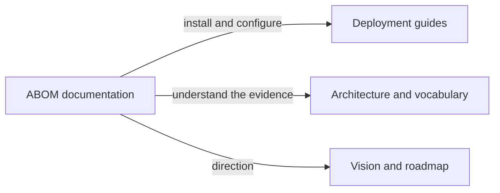

# advanced-security/codeql-abom

Start with [deployment](deployment/index.md) to install and configure ABOM, or
[architecture](architecture.md) to understand its evidence and runtime boundaries.

| When working on | Topics | Read |
| --- | --- | --- |
| Choosing an installation | supported deployment boundary | [Deployment](deployment/index.md) |
| First source installation | tools, query packs, authentication, startup | [Source setup](deployment/source.md) |
| Configuring ABOM | credentials, ownership, paths, optional features | [Configuration](deployment/configuration.md) |
| Running the local service | lifecycle, backups, batch commands, troubleshooting | [Operations](deployment/operations.md) |
| Learning the interface | read-only walkthroughs, QLaaS development and investigations | [Tutorials](tutorials.md) |
| Understanding the system | pipeline, data model, invariants | [Architecture](architecture.md) |
| Understanding labels and claims | shared terminology | [Vocabulary](vocabulary.md) |
| Understanding its purpose | audience and native GitHub capabilities | [Value proposition](abom-value-proposition.md) |
| Understanding direction | goals and future themes | [Vision](vision.md), [roadmap](roadmap.md) |
