# Roadmap

Where ABOM is going, in themes rather than tasks. For the destination and the reasoning that fixes
it, see [the vision](vision.md). The ranked, startable work is in
[`plans/next.md`](../plans/next.md); each theme below names the plan that holds its reasoning.

## Built

The measuring half works end to end. ABOM discovers repositories in a declared account, analyzes
them with CodeQL, follows their Actions dependencies upstream one measured hop at a time, and
serves the resulting transitive graph with findings, reach and coverage attached. It exports a bill
of materials, submits a dependency snapshot to GitHub, and explains what it has not looked at.

```mermaid
flowchart LR
  MEAS["measure<br/>discover · analyze · expand"] --> HOLD["hold<br/>graph · findings · reach"]
  HOLD --> OUT["bill of materials ·<br/>dependency snapshot"]
  HOLD -. "not built" .-> ACT["act<br/>gate · alert · campaign"]
  HOLD -. "not built" .-> ASK["ask<br/>one scope, two renderings"]
  style ACT fill:#3d2d1d
  style ASK fill:#3d2d1d
```

See [how it works](architecture.md) for the current shape.

## An organization that stays current at scale

ABOM can be pointed at a declared organization and left alone: one loop reads the account on a
period, queues what it finds, analyzes and reads again, from an empty database and without a command
being run. Reads are conditional and paced by the budget GitHub reports.

What is not solved is doing that for an organization of twenty thousand repositories. Reading
everything on every period is affordable at small size and not at large, and the three questions an
organization poses have different costs: what is new and what changed can be answered from a sorted
prefix, while **what is gone can only be answered by reading everything**. GraphQL is the efficient
way to ask the first two and to carry whatever else is wanted about a repository, with REST as the
fallback for the organizations that will not permit it. `plans/api/org-enumeration.md`

## One scope, two renderings

A security team asks one question in two shapes: which things match this, and what do they touch.
The interface is four surfaces — a Dashboard that hands over a scope rather than reporting on one,
an Inventory for which things match, an Explorer for what they touch, and Settings for what the
operator claims. An action belongs to the selection rather than to a page, so exporting a bill of
materials, re-analyzing, or opening something in the graph are all the same verb over whatever was
just narrowed to.

What the Inventory shows is a node kind at a time, because a unit only exists once its columns are
its own: a workflow is a consumer rather than a dependency, so a grid that measures how far it
reaches can only answer zero for it. Built; see [`architecture.md`](architecture.md).

The scope that narrows is the predicate language, named and saved, so the same scope means the same
thing on every surface and can be loaded again next month. Built; see
[`architecture.md`](architecture.md).

Relationships are part of it. A `uses:` line is an edge, so *which references float on a tag* and
*what sits on a route to a live advisory* are questions about edges, and an edge has to carry enough
to answer them — stored once and read everywhere rather than derived per request.
`plans/db/edge-facts.md`

## Business units, read from the organization

An organization has no single person who can act on a finding in it. Repository custom properties
already carry the dividing line the organization uses, and the distinct values ABOM discovers become
a scoping dimension across discovery, filters, the Explorer, the bill of materials and policy. It is
what makes the remediation phase addressable to somebody.

## Enablement, so a coverage gap names its cause

ABOM reports honestly that a repository has no CodeQL database and cannot say why. Consuming
[`gh-ghas-audit`](https://github.com/advanced-security/gh-ghas-audit) turns that absence into
configuration, execution, freshness or language coverage — an enablement task somebody can do. The
exchange runs both ways: GitHub's language statistics do not report `actions`, so ABOM supplies the
one gap that audit cannot see. `plans/api/ghas-enablement.md`

## Two shapes of database, answering two different questions

Every database ABOM builds is one repository's own sparse checkout — the shape GitHub's Default
Setup builds too, so a rule firing in one of ours is reporting something a developer could also be
shown by their own code scanning.

A second shape stages an owned repository's whole transitive closure under
`.github/actions/external/${owner}/${repo}/`, which is a convention `codeql/actions-all` already
recognizes. Dataflow then crosses `uses:` boundaries at any depth: taint from an externally
controlled value in a workflow, through three staged dependencies, into the deepest `run:`. Nothing
native reports that, and nothing else could.

The two must never be confused, which is why an analysis records the shape it was built from and a
reader can filter on it. Same rule, same repository, opposite meanings: one predicts an alert
somebody will see, the other names exposure GitHub will never report. The ceiling is that a
closure holds one reference per dependency, which is survivable only because it is rooted at one
owned repository. `plans/ql/closure-database.md`, `plans/db/analysis-mode.md`

## The questions are the organization's own

The set of questions anybody can ask of the graph is fixed: whatever `codeql/actions-queries` ships,
plus one marker ABOM writes. They are not the organization's own questions, and writing those needs
QL, the `actions` library and a fixture — which the person who knows the organization's Actions
patterns usually does not have.

So ABOM drives the authoring loop rather than asking anybody to learn it. An operator supplies an
example that should match and one that should not; the
[CodeQL development MCP server](https://github.com/advanced-security/codeql-development-mcp-server)
scaffolds, extracts, compiles, tests and reviews against fixtures the CLI built. The result is
cataloged beside the upstream and ABOM-authored queries, told apart by the pack it came from rather
than by a prefix, run against whatever scope the operator has already narrowed to, and its results
land on the graph like any other. `plans/ql/query-authoring.md`, `plans/db/query-catalog.md`,
`plans/api/scope-to-databases.md`, `plans/api/on-demand-analysis.md`

## From a finding to a fix

**This is the gap that matters most.** ABOM holds thousands of findings that terminate on its own
screen, and a security team cannot act on a dashboard nobody is assigned to.

Two routes out, in order:

1. **A gate that refuses the pull request** that introduces the exposure, which beats reporting it
   after it merges — ABOM holds the only transitive Actions graph, so it is the only thing that can
   refuse a change on that basis. The policy has a life before it has teeth: drafted, simulated
   against stored state, and adopted only if what it would have blocked is acceptable — which is
   built. `plans/api/verdict-gate.md`, `plans/api/abom-check.md`
2. **A pack the organization publishes and its own Default Setup adopts**, through the
   `github-codeql-config-file` repository property, which merges a configuration file with the one
   Default Setup generates. ABOM produces the configuration; GitHub produces the alerts, where
   developers already look and where a campaign can pick them up. Simulation comes first, because
   publishing changes what every developer sees and the author is not who gets asked about it.
   `plans/api/query-simulation.md`, `plans/ql/pack-promotion.md`

**ABOM's own findings stay in ABOM.** They are what a publication decision is made from, not
something to live with afterwards.

**What a rule can be about is the half that is not built.** A policy is written in the same filter
terms a reader narrows the corpus with, and that language can name a rule id, a provider and a
severity. It cannot yet say *carries a live advisory* or *is reached from something you own*, which
is most of what an Actions supply-chain rule is for — and it silently drops the terms it cannot
enforce, so a rule can bite wider than the view it was written from.
`plans/api/policy-language.md`

Both need a server a pull request can reach, which this project does not yet have.

## Remediation that GitHub can drive

The submitted dependency snapshot already names versions for most commit-pinned dependencies, which
is what lets Dependabot match an advisory at all. Two things are open: whether ABOM should submit
the direct commit-pinned entries it currently withholds, and whether GitHub opens a pull request on
the parent dependency for a transitive Actions alert. The second is an inference from GitHub's
documentation and has to be measured, not asserted. `plans/db/version-resolution.md`,
`plans/api/dependency-submission.md`

## Staying current without being told

The crawl is resumable and budgeted, and it can already detect that a reference has moved. What is
missing is the trigger — reading in response to events rather than on a timer — and the address an
event would arrive at. Until then a periodic sweep is the floor. `plans/api/org-server.md`,
`plans/api/event-driven-reading.md`

Separately, a finding that stops being reported is currently never removed. The sighting record
exists and the sweep is written; it waits on a crawl to make its report believable.
`plans/db/finding-lifecycle.md`

## Decisions not to look, and not to act yet

Every organization carries things it has decided not to analyze and things it has decided not to act
on yet. Both are legitimate, neither may be silent, and they are different decisions: an exclusion
stops the work, an exception lets the work run and record while the result is set aside. Each is a
governed record with a reason nobody may omit and, for an exception, a date it comes back.

The shape exists and reaches only a policy verdict today. What is owed is a scope beyond one rule,
an exclusion that actually stops work, an exception that hides a result while the evidence survives
it, and a screen that refuses to write either without a reason.
`plans/db/exclusions-and-exceptions.md`

## Scale

The interface is legible at the sizes an operator actually arrives at, and the endpoints behind it
answer in well under a second at the sizes measured so far. The known ceilings are the browser's
node count, the fact that reach is recomputed wholesale, and that boundaries and relationships
cannot yet be drawn at once — the layout does not separate accounts well enough, so the reader
chooses between them and the canvas says which it is showing. None is urgent; all are measured
rather than guessed, and all have to be re-measured against a real organization rather than carried
forward as remembered numbers. `plans/db/data-efficiency.md`

## Deliberately not on the roadmap

- **Enterprise scope, or federation across organizations.** The boundary is what makes the
  efficiency target mean anything, and a tool spanning organizations inherits no permission model it
  can rely on.
- **Uploading SARIF to code scanning.** Refused rather than deferred. An alert ABOM wrote would sit
  in somebody else's Security tab, and an upload replaces rather than adds — a wrong category
  deletes alerts that cannot be recovered. Publishing a pack achieves the same outcome through the
  organization's own consent mechanism, and writing nothing is a stronger guarantee than writing
  carefully.
- **Re-implementing what `gh-ghas-audit` measures.** Enablement has an owner; ABOM consumes the
  answer and contributes the one gap that tool cannot see.
- **Evaluating an `if:` condition.** Conditions are reported verbatim. Deciding whether one holds is
  not something static analysis settles.
- **Deriving vulnerability from an advisory.** Advisories enrich; a verdict comes only from a rule.
- **A `pin_status` column, or any stored judgement about how a reference is pinned.** The reference
  is recorded as written; a judgement about it belongs to whoever asks.
- **Anything that writes to another account's repositories without a person asking.**
