# Roadmap

Where ABOM is going, in themes rather than tasks. For the destination and the reasoning that fixes
it, see [the vision](vision.md). The ranked, startable work is in
[`plans/next.md`](../plans/next.md); each theme below names the plan that holds its reasoning.

## Built

The measuring half works end to end. ABOM discovers repositories in a declared account, analyzes
them with CodeQL, follows their Actions dependencies upstream one measured hop at a time, and
serves the resulting transitive graph with findings, reach and coverage attached. It exports a bill
of materials, submits a dependency snapshot to GitHub, and explains what it has not looked at. One
scope answers as a list or as a graph, an operator can write queries of their own and take a
version through a lifecycle, and a run can be asked for over whatever a scope resolves to.

```mermaid
flowchart LR
  MEAS["measure<br/>discover · analyze · expand"] --> HOLD["hold<br/>graph · findings · reach"]
  HOLD --> ASK["ask<br/>one scope, two renderings<br/>your queries, on demand"]
  HOLD --> OUT["bill of materials ·<br/>dependency snapshot"]
  HOLD -. "not built" .-> ACT["act<br/>gate · alert · campaign"]
  style ACT fill:#3d2d1d
```

See [how it works](architecture.md) for the current shape.

## Native locking is the resolution baseline

GitHub's native workflow lockfiles are the gold standard for ABOM's effective-dependency
resolution, not an optional lookup optimization. The declared ref preserves intent; the governing
workflow lock selects the immutable commit; verified version evidence supports advisory context.
Each belongs to the analyzed revision, and a current live tag cannot overwrite that selection.
**This is built**: ABOM analyzes the commit a lock selects, every reader that says what runs
follows it beside the declared ref, GitHub's own verification runs when asked, and a lock
requirement is a policy over the lock rules. See [how it works](architecture.md#locks).

GitHub's [native tooling](../plans/tools/actions-lock.md) keeps generation, verification and
updates; what is left there is observing the runner enforce a nested pin on an approved target.
Missing native coverage stays explicit, and parsed coverage, network verification and observed
runner enforcement stay distinct facts. Closure staging comes next, staging the selected commits.

## An enterprise that stays current at scale

ABOM can be pointed at a declared organization and left alone: one loop reads the account on a
period, queues what it finds, analyzes and reads again, from an empty database and without a command
being run. Reads are conditional and paced by the budget GitHub reports.

What is not solved is doing that for an enterprise — many organizations in one instance, up to one
hundred thousand repositories in one of them. Reading
everything on every period is affordable at small size and not at large, and the three questions an
organization poses have different costs: what is new and what changed can be answered from a sorted
prefix, while **what is gone can only be answered by reading everything**. GraphQL is the efficient
way to ask the first two and to carry whatever else is wanted about a repository, with REST as the
fallback for the organizations that will not permit it. A repository a full listing no longer names
is named as missing and stops being the operator's; removing what only it reached is the prune's,
which says what it takes first. `docs/architecture.md`

Staying current is also about not paying twice for what did not move, and that has the same shape
one level down. A commit is fetched once however many references name it, and a query is evaluated
once against a given database — both because the thing is identified by its content rather than by
the name something reached it through. The unfinished half is the opposite direction: when ABOM
changes what it fetches, what it runs or how it reads the results, it must put back exactly the work
that change touched and nothing else. A crawl that cannot name what it invalidated has only one
safe move left, which is to do all of it again. `plans/db/analysis-ledger.md`,
`plans/db/checkout-cache.md`

## One scope, two renderings

A security team asks one question in two shapes: which things match this, and what do they touch.
The interface is four surfaces — a Dashboard that hands over a scope rather than reporting on one,
an Inventory for which things match, an Explorer for what they touch, and Settings for what the
operator claims. An action belongs to the selection rather than to a page, so exporting a bill of
materials, re-analyzing, or opening something in the graph are all the same verb over whatever was
just narrowed to.

What the Inventory shows is a node kind at a time, because a unit only exists once its columns are
its own: a workflow is a consumer rather than a dependency, so a grid that measures how far it
reaches can only answer zero for it. Built; see [`architecture.md`](architecture.md).

The scope that narrows is the predicate language, named and saved, so the same scope means the same
thing on every surface and can be loaded again next month. Built; see
[`architecture.md`](architecture.md).

Relationships are part of it, and are built. A `uses:` line is an edge, so *which references float
on a tag* and *what sits on a route to a live advisory* are questions about edges, and an edge
carries enough to answer them — stored once and read everywhere rather than derived per request.
They are a unit of Inventory in their own right, and the containment the canvas draws is stored
rather than synthesized.

## Business units, read from the organization

An organization has no single person who can act on a finding in it. Repository custom properties
already carry the dividing line the organization uses, and the distinct values ABOM discovers become
a scoping dimension across discovery, filters, the Explorer, the bill of materials and policy. It is
what makes the remediation phase addressable to somebody.

## Enablement, so a coverage gap names its cause

ABOM reports honestly that a repository has no CodeQL database and cannot say why. Consuming
[`gh-ghas-audit`](https://github.com/advanced-security/gh-ghas-audit) turns that absence into
configuration, execution, freshness or language coverage — an enablement task somebody can do. The
exchange runs both ways: GitHub's language statistics do not report `actions`, so ABOM supplies the
one gap that audit cannot see. `plans/api/ghas-enablement.md`

## Two shapes of database, answering two different questions

Every database ABOM builds is one repository's own sparse checkout — the shape GitHub's Default
Setup builds too, so a rule firing in one of ours is reporting something a developer could also be
shown by their own code scanning.

A second shape stages the composite actions and reusable workflows an owned repository's closure
reaches under `.github/actions/external/` and `.github/workflows/external/`, a convention
`codeql/actions-all` already recognizes; nothing else is a callable, so nothing else is staged. Dataflow then crosses `uses:` boundaries at any depth: taint from an externally
controlled value in a workflow, through three staged dependencies, into the deepest `run:`. Nothing
in ordinary Default Setup stages that dependency closure; the extended analysis addresses that
different input shape rather than competing with native lock generation.

The two must never be confused. Each analysis already records its shape and exposes that
distinction to readers. The same rule can describe a repository's own source or
a staged dependency path that ordinary Default Setup did not analyze. The staging namespace holds
one selected commit per staged callee; count distinct selected commits of those, not ref names and
not every action.
The second shape is built: `codeql-abom closure` stages what each owned repository's lock-aware
closure reaches and records what it finds as [extended evidence](architecture.md#analysis-modes)
that moves no existing total. On the crawled organization it adds about 86% to what the crawl
spends analyzing the same repositories, and found nothing the regular analysis had not, which is
an answer about this organization rather than about the shape.

## The questions are the organization's own

An organization's questions are its own — which runner labels are permitted, which internal action
must never sit beneath a privileged job. Writing those needs QL, the `actions` library and a
fixture, which the person who knows the Actions patterns usually does not have.

So ABOM drives the authoring loop rather than asking anybody to learn it. The place to put a query
exists: an operator's directory is a CodeQL pack, its queries are cataloged beside the upstream and
ABOM-authored ones and told apart by the pack they came from rather than by a prefix, they run
against whatever scope the operator has narrowed to, and their results land on the graph like any
other, each traced to the version and source of the rule that reported it. A version leaves `dev`
only when its tests pass.

The half that removes QL from the requirement is built. An operator supplies an example that should
match and one that should not, or picks results from a run and lets an agent draft them. An agent
session, driven through the
[CodeQL development MCP server](https://github.com/advanced-security/codeql-development-mcp-server)
and confined by ABOM, writes the fixtures and the query. The operator accepts what it reported, and
ABOM then tests it itself. A test fails first on the lines its fixture marks before the query is
written, one `actions-all` answers for authoring and execution, and every mark names the CodeQL it
was recorded under. A run holds what a query still being refined reports rather than writing it
as findings, and whoever reviews it turns all of it, or the results they chose, into findings once
the query has earned it; a version a pack published or a suite promoted stores findings unless
somebody says otherwise. A finished run is compared with the code scanning alerts developers
already see, and says what adopting it would add, where, and how stale each commit is; that
comparison is what earns `review`. What remains is checking a comparison against what appears once
a pack is live, which waits with publishing. Running several CodeQL releases side by side, so an
upgrade can be compared before it is taken, is later — and the first comparison on real alerts
showed why: the same commit under a year-older CodeQL disagreed by seven results.
`docs/architecture.md`, `plans/api/query-simulation.md`

## From a finding to a fix

**This is the gap that matters most.** ABOM holds thousands of findings that terminate on its own
screen, and a security team cannot act on a dashboard nobody is assigned to.

Two routes out, in order:

1. **A gate that refuses the pull request** that introduces the exposure, which beats reporting it
   after it merges. ABOM can apply operator policy to the organization's recorded transitive
   dependency evidence. Drafting, simulating and adopting that policy against stored state are
   built; the base/head gate and its workflow client are not.
   [Verdict gate](../plans/api/verdict-gate.md), [abom-check](../plans/api/abom-check.md).
2. **A pack the organization publishes and its own Default Setup adopts**, through the
   `github-codeql-config-file` repository property, which merges a configuration file with the one
   Default Setup generates. ABOM produces the configuration; GitHub produces the alerts, where
   developers already look and where a campaign can pick them up. Simulation comes first, because
   publishing changes what every developer sees and the author is not who gets asked about it.
   `plans/api/query-simulation.md`, `plans/ql/pack-promotion.md`

**ABOM's own findings stay in ABOM.** They are what a publication decision is made from, not
something to live with afterwards.

**What a rule can be about is built.** A policy is written in the same filter terms a reader narrows
the corpus with, and that language can name a rule, a provider, a level and a security-severity
band; a live advisory at the severity GitHub published; whether an owned repository reaches either
directly or through an intermediary; and other policies, to refuse what any of them refuses. Every
term it can say is applied or refused by name, so a rule never bites wider than the view it was
written from. What is left is the gate that acts on one. `plans/api/verdict-gate.md`

Both need a server a pull request can reach, which this project does not yet have.

## Remediation that GitHub can drive

ABOM already has guarded synthetic-path submission with measured version evidence. Its expansion,
including direct-pin supplements and workflow write grants, is deferred while the
[native comparison](../plans/api/dependency-graph-crosscheck.md) measures runner enforcement,
Dependabot lock updates, DG/SBOM inventory, review, alerts and update PRs independently. Native update
support is visible in source; automatic transitive DG reporting remains a separate capability to
establish, not a release promise.

Retain the existing [submission guards and ledger](../plans/api/dependency-submission.md).
If native coverage replaces a use case, retiring it requires a deliberate release of historical
snapshots, not simply deleting code. Further [version lookup](../plans/db/version-resolution.md)
enriches evidence without changing a locked execution choice or authorizing a new publisher.

## Workflow integration and dependency provenance

The planned [abom-check](../plans/api/abom-check.md) release is verdict-only. It asks the server
about exact base/head commits and their governing lock contexts, performs no analysis or native
fixing, and receives no GitHub contents-write credential. Submission modes remain deferred;
native lock adoption does not add an implicit workflow publisher.

Jesse Houwing's
[actions-dependency-submission](https://github.com/jessehouwing/actions-dependency-submission),
introduced through [issue #18](https://github.com/advanced-security/codeql-abom/issues/18), informs
this integration and three separate planned efforts: [fork and mirror provenance](../plans/db/fork-provenance.md),
[host-aware GitHub access](../plans/api/github-hosts.md), and
[container declaration inventory](../plans/db/container-inventory.md). Upstream identity stays
attributed evidence, credentials stay at their authorized host, and container declarations do not
assert image contents or vulnerability. These plans extend ABOM's existing measurements and give
credit to the reference action's ideas without claiming the additions are already built. GitHub's
[native tool](https://github.com/github/gh-actions-lock) and
[shared parser](https://github.com/github/actions-lockfile) own pinning and format semantics.
Numeric lock IDs do not establish fork ancestry, hostname metadata does not prove GHES support,
and an action's locked repository commit does not inventory its container images.

## Staying current without being told

The crawl is resumable and budgeted, and it can already detect that a reference has moved. What is
missing is being told: an enterprise App's events for every repository the enterprise owns, and
polling for the dependencies it does not, each process drawing on a budget the operator sets and
can watch being spent, with the freshness that budget buys stated beside it. GitHub's limits are
shared with everything else the enterprise runs, so ABOM never assumes they are its own. Until the
events arrive a periodic sweep is the floor. `plans/api/change-ingestion.md`,
`plans/api/enterprise-server.md`

The graph those changes land in is being made commit-aware: each commit's declarations are its own,
every walk stands at the commits a reference actually resolves to, and reach is counted per version.
`plans/db/commit-aware-graph.md`

## Knowing the graph is right

Whether ABOM's graph is right has been learned late, by somebody noticing. A checker running beside
it compares each claim with an independent reading at the same commit — the files themselves,
GitHub's dependency graph, where a reference points now, and what a workflow's run actually
downloaded — and recomputes every derivation from scratch to compare with what is maintained. It
reports fidelity per build and queues every disagreement with what it takes to reproduce it; it
never corrects either reading. `plans/tools/graph-consistency-checker.md`

Separately, a finding that stops being reported is currently never removed. The sighting record
exists and the sweep is written; it waits on a crawl to make its report believable.
`plans/db/finding-lifecycle.md`

## Decisions not to look, and not to act yet

Every organization carries things it has decided not to analyze and things it has decided not to act
on yet. Both are legitimate, neither may be silent, and they are different decisions: an exclusion
stops the work, an exception lets the work run and record while the result is set aside. Each is a
governed record with a reason nobody may omit and, for an exception, a date it comes back.

The shape exists and reaches only a policy verdict today. What is owed is a scope beyond one rule,
an exclusion that actually stops work, an exception that hides a result while the evidence survives
it, and a screen that refuses to write either without a reason.
`plans/db/exclusions-and-exceptions.md`

## Scale

The interface is legible at the sizes an operator actually arrives at, and the endpoints behind it
answer in well under a second at the sizes measured so far. The known ceilings are the browser's
node count, the fact that reach is recomputed wholesale, and that boundaries and relationships
cannot yet be drawn at once — the layout does not separate accounts well enough, so the reader
chooses between them and the canvas says which it is showing. None is urgent; all are measured
rather than guessed, and all have to be re-measured against a real organization rather than carried
forward as remembered numbers. `plans/db/data-efficiency.md`

An enterprise adds two ceilings that are architectural rather than measured: every derivation is
recomputed over the whole graph, and one embedded database owned by one process is the only writer
and the only reader. Derivations become incremental, with the wholesale recompute kept as the
oracle that checks them, and the enterprise deployment runs PostgreSQL behind the same store
interface, so coordinators can be replicated and readers scaled out while the single binary keeps
SQLite. Efficiency at that scale is measured on real organizations as they become available, never
extrapolated from this one. `plans/db/commit-aware-graph.md`, `plans/db/store-backends.md`

## Deliberately not on the roadmap

- **Uploading SARIF to code scanning.** Refused rather than deferred. An alert ABOM wrote would sit
  in somebody else's Security tab, and an upload replaces rather than adds — a wrong category
  deletes alerts that cannot be recovered. Publishing a pack achieves the same outcome through the
  organization's own consent mechanism, and writing nothing is a stronger guarantee than writing
  carefully.
- **Re-implementing what `gh-ghas-audit` measures.** Enablement has an owner; ABOM consumes the
  answer and contributes the one gap that tool cannot see.
- **A competing Actions lock generator, verifier or updater.** Consume GitHub's supported tooling
  and versioned evidence. Publication expansion waits for a measured native gap, not a prediction
  that GitHub will or will not build one.
- **Evaluating an `if:` condition.** Conditions are reported verbatim. Deciding whether one holds is
  not something static analysis settles.
- **Deriving vulnerability from an advisory.** Advisories enrich; a verdict comes only from a rule.
- **A `pin_status` column, or any stored judgement about how a reference is pinned.** The reference
  is recorded as written; a judgement about it belongs to whoever asks.
- **Anything that writes to another account's repositories without a person asking.**
