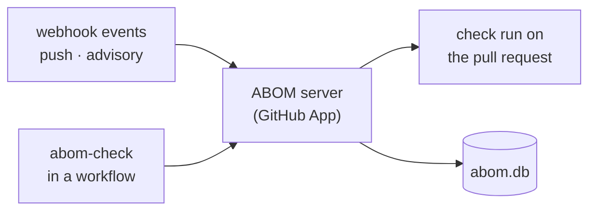

# Where ABOM is going

The destination, and the reasoning that fixes it. For what the system does today, see
[how it works](architecture.md). For the native capabilities ABOM builds on and the questions it
adds, see [why ABOM exists](abom-value-proposition.md). For the themes between
here and there, see [the roadmap](roadmap.md). For the words, see
[the vocabulary](vocabulary.md).

## Who this is for

A central security team responsible for GitHub Actions across a single GitHub organization. They
already run GitHub Advanced Security, and their problem is not a shortage of detection. It is that
detection arrives one repository at a time, and nothing assembles it into something an organization
can act on.

ABOM is the glue between detection and response for GitHub Actions in that organization. It holds
source-linked transitive dependency evidence, findings that cannot travel the public advisory
route, the enablement state that explains a gap, and the operator policy that makes those results
actionable. GitHub's native locks are the target basis for effective dependency identity; ABOM
consumes that foundation rather than claiming to be the only producer of a transitive graph.

Native lock consumption is planned, not built. Requested ref, governing lock and analyzed commit
must remain explainable together. GitHub owns pinning and update tooling; ABOM adds CodeQL evidence,
ownership, reach and policy across the organization. A native product filling an inventory or
publication gap is a reason to integrate and retire redundant work after verification.

## One organization is the unit

Two reasons, and only the first is about permission.

**The organization is where ownership already means something GitHub enforces.** Membership,
repository access and custom properties are all administered there. A tool scoped to it inherits a
boundary somebody already drew, rather than inventing one and asking to be trusted with it.

**A ceiling you can name is a ceiling you can optimize against.** Near-real-time is a claim about a
bounded set. The whole point of the discovery work ahead — conditional requests, a rate-limit budget
read rather than discovered by being throttled, reading on events instead of on a timer — is to keep
one organization's Actions graph current at a cost that does not grow with somebody else's estate.
That target is meaningless without a stated boundary.

**This is the supported configuration, not a refusal.** `abom_owned_scope` accepts several declared
accounts and will keep doing so; a team whose responsibility spans two organizations is not locked
out. One organization is what gets measured, tuned and stated in every figure.

## A security team's questions are not a repository's questions

GHAS answers per repository: is this one configured, what did the scan find, which alerts are open.
Those are the right questions for the developer who can fix them, and the wrong shape entirely for
the team accountable across ten thousand of them.

The estate-level questions are ABOM's focus: which business unit carries reachable exposure, what
changes if an action is bumped, and who can act on it. Native inventory and reporting capabilities
will evolve. Compare their coverage at known revisions rather than assuming a permanent product
gap; ABOM's contribution is relating that evidence to source-level findings, ownership and policy.

## Enablement and exposure are different questions

ABOM measures **exposure** — what the Actions graph is, what reaches what, and what a rule flagged
along the way. It does not measure **enablement**: whether scanning is switched on, configured for
the languages present, running, and running recently.

Today that shows up inside ABOM as an absence with no explanation. `abom_database_catalog` records
which repositories have a CodeQL database. A repository with none may have scanning disabled, a
failing workflow, a language nobody selected, or no supported code at all. ABOM reports the absence
honestly and cannot say which it is — the absent-measurement invariant working exactly as intended,
and still leaving the operator without a next step.

[`gh-ghas-audit`](https://github.com/advanced-security/gh-ghas-audit) measures that, across four
independent dimensions: configuration, execution, freshness and language coverage. ABOM consumes its
report so that **a coverage gap names its cause, and becomes an enablement task somebody can do.**

The exchange runs both ways. GitHub's repository language statistics do not report `actions`, so an
audit built on them cannot tell an operator that a repository is missing Actions analysis. ABOM
knows which repositories hold `.github/workflows/**`. That is the one language gap the audit is
structurally blind to, and ABOM is what closes it.

**An enablement status is an attributed external statement, exactly like a GHSA.** It enriches
ABOM's coverage story and never becomes an ABOM verdict. ABOM does not re-implement what the audit
already measures, and does not silently adopt its conclusions as its own.

## A business unit is discovered, never configured by hand

An organization of ten thousand repositories has no single person who can act on a finding in it.
Remediation is only actionable at a smaller scope: a security campaign has a named contact, a
vulnerability report has an audience, and an organization has neither.

That dividing line already exists in GitHub, as repository custom properties. An operator names the
key or keys that carry it — `business_unit`, `app_name`, whatever the organization already
administers — and the distinct values ABOM discovers become a first-class scoping dimension.

| Surface | What business-unit scope does there |
| --- | --- |
| Dashboard | Offers each unit as a way into the Inventory, already scoped to it |
| Discovery | States coverage and queue progress per unit, not only per organization |
| Inventory | Which things in the unit match, with the actions that operate on them |
| Explorer | Group and filter the closure by unit, beside owner, repository and workflow |
| Bill of Materials | A document bounded to one unit, which is the scope somebody will actually read |
| Policy | A rule that binds to one unit, so enforcement can start where it is wanted |

**A business unit is read, never guessed.** It comes from the property GitHub holds, never inferred
from a repository-name prefix or a team's spelling of itself. A repository carrying no value for the
configured key is its own state and is reported as such, never folded into a default bucket — the
same rule coverage already follows, for the same reason.

## One scope, two renderings

A security team asks one question in two shapes: *which things match this*, and *what do they
touch*. A table answers the first and a graph answers the second, and they are only worth having
together if they are two renderings of one scope and one selection.

So the interface is four surfaces and no more: a **Dashboard** that is a way in rather than a report,
an **Inventory** for which things match, an **Explorer** for what they touch, and **Settings** for
what the operator claims.

**The Dashboard states nothing it is not the best place to state.** Its job is to hand a reader a
scope: controls that name a count and open the Inventory already narrowed to what produced it. How
complete the picture is belongs to Discovery, which answers it per depth, per queue state and per
business unit; a shorter second answer on the landing page was read as the whole one.

An action belongs to the selection rather than to a page. *Export a bill of materials for these*,
*re-analyze these*, *show me these in the graph* — each is the same verb over whatever the operator
has just narrowed to, which is why none of them is a destination of its own. A page per action has
to invent its own scope, and an operator who narrowed somewhere else cannot carry that narrowing to
it.

The scope is the predicate language, so **a saved scope, a bill of materials, a report and a gate
policy are one object with different consequences** — and a relationship is as filterable as a node,
because *which references float on a tag* and *what crosses into another account* are questions
about edges that a reader has to be able to ask as edges.

## The questions are the organization's own

ABOM relates the organization's dependency graph to source-level query results, and the set of
questions anybody can ask of it is currently fixed: whatever `codeql/actions-queries` ships, plus one marker ABOM
writes. Those are good general questions, and they are not *this organization's* questions — which
runner labels are permitted, which internal action must never appear beneath a privileged job, which
of last quarter's incident patterns still exists anywhere.

CodeQL can express all of those. What stops a security team writing them is that doing so needs QL,
the `actions` library, and a fixture — and the person who knows the organization's Actions patterns
is usually not that person. So ABOM drives the authoring loop instead of asking somebody to learn
it: an operator supplies an example that should match and one that should not, and the
[CodeQL development MCP server](https://github.com/advanced-security/codeql-development-mcp-server)
scaffolds, extracts, compiles, tests and reviews against fixtures the CLI built. **The negative
example is the part that matters**, because it is how somebody who does not read QL can tell a
query is not too broad.

A query authored that way is a first-class thing rather than a side channel. It is cataloged beside
the upstream and ABOM-authored ones, distinguishable from them by where it came from rather than by
a prefix on its rule id; it runs against whatever scope the operator has already narrowed to, which
is the same predicate language every surface uses; and its results land on the graph, so a custom
pattern gets the same reach and blast-radius arithmetic as anything else.

**This does not lower the bar on what a finding means.** A query somebody wrote on Tuesday carries a
rule id like any other, and the verdict is still the rule's. What changes is who gets to write the
rule.

## The path from a finding to a fix

Detection is not the goal. On GitHub, every mechanism that makes remediation scale across an
organization takes the same object as input: a **code scanning alert**. Security campaigns group and
assign them, Agentic Autofix triggers on them, and an alert in a campaign can be handed to a
developer or to the Copilot coding agent, which opens the pull request.

So a finding has to reach an alert to matter — and **ABOM does not write one, ever.** An alert
appears in somebody else's repository, in the Security tab their developers read and in the numbers
their leadership is measured on. A tool that can create those is a tool that eventually creates them
by accident.

The route out is the organization's own configuration instead. A CodeQL configuration file applied
through the `github-codeql-config-file` repository property is merged with the configuration Default
Setup generates, so an organization can add a query pack without switching to advanced setup and
without anybody editing a workflow. **ABOM produces the configuration; GitHub produces the alerts.**

```mermaid
flowchart LR
  subgraph built["Existing guarded dependency route"]
    CLOSE["transitive closure,<br/>version resolved where measured"] --> SUB["dependency submission"]
    SUB --> DG["GitHub dependency graph"]
    DG -. "supported version matching" .-> DA["Dependabot alert"]
  end
  subgraph gap["Not built: the findings route"]
    FIND["CodeQL findings,<br/>authored, upstream and ABOM's"] --> SIM["simulate across<br/>the organization"]
    SIM -. "not built" .-> PUB["publish the pack"]
    PUB --> CFG["Default Setup adopts it"]
    CFG --> CS["code scanning alert"]
    CS --> CAMP["security campaign"]
    CAMP --> PR["Autofix, or assign to a<br/>developer or Copilot"]
  end
  style PUB fill:#3d2d1d
  style CFG fill:#3d2d1d
  style CS fill:#3d2d1d
  style CAMP fill:#3d2d1d
  style PR fill:#3d2d1d
```

The existing dependency route is not a commitment to expand it. Native lock-backed inventory and
remediation are [measured separately](../plans/api/dependency-graph-crosscheck.md); new workflow
submission modes are deferred, and any retirement must account for snapshots already sent.

Simulation comes first, and it is the step that makes the rest defensible. Publishing a pack changes
what every developer in the organization sees, and the person who wrote the query is not the person
who will be asked about the four hundred alerts it raised. So ABOM answers the question first —
*which repositories would raise how many alerts, and how many of those are already there* — from the
databases it already holds. **No alert exists that a person did not choose**, satisfied by
construction rather than by a gate: the choice is the publication, and removing the pack from the
configuration file stops the alerts at the next scan.

That answer has a stated boundary. ABOM analyzes a pinned commit; Default Setup scans a default
branch. Where those agree the answer is a measurement, and where they do not it is an
extrapolation, and it says which it is.

**ABOM's own findings stay in ABOM, permanently and by design.** They are what publication decisions
are made from, not something to live with afterwards.

The gate below is the second route, and the faster one: refusing the pull request that introduces
the exposure beats reporting it after it merges.

## The security team owns the rule, and can try it before it bites

Blocking is adjudication, and ABOM does not adjudicate. The resolution is that **the verdict is the
operator's, computed by us**: ABOM reports which side of an advisory's version range an observed
reference falls on, with depth, reach and findings beside it, and a declared policy says what each
side means. A refused pull request is explainable as *your policy said block on X, and here is X* —
never as *ABOM thinks this is bad*.

A rule nobody can try is a rule nobody turns on. So a policy has a life before it has teeth: an
operator drafts it, **simulates it against stored state** to see what it would have blocked, and
adopts it only if that answer is acceptable. The graph is already there; the simulation costs no
crawl and no ingress.

A rule is written in the same terms a reader narrows the corpus with, because *what should block a
pull request* and *what am I looking at* are one question asked twice. **A saved view and a gate
policy are the same object with different consequences**, which is what keeps a refusal explainable
in terms somebody has already seen on a screen.

What those terms must be able to say is decided by what this project is for, and it is three things
rather than everything:

- **An advisory**, reported with its range and the observed references beside it — never adjudicated.
- **A finding**, by the rule id that produced it, which is the only source of a security verdict.
- **Reachability from something owned**, direct where a repository can fix it itself and transitive
  where it waits on an intermediary somebody else owns.

The third is the reason any of this exists. GitHub's dependency graph stops at the first hop, so a
rule about the second hop is a rule only ABOM can evaluate — and severity then reach is already
the order remediation follows, so a policy written in those two axes is not a new model,
it is the existing one given teeth. **A rule is never about a specific reference, and never about
something the operator does not own.** Pinning is `actions/unpinned-tag`'s call, and a repository
outside the declared scope is somebody else's to fix.

Enforcement has to start somewhere narrower than everything, which is what business-unit scope is
for, and it has to survive contact with the exceptions every real organization carries.

| | Means | Effect | Required shape |
| --- | --- | --- | --- |
| **Exclusion** | Do not do this work | Nothing is analyzed, nothing is recorded | Enumerated |
| **Exception** | Do the work, do not act on the result | The work runs and records; the result is waived, or hidden | Enumerated, and expires |

**These govern the estate, not only a rule.** An operator excluding a repository from analysis is
not writing a policy, and a team hiding a result it has decided not to act on yet is not either.
Both are the same governed record: a reason nobody may omit, an author, and — for an exception — a
review date, because a hidden result with no expiry is a permanent hole nobody decided to dig.

**Hiding is never destruction.** An exception filters a read; the analysis still runs and still
records, so the decision stays reviewable and the evidence survives it.

**Both are listable in full at any moment, and neither is ever an open-ended pattern.** A pattern
cannot be audited, and it silently adopts a repository created after it was written — a waiver
nobody granted. That is the same failure [`plans/db/owned-scope.md`](../plans/db/owned-scope.md)
already refused for discovery scope, and it is refused here for the same reason.

## A client in the workflow, a server in the organization

The shape the vision points at is a GitHub App resident in the organization, kept current by events,
and a thin action — `abom-check` — that asks it for a verdict from inside a pull request.

The client analyzes nothing. It asks the API for a verdict at a commit and renders it, which makes
it a third consumer of the same endpoints the interface and the CLI already use.

**Both halves stay local until they are mature.** Doing this properly means `abom-check` lives in
its own released repository, and adopting that split early would turn every change into a
three-repository round trip — edit the action, publish it, update the workflow that calls it, run
the whole thing to see whether the change was right. Until the server and client have earned a
release, they run on one workstation against one declared organization, and the plans say so rather
than describing a deployment that does not exist.

## What stays true

These carry forward unchanged from [the architecture](architecture.md), and the new surfaces do not
get an exemption from them.

- **A security verdict comes only from a CodeQL rule id.** A rule that did not flag a reference is
  reported as a rule that did not look. This holds for a rule the operator wrote as much as for one
  GitHub ships.
- **Advisories enrich; they never adjudicate.** So does an enablement status, for the same reason
  and under the same rule.
- **An absent measurement is not a measurement of zero.**
- **A person chooses every alert.** Nothing writes to another repository's security surface on a
  timer or by inference — and now nothing writes to it at all.
- **Say what was excluded.** A scoped view states what it left out.

Four the vision adds:

- **A business unit is read, never guessed.**
- **A policy nobody simulated is not adopted.**
- **An exclusion is enumerated; an exception is enumerated and expires.**
- **Hiding a result is a decision somebody signs**, with a reason and a date it comes back.

## Deliberately not the vision

- **Enterprise scope, or federation across organizations.** The boundary is what makes the
  efficiency target meaningful, and a tool that spans organizations inherits no permission model it
  can rely on.
- **Re-implementing what `gh-ghas-audit` measures.** Enablement is a solved problem with an owner.
  ABOM consumes the answer and contributes the one gap that tool cannot see.
- **Evaluating an `if:` condition.** Conditions are reported verbatim. Whether one holds at a given
  moment is not something static analysis settles.
- **Deriving vulnerability from an advisory.**
- **A hosted service.** Self-hosted, in the organization it measures.
- **Uploading SARIF to code scanning.** Refused rather than deferred. The route to an alert is the
  organization publishing a pack its own Default Setup adopts, which is reversible by the people it
  affects and needs no write from ABOM at all.
- **A second code scanning interface.** ABOM is where a detection is authored, measured and decided
  on. Once published, it is lived with in the place developers already look.
