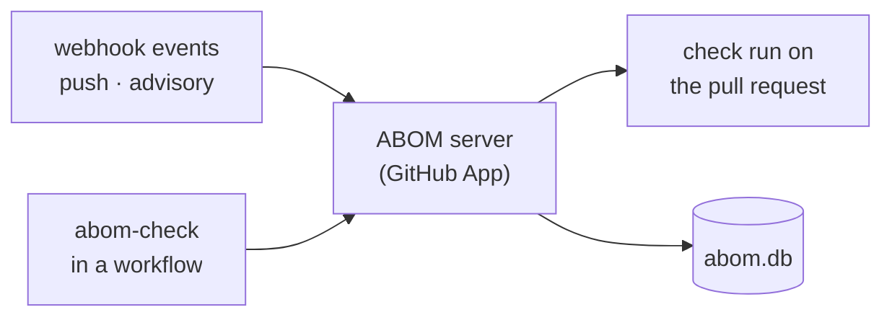

# Where ABOM is going

The destination, and the reasoning that fixes it. For what the system does today, see
[how it works](architecture.md). For the documented gaps in GitHub's native experience that justify
a separate tool at all, see [why ABOM exists](abom-value-proposition.md). For the themes between
here and there, see [the roadmap](roadmap.md). For the words, see
[the vocabulary](vocabulary.md).

## Who this is for

A central security team responsible for GitHub Actions across a single GitHub organization. They
already run GitHub Advanced Security, and their problem is not a shortage of detection. It is that
detection arrives one repository at a time, and nothing assembles it into something an organization
can act on.

ABOM is the glue between detection and response for GitHub Actions in that organization. It holds
the transitive dependency graph nothing else holds, the findings that cannot travel the advisory
route, the enablement state that explains a gap, and the policy that turns any of those into a
pull request somebody has to answer for.

## One organization is the unit

Two reasons, and only the first is about permission.

**The organization is where ownership already means something GitHub enforces.** Membership,
repository access and custom properties are all administered there. A tool scoped to it inherits a
boundary somebody already drew, rather than inventing one and asking to be trusted with it.

**A ceiling you can name is a ceiling you can optimize against.** Near-real-time is a claim about a
bounded set. The whole point of the discovery work ahead — conditional requests, a rate-limit budget
read rather than discovered by being throttled, reading on events instead of on a timer — is to keep
one organization's Actions graph current at a cost that does not grow with somebody else's estate.
That target is meaningless without a stated boundary.

**This is the supported configuration, not a refusal.** `abom_owned_scope` accepts several declared
accounts and will keep doing so; a team whose responsibility spans two organizations is not locked
out. One organization is what gets measured, tuned and stated in every figure.

## A security team's questions are not a repository's questions

GHAS answers per repository: is this one configured, what did the scan find, which alerts are open.
Those are the right questions for the developer who can fix them, and the wrong shape entirely for
the team accountable across ten thousand of them.

The estate-level questions have no native home. Which business unit carries the most reachable
exposure. What breaks if this action is bumped. Who has to be told, and in what order. GitHub is
explicit about one piece of this: dependencies contributed through the submission API "are shown in
dependency review, but are *not* available in your organization's dependency insights". The very
closure ABOM contributes is visible per repository and absent from the organization-wide view.
Producing that view stays ABOM's job, and nothing native is going to take it over.

## Enablement and exposure are different questions

ABOM measures **exposure** — what the Actions graph is, what reaches what, and what a rule flagged
along the way. It does not measure **enablement**: whether scanning is switched on, configured for
the languages present, running, and running recently.

Today that shows up inside ABOM as an absence with no explanation. `abom_database_catalog` records
which repositories have a CodeQL database. A repository with none may have scanning disabled, a
failing workflow, a language nobody selected, or no supported code at all. ABOM reports the absence
honestly and cannot say which it is — the absent-measurement invariant working exactly as intended,
and still leaving the operator without a next step.

[`gh-ghas-audit`](https://github.com/advanced-security/gh-ghas-audit) measures that, across four
independent dimensions: configuration, execution, freshness and language coverage. ABOM consumes its
report so that **a coverage gap names its cause, and becomes an enablement task somebody can do.**

The exchange runs both ways. GitHub's repository language statistics do not report `actions`, so an
audit built on them cannot tell an operator that a repository is missing Actions analysis. ABOM
knows which repositories hold `.github/workflows/**`. That is the one language gap the audit is
structurally blind to, and ABOM is what closes it.

**An enablement status is an attributed external statement, exactly like a GHSA.** It enriches
ABOM's coverage story and never becomes an ABOM verdict. ABOM does not re-implement what the audit
already measures, and does not silently adopt its conclusions as its own.

## A business unit is discovered, never configured by hand

An organization of ten thousand repositories has no single person who can act on a finding in it.
Remediation is only actionable at a smaller scope: a security campaign has a named contact, a
vulnerability report has an audience, and an organization has neither.

That dividing line already exists in GitHub, as repository custom properties. An operator names the
key or keys that carry it — `business_unit`, `app_name`, whatever the organization already
administers — and the distinct values ABOM discovers become a first-class scoping dimension.

| Surface | What business-unit scope does there |
| --- | --- |
| Discovery | States coverage and queue progress per unit, not only per organization |
| Filters | One predicate language, so the same scope means the same thing on every surface |
| Explorer | Group and filter the closure by unit, beside owner, repository and workflow |
| Bill of Materials | A document bounded to one unit, which is the scope somebody will actually read |
| Policy | A rule that binds to one unit, so enforcement can start where it is wanted |

**A business unit is read, never guessed.** It comes from the property GitHub holds, never inferred
from a repository-name prefix or a team's spelling of itself. A repository carrying no value for the
configured key is its own state and is reported as such, never folded into a default bucket — the
same rule coverage already follows, for the same reason.

## The path from a finding to a fix

Detection is not the goal. On GitHub, every mechanism that makes remediation scale across an
organization takes the same object as input: a **code scanning alert**. Security campaigns group and
assign them, Agentic Autofix triggers on them, and an alert in a campaign can be handed to a
developer or to the Copilot coding agent, which opens the pull request.

A finding that never becomes an alert cannot join a campaign, cannot be assigned, and cannot become
a pull request — however correct it is, and however well it is displayed somewhere else.

```mermaid
flowchart LR
  subgraph built["Built: the dependency route"]
    CLOSE["transitive closure,<br/>version resolved where measured"] --> SUB["dependency submission"]
    SUB --> DG["GitHub dependency graph"]
    DG --> DA["Dependabot alert"]
  end
  subgraph gap["Not built: the findings route"]
    FIND["CodeQL findings,<br/>public and private actions"] --> REV["central review in ABOM"]
    REV -. "no upload path exists" .-> CS["code scanning alert"]
    CS --> CAMP["security campaign"]
    CAMP --> PR["Autofix, or assign to a<br/>developer or Copilot"]
  end
  style CS fill:#3d2d1d
  style CAMP fill:#3d2d1d
  style PR fill:#3d2d1d
```

Review comes first. A central team decides what deserves a developer's attention before it becomes
an alert, rather than every query result landing in every repository unfiltered. **No alert may
exist that a person did not choose**, which is why the upload is gated on the review and not the
other way round.

The gate below is the second route to the same place, and the faster one: refusing the pull request
that introduces the exposure beats reporting it after it merges.

## The security team owns the rule, and can try it before it bites

Blocking is adjudication, and ABOM does not adjudicate. The resolution is that **the verdict is the
operator's, computed by us**: ABOM reports which side of an advisory's version range an observed
reference falls on, with depth, reach and findings beside it, and a declared policy says what each
side means. A refused pull request is explainable as *your policy said block on X, and here is X* —
never as *ABOM thinks this is bad*.

A rule nobody can try is a rule nobody turns on. So a policy has a life before it has teeth: an
operator drafts it, **simulates it against stored state** to see what it would have blocked, and
adopts it only if that answer is acceptable. The graph is already there; the simulation costs no
crawl and no ingress.

A rule is written in the same terms a reader narrows the corpus with, because *what should block a
pull request* and *what am I looking at* are one question asked twice. **A saved view and a gate
policy are the same object with different consequences**, which is what keeps a refusal explainable
in terms somebody has already seen on a screen.

What those terms must be able to say is decided by what this project is for, and it is three things
rather than everything:

- **An advisory**, reported with its range and the observed references beside it — never adjudicated.
- **A finding**, by the rule id that produced it, which is the only source of a security verdict.
- **Reachability from something owned**, direct where a repository can fix it itself and transitive
  where it waits on an intermediary somebody else owns.

The third is the reason any of this exists. GitHub's dependency graph stops at the first hop, so a
rule about the second hop is a rule only ABOM can evaluate — and severity against reach is already
the arithmetic remediation is ordered by, so a policy written in those two axes is not a new model,
it is the existing one given teeth. **A rule is never about a specific reference, and never about
something the operator does not own.** Pinning is `actions/unpinned-tag`'s call, and a repository
outside the declared scope is somebody else's to fix.

Enforcement has to start somewhere narrower than everything, which is what business-unit scope is
for, and it has to survive contact with the exceptions every real organization carries.

| | Means | Required shape |
| --- | --- | --- |
| **Exclusion** | The rule does not apply here | Enumerated |
| **Exception** | The rule applies and is waived | Enumerated, and expires |

**Both are listable in full at any moment, and neither is ever an open-ended pattern.** A pattern
cannot be audited, and it silently adopts a repository created after it was written — a waiver
nobody granted. That is the same failure [`plans/db/owned-scope.md`](../plans/db/owned-scope.md)
already refused for discovery scope, and it is refused here for the same reason.

## A client in the workflow, a server in the organization

The shape the vision points at is a GitHub App resident in the organization, kept current by events,
and a thin action — `abom-check` — that asks it for a verdict from inside a pull request.

The client analyzes nothing. It asks the API for a verdict at a commit and renders it, which makes
it a third consumer of the same endpoints the interface and the CLI already use.

**Both halves stay local until they are mature.** Doing this properly means `abom-check` lives in
its own released repository, and adopting that split early would turn every change into a
three-repository round trip — edit the action, publish it, update the workflow that calls it, run
the whole thing to see whether the change was right. Until the server and client have earned a
release, they run on one workstation against one declared organization, and the plans say so rather
than describing a deployment that does not exist.

## What stays true

These carry forward unchanged from [the architecture](architecture.md), and the new surfaces do not
get an exemption from them.

- **A security verdict comes only from a CodeQL rule id.** A rule that did not flag a reference is
  reported as a rule that did not look.
- **Advisories enrich; they never adjudicate.** So does an enablement status, for the same reason
  and under the same rule.
- **An absent measurement is not a measurement of zero.**
- **A person chooses every alert.** Nothing writes to another repository's security surface on a
  timer or by inference.
- **Say what was excluded.** A scoped view states what it left out.

Three the vision adds:

- **A business unit is read, never guessed.**
- **A policy nobody simulated is not adopted.**
- **An exclusion is enumerated; an exception is enumerated and expires.**

## Deliberately not the vision

- **Enterprise scope, or federation across organizations.** The boundary is what makes the
  efficiency target meaningful, and a tool that spans organizations inherits no permission model it
  can rely on.
- **Re-implementing what `gh-ghas-audit` measures.** Enablement is a solved problem with an owner.
  ABOM consumes the answer and contributes the one gap that tool cannot see.
- **Evaluating an `if:` condition.** Conditions are reported verbatim. Whether one holds at a given
  moment is not something static analysis settles.
- **Deriving vulnerability from an advisory.**
- **A hosted service.** Self-hosted, in the organization it measures.
- **A second code scanning interface.** ABOM is where findings are reviewed before they become
  alerts, not where they are lived with afterwards.
