# Vocabulary

One word per notion, chosen once and used everywhere. `checkVocabulary` in
`ui/tools/check-style.mjs` fails the build on the retired spellings, so this is a build step rather
than a convention.

## Ownership

Three notions, and only one of them means responsibility.

```mermaid
flowchart LR
  DECL["Yours<br/>abom_owned_scope"] --> RESP{"can you<br/>change it?"}
  MEMB["A member of<br/>abom_account"] --> RESP
  REACH["Reached<br/>the graph"] --> RESP
  RESP -->|yes| Y["only what you declared"]
  RESP -->|no| N["membership proves nothing;<br/>reached is somebody else's"]
  style MEMB fill:#3d2d1d
  style REACH fill:#3d2d1d
```

| Word | Source | Means |
| --- | --- | --- |
| **Yours** | `abom_owned_scope` | Declared by the operator. The only one that implies you can change anything. |
| **A member of** | `abom_account` | What `gh` reports. Decides nothing on its own. |
| **Reached** | The graph | Whatever the declared scope depends on, at any depth. |

`repository.origin` records how a row entered the corpus. It is provenance of the data, and is
never rendered as an ownership claim.

**Retired, and not to be reintroduced:** *in scope* and *under review*. Both read as a claim of
responsibility that nobody made. There is no state in which a repository is under review by nobody
— nothing happens until an operator claims an account.

**Both halves, always.** The declared scope is stated first, because every other figure is scoped by
it, and the count of what has been read stays beside it as *coverage*. "N repositories analyzed" is
a fact about how much has been looked at and claims nothing about who owns them; hiding it would
make coverage unreadable, which is the same mistake in the other direction.

**An absent claim is not a measured emptiness.** The strip reads "none declared", never "0".

## Boundaries

Every edge carries a stored class. The reader-facing words follow the Bill of Materials, because
that is the surface where a non-expert reads them.

| Stored | Shown |
| --- | --- |
| `same-repository` | Same repository |
| `same-owner` | Same account |
| `cross-owner` | Another account |

Stored values do not change. **Retired spellings:** *Same org/owner*, *Cross org/owner*, *Same org*.

A reader who filters "Another account" on one page and "Cross org/owner" on another has no way to
know they asked the same question — which is the whole reason one spelling wins.

## Exposure

| Word | Means |
| --- | --- |
| **Runtime** | This organization executes it |
| **Build time** | Only an upstream project's CI runs it |
| **Direct** | The repository names it itself, `hops = 1` |
| **Transitive** | Reached through an intermediary someone else maintains |

Classification comes from `edge_kind`, which CodeQL already emits, and is never re-derived from
file paths. Reporting build-time work as though this organization ran it would overstate exposure.

## Coverage

| Word | Means |
| --- | --- |
| **Analyzed** | A query ran against it and the result was ingested |
| **Unanalyzed** | Known to exist, nothing has looked |
| **Nothing to analyze** | Looked, and there was no database or no workflow |

A reader must be able to tell "we have not looked" from "there was nothing to look at", because
only one of them is work somebody can do. Partial coverage is its own state, not a rounding of
`analyzed` in either direction.

## Enablement

**Coverage** is whether ABOM looked. **Enablement** is whether the product feature is switched on,
configured for the languages present, running, and running recently. They are different questions
with different owners, and answering one does not answer the other.

An enablement status is read from an external audit and is an attributed external statement, in the
same class as a GHSA. It explains a coverage gap; it never becomes an ABOM verdict, and it is never
rendered as though ABOM measured it.

**Not to be used as synonyms for each other**, because "unanalyzed" is work ABOM can do and
"not enabled" is work the repository's owner has to do first.

## Scope inside an organization

| Word | Source | Means |
| --- | --- | --- |
| **Repository grouping** | A repository custom property GitHub holds | A distinct value of a configured key, used to group and filter the estate. ABOM names the key the operator chose rather than what it might mean: `business_id` yields business units, `team` yields teams, and asserting either from the other would be a meaning read from nowhere |
| **No value** | The absence of that property | Its own state, reported as such |

The key or keys are configured by the operator — `business_unit`, `app_name`, whatever the
organization already administers. The *values* are discovered, never listed by hand.

A repository carrying no value for the configured key is **never folded into a default bucket**, for
the same reason an absent measurement is not a zero: somebody has to be able to see that the
property was never set.

## Waivers

Two notions, and the difference is whether the work happens and whether it ends.

| Word | Means | Effect | Required shape |
| --- | --- | --- | --- |
| **Exclusion** | Do not do this work | Nothing is analyzed, nothing is recorded | Enumerated |
| **Exception** | Do the work, do not act on the result | The work runs and records; the result is waived, or hidden | Enumerated, and expires |

They govern the estate, not only a rule: excluding a repository from analysis is not writing a
policy. Each carries a reason nobody may omit and an author, and an exception carries the date it
comes back.

**Hiding is not destruction.** An exception filters a read. Pruning removes what the declared
closure no longer reaches, which is a different operation with different consequences, and neither
is a synonym for the other.

Both must be listable in full at any moment. **Neither is ever an open-ended pattern**, because a
pattern cannot be audited and silently covers a repository created after it was written — a waiver
nobody granted.
