# Vocabulary

One word per notion, chosen once and used everywhere. `checkVocabulary` in
`ui/tools/check-style.mjs` fails the build on the retired spellings, so this is a build step rather
than a convention.

## Ownership

Three notions, and only one of them means responsibility.

```mermaid
flowchart LR
  DECL["Yours<br/>abom_owned_scope"] --> RESP{"can you<br/>change it?"}
  MEMB["A member of<br/>abom_account"] --> RESP
  REACH["Reached<br/>the graph"] --> RESP
  RESP -->|yes| Y["only what you declared"]
  RESP -->|no| N["membership proves nothing;<br/>reached is somebody else's"]
  style MEMB fill:#3d2d1d
  style REACH fill:#3d2d1d
```

| Word | Source | Means |
| --- | --- | --- |
| **Yours** | `abom_owned_scope` | Declared by the operator. The only one that implies you can change anything. |
| **A member of** | `abom_account` | What `gh` reports. Decides nothing on its own. |
| **Reached** | The graph | Whatever the declared scope depends on, at any depth. |

`repository.origin` records how a row entered the corpus. It is provenance of the data, and is
never rendered as an ownership claim.

**Retired, and not to be reintroduced:** *in scope* and *under review*. Both read as a claim of
responsibility that nobody made. There is no state in which a repository is under review by nobody
— nothing happens until an operator claims an account.

**Both halves, always.** The declared scope is stated first, because every other figure is scoped by
it, and the count of what has been read stays beside it as *coverage*. "N repositories analyzed" is
a fact about how much has been looked at and claims nothing about who owns them; hiding it would
make coverage unreadable, which is the same mistake in the other direction.

**An absent claim is not a measured emptiness.** The strip reads "none declared", never "0".

## Boundaries

Every edge carries a stored class. The reader-facing words follow the Bill of Materials, because
that is the surface where a non-expert reads them.

| Stored | Shown |
| --- | --- |
| `same-repository` | Same repository |
| `same-owner` | Same account |
| `cross-owner` | Another account |

Stored values do not change. **Retired spellings:** *Same org/owner*, *Cross org/owner*, *Same org*.

A reader who filters "Another account" on one page and "Cross org/owner" on another has no way to
know they asked the same question — which is the whole reason one spelling wins.

## Exposure

| Word | Means |
| --- | --- |
| **Runtime** | This organization executes it |
| **Build time** | Only an upstream project's CI runs it |
| **Direct** | The repository names it itself, `hops = 1` |
| **Transitive** | Reached through an intermediary someone else maintains |
| **Reached from yours** | The `reached` term: charged to the repositories that reach it, directly or transitively, rather than to where a finding was found |
| **Advisory severity** | The severity GitHub published an advisory at: critical, high, medium (GitHub also says moderate), low, or **unrated** where it published none. Never whether a reference falls inside the range |
| **Any of these policies** | A superset: a policy naming others, which refuses what any of them refuses |

Classification comes from `edge_kind`, which CodeQL already emits, and is never re-derived from
file paths. Reporting build-time work as though this organization ran it would overstate exposure.

## Coverage

| Word | Means |
| --- | --- |
| **Analyzed** | A query ran against it and the result was ingested |
| **Unanalyzed** | Known to exist, nothing has looked |
| **Nothing to analyze** | Looked, and there was no database or no workflow |
| **Missing** (from a full listing) | A declared repository the last full listing of its account did not name. No longer yours, and nothing removed for it; what only it reached is what the prune offers. Only a full listing can say it, and only one can say nothing is missing |

A reader must be able to tell "we have not looked" from "there was nothing to look at", because
only one of them is work somebody can do. Partial coverage is its own state, not a rounding of
`analyzed` in either direction.

## Analysis modes

| Word | Means |
| --- | --- |
| **Regular** | One repository's own checkout, the input shape ordinary Default Setup analyzes |
| **Extended** | An owned repository plus staged dependencies, which ordinary Default Setup does not stage |
| **Mixed** | One defect observed in both shapes, counted once; not a writable mode or a filter value |
| **Shape not recorded** | No recorded run establishes the finding's shape |

A mode describes inputs, not whether GitHub enabled a query or will publish an alert. Coverage
and dependency reach continue to describe regular analysis even when a view selects extended
evidence. Neither a lock context nor a query's source substitutes for this database shape.

## Queries

| Word | Means |
| --- | --- |
| **Query version** | A content hash over a query's text and every library it imports. Editing a library changes it |
| **Source** | Which pack supplied the query: upstream, ABOM's own, custom (the operator's), or several at once. A finding's source is its rule's, as the evaluation that reported it recorded |
| **Source not recorded** | No evaluation that reported a finding recorded where its rule's query came from. It matches no source, and is counted beside an answer narrowed by one |
| **Provider not recorded** | A finding whose SARIF named no tool, which is most findings older than the column. It matches no provider, is never relabeled CodeQL, and is counted beside an answer narrowed by one |
| **Severity** | The level a result reported — error, warning, recommendation. A rule's own metadata, never ABOM's judgement |
| **Security severity** | A rule's declared security score banded as code scanning bands it: **critical** from 9.0, **high** from 7.0, **medium** from 4.0, **low** above zero. Every count of findings says how many sit in each band. A rule's own metadata, never ABOM's judgement |
| **Unknown** (security severity) | A finding whose rule declares no security score. Counted beside the bands, never as low or as zero |
| **Declared metadata** | Every pair a query version states about itself, as `codeql resolve metadata` reads it. *Not read yet* means nothing has resolved that version, not that it declares nothing |
| **What reported it** | A finding's evaluations: what ran, in which shape, under which CodeQL, the rule's own version, and who ran it — the crawl, run *N*, or a replayed recording |
| **Lane** | What ran that is not one query: a whole suite invoked in one call, or several queries in one evaluation |
| **Stage** | How far a version has been taken: `dev`, `test`, `extended-test`, `review`, `deploy` |
| **Step** | One of seven marks inside `dev` and `test`: target, help, expected results, test database, AST, compiles, tests. Pending, failed, warning or passing. Pending is grey and is never a failure: nothing has been shown yet |
| **Mark** (in a fixture) | `# $ Alert` on a line the query must report. A marked line it does not report is a **missing** result, and an unmarked line it reports an **unexpected** one |
| **Failed first** | A version's tests failed on a marked result, over the fixtures a later version passes on. Without it the tests step is a warning |
| **CodeQL *x*** | The CodeQL a test, a tree or a run was recorded under. A mark recorded under another reads as stale, and *not recorded* is not a version |
| **Request** | What a query should catch or stop catching, with a `COMPLIANT` and a `NON_COMPLIANT` example. Open, in progress, done or declined |
| **Selected by you** / **decided by the agent** | Who chose a request's target. Empty means the agent decides |
| **False alarm** / **missed detection** | Evidence on a request: a finding that should not have fired, or a repository where nothing fired that should have |
| **Session** | An agent writing the query a request asks for, started by a person. Running, finished, stopped, failed or interrupted |
| **What it did** | A session's timeline: every tool call, allowed or refused, and why |
| **Refused** | A tool call that ABOM's bounds did not let run, or a run that could not start. Either says why |
| **Tree** | What `PrintAST` printed over a test database, in a session or by ABOM when somebody asked. It is the evidence for the AST step while the fixtures are unchanged |
| **Accepted** / **rejected** | An operator's decision about what a query reported. Accepting makes it the expected result; a rejection's reason is handed to the next session |
| **Draft** | A request an agent drafted from a run's picked results. Nobody has filed it until a person saves it |
| **AI units** | What a session spent, as the Copilot CLI reported it. Absent where it reported nothing |
| **Run** | A request to analyze chosen query versions over chosen repositories' databases, or over every repository a scope lists. Drafted on the Inventory or the CodeQL page, one draft for both; from the CodeQL page, over a named scope, whose name the run keeps beside the question it resolved to |
| **Still to do** | What a run under way has not reached in this start: waiting, running, or finished only before this start began. Listed first, the one running at the head |
| ***About x left*** | A run's time remaining: its own finished members' pace times what is still to do. Absent until one of them finishes, and never forecast before Run |
| **Held but not built by this CodeQL** | A database on disk that another CodeQL built, or that records none. Counted before Run as one the run builds, not as one it has |
| **Findings on** / **findings off** | A run's one setting: whether what its queries report is stored as findings or held. Suggested from what its queries are — on only when every one is a version a pack published or a suite promoted — and overridden by one switch |
| **Held** | What a run with findings off reported, kept apart from findings under an evaluation no skip reads. It states first how many of the scope's repositories it covers |
| **Convert** | Make findings of what a held run kept — all of it, one repository, or chosen results — recording who did it and from which run |
| **Skipped** | A run's repository already answered by an earlier run with the same versions, commit and CLI, and carrying that answer |
| **Interrupted** | A run the server stopped under: neither finished nor canceled |
| **Comparison** | A finished regular run's results set against the code scanning alerts GitHub holds now. It reads and writes nothing back |
| **Would add** | What adopting a run's queries would put in front of developers: **new** results no alert stands for, and results **reopening** a fixed alert. Never the run's total |
| **Already alerted** | A result an open or dismissed alert already stands for, by rule and place. It adds nothing |
| **Not compared** | A repository a comparison names and leaves out of its count, with why: no results, results counted before their evaluation was kept, no code scanning analysis, no Actions analysis, or not read |
| **Measured** / **an inference** | A repository analyzed at the commit and under the CodeQL GitHub's alerts describe, or one where either differs |
| **Current**, **behind**, **ahead**, **diverged**, **unknown** | How the commit analyzed relates to the default branch when a comparison read it. Unknown where the branch could not be read, never current by default |

A query id names a rule; a query *version* names the code behind it, which is what a stage, a test
result and a run all attach to. Source comes from the pack, never from the id: a prefix is a naming
convention anybody can adopt. *Custom* is authorship; *yours* is ownership, and the two never
share a word.

Advancing a stage is an act somebody signs, never something ABOM awards. `test`, `extended-test`
and `review` are the rungs that are earned — the first requires that version's own tests to
pass, the second every step but the target, which belongs to a request, and the third a
comparison of a run of that version under the CodeQL the server runs — and `deploy` records intent
until the evidence behind it exists.
A warning is evidence gone stale, never a guess.

## Enablement

**Coverage** is whether ABOM looked. **Enablement** is whether the product feature is switched on,
configured for the languages present, running, and running recently. They are different questions
with different owners, and answering one does not answer the other.

An enablement status is read from an external audit and is an attributed external statement, in the
same class as a GHSA. It explains a coverage gap; it never becomes an ABOM verdict, and it is never
rendered as though ABOM measured it.

**Not to be used as synonyms for each other**, because "unanalyzed" is work ABOM can do and
"not enabled" is work the repository's owner has to do first.

## Named scopes

| Word | Means |
| --- | --- |
| **Named scope** | A predicate with a name: one of ABOM's built-in questions, or one an operator kept. It opens on any page that applies its terms |
| **Keep** | Name the scope on screen and save it. On the Explorer, how it is drawn is kept beside it |
| **Forget** | Delete a scope an operator kept. A built-in cannot be forgotten |
| ***Page* cannot narrow by** | Why a named scope is disabled on this page: the terms it cannot apply, and the pages that can |
| **This graph does not apply *x*** | The Explorer arrived with a term it applies on neither side, and draws nothing rather than a wider picture |

A named scope is the question, never the page it was kept on: one kept on the Explorer asks the
same thing on the Inventory, and one kept in the CodeQL page's run draft is the scope the draft was
over.

## Scope inside an organization

| Word | Source | Means |
| --- | --- | --- |
| **Repository grouping** | A repository custom property GitHub holds | A distinct value of a configured key, used to group and filter the estate. ABOM names the key the operator chose rather than what it might mean: `business_id` yields business units, `team` yields teams, and asserting either from the other would be a meaning read from nowhere |
| **No value** | The absence of that property | Its own state, reported as such |

The key or keys are configured by the operator — `business_unit`, `app_name`, whatever the
organization already administers. The *values* are discovered, never listed by hand.

A repository carrying no value for the configured key is **never folded into a default bucket**, for
the same reason an absent measurement is not a zero: somebody has to be able to see that the
property was never set.

## Waivers

Two notions, and the difference is whether the work happens and whether it ends.

| Word | Means | Effect | Required shape |
| --- | --- | --- | --- |
| **Exclusion** | Do not do this work | Nothing is analyzed, nothing is recorded | Enumerated |
| **Exception** | Do the work, do not act on the result | The work runs and records; the result is waived, or hidden | Enumerated, and expires |

They govern the estate, not only a rule: excluding a repository from analysis is not writing a
policy. Each carries a reason nobody may omit and an author, and an exception carries the date it
comes back.

**Hiding is not destruction.** An exception filters a read. Pruning removes what the declared
closure no longer reaches, which is a different operation with different consequences, and neither
is a synonym for the other.

Both must be listable in full at any moment. **Neither is ever an open-ended pattern**, because a
pattern cannot be audited and silently covers a repository created after it was written — a waiver
nobody granted.
