# The authoring loop runs inside ABOM, and every step it takes is checked

**Status:** A person starts a session from a request's row. ABOM drives the Copilot CLI through the
Go SDK, with ql-mcp as the only tool server. It confines and records every call before the call
runs, keeps what `PrintAST` printed, and re-derives every step from disk. What is left:

- the operator's review of `.expected`
- what a session spends
- a run's results becoming a drafted request
- where ql-mcp is installed from

## Why this exists

[`ql/query-authoring.md`](../ql/query-authoring.md) sets out what a query has to show before
anybody trusts it: a target, help, expected results, a test database, an AST, a query that compiles
and tests that pass. An operator who knows their organization's Actions patterns and not QL can
describe the pattern and paste two examples, and nothing more. Everything between that request and a
green test is work somebody has to do, and today that somebody has to write QL.

The loop that does it already exists.
[`codeql-development-mcp-server`](https://github.com/advanced-security/codeql-development-mcp-server)
(ql-mcp) scaffolds a query and its test, extracts a test database, prints the AST so classes and
predicates are read rather than guessed, compiles, runs the test against an `.expected` file and
accepts it once the output has been reviewed. What it needs is an agent to drive it and a host that
keeps that agent inside the lines. ABOM holds the request, the corpus the query will run against and
the catalog it will land in, so ABOM is the host.

**The host is in-process.** The [Copilot SDK](https://github.com/github/copilot-sdk) ships a
generally available Go package, `github.com/github/copilot-sdk/go`, which drives the Copilot CLI in
server mode over JSON-RPC. Its hooks are Go callbacks in the calling process, not scripts on a
path: every tool call the agent makes is decided and recorded by ABOM's own code before and after it
runs. That replaces the design this work first assumed — `exec` hooks installed into a
`COPILOT_HOME` — and it is the reason the harness can be tested without a live model: a hook is a
function that takes a tool call and returns a decision.

```mermaid
flowchart LR
    REQ["request row"] -->|"a person presses<br/>Work it with an agent"| SES["SDK session<br/>in the ABOM server"]
    SES -->|"JSON-RPC"| CLI["Copilot CLI<br/>ModeEmpty"]
    CLI -->|"stdio MCP"| QLMCP["ql-mcp 2.27.1"]
    QLMCP -->|"codeql"| WS["operator workspace<br/>one query's files"]
    SES -->|"before and after<br/>every tool call"| GATE["Go callbacks:<br/>confine, record"]
    GATE --> TL["abom_authoring_event<br/>the timeline"]
    GATE --> AST["abom_authoring_ast<br/>printed trees"]
    WS -->|"ABOM re-derives<br/>every state"| STEPS["step marks"]
    AST -->|"(e)"| STEPS
    WS -. "test_accept asks,<br/>and nobody answers yet" .-> REV["operator review<br/>of .expected"]
    style REV fill:#3d2d1d
```

## The shape

**One client and one CLI per session.** In SDK v1.0.14, `BaseDirectory` is a client option and not
a session option. It sets the CLI's `COPILOT_HOME`, so each session starts its own CLI child process
over stdio.

The client runs in `ModeEmpty` and names itself `codeql-abom`. In that mode the CLI loads none of
these:

- custom instructions
- skills
- hook files
- plugins
- the session store
- memory
- host git

The CLI loads its own `github-mcp-server` into every session unless told not to. That would give the
agent write access to GitHub, so a session disables it. A request has at most one session running.

**Two directories, both removed when the session ends.**

- `<work-dir>/authoring/session-<n>/copilot` is the CLI's home. The agent can neither read nor
  write it.
- `…/ql-mcp` is ql-mcp's scratch, holding its temporary files and query logs. The agent can read it
  and not write it.

The workspace is the operator's pack. ABOM's own packs and the CodeQL package cache are readable.

**ql-mcp is the only MCP server.** It is launched from `--ql-mcp`, by default
`npx -y codeql-development-mcp-server@2.27.1`, with this environment:

| Variable | Set to |
| --- | --- |
| `CODEQL_MCP_WORKSPACE` | the pack |
| `CODEQL_ADDITIONAL_PACKS` | ABOM's pack search path; a test pack does not resolve without it |
| `CODEQL_PATH` | ABOM's CodeQL |
| its temporary and log directories | the scratch |

Its startup can take minutes, so its timeout is 20 minutes. ql-mcp needs Node `^24.15` or later. At
runtime a tool is named `<server-key>-<tool>`, and a hook strips the prefix.

**The tools are an allowlist.** No shell exists in the session.

- Built in: `view`, `glob`, `grep`, `create`, `edit`.
- From ql-mcp, the loop:
  - `codeql_test_extract`
  - `codeql_query_run`
  - `codeql_query_compile`
  - `codeql_test_run`
  - `codeql_test_accept`
  - `codeql_resolve_metadata`
  - `codeql_lsp_diagnostics`
- From ABOM:
  - `abom_catalog`, the queries the pack holds.
  - `abom_target`, which records *improve `<id>`* or *create `<id>` as `<Name>`*, with its
    rationale, on the request as `target_source = agent` and `target_detail`.

**ABOM lays out the target, not the agent.** The agent cannot make a directory. ql-mcp's
`create_codeql_query` lays an `actions` test out wrongly (see the ql-mcp table below). So ABOM does
it:

- An operator's target that has no test gets one scaffolded when the session starts.
- A created target gets a stub query, holding its `@id` and `none()`, and a test directory when the
  agent decides.

**The rules are appended, and the request is fenced.** The bounds, the TDD order and the tools'
argument shapes go into the system message in `append` mode, so the SDK's own safety sections stay.
The request goes into the prompt, fenced, as data. It is never treated as instructions.

**The lock and the limits.**

- The session holds `runner.Lock` for its lifetime, because ql-mcp's CodeQL calls take none of
  ABOM's locks.
- A session is refused unless discovery is paused or stopped.
- `--authoring-limit` is the wall-clock limit, 45 minutes by default.
- `--authoring-credits` is an AI Credits limit.
- A stop control is on the row.
- A server that restarts marks a running session *interrupted*.

**What a session leaves behind.** Every event is in `abom_authoring_event`:

- `GET /api/authoring-sessions/{id}/events?after=` pages the events.
- `GET /api/query-requests/{id}/sessions` lists sessions with the tool calls in flight.
- The request's detail row shows both.

What `PrintAST` or `PrintCFG` printed is kept in `abom_authoring_ast` with the digest of the
fixtures:

- It is read from the path ql-mcp names, and only inside the scratch.
- It is capped at 1 MiB.
- The agent is told which file holds the tree.

(e) passes from the newest kept tree whose digest matches the fixtures on disk.

### The callbacks

| Callback | Decides or records |
| --- | --- |
| `OnPreToolUse` | the tool against the allowlist, and each argument against its shape. It allows a write only to the target's `src/<Name>.ql`, `.md` or `.qhelp`, or to a YAML fixture under its test directory. Never to a `.qlref`, `.expected`, `.actual`, library or manifest, or to the test database. It answers `ask` for `codeql_test_accept` |
| `OnPermissionRequest` | the typed request the CLI raises when a hook defers. It checks the path again after following links, and denies shell, URL and anything unknown. An `ask` is refused with the reason: the operator reviews |
| `OnPostToolUse` / `OnPostToolUseFailure` | records the outcome and how long the call took. It keeps a printed tree and tells the agent where it is |
| `OnSessionStart` / `OnSessionEnd` | recorded. The session's directories are removed when it ends |
| `OnErrorOccurred` | recorded, and the session aborts. Nothing retries silently |
| session events | ql-mcp's connection status, and each agent message that is not empty |

No callback returns an error. The SDK answers a callback's error to the CLI as a JSON-RPC error and
says nothing about what the CLI then does, so each callback recovers and denies itself.

| Tool call | Step it belongs to |
| --- | --- |
| a write of `src/<Name>.md` | (b) help |
| a write of `test/<Name>/<Name>.expected`, then `codeql_test_accept` | (c) expected |
| `codeql_test_extract` | (d) test database |
| `codeql_query_run` with `PrintAST` | (e) AST |
| `codeql_query_compile` | (f) compiles |
| `codeql_test_run` | (g) tests |

The timeline says what the agent did. **It never sets a mark.** ABOM re-derives every step's state
from the files on disk and from its own records, exactly as for a query somebody wrote by hand.

### What ql-mcp 2.27.1 does that the harness works around

| ql-mcp 2.27.1 | What the harness does |
| --- | --- |
| The `codeql_*` tools advertise an empty `inputSchema`, so the agent is shown no argument names | The rules name each tool's arguments, and a refusal says what the argument should be |
| `codeql_query_run` for `PrintAST` without `sourceFiles` fails with `extensional undefined` | The rules say to name the fixture |
| `sourceFiles` is one string, separated by commas; a list fails | It is refused before it runs, with an example |
| `codeql_test_extract` passes `language` to `codeql test extract`, which rejects it | The argument is refused, with the explanation |
| A graphtext result is a directory named `results.txt`, holding `actions/tools/print-ast.txt` | ABOM walks the directory and tells the agent the file |
| `create_codeql_query` lays an `actions` query out as `src/<Name>/<Name>.ql`, beside a fixture that begins with `//`, which is not YAML | The tool is refused, and ABOM lays out the target |

Each workaround goes when ql-mcp fixes what it works around.

## Pending

1. **The `.expected` review.**

   **Decided: ABOM accepts; the agent does not.** A session whose `.actual` holds what the examples
   ask for ends at `codeql_test_accept`. That call is refused with *the operator reviews*.

   The rejected alternative was holding the session open until approval resumed it:

   - That would hold the machine-wide lock, and so the crawl, for as long as the review takes.
   - The agent has nothing left to do at that point.

   So:

   1. The request's row shows `.actual` beside the `COMPLIANT` and `NON_COMPLIANT` examples.
   2. Approving runs `codeql test accept` through ABOM's runner, under the lock, and records who
      approved.
   3. ABOM then runs the version's own tests, so (f) and (g) come from ABOM's invocation and never
      from the agent's.

   Rejecting keeps the reason, and the next session's prompt carries it. Depends on nothing.

2. **What a session spent.** The credit limit is enforced, but nothing measures spending. The CLI
   reports each model call as an `assistant.usage` event, and nothing keeps those events.

   The session row should carry the credits and tokens spent:

   - Record them as the events arrive, so a stopped session still says what it cost.
   - Show the value as absent when the CLI reported nothing. Never show zero.

   Depends on nothing.

3. **A run's results become a request.** The operator already picks findings that should not have
   fired, or repositories where nothing fired that should have, and files a prefilled request with
   them as evidence.

   What the agent adds:

   - It reads the chosen results. Each member's SARIF is retained beside the run.
   - It ranks them with ql-mcp's `sarif_rank_false_positives` and `sarif_rank_true_positives`.
   - It drafts the description, and the examples cut from the chosen code.

   The operator approves, edits or cancels the draft. Nothing is filed without them. Depends on
   nothing.

4. **Where ql-mcp comes from.** `npx` ignores `min-release-age-exclude`, because npm 11.19.1's
   `libnpmexec` does not read it. Two failures follow:

   - On a machine with a release-age window, a pinned release younger than the window is refused.
   - A registry proxy that has not mirrored the release answers `ETARGET`.

   On this workstation both were true. What ran was the public tarball, installed with
   `npm install` into a directory and named by `--ql-mcp`. A session whose MCP server never starts
   now records that status on the timeline, so it no longer looks like a server with no tools.

   The fork:

   - **(a)** ABOM installs the pinned tarball into its work directory on first use, checked against
     its published integrity.
   - **(b)** The operator installs it, and `--ql-mcp` stays the only setting.
   - **(c)** It ships beside a pinned CLI embedded with `go tool bundler`.

   Depends on nothing.

## The constraints that must not be broken

**No agent in the execution lane.** Runs, the crawl and the tier bindings are deterministic and
reproducible from query version, database, CLI version and pack digests. The agent writes files in
the operator's workspace and nothing else.

**What an agent reports is not evidence.** Its tool calls produce artifacts, and ABOM checks the
artifacts. A step an agent says it finished and ABOM cannot see is pending.

**A session is started by a person.** No schedule, sweep or retry starts one, for the same reason no
run starts itself: it spends somebody's credits and writes into somebody's pack.

**Writes are confined to one query.** A session authoring `acme/self-hosted-runner` can touch that
query's source, help and test directory and nothing else in the workspace — no other query, no
manifest, no suite.

**An `.expected` file is never accepted blind.** Accepting without reading bakes in the bug, and a
person who does not read QL can still read whether the `NON_COMPLIANT` line appeared and the
`COMPLIANT` one did not.

**A failure denies.** Confinement that allows when its own check breaks is not confinement.

**A call is recorded before it runs, or it does not run.** A timeline with holes is an audit trail of
only the calls that happened to be recorded.

**Nothing the machine configures reaches a session.** The operator's own `~/.copilot` must not
decide what an agent in ABOM can do. That covers its instructions, skills, hooks, MCP servers and
memory. Each is a path by which something other than ABOM widens the bounds.

**A path that a tool's output names is followed only inside the scratch.** The agent steers what
ql-mcp prints, so a path in that output is resolved through links. It is refused outside the
session's own directory.

**The CLI is named, never found.** The CLI is a configured path, never whatever `copilot` is first
on `PATH`. On a workstation running VS Code, the first one on `PATH` is Copilot Chat's shim. On this
workstation the shim answered *Cannot find GitHub Copilot CLI* and then waited for input.

**Credentials never reach a log or the ledger.** The token comes from the operator's `gh` login or a
configured token; the session directory is scrubbed when the session ends.

**The workspace is untrusted output.** Agent-written QL is executed later by ABOM, and a pack
dependency an agent added is a supply-chain path, so dependencies are reviewed at `review` rather
than resolved silently at run time.

## Verification

- A request carrying two examples ends with every step passing by ABOM's own checks, with no Go
  change for that request, and its timeline names every tool call that got it there.
- A tree the agent printed is kept. (e) turns to a warning when a fixture changes after it.
- A write outside the target's files is denied and recorded, and the file is unchanged.
- A callback made to fail denies the tool call it was deciding.
- Starting a session while discovery crawls is refused, and a session in flight holds the lock that
  keeps the crawl from starting.
- Stopping a session mid-flight leaves the workspace, the ledger and the request in a state a reader
  can interpret, and the lock released.
- A drafted request from chosen run results is not filed until the operator approves it.
