# The authoring loop runs inside ABOM, and every step it takes is checked

**Status:** Nothing exists. ABOM scaffolds the operator's pack, runs its tests and keeps requests,
but no agent session is started anywhere, and nothing an agent would do is confined or recorded.

## Why this exists

[`ql/query-authoring.md`](../ql/query-authoring.md) sets out what a query has to show before
anybody trusts it: a target, help, expected results, a test database, an AST, a query that compiles
and tests that pass. An operator who knows their organization's Actions patterns and not QL can
describe the pattern and paste two examples, and nothing more. Everything between that request and a
green test is work somebody has to do, and today that somebody has to write QL.

The loop that does it already exists.
[`codeql-development-mcp-server`](https://github.com/advanced-security/codeql-development-mcp-server)
(ql-mcp) scaffolds a query and its test, extracts a test database, prints the AST so classes and
predicates are read rather than guessed, compiles, runs the test against an `.expected` file and
accepts it once the output has been reviewed. What it needs is an agent to drive it and a host that
keeps that agent inside the lines. ABOM holds the request, the corpus the query will run against and
the catalog it will land in, so ABOM is the host.

**The host is in-process.** The [Copilot SDK](https://github.com/github/copilot-sdk) ships a
generally available Go package, `github.com/github/copilot-sdk/go`, which drives the Copilot CLI in
server mode over JSON-RPC. Its hooks are Go callbacks in the calling process, not scripts on a
path: every tool call the agent makes is decided and recorded by ABOM's own code before and after it
runs. That replaces the design this work first assumed — `exec` hooks installed into a
`COPILOT_HOME` — and it is the reason the harness can be tested without a live model: a hook is a
function that takes a tool call and returns a decision.

```mermaid
flowchart LR
    REQ["request row"] -. "a person presses Author" .-> SES["SDK session<br/>in the ABOM server"]
    SES -. "JSON-RPC" .-> CLI["Copilot CLI<br/>server mode"]
    CLI -. "stdio MCP" .-> QLMCP["ql-mcp 2.27.1"]
    QLMCP -->|"codeql"| WS["operator workspace<br/>src/ and test/"]
    SES -. "before and after<br/>every tool call" .-> HOOKS["Go callbacks:<br/>confine, record"]
    HOOKS -. "timeline" .-> LEDGER["step ledger"]
    WS -->|"ABOM re-derives<br/>every state"| STEPS["step marks"]
    style SES fill:#3d2d1d
    style CLI fill:#3d2d1d
    style QLMCP fill:#3d2d1d
    style HOOKS fill:#3d2d1d
    style LEDGER fill:#3d2d1d
```

## The shape

**One client per server, one session per request.** The SDK starts the CLI as a child process over
stdio. Each session is created with its own `BaseDirectory`, which sets `COPILOT_HOME` for it, under
ABOM's work directory, so nothing is written into the operator's own `~/.copilot` and a session's
state can be scrubbed without touching anybody else's. Its `WorkingDirectory` is the custom query
workspace.

**ql-mcp is registered per session and pinned.** `MCPServers` names one stdio server,
`npx -y codeql-development-mcp-server@2.27.1`, with its `Tools` limited to the loop: scaffold,
pack install, test extract, query run for `PrintAST`, compile, test run, test accept, metadata and
diagnostics. At runtime a tool is named `<server-key>-<tool>`; allow lists name it
`mcp:<server-key>-<tool>`. ql-mcp needs Node `^24.15` or later.

**ABOM contributes what only ABOM knows**, as SDK tools rather than prompt text:

- the request — description, `COMPLIANT` and `NON_COMPLIANT` examples, kind;
- the catalog's `actions` queries — ids, help, paths — so the target decision (a) compares against
  what exists instead of inventing a near-duplicate;
- a tool that records the target decision, `improve <id>` or `create <proposed id>`, with its
  rationale, as structured output.

**The prompt is the TDD order**, built on ql-mcp's `test_driven_development` prompt with
`language=actions`: target, examples into a fixture tree, `.expected`, extract, `PrintAST`, query,
compile, test. The system message is customized by section, never replaced, so the SDK's own safety
sections stay in place.

### The callbacks

| Callback | Decides or records |
| --- | --- |
| `OnPreToolUse` | allows a write only under the target's `src/<Name>.ql`, `src/<Name>.md` and `test/<Name>/`; denies `abom.db`, anything under ABOM's own `ql/`, and the session's `BaseDirectory`; answers `ask` for `codeql_test_accept` |
| `OnPermissionRequest` | denies shell by default — the loop needs ql-mcp's tools, not a terminal |
| `OnPostToolUse` / `OnPostToolUseFailure` | records each tool call against its step, with its outcome, as a timeline entry |
| `OnSessionStart` / `OnSessionEnd` | binds the session to the request; on end, scrubs the session directory |
| `OnErrorOccurred` | aborts; nothing retries silently |

| Tool call | Step it belongs to |
| --- | --- |
| a write of `src/<Name>.md` | (b) help |
| a write of `test/<Name>/<Name>.expected`, then `codeql_test_accept` | (c) expected |
| `codeql_test_extract` | (d) test database |
| `codeql_query_run` with `PrintAST` | (e) AST |
| `codeql_query_compile` | (f) compiles |
| `codeql_test_run` | (g) tests |

The timeline says what the agent did. **It never sets a mark.** Every step's state is re-derived by
ABOM from the files on disk and from its own CLI invocations, exactly as for a query somebody wrote
by hand.

## Pending

1. **The session runner.** Client lifecycle, one session per request, `BaseDirectory` and
   `WorkingDirectory`, ql-mcp registration, ABOM's tools and the prompt. Started and cancelled from
   the request row through control-guarded endpoints; cancellation is `Session.Abort`. The target
   decision is recorded on the request as `target_source = agent` — the value already exists and
   nothing writes it — with its rationale in a new nullable `target_detail` column, so *decided by
   the agent* carries its reason. Depends on [`ql/query-authoring.md`](../ql/query-authoring.md)
   item 1 for (e); every other step it moves is already derived.
2. **Confinement, failing closed.** The `OnPreToolUse` and `OnPermissionRequest` decisions above,
   tested as plain functions over recorded tool calls. **Verify before relying on it**: a callback
   that returns an error must deny the call. If the SDK treats an error as allow, the callback
   recovers and denies itself. Depends on 1.
3. **The `.expected` review.** `codeql_test_accept` writes whatever the query produced. The session
   stops at `ask`, the request row shows the output against the examples, and the operator approves
   or rejects; only approval resumes it. Depends on 1.
4. **The lock and the budget.** ql-mcp's CodeQL invocations take none of ABOM's machine-wide lock, so
   a session holds `runner.Lock` for its lifetime and is refused while discovery crawls. Each
   session has an AI Credits limit, a wall-clock limit and a stop control on its row. Depends on 1.
5. **Where the CLI comes from.** The Go SDK does not bundle the Copilot CLI. The alternatives are:
   require `copilot` on `PATH` (or `COPILOT_CLI_PATH`) and refuse to start with the reason when it
   is absent; or embed a pinned CLI with `go tool bundler`, which downloads the release asset and
   checks it against the release's `SHA256SUMS.txt`, at the cost of a larger binary. On a
   workstation running VS Code, `copilot` on `PATH` is Copilot Chat's own bundled CLI, so the first
   means whichever version the editor last installed. Depends on nothing but the decision.
6. **A run's results become a request.** The operator already picks findings that should not have
   fired, or repositories where nothing fired that should have, and files a prefilled request with
   them as evidence. What the agent adds: it reads the chosen results — each member's SARIF is
   retained beside the run — ranks them with ql-mcp's `sarif_rank_false_positives` and
   `sarif_rank_true_positives`, and drafts the description and the examples cut from the chosen
   code. The operator approves, edits or cancels the draft; nothing is filed without them. Depends
   on 1–4.

## The constraints that must not be broken

**No agent in the execution lane.** Runs, the crawl and the tier bindings are deterministic and
reproducible from query version, database, CLI version and pack digests. The agent writes files in
the operator's workspace and nothing else.

**What an agent reports is not evidence.** Its tool calls produce artifacts, and ABOM checks the
artifacts. A step an agent says it finished and ABOM cannot see is pending.

**A session is started by a person.** No schedule, sweep or retry starts one, for the same reason no
run starts itself: it spends somebody's credits and writes into somebody's pack.

**Writes are confined to one query.** A session authoring `acme/self-hosted-runner` can touch that
query's source, help and test directory and nothing else in the workspace — no other query, no
manifest, no suite.

**An `.expected` file is never accepted blind.** Accepting without reading bakes in the bug, and a
person who does not read QL can still read whether the `NON_COMPLIANT` line appeared and the
`COMPLIANT` one did not.

**A failure denies.** Confinement that allows when its own check breaks is not confinement.

**Credentials never reach a log or the ledger.** The token comes from the operator's `gh` login or a
configured token; the session directory is scrubbed when the session ends.

**The workspace is untrusted output.** Agent-written QL is executed later by ABOM, and a pack
dependency an agent added is a supply-chain path, so dependencies are reviewed at `review` rather
than resolved silently at run time.

## Verification

- A request carrying two examples ends with every step passing by ABOM's own checks, with no Go
  change for that request, and its timeline names every tool call that got it there.
- A write outside the target's files is denied and recorded, and the file is unchanged.
- A callback made to fail denies the tool call it was deciding.
- Starting a session while discovery crawls is refused, and a session in flight holds the lock that
  keeps the crawl from starting.
- Stopping a session mid-flight leaves the workspace, the ledger and the request in a state a reader
  can interpret, and the lock released.
- A drafted request from chosen run results is not filed until the operator approves it.
