# Run these queries, against this scope, now

**Status:** A run is asked over repositories chosen in the Inventory — one by one, or all that a
scope lists on the Repositories unit, sent as the scope itself — states how many it covers and how
many already have a database before it is pressed, and is carried out, stopped, and counted per
repository and per query. A member with no database on disk, or one another CodeQL built, gets one
built through the crawl's own fetch, caches and lock, and a member whose evaluation is already
stored is skipped with that answer; the run records the CodeQL it ran under. Results land in the
same tables the crawl writes, attributed to the same nodes, and each member's results are listed
one at a time, to be picked as a request's evidence. A prediction holds its results apart instead,
and nothing moves a held result into findings: a run's results are findings in full or not at all,
decided before it starts. What it cannot do is let whoever ran it turn what a run held, or a chosen
part of it, into findings, start from the CodeQL page over a scope somebody named, gather while it
runs the repositories it still has to do, or say before Run which held databases another CodeQL
built.

## Why this exists

What the crawl runs is decided by `abom_tier_suite`: three tiers, each bound to a set of suites,
applied to whatever it claims next. That is the right shape for keeping an organization current and
the wrong shape for every question a person arrives with — *does this pattern exist anywhere in the
payments repositories*, *did last week's change to this rule alter what it finds*, *what would this
new query do*. A crawl is not a feedback loop, and a feedback loop is what writing a query needs.

That much is built. `internal/store.CreateAnalysisRun` writes the request down before anything
runs, `internal/expand.Executor` carries it out over the databases
[the scope resolution](../../docs/architecture.md#reading-the-data-out) named, ingests each
member's SARIF through `internal/ingest` and attributes the results to nodes — so a run's findings
reach the graph, the Inventory, a policy and the gate exactly as a crawl's do.

What is left is that a run is cheaper to start than to steer.

**It starts from the selection.** A catalog row's Run carries its version to the Inventory, where
repositories are chosen and the run is the verb over them; *Run queries* there starts the same flow
without a version chosen. The selection travels as `repositories=`, which resolves by name, so a
repository nothing has fired in is as runnable as one with findings. *Choose all* on the
Repositories unit sends the scope instead, which resolves to exactly the rows that unit lists, so
a selection is never chosen page by page.

```mermaid
flowchart LR
    CAT["CodeQL catalog row"] -->|"version"| INV["Inventory selection"]
    INV -->|"GET /api/databases?…<br/>size before Run"| PRE["the run's own resolution"]
    INV -->|"POST /api/runs?repositories=<br/>or the scope itself"| REC["abom_analysis_run<br/>+ member per repository"]
    PRE ---|"the same set"| REC
    REC -->|"/api/runs/{id}/start"| EXEC["Executor.Run"]
    EXEC -->|"runner.AnalyzeQueries"| SARIF["SARIF per member"]
    SARIF -->|"count by ruleId"| RES["abom_analysis_result"]
    SARIF -->|"ingest.FindingsFromSARIF"| FIND["abom_finding"]
    FIND -->|"LinkFindingsToNodes"| NODE["abom_finding_node<br/>graph, units, policy"]
    STOP["/api/runs/{id}/cancel"] -->|"member in flight<br/>back to pending"| EXEC
    EXEC -->|"answered already:<br/>skipped, with that answer"| LEDGER["abom_query_run<br/>+ the member that stored it"]
    EXEC -->|"no database on disk,<br/>or another CodeQL's"| BUILD["Expander.buildDatabase<br/>checkout cache, runner lock"]
    BUILD -->|"database, retained<br/>when configured"| EXEC
    REC -. "untracked name or<br/>extended shape" .-> NOBUILD["never built:<br/>no database, with the reason"]
    FIND -->|"sighted under the<br/>member's ledger row"| PICK["/api/runs/{id}/results<br/>picked as request evidence"]
    CAT -. "no scope offered here" .-> DROP["a named scope chosen<br/>on the CodeQL page"]
    VIEWS["/api/views<br/>refuses.run per scope"] -. "read by no page yet" .-> DROP
    NAMED["named scope<br/>?view="] -->|"resolves as the<br/>Repositories unit lists it"| REC
    DROP -. "would send" .-> NAMED
    PRE -. "counts another CodeQL's<br/>database as held" .-> STALE["held before Run,<br/>rebuilt during it"]
    SARIF -->|"a prediction:<br/>PredictionsFromSARIF"| HELD["abom_predicted_result"]
    HELD -. "chosen by whoever<br/>started the run" .-> CONV["converted to findings,<br/>all or a chosen part"]
    HELD -. "refused as<br/>request evidence" .-> NOPICK["evidence picked from<br/>what a run held"]
    style NOBUILD fill:#3d2d1d
    style DROP fill:#3d2d1d
    style STALE fill:#3d2d1d
    style CONV fill:#3d2d1d
    style NOPICK fill:#3d2d1d
```

## Pending

1. **What a run finds becomes a finding when the person who ran it says so.** Findings do not come
   only from the crawl, and a query being refined is where most of them should come from once it
   has earned it. Today that is all or nothing, fixed before the run starts: *Run* ingests every
   result into `abom_finding` and attributes it, so the graph, every unit, a policy and the gate
   read it at once; *Predict* holds every result in `abom_predicted_result`, and nothing moves one
   out. And the refinement loop runs through the first: request evidence names a
   `finding_row_id`, and `evidenceShown` refuses a prediction's, so a version still at `dev` reaches
   the review loop only by writing every false alarm it raises as a finding everything reads.
   **Decided: one kind of run, with findings on or off, and no prediction of its own.** A run's
   results are findings or held, all of them or none — the setting is the run's, never one query's
   within it — and *Predict* becomes a run with findings off, which [query
   simulation](query-simulation.md) compares with the code scanning alerts GitHub holds now.
   **The draft suggests the setting from what its queries are:** on when every query in the run is
   unchanged from a version a pack published or a suite promoted — an upstream query, a version at
   `deploy`, or one a tier's suite resolved to, whose results the crawl already stores as findings
   — and off for anything else, which is every version still being refined. The suggestion says
   why it is what it is, and one toggle overrides it for that run. **A part is chosen in review,
   after the run:** what a run held is listed, and all of it or a chosen part is converted to
   findings. Evidence is picked from what a run held as it is from findings now. A conversion
   writes a finding like any other — through `internal/ingest`, on the same keys, attributed by
   `LinkFindingsToNodes` — under a ledger row built from the run's own evaluation, so it carries the
   query version, pack digest, CLI and commit that reported it, and it records who converted it,
   when, and from which run. In that order: the toggle and its suggestion, replacing *Predict*;
   evidence from what a run held; conversion. **The prediction is deleted, not kept beside the
   setting:** the run kind and its `prediction` column, *Predict* and every marker naming a
   prediction, the pick button's refusal and `evidenceShown`'s, and `abom_predicted_result` under a
   name that says less than what it holds. Held results keep one table and one reader, named for
   what they are, and an existing store is migrated in place rather than left carrying either. The
   refusal of an extended shape leaves the run for [query simulation](query-simulation.md)'s
   comparison, which is the only reader that needs a regular one: refining a query against a
   closure database with findings off is legitimate. Depends on nothing.
2. **Say what is left while a run is under way.** The Runs tab counts members by state — *28
   waiting, 1 running* — and lists each one with its state only behind *Show every repository*,
   mixed in with the finished ones. **Decided: the number and the list still to do come first, and
   a time remaining is optional.** One, where shown, is taken from the run's own pace — how long
   its finished members took — so a run starts without one, and the figure is revised as each
   member finishes. It is never forecast before Run from tier or cycle timings: those describe
   other queries over other repositories, and a time varies by machine, repository and query in
   ways no forecast from elsewhere captures. Not where the work is. Depends on nothing.
3. **Run chosen queries over a named scope, from the CodeQL page.** Pick one or more query versions
   on the catalog tab and a scope from a drop-down of the named ones — the six built-ins and every
   scope anyone kept — and run, without visiting the Inventory. Today the catalog hands one version
   to the Inventory, and the draft that holds several is the Inventory's; it belongs on both rather
   than copied. The server resolves it already: `POST /api/runs?view=owned` covers the 30
   repositories the Repositories unit lists for *What you own*, and `view=advisory-routes` its 15;
   the other four built-ins carry `flags` or `ref` and are refused with those terms named. What is
   left is the page. The control is built — `ui/Shared/NamedScopes.razor`, which the Inventory and
   the Explorer host — and `/api/views` already answers, for every named scope, the terms a run
   cannot apply (`refuses.run`, read from `view.Spec.UnenforceableAsRun`), so the drop-down is that
   control hosted in the run draft with `Surface="run"`: one a run refuses is disabled with its
   terms named, and a chosen one shows its size before Run. *Keep* there names the scope the draft
   holds, which the CodeQL page has none of until a named one is chosen. The run records the
   canonical predicate a name resolved to and not yet the name beside it, as how it was chosen,
   which a run chosen from a drop-down is the first to need. Depends on nothing.
4. **A database another CodeQL built is counted as held before Run, and rebuilt during it.** The
   executor reuses a held database only when its `creationMetadata.cliVersion` is the CodeQL
   running now, and rebuilds any other. `store.retainedFor`, which both the preview and
   `CreateAnalysisRun` resolve through, ignores `abom_local_database.cli_version`. So *already have
   a database* counts a database the run will build again. On the verification store after the
   2.27.1 upgrade, that is **all 863 held databases, every one recorded as built by 2.27.0**.

   Fix: the resolution takes the CodeQL running now, and marks another's database buildable with
   the reason, *held, but CodeQL 2.27.0 built it*. A row with no CodeQL recorded is not known to be
   this CodeQL's, so it is buildable too. The executor keeps reading the database's own metadata,
   because the row can be wrong about the file. Depends on nothing.

## What it means that the scope resolution retired into this

`store.DatabasesMatching` resolves a predicate to `(repository, commit, mode)` triples marked
retained, buildable or unavailable, states its gap per repository, echoes the mode and explains an
empty set rather than falling back. A scope asking the Repositories unit's question goes through
`store.DatabasesListed` first, which takes exactly the rows that unit lists and hands them on as
names. `/api/databases` serves the run's own resolution and refuses what a run refuses
(`view.Spec.UnenforceableAsRun`), which is no longer what `/api/match` refuses: a run applies the
set path's terms and the Repositories unit's. That work is done and the plan describing it is gone;
what survives of it are the constraints below and the fact recorded in
[`docs/architecture.md`](../../docs/architecture.md#reading-the-data-out).

## The constraints that must not be broken

**Where a run's results are findings, they are written to the same tables as a crawl, with the
same keys.** A result that lands somewhere separate needs every reader taught about a second
source, and the first reader that is not taught shows a number missing half its inputs. Held by
ingesting through `internal/ingest` and building the ledger row from the crawl's own
`identifyFindings`. A run with findings off holds its results apart, which is what they are until
somebody converts them; a converted result goes through the same path, never a second one.

**A run with findings off answers no run, and borrows no answer.** It stores no evaluation, so a
run after it is never skipped on its answer and records the findings it finds. It never skips on a
stored answer either, because that answer lists findings rather than what it would hold.

**A converted part is not an evaluation's whole answer.** A run skips a member answered in full
under the same key, and the finding lifecycle reads a finding no longer sighted as one no longer
reported. A ledger row standing behind only what somebody converted would be read by both as
everything the query reported: the next run would skip on it and list the part as the answer, and
every result left held would read as having stopped. So a conversion answers no skip, and a result
left held has not stopped being reported.

**Converting is a person's act.** Like starting a run, it is done by somebody who can be named,
and no schedule, sweep or setting does it on anybody's behalf.

**A lane of one query is that query, and carries its own version.** `combinedVersion` hashes a set;
a one-element set passes through unhashed, because hashing it mints an identity nothing else holds
— the catalog records each query's own version, and a single-query run recorded under a hash of it
joins to nothing and reports the query as never analyzed.

**Attribution is part of finishing, not part of a member.** `LinkFindingsToNodes` runs once when
the run completes, as the crawl runs it once per cycle: the join is over the whole table, so doing
it per member repeats the same work for every repository in the run. A finding no node carries is
invisible to the graph, to every unit and to the gate.

**A stop keeps what was already analyzed.** The member in flight is stopped with it and goes back to
pending, so a run that is stopped is a run with results, not a run undone. Only runs this process
started can be stopped: one left `running` by a server that died is not this server's to cancel, and
reporting a cancellation that never happened is worse than refusing. The next start marks such a run
`interrupted` and returns its member in flight to pending, which is the state that can be started
again.

**A query's count is its own, never its run's.** A member's total is every query in the run;
`abom_analysis_result` holds what each found there, and every query asked for is written even at
zero, so a query that looked and found nothing is a zero rather than an absence. A member counted
before the split existed has a total and no share, and is shown that way rather than as zero.

**A set of queries evaluated together is not a query.** The ledger names them under one id, joined
by spaces, with a version hashed over the set; the catalog lists that row as a lane and credits
each query it names.

**A skip carries the answer it declines to repeat.** A member already answered under the same run
key — commit, filter, mode, CLI, pack digest and the query's version over its whole import closure —
is recorded `skipped`, linked to that evaluation, with its counts and document, and names the run
that produced them. Only a member that stored its answer in full answers: a ledger row alone is
what a failed ingest leaves. An edit changes the version, so tuning is never skipped; a change to
how ABOM reads results is in no key, which is the gap `next.md` records for the crawl as well. A
member that could not be built stored nothing, so it is attempted again on every pass.

**A member that has not run has no result count, and a member that found nothing has a zero.**
`result_count` is nullable for exactly this reason. Collapsing them reports a clean result for work
that never happened.

**The count comes from the document, never from the write.** Findings are unique on location and
fingerprint, so a rule that has fired here before stores nothing; counting rows written would
report a member that found nineteen results as having found none.

**Resolution never builds anything.** Answering *which databases* and acting on the answer are
separate, which is what lets a reader see the size of a thing before it happens and what lets a
simulation resolve a scope without spending a minute of cloning.

**A run records the question, never only its name.** It records the canonical predicate a name
resolved to, so keeping another scope under the name — as a release can replace a built-in —
cannot change what an old run says it asked. The name beside it, as how the run was chosen, is
item 3's to record.

**A run's scope is a tab a reader can open and count.** A term the Repositories unit applies
resolves to exactly the rows that unit lists: the same WHERE clause, the same owned closure, seeds
only. Names and findings terms narrow it and never widen it, so a listing holding nothing is
refused rather than handed on: an empty list narrows the set path by nothing, and a rule beside an
empty owned scope would otherwise reach every repository it ever fired in. A term that chooses no
repository — `flags`, `ref`, `kinds` and the rest — is refused by name. Without one of the unit's
terms, names and findings keep the set path's meaning, which is how a rule's own reach is still
runnable.

**The preview is the run.** `/api/databases` answers with the resolution `POST /api/runs` records,
and refuses what it refuses. A size shown before Run from anywhere else is a size the run need not
spend.

**Which named scopes a run can take is the server's answer.** A client deciding it would be a
capability that exists only in a client, and the first refusal it got wrong would widen a run
without a word.

**A database that does not exist is a stated absence, not an exclusion.** Returning only what is on
disk makes a scope silently mean something narrower than it says, and the narrowing is invisible
precisely where it matters most. Held today by every member of a run being kept, including the ones
nothing can analyze. Resolution states the absence; a run acts on it by building, and only a
repository that cannot be built stays absent, with its reason.

**A run never analyzes a test database.** Runs are over the inventory — databases built from
repositories ABOM tracks. A query's test database is its own fixture, and a result from one would be
counted as a finding in a repository that does not exist.

**A run builds only what the crawl would have built:** a regular database, for a repository ABOM
tracks. Ingesting any other repository enters it as a seed, because that is the column's default,
and an extended database built as a regular one would carry an identity describing a different
artifact. Both stay *no database*, with the reason.

**A member is recorded at the database it was analyzed against.** A repository nothing analyzed is
built at its default branch and takes the commit that fetch turned out to be; one whose analysis
predates recorded filters takes the filter fetched now. Its ledger row says the same, or it would
describe a database that does not exist.

**A held database answers only for the CodeQL that built it.** Extraction changes between
releases, so a database 2.27.0 built, evaluated by 2.27.1, would be recorded as 2.27.1's answer
about code 2.27.1 never read. The run rebuilds it, and records the CodeQL it ran under; re-running
after an upgrade is a person pressing Run, never the upgrade itself.

**Resumability is not weakened.** The crawl's queue and ledger stay per `(dependency, reference)`.
An on-demand run does not claim frontier rows and does not mark anything analyzed that the crawl
would otherwise reach — it is a reader with a different plan, not a second writer to the queue.

**It competes with the crawl rather than racing it.** Every `codeql` invocation shares one local
compilation cache, and the executor is built from the same `*runner.Runner` the supervisor holds so
they contend for one machine-wide lock rather than two. It builds through the supervisor's own
expander, so a run and a round share one checkout cache, one database cache and one rate limit.

**Nothing leaves the machine.** No result of an on-demand run is uploaded, submitted or posted
anywhere. Findings stay in ABOM; the route out is publishing a pack, which
[`ql/pack-promotion.md`](../ql/pack-promotion.md) owns and which a person performs deliberately.

**A run nobody asked for is a defect.** No schedule, sweep or retry may start one. The crawl is the
thing that runs on its own; this is the thing a person presses. `RequestedBy` is required at the
store boundary and a run cannot be created without it.

## Verification

- A run whose results are held changes no total anywhere; converting a chosen part of it adds
  exactly those findings, each attributed and each naming the version, run and person behind it,
  and a run afterwards over the same key is not skipped on the conversion.
- A result picked as evidence from what a run held is accepted as one picked from a finding is.
- The findings an on-demand run reports and the findings the Inventory lists for the same scope are
  the same set, compared rather than assumed.
- A query added to the catalog runs against a chosen scope and lands attributed results, with no Go
  change — the same acceptance test [`api/query-suites.md`](query-suites.md) sets for the mechanism.
- The version a run records is the version the catalog holds, compared string for string rather
  than by prefix. A 12-character match is not a match.
- The run record accounts for every database in the resolved set: analyzed, skipped, failed or
  unavailable, summing to the set size.
- A run and a crawl cycle overlapping produce the same rows either would have produced alone,
  asserted on the fixture corpus rather than by observation.
- Cancelling a run mid-flight leaves every member in a state a reader can interpret, and leaves the
  frontier exactly as it was.
- Killing the process mid-run leaves a run record a reader can interpret.
- A time remaining, where one is shown, comes from the run's own finished members, is absent before
  the first one finishes, and is compared once against when the run actually ended.
- A run over a named scope chosen on the CodeQL page covers the repositories its size showed
  before Run, and names the scope it was chosen by.
- A scope kept on the CodeQL page opens on the Inventory and the Explorer with the predicate it was
  kept with, and one kept on either opens here the same way, compared byte for byte against the
  stored row.
- A named scope carrying a term a run cannot apply is disabled in the draft with the term named.
