# Run these queries, against this scope, now

**Status:** A run is asked for over repositories chosen in the Inventory, carried out, stopped, and
counted per repository and per query. A member with no database on disk gets one built through the
crawl's own fetch, caches and lock; its results land in the same tables the crawl writes, attributed
to the same nodes, and each member's results are listed one at a time, to be picked as a request's
evidence. What it cannot do is decline work already on record, say what it will cost before it
starts, or start from the CodeQL page over a scope somebody named.

## Why this exists

What the crawl runs is decided by `abom_tier_suite`: three tiers, each bound to a set of suites,
applied to whatever it claims next. That is the right shape for keeping an organization current and
the wrong shape for every question a person arrives with — *does this pattern exist anywhere in the
payments repositories*, *did last week's change to this rule alter what it finds*, *what would this
new query do*. A crawl is not a feedback loop, and a feedback loop is what writing a query needs.

That much is built. `internal/store.CreateAnalysisRun` writes the request down before anything
runs, `internal/expand.Executor` carries it out over the databases
[the scope resolution](../../docs/architecture.md#reading-the-data-out) named, ingests each
member's SARIF through `internal/ingest` and attributes the results to nodes — so a run's findings
reach the graph, the Inventory, a policy and the gate exactly as a crawl's do.

What is left is that a run is cheaper to start than to steer.

**It cannot decline work.** `Executor.Run` analyzes every member, building what it lacks, every
time, while the crawl's `expand.pendingWork` refuses what is already recorded at the same commit,
pack digest, CLI version and sparse filter. Both are defensible for different questions, which is
why this is a fork rather than an omission.

**It starts from the selection.** A catalog row's Run carries its version to the Inventory, where
repositories are chosen and the run is the verb over them; *Run queries* there starts the same flow
without a version chosen. The selection travels as `repositories=`, which resolves by name, so a
repository nothing has fired in is as runnable as one with findings.

```mermaid
flowchart LR
    CAT["CodeQL catalog row"] -->|"version"| INV["Inventory selection"]
    INV -->|"POST /api/runs?repositories="| REC["abom_analysis_run<br/>+ member per repository"]
    REC -->|"/api/runs/{id}/start"| EXEC["Executor.Run"]
    EXEC -->|"runner.AnalyzeQueries"| SARIF["SARIF per member"]
    SARIF -->|"count by ruleId"| RES["abom_analysis_result"]
    SARIF -->|"ingest.FindingsFromSARIF"| FIND["abom_finding"]
    FIND -->|"LinkFindingsToNodes"| NODE["abom_finding_node<br/>graph, units, policy"]
    STOP["/api/runs/{id}/cancel"] -->|"member in flight<br/>back to pending"| EXEC
    EXEC -. "no skip decision consulted" .-> PEND["expand.pendingWork"]
    EXEC -->|"no database on disk"| BUILD["Expander.buildDatabase<br/>checkout cache, runner lock"]
    BUILD -->|"database, retained<br/>when configured"| EXEC
    REC -. "untracked name or<br/>extended shape" .-> NOBUILD["never built:<br/>no database, with the reason"]
    FIND -->|"sighted under the<br/>member's ledger row"| PICK["/api/runs/{id}/results<br/>picked as request evidence"]
    CAT -. "no scope offered here" .-> NAMED["named scope<br/>?view="]
    NAMED -. "set path refuses<br/>scope, flags, ref" .-> REC
    style PEND fill:#3d2d1d
    style NOBUILD fill:#3d2d1d
    style NAMED fill:#3d2d1d
```

## Pending

1. **Decide what a re-run of an unchanged database means, and make the answer visible.**
   `Executor.Run` consults nothing, and "run again" re-analyzes every member. **The alternatives
   are: always run and say the result supersedes; honor the skip and report each skipped member
   with its reason; or make it an explicit choice on the request.** Whichever is chosen, a member
   that did not run says so rather than reading as a clean result. A member that could not be built
   is attempted again on every pass: on the crawled organization, the two owned repositories with
   nothing to build are fetched again each time. Depends on nothing.
2. **State the size and the cost before spending it.** A run says how many repositories it resolved
   to and how many have a database once it exists; nothing says so before Run is pressed, and
   nothing says how long it will take. The cycle timings are logged and surfaced nowhere. Shared
   with [`ui/tier-suites.md`](../ui/tier-suites.md) item 1, which owns the number; this is one of
   its consumers. Depends on nothing.
3. **A selection larger than a page.** The Inventory's choose boxes act on the rows in view, so a
   selection across pages is chosen page by page and a whole filtered scope cannot be chosen in one
   act. The alternatives are: a "choose all N" that sends the scope's predicate rather than names;
   or a cap stated beside the control. Depends on nothing but the decision.
4. **Run chosen queries over a named scope, from the CodeQL page.** Pick one or more query versions
   on the catalog tab and a scope from a drop-down of the named ones — the six built-ins and every
   scope anyone kept — and run, without visiting the Inventory. Today the catalog
   hands one version to the Inventory, and the draft that holds several is the Inventory's; it
   belongs on both rather than copied. The server already resolves `?view=<name>` for
   `POST /api/runs` and `/api/databases`. **Resolution is what blocks it:** the set path refuses
   `scope`, `flags` and `ref`, which every built-in carries, so on the crawled organization all six
   are refused while the Repositories unit lists *What you own* as 30 repositories — 21 with a
   retained database, 7 holding no actions content, 2 that have failed eight times. A name is a
   population on the Inventory and nothing in a run. The fork:
   - **As the Repositories unit lists it** — the run's set is a tab a reader can open and count, and
     the finding terms that unit refuses (`rules`, `severity`, …) stop scoping a run, though the set
     path takes them today.
   - **Teach the set path `scope`** — one resolution for a run, `/api/match` and every policy, which
     widens the gate's language and so is [filter enforcement](filter-enforcement.md)'s decision.

   Either answers item 3's *choose all N*, which sends a predicate instead of names for the same
   reason. The drop-down is the shared control [named scopes](../ui/named-scopes.md) puts on every
   page that builds a scope, so a run's scope can be kept here and opened anywhere; one the run path
   refuses is disabled with its terms named, and a chosen one shows its resolution — held, to build,
   gaps — before Run. Depends on the fork and on that control.

## What it means that the scope resolution retired into this

`store.DatabasesMatching` resolves a predicate to `(repository, commit, mode)` triples marked
retained, buildable or unavailable, states its gap per repository, echoes the mode and explains an
empty set rather than falling back. `/api/databases` serves it through the same enforcement path as
`/api/match`. That work is done and the plan describing it is gone; what survives of it are the
constraints below and the fact recorded in
[`docs/architecture.md`](../../docs/architecture.md#reading-the-data-out).

## The constraints that must not be broken

**An on-demand run writes to the same tables as a crawl, with the same keys.** A result that lands
somewhere separate needs every reader taught about a second source, and the first reader that is not
taught shows a number missing half its inputs. Held by ingesting through `internal/ingest` and
building the ledger row from the crawl's own `identifyFindings`.

**A lane of one query is that query, and carries its own version.** `combinedVersion` hashes a set;
a one-element set passes through unhashed, because hashing it mints an identity nothing else holds
— the catalog records each query's own version, and a single-query run recorded under a hash of it
joins to nothing and reports the query as never analyzed.

**Attribution is part of finishing, not part of a member.** `LinkFindingsToNodes` runs once when
the run completes, as the crawl runs it once per cycle: the join is over the whole table, so doing
it per member repeats the same work for every repository in the run. A finding no node carries is
invisible to the graph, to every unit and to the gate.

**A stop keeps what was already analyzed.** The member in flight is stopped with it and goes back to
pending, so a run that is stopped is a run with results, not a run undone. Only runs this process
started can be stopped: one left `running` by a server that died is not this server's to cancel, and
reporting a cancellation that never happened is worse than refusing. The next start marks such a run
`interrupted` and returns its member in flight to pending, which is the state that can be started
again.

**A query's count is its own, never its run's.** A member's total is every query in the run;
`abom_analysis_result` holds what each found there, and every query asked for is written even at
zero, so a query that looked and found nothing is a zero rather than an absence. A member counted
before the split existed has a total and no share, and is shown that way rather than as zero.

**A set of queries evaluated together is not a query.** The ledger names them under one id, joined
by spaces, with a version hashed over the set; the catalog lists that row as a lane and credits
each query it names.

**A member that has not run has no result count, and a member that found nothing has a zero.**
`result_count` is nullable for exactly this reason. Collapsing them reports a clean result for work
that never happened.

**The count comes from the document, never from the write.** Findings are unique on location and
fingerprint, so a rule that has fired here before stores nothing; counting rows written would
report a member that found nineteen results as having found none.

**Resolution never builds anything.** Answering *which databases* and acting on the answer are
separate, which is what lets a reader see the size of a thing before it happens and what lets a
simulation resolve a scope without spending a minute of cloning.

**A run records the question, never only its name.** `startRun` keeps the query string verbatim, so
a run scoped by `view=mine` would record the name, and keeping another scope as *mine* replaces it,
as a release can replace a built-in. The run records the canonical predicate the name resolved to,
with the name beside it as how it was chosen.

**A database that does not exist is a stated absence, not an exclusion.** Returning only what is on
disk makes a scope silently mean something narrower than it says, and the narrowing is invisible
precisely where it matters most. Held today by every member of a run being kept, including the ones
nothing can analyze. Resolution states the absence; a run acts on it by building, and only a
repository that cannot be built stays absent, with its reason.

**A run never analyzes a test database.** Runs are over the inventory — databases built from
repositories ABOM tracks. A query's test database is its own fixture, and a result from one would be
counted as a finding in a repository that does not exist.

**A run builds only what the crawl would have built:** a regular database, for a repository ABOM
tracks. Ingesting any other repository enters it as a seed, because that is the column's default,
and an extended database built as a regular one would carry an identity describing a different
artifact. Both stay *no database*, with the reason.

**A member is recorded at the database it was analyzed against.** A repository nothing analyzed is
built at its default branch and takes the commit that fetch turned out to be; one whose analysis
predates recorded filters takes the filter fetched now. Its ledger row says the same, or it would
describe a database that does not exist.

**Resumability is not weakened.** The crawl's queue and ledger stay per `(dependency, reference)`.
An on-demand run does not claim frontier rows and does not mark anything analyzed that the crawl
would otherwise reach — it is a reader with a different plan, not a second writer to the queue.

**It competes with the crawl rather than racing it.** Every `codeql` invocation shares one local
compilation cache, and the executor is built from the same `*runner.Runner` the supervisor holds so
they contend for one machine-wide lock rather than two. It builds through the supervisor's own
expander, so a run and a round share one checkout cache, one database cache and one rate limit.

**Nothing leaves the machine.** No result of an on-demand run is uploaded, submitted or posted
anywhere. Findings stay in ABOM; the route out is publishing a pack, which
[`ql/pack-promotion.md`](../ql/pack-promotion.md) owns and which a person performs deliberately.

**A run nobody asked for is a defect.** No schedule, sweep or retry may start one. The crawl is the
thing that runs on its own; this is the thing a person presses. `RequestedBy` is required at the
store boundary and a run cannot be created without it.

## Verification

- The findings an on-demand run reports and the findings the Inventory lists for the same scope are
  the same set, compared rather than assumed.
- A query added to the catalog runs against a chosen scope and lands attributed results, with no Go
  change — the same acceptance test [`api/query-suites.md`](query-suites.md) sets for the mechanism.
- The version a run records is the version the catalog holds, compared string for string rather
  than by prefix. A 12-character match is not a match.
- The run record accounts for every database in the resolved set: analyzed, skipped, failed or
  unavailable, summing to the set size.
- A run and a crawl cycle overlapping produce the same rows either would have produced alone,
  asserted on the fixture corpus rather than by observation.
- Cancelling a run mid-flight leaves every member in a state a reader can interpret, and leaves the
  frontier exactly as it was.
- Killing the process mid-run leaves a run record a reader can interpret.
- Cost stated before a run is compared to the cost it took, once, so the estimate is calibrated.
- A run over a named scope covers the repositories its resolution showed before Run, and still
  states that predicate after another scope is kept under the same name.
