# A query's effect across the organization is known before anybody turns it on

**Status:** Nothing compares a run's results with what GitHub already alerts. A run with findings
off holds what a query reports, per repository and rule, stating first how many of the scope's
repositories it covers; that is what this plan reads. What is left is the comparison itself, the
enablement condition, the merge with Default Setup, the staleness of each commit, what earns
`review`, and the check once published. What is left waits on what a scope means wherever it is
reused.

**Decided: this plan is a comparison, not a kind of run.** It sets some run's results, over regular
databases, against the code scanning alerts GitHub holds now, for one or more repositories. A run
with findings off is what it usually reads, because a query nobody adopted should not have written
findings yet.

**Decided: nothing here starts until the on-demand analysis work has landed.** The run half has: a
run is drafted on the CodeQL page over a named scope, says what it still has to do while it runs,
and states its size before Run against the CodeQL running now
([`docs/architecture.md`](../../docs/architecture.md#reading-the-data-out)), and every term of the
language is applied or refused by name on every surface. What is left is what a scope means
wherever it is reused: [org enumeration](org-enumeration.md) — an organization read
without one request per repository. A comparison reads a run over a scope, so that is what every
comparison is asked for and read through. Each item below that says it depends on nothing depends
on nothing *within this plan*.

## Why this exists

ABOM already refuses to let a rule bite before somebody has seen what it would do: a policy is
drafted, **simulated against stored state**, and adopted only if what it would have blocked is
acceptable. `abom_policy_simulation` records the counts that decision was made on.

A query had no equivalent, and it is the more consequential of the two. Adopting a policy changes
what ABOM refuses. Publishing a query pack that an organization's Default Setup picks up changes
what **every developer in the organization sees in their Security tab** — and the person who wrote
the query is usually not the person who will be asked about the four hundred alerts it raised.

So the question a query author needs answered before publishing is precise: *given this query, which
repositories would raise how many alerts, and which of those are already there?* The first half is
a run: its results, held while nobody has adopted the query, say where it fires and how often. The
second half is the comparison with what is already alerted, and it is what this plan adds.

**The comparison reads `regular` mode, and only `regular` mode.** Default Setup builds one
repository's own checkout. It stages nothing, so it never resolves a `uses:` across a repository
boundary and never sees anything
[`ql/closure-database.md`](../ql/closure-database.md) reveals. A comparison made from an extended
run would confidently name alerts that will never appear. The run itself may be over any shape —
refining a query against a closure database is legitimate — so the refusal belongs to the
comparison, not to the run. Preserve the implemented
[analysis-mode isolation](../../docs/architecture.md#analysis-modes).

```mermaid
flowchart LR
    DRAFT["a run's draft"] -->|"findings off"| HELD["what a run held:<br/>a count per rule, every result"]
    HELD -. "not compared yet" .-> CMP["new, and<br/>already alerted"]
    ALERTS["code scanning alerts,<br/>read now"] -. "not read yet" .-> CMP
    EXT["a run over<br/>extended databases"] -. "refused" .-> CMP
    CMP -. "never" .-> WRITE["an alert, a finding,<br/>or a write to GitHub"]
    style CMP fill:#3d2d1d
    style ALERTS fill:#3d2d1d
    style EXT fill:#3d1d1d
    style WRITE fill:#3d1d1d
```

## Pending

1. **Subtract what is already alerted.** A rule that fires 400 times where 380 alerts already exist
   adds 20. The count that matters to the person who will be asked about it is the **delta**, not
   the total. **Decided: "already alerted" is GitHub's code scanning alerts, read now**, for the
   repositories somebody chose — what a developer actually sees, which ABOM does not read today,
   and which need the security-events permission per repository. The results compared are some
   run's over regular databases, findings on or off. A result carries a `result_hash`; what an
   alert is matched on is part of this item, since an alert is read from GitHub's API rather than
   from a document ABOM produced, and its most recent instance sits at a commit of its own. ABOM's
   own findings for the same rule would have been cheap and would have said less: on the
   verification store a held run of `actions/missing-workflow-permissions` over three owned
   repositories held 7 results, and all 7 were already findings the crawl stored, by hash and by
   location, so its delta would be 0 whatever GitHub shows. Depends on nothing.
2. **State the enablement condition.** A repository with no Actions analysis enabled raises no alert
   however loudly the query fires, and GitHub's repository language statistics **do not report
   `actions`** — which is the one gap `gh-ghas-audit` is structurally blind to and
   [`api/ghas-enablement.md`](ghas-enablement.md) exists to close. Until that lands, the comparison
   carries the condition rather than the answer: *this many alerts, in the repositories where
   Actions analysis is running*. Depends on nothing here.
3. **State the merge.** A configuration file applied through the `github-codeql-config-file`
   property is **merged** with the configuration Default Setup generates, so the alerts that appear
   are the union of the default suite and the added pack. A comparison that ignores the merge
   counts the wrong set — it has to be a delta over what the repository already runs, not a
   standalone count. Depends on 1 and 2.
4. **Keep the comparison, so it can be checked afterwards.** Written down before publication, and
   compared with what actually appeared once the pack is live. A comparison nobody revisits is a
   number that was never tested. Depends on 3 and on
   [`ql/pack-promotion.md`](../ql/pack-promotion.md), which is deferred until much later, so this
   item waits with it.
5. **Say what earns `review`.** [`next.md`](../next.md) names this plan as what earns the stage,
   and nothing yet asks for a comparison before it is set. The fork: a comparison of a run of that
   exact version under the CodeQL the server runs, over any scope somebody chose, which proves the
   query was looked at before it bites; or over the declared scope, which proves it was looked at
   where it will bite. Either way it is a refusal naming what is missing, as `extended-test`'s is.
   Depends on nothing.
6. **Name the staleness.** Each member records the commit it was analyzed at, and nothing on
   screen says how that commit relates to the default branch Default Setup scans — which the
   inference boundary below calls the failure mode. The comparison states it per repository, and a
   repository whose default branch nobody has read since is said to be unknown rather than current.
   Depends on nothing.

## The inference boundary, stated rather than implied

**Exact for the commit analyzed. An inference beyond it.** ABOM analyzes a pinned commit; Default
Setup scans a default branch and a pull request head. Where those agree, the comparison is a
measurement; where they do not, it is an extrapolation, and the size of the gap is how stale the
analysis is.

This is the same refusal [`api/dependency-graph-crosscheck.md`](dependency-graph-crosscheck.md)
already makes for a different reason — *an SBOM describes a default branch and we analyze a pinned
commit* — and it is not softened here because the comparison is more useful if it is believed. **A
comparison that does not name its own staleness is the failure mode.**

## The constraints that must not be broken

**A comparison creates nothing.** No alert, no finding, no submission, no write to any repository.
It reads alerts and a run's results, and what it holds is a count and a list against that run.

**A comparison reads a regular run only.** Refused where the comparison is asked for, naming the
run's shape, and never where the run is: a run with findings off over a closure database is how a
query is refined against one.

**A held result is not a finding until somebody converts it.** It is what *would* be reported by
a query nobody has adopted. Merging a run's held results into `abom_finding` without anybody
choosing it would make the counts on every surface include things nobody chose to look for; the
run's [conversion](../../docs/architecture.md#reading-the-data-out) is the one that is chosen.

**Say what was not compared.** Repositories with no database, with no Actions analysis, whose
alerts could not be read, or with an analysis too old to trust are named individually. A confident
number over an unnamed subset is worse than no number, because it will be quoted.

**A security verdict still comes only from a rule id**, and a comparison adds no verdict of its
own. It says what a rule would say, not whether the rule is right.

## Verification

- A run's results and the actual alerts are compared once for real, on `codeql-abom-test1`, with the
  comparison written down **before** the pack is published. A disagreement is the finding, and it is
  recorded rather than reconciled.
- The delta is checked against an alert set that already exists: comparing a run of an adopted
  query returns zero new alerts.
- A version advanced to `review` without the comparison that earns it is refused, naming what is
  missing.
- A comparison of a repository whose default branch has moved past the commit it was analyzed at
  says so beside that repository's count.
- A comparison asked of a run over extended databases is refused, naming the shape.
