# A query's effect across the organization is known before anybody turns it on

**Status:** Built as a comparison of a finished regular run with the code scanning alerts GitHub
holds now, which earns `review`; what is left is checking one against what appears once a pack is
live, and separating what a pack adds from what a CodeQL upgrade alone would raise.
[`docs/architecture.md`](../../docs/architecture.md#reading-the-data-out) says what a comparison
reads, counts, names and refuses.

**Decided: this plan is a comparison, not a kind of run.** It sets some run's results, over regular
databases, against the code scanning alerts GitHub holds now, for one or more repositories. A run
with findings off is what it usually reads, because a query nobody adopted should not have written
findings yet.

**Decided: `review` is earned over any scope somebody chose**, by a finished comparison of a run of
that exact version under the CodeQL the server runs that compared at least one repository. That
proves the query was looked at against what developers see before it bites. Requiring the declared
scope instead would prove it was looked at *where* it will bite. Nothing asks for that yet, and the
declared scope is now one set wherever it is read — a repository a full listing no longer names
leaves it everywhere at once — so it would be a change to the refusal alone.

## Why this exists

ABOM already refuses to let a rule bite before somebody has seen what it would do: a policy is
drafted, **simulated against stored state**, and adopted only if what it would have blocked is
acceptable. `abom_policy_simulation` records the counts that decision was made on.

A query had no equivalent, and it is the more consequential of the two. Adopting a policy changes
what ABOM refuses. Publishing a query pack that an organization's Default Setup picks up changes
what **every developer in the organization sees in their Security tab** — and the person who wrote
the query is usually not the person who will be asked about the four hundred alerts it raised.

So the question a query author needs answered before publishing is precise: *given this query, which
repositories would raise how many alerts, and which of those are already there?* The first half is
a run: its results, held while nobody has adopted the query, say where it fires and how often. The
second half is the comparison with what is already alerted, and it is what this plan adds.

**The comparison reads `regular` mode, and only `regular` mode.** Default Setup builds one
repository's own checkout. It stages nothing, so it never resolves a `uses:` across a repository
boundary and never sees anything a
[closure database](../../docs/architecture.md#analysis-modes) reveals. A comparison made from an
extended run would confidently name alerts that will never appear. The run itself may be over any shape —
refining a query against a closure database is legitimate — so the refusal belongs to the
comparison, not to the run. Preserve the implemented
[analysis-mode isolation](../../docs/architecture.md#analysis-modes).

```mermaid
flowchart LR
    DRAFT["a run's draft"] -->|"findings off"| HELD["what a run held:<br/>a count per rule, every result"]
    HELD --> CMP["would add, and<br/>already alerted"]
    ALERTS["code scanning alerts,<br/>read now"] --> CMP
    EXT["a run over<br/>extended databases"] -. "refused" .-> CMP
    CMP -. "not checked yet" .-> LIVE["what appeared<br/>once a pack is live"]
    CMP -. "not separated yet" .-> UPGRADE["what a CodeQL<br/>upgrade alone raises"]
    CMP -. "never" .-> WRITE["an alert, a finding,<br/>or a write to GitHub"]
    style LIVE fill:#3d2d1d
    style UPGRADE fill:#3d2d1d
    style EXT fill:#3d1d1d
    style WRITE fill:#3d1d1d
```

## Pending

1. **Check a comparison once the pack is live.** A comparison is already kept whole, so analyzing
   its run again does not change what it said. What is left is setting it beside what actually
   appeared after publication, because a comparison nobody revisits is a number that was never
   tested. A disagreement is the finding, and it is recorded rather than reconciled. Depends on
   [`ql/pack-promotion.md`](../ql/pack-promotion.md), which is deferred until much later, so this
   item waits with it.
2. **Separate what a pack adds from what a CodeQL upgrade alone would raise.** Measured on
   `has-ghas/build-applications-w-copilot-agent-mode`: a held run of the adopted
   `actions/unpinned-tag` at the very commit GitHub last analyzed held 20 results against 13 open
   alerts, all 13 matched, and the other 7 were reusable workflows the query reports under CodeQL
   2.27.1 and did not under the 2.23.1 GitHub's year-old analysis ran. They count as *would add*,
   and GitHub's next Default Setup analysis would raise them with no pack at all. Each repository
   now names both CodeQL versions and reads as an inference, which is honest and does not say which
   results are which. The fork: run the repository's own configured suite at the server's CodeQL
   beside the query and subtract it, which doubles the analysis cost and needs the configuration
   Default Setup generates, readable with the repository Administration read the App holds; or read
   the alerts' own tool version and refuse to count a repository whose last analysis ran another
   CodeQL, which is cheap and would have left this repository uncounted. Depends on nothing.
3. **Read enablement from the audit, not from the newest page of analyses.** A comparison names a
   repository whose code scanning holds no Actions analysis it can recognize, by a category naming
   `language:actions` among the newest hundred analyses, or an Actions alert. That is evidence an
   analysis ran, never that Actions analysis is configured and running. When
   [`api/ghas-enablement.md`](ghas-enablement.md) lands, its attributed enablement status replaces
   the inference, and the audit's `not-configured` and *cannot inspect* stay apart. Depends on it.

## The inference boundary, stated rather than implied

**Exact for the commit analyzed. An inference beyond it.** ABOM analyzes a pinned commit; Default
Setup scans a default branch and a pull request head. Where those agree, the comparison is a
measurement; where they do not, it is an extrapolation, and the size of the gap is how stale the
analysis is. **The same commit is not enough**: GitHub's analysis ran some CodeQL, and the same
code under another one is another answer, so a repository is measured only where both the commit
and the CodeQL are the ones GitHub's alerts describe.

This is the same refusal [`api/dependency-graph-crosscheck.md`](dependency-graph-crosscheck.md)
already makes for a different reason — *an SBOM describes a default branch and we analyze a pinned
commit* — and it is not softened here because the comparison is more useful if it is believed. **A
comparison that does not name its own staleness is the failure mode.**

## The constraints that must not be broken

**A comparison creates nothing.** No alert, no finding, no submission, no write to any repository.
It reads alerts and a run's results, and what it holds is a count and a list against that run.

**A comparison reads a regular run only.** Refused where the comparison is asked for, naming the
run's shape, and never where the run is: a run with findings off over a closure database is how a
query is refined against one.

**A held result is not a finding until somebody converts it.** It is what *would* be reported by
a query nobody has adopted. Merging a run's held results into `abom_finding` without anybody
choosing it would make the counts on every surface include things nobody chose to look for; the
run's [conversion](../../docs/architecture.md#reading-the-data-out) is the one that is chosen.

**Say what was not compared.** Repositories with no results, no code scanning analysis, no
Actions analysis, or whose alerts could not be read are named individually and left out of the
count; one analyzed at another commit or under another CodeQL than GitHub's says so beside its
count. A confident number over an unnamed subset is worse than no number, because it will be
quoted.

**A security verdict still comes only from a rule id**, and a comparison adds no verdict of its
own. It says what a rule would say, not whether the rule is right.

## Verification

- A comparison is written down **before** a pack is published and set beside what appeared after,
  on `codeql-abom-test1`. That repository holds no Actions alerts and is not in the crawled corpus,
  so the first real comparison was made on the owned `has-ghas` repositories instead; the
  before-and-after on a test target waits with pack promotion.
- Comparing a run of an adopted query returns zero new alerts where GitHub's analysis ran the same
  CodeQL. Where it did not, the comparison says so beside the count, and item 2 decides what it
  may count.
- A comparison of a repository whose default branch has moved past the commit it was analyzed at
  says so beside that repository's count, with how many commits, on real data. Both repositories
  compared so far were at their default branch's head.
