# Analyze the commit the workflow actually locks

**Status:** the lock is read at the analyzed commit and its coverage recorded per workflow;
selection still follows the declared reference.

## Why this exists

A workflow can request `owner/action@v1` while its native lock deliberately selects an older SHA
than `v1` points to today. ABOM currently probes live references and can therefore analyze code
different from the code that locked workflow selects. Two consuming repositories can also lock the
same tag to different commits. Neither a global tag cache nor an optional lock lookup fixes that.

**Native lock-aware resolution is the gold standard and the default design.** Automatically read
the lock belonging to the analyzed workflow revision. Preserve its symbolic version context and
its immutable execution identity, rather than choosing between readable refs and reproducible code.
Missing native coverage remains supported and explicit; broken locks never silently select a live
tag instead. Platform enforcement and advisory matching remain separately evidenced capabilities.

The existing `/.github/` sparse checkout already contains the lock. `commitWithoutFetching` lacks
consumer context, the frontier is unique on `(node_key, ref)`, and `fetch` still passes `b.ref` on
a cache miss. A probe-only wrapper could choose a locked SHA on a warm cache and fetch today's tag
on a cold one. `SubmissionClosure` also joins through the frontier's single resolved SHA; readers
claiming an effective execution graph must eventually use the consumer's selected revision.

## Evidence contract

Keep the source `uses:` ref, the lock entry's symbolic ref, the selected digest and the actually
analyzed commit distinct. Bind the selection to consuming host/repository, root commit, workflow
path, governing lock digest/schema, dependency key and source action subpath. Retain numeric native
owner/repository IDs as attributed identity evidence, not SQLite row IDs or an ownership declaration.

| Input state | Permitted interpretation |
| --- | --- |
| No lock or workflow not onboarded | Existing declared-ref resolution, explicitly lacking native-lock coverage |
| Onboarded with no external dependencies | A recorded empty set, not missing coverage |
| Supported lock with relevant entries | Contextual locked selection with its verification state stated separately |
| Malformed, inconsistent, unsupported or incomplete lock | Named coverage failure; no silent live-tag substitute |
| Native verification unavailable or inconclusive | Unverified selection evidence, not a verified or safe workflow |

Direct SHA references retain their existing pin evidence even without a native lock. A symbolic
ref is not automatically a semantic version, and a structurally valid lock does not prove its
claimed ref/commit relation against GitHub. Parsing, offline coverage, network identity/reachability
verification and observed runtime enforcement are separate facts with separate provenance.

```mermaid
flowchart LR
    TREE["tree at the<br/>analyzed commit"] -->|"/.github/ is already<br/>in the sparse filter"| READ["read actions.lock"]
    READ -->|"no file"| ABSENT["not_onboarded"]
    READ -->|"schema this consumer<br/>cannot read"| BAD["unsupported<br/>+ named reason"]
    READ -->|"parsed"| PER["per workflow"]
    PER -->|"listed, no entries"| EMPTY["empty<br/>a recorded set"]
    PER -->|"listed with entries"| COV["covered"]
    PER -->|"workflow absent"| ABSENT
    COV -->|"digest, not the<br/>ref field"| SEL["selected commit"]
    BAD -. "never falls back" .-> SEL
    ABSENT -. "never falls back" .-> SEL
    SEL -. "selection not yet wired<br/>into acquisition" .-> FRONTIER["frontier ref"]
    style BAD fill:#3d1d1d
    style FRONTIER fill:#3d2d1d
```

## Pending

1. **Prove the native contract before choosing nested pins.** Use pinned native fixtures and the
   compatibility work in [actions-lock.md](../tools/actions-lock.md) to establish which lock governs
   nested composites, reusable workflows and `$/` references: caller, callee or a documented
   combination. Resolve conflicting contexts explicitly. Do not implement production precedence by
   guessing or unioning every lock encountered. This spike can start independently of deployment.
   The parser already answers part of it: `Action.Uses` carries each dependency's direct nested
   `uses:` as canonical pin keys, and `File.Workflows` is the flat transitive closure per workflow,
   so the nested DAG is recorded rather than needing reconstruction. What that does not settle is
   which lock wins when a callee carries its own.
2. **Ingest the lock's graph evidence.** Coverage per workflow is recorded; the dependency DAG in
   `Action.Uses` is not, nor are the numeric owner/repository IDs that detect a transferred
   repository. Keep native graph evidence separate from source declarations; no invented declaring
   line or finding for a lock-only dependency. Compare readers using
   [dependency-graph-crosscheck.md](../api/dependency-graph-crosscheck.md).
3. **Measure how much selection actually diverges.** Measured 2026-09-20: of 60 corpus
   repositories, 59 carry no lockfile and one carries a deliberately unsupported fixture, so
   **nothing in the corpus is covered** and the divergence question cannot be asked of it. This
   repository is covered at schema `v0.0.2` — 35 selections, 0 missing, 4 references outside the
   format — and every locked commit agrees with what its tag resolves to today, so lock-aware
   selection would currently change nothing here either. Selection work therefore needs a
   purpose-built fixture where a lock and a live tag genuinely disagree; until one exists, items 4
   through 7 are unvalidatable rather than merely unstarted. Depends on 2 for the entry data.
4. **Bind consumer contexts to reusable analysis work.** Represent different selected commits for
   identical requested tags without overwriting either consumer. The relation is decided: enqueue
   the selected commit as the frontier `ref`. Nothing widens the `(node_key, ref)` key, the
   declared ref stays on the edge where `ref_raw`/`ref_value`/`pin_comment` already hold it, and
   two consumers that lock the same commit share one row — which is correct, because analysis
   identity is repository/commit, not consumer count. Two consequences shrink item 5:
   `commitWithoutFetching` already short-circuits on `isCommit`, and `DueForRecheck` already
   excludes a ref equal to its resolved commit, so a locked selection stops being drift-probed
   without new logic. Preserve declared ref, action subpath and governing context through frontier
   scheduling and recursive traversal. Depends on the precedence decision in 1 and the evidence
   in 2.
5. **Honor the selected commit on every acquisition path.** Change selection through precheck,
   cache hit, cold fetch, no-cache and retry paths together. Reuse the built
   [checkout cache](checkout-cache.md); verify the fetched commit and retain raw-ref provenance.
   Live rechecks may report drift without repinning a locked consumer. Existing moved-tag behavior
   remains correct for consumers using declared-ref resolution. Depends on 4.
6. **Invalidate the context, not unrelated analyses.** A root lock change must invalidate affected
   resolution/closure projections even if source `uses:` values are unchanged. Include lock and
   interpretation inputs in the identity of the derivation that consumes them. Preserve
   `QueryRun.key()`'s content-based reuse for identical upstream evaluations and attach each
   consumer separately. Review content-equivalence and skip paths so a new lock is not ignored.
   Depends on 4 and 5; [ref-provenance.md](ref-provenance.md) owns run attribution.
7. **Carry effective selection into readers.** Review closure, graph, exposure, reach and BOM joins
   that claim to describe executed dependencies, including `submissionClosureQuery`. Preserve
   declared-versus-effective views and unknown coverage rather than silently changing the meaning
   of a legacy aggregate. Propagate the context through API and interface, and explain any corrected
   totals. [closure-database.md](../ql/closure-database.md) consumes this contract before staging;
   it does not implement another selector. Depends on 4 through 6.
8. **Consume native verification without inventing verdicts.** Run the pinned CLI only as an
   explicitly requested, budgeted no-fix operation, never in a getter or on every render. Store
   tool/schema version, verification time, mode, categories and inconclusive/error states. Unknown
   categories and tool failures cannot become success. Do not rename native diagnostics into
   fabricated CodeQL rule IDs or suppress query findings because a lock exists. Assess upstream
   CodeQL lock modeling with real query fixtures before changing any rule-level claim. Depends on
   2 and the tool contract, not on writing a replacement verifier.
9. **Let declared policy use the recorded coverage.** Any policy requirement for native locking
   must be explicit, enforceable and simulated. A missing or unsupported lock is not an automatic
   vulnerability verdict. The thin `abom-check` client reads server evidence and policy; it does
   not scan or repair locks locally. Depends on 7 and 8 and the existing policy/gate plans.

## The constraints that must not be broken

**Locked selection outranks a newer live tag for that workflow.** These are answers to different
questions, not competing confidence levels in one global tag record. Never upgrade a dependency
as a side effect of analyzing it, or use an upstream project's current lock to describe an older
consumer revision.

**A lock is scoped evidence, not proof of safety.** Validate identities and supported platforms
without treating repository-controlled metadata as independently verified. Advisory-version
interpretation requires measured ref/commit evidence; the lock's presence creates no alert or
security verdict. Full semver tags can move too.

**One checkout can serve many contexts; one context cannot borrow another's answer.** Distinct
subfolder entrypoints and selected commits retain their relationships even when bytes are fetched
once. An absent account, native identity or verification result is not a guessed value.

**No hidden fallback or mutation.** Continue recording declarations with explicit coverage gaps
when effective selection is unknown. Do not label that result locked, empty or complete. ABOM does
not write locks, run fix/relock/accept-moved, widen ownership or create a new publisher here.

**Database shape and lock context are independent.** Preserve the implemented
[regular/extended contract](../../docs/architecture.md#analysis-modes). A lock does not remove CodeQL's staging namespace collisions
or make ordinary single-repository analysis interprocedural across the entire closure.

## Verification

- Two roots use the same tag but lock different commits: both cold and warm runs select their own
  code and callee edges/findings, without cross-context union or last-writer replacement.
- A live tag moves beyond the locked SHA: locked selection remains unchanged with caching enabled,
  disabled or evicted; the ordinary no-lock moved-tag test still passes. Two consumers of one
  commit share fetching and evaluation but preserve both attribution records.
- Exercise same-repository subpaths, different refs, nested composites/reusable workflows,
  `./` and `$/`, caller/callee conflicts and native depth limits. Compare selected revisions with
  the native semantics proved in item 1 rather than assuming any lock found governs the traversal.
- Cover missing/not-onboarded/empty/invalid/future-schema states, digest algorithms, identity
  mismatch, redirects, case and host variants, denied reads and inconclusive verification.
  Unsupported input is visible and cannot silently become today's tag.
- A lock-only root change re-derives the affected context while unchanged dependency analyses are
  reused. Parser/interpretation upgrades invalidate their own results without duplicate CodeQL runs.
- Before/after checks use a SQLite backup. The no-lock path is behavior-preserving; explain every
  changed selected revision and aggregate on locked examples instead of requiring incorrect old
  answers to remain equal. Source refs and query provenance never change to match a projection.
- Generate QL/BQRS fixtures with the real CLI and native lock fixtures with the pinned tool in
  isolated trees, or retain notices for reused upstream fixtures. Assert identities and request
  counts, not just package totals or timing. No test modifies the operator's lock or live database.
- Follow required project gates when implementing code, checking discovery is idle before any
  shared CodeQL invocation. API/UI evidence must retain unknown coverage through every layer.

## Sources and attribution

GitHub's [shared format and Go parser](https://github.com/github/actions-lockfile/blob/go/v0.0.4/README.md)
and [parser implementation](https://github.com/github/actions-lockfile/blob/go/v0.0.4/go/pkg/lockfile/lockfile.go)
are the integration surface, not a schema to reimplement. The
[native CLI](https://github.com/github/gh-actions-lock/blob/v0.1.6/README.md),
[resolver](https://github.com/github/gh-actions-lock/blob/v0.1.6/internal/resolve/resolver.go)
and [JSON contract tests](https://github.com/github/gh-actions-lock/blob/v0.1.6/cmd/gh-actions-lock/check_json_golden_test.go)
inform the semantics and consumer checks. This builds on native functionality; it does not claim
that every host already enforces it or that lock-backed transitive DG/advisory ingestion has shipped.
