# Analyze the commit the workflow actually locks

**Status:** the lock is read at the analyzed commit with its whole graph, and discovery queues the
commit it selects beside the declared ref; every reader still describes the declared ref.

## Why this exists

A workflow can request `owner/action@v1` while its native lock deliberately selects an older SHA
than `v1` points to today. Two consuming repositories can also lock the same tag to different
commits. Neither a global tag cache nor an optional lock lookup fixes that.

**Measured 2026-09-27 on every public lock GitHub code search returns** — 243 repositories, each
lock read at its default branch's head with the pinned parser, and every symbolic pin compared
with `git ls-remote <ref> <ref>^{}`, peeled line preferred: 240 parse at schema `v0.0.2` and 3 are
unsupported. Of 5,007 pins, 2,199 are keyed by commit, 2,634 symbolic pins select what their ref
resolves to today, and **174 select something else**, in 94 consumers. The corpus is lopsided:
212 of the 243 repositories belong to two owners, and outside them only 1 of 181 symbolic pins
has moved. `dtolnay/rust-toolchain@v1` is the plan's premise measured: 21 consumers lock today's
commit, 4 lock `6c977a6c` and 2 lock `e97e2d8c` — three commits behind one requested tag. One
lock records an annotated tag's own object as its commit (`haskell-actions/setup@v2.12.1`). The
crawled organization carries no lock at all (7,704 coverage rows, every one `not_onboarded`), so
nothing a reader shows there can move until one arrives.

**What the pinned CLI actually writes, read from its v0.1.6 source and from a lock it generated
in an isolated tree**, which settled which lock governs what:

- A workflow's own steps are governed by its repository's lock, for that workflow only.
- A composite action's nested `uses:` are governed by **the caller's** lock. The CLI resolves a
  composite's `action.yml` recursively and records its nested pins in the root lock's DAG; it
  never reads the callee's lock. One pin key names one commit per lock, however it is reached.
- A workflow entry lists **the pins the workflow and its own `$/` composites name**, refuting the
  parser's own claim that it is the flat transitive closure: a remote composite's nested pin is
  reachable through its parent's `uses:` and nowhere else.
- `$/` inside a composite resolves in the composite's own repository at its selected commit, and
  at the running commit in the consumer; neither has a lock entry. A local `./` action keeps a
  workflow from being onboarded. A remote reusable workflow is outside the `v0.0.2` grammar.
- Pins collapse subpaths: `actions/cache/save@v4` and `actions/cache@v4` are one entry.

That is generation semantics. That the runner enforces a nested pin is still unobserved; the
[tooling plan](../tools/actions-lock.md) owns measuring it on an approved target.

## Evidence contract

Keep the source `uses:` ref, the lock entry's symbolic ref, the selected digest and the actually
analyzed commit distinct. Bind the selection to consuming host/repository, root commit, workflow
path, governing lock digest/schema, dependency key and source action subpath. Retain numeric native
owner/repository IDs as attributed identity evidence, not SQLite row IDs or an ownership declaration.

| Input state | Permitted interpretation |
| --- | --- |
| No lock or workflow not onboarded | Existing declared-ref resolution, explicitly lacking native-lock coverage |
| Onboarded with no external dependencies | A recorded empty set, not missing coverage |
| Supported lock with relevant entries | Contextual locked selection with its verification state stated separately |
| Malformed, inconsistent, unsupported or incomplete lock | Named coverage failure; no silent live-tag substitute |
| Native verification unavailable or inconclusive | Unverified selection evidence, not a verified or safe workflow |

Every entry is validated, not only those a workflow lists: any entry can become a selection, so a
lock with one malformed entry is unsupported as a whole rather than read in part. A digest of the
wrong length or alphabet selects nothing whatever the parser allowed.

Direct SHA references retain their existing pin evidence even without a native lock. A symbolic
ref is not automatically a semantic version, and a structurally valid lock does not prove its
claimed ref/commit relation against GitHub. Parsing, offline coverage, network identity/reachability
verification and observed runtime enforcement are separate facts with separate provenance.

```mermaid
flowchart LR
    TREE["tree at the<br/>analyzed commit"] -->|"/.github/ is already<br/>in the sparse filter"| READ["read actions.lock"]
    READ -->|"no file"| ABSENT["not_onboarded"]
    READ -->|"schema this consumer<br/>cannot read"| BAD["unsupported<br/>+ named reason"]
    READ -->|"parsed"| PER["per workflow"]
    PER -->|"listed, no entries"| EMPTY["empty<br/>a recorded set"]
    PER -->|"listed with entries"| COV["covered"]
    PER -->|"workflow absent"| ABSENT
    COV -->|"digest, not the<br/>ref field"| SEL["selected commit"]
    BAD -. "never falls back" .-> SEL
    ABSENT -. "never falls back" .-> SEL
    SEL -->|"queued beside<br/>the declared ref"| FRONTIER["frontier row<br/>at the commit"]
    FRONTIER -. "readers still join<br/>the declared ref" .-> READERS["effective view"]
    style BAD fill:#3d1d1d
    style READERS fill:#3d2d1d
```

**Why the declared ref stays queued.** Every reader that joins an edge to the frontier does it on
`(node_key, ref_value)`, which is the source as written. Queuing the selected commit *instead*
would leave a locked consumer's dependency with no row there, and every total would call it
unexamined. Beside it, nothing a reader says moves until it is taught the effective view, and an
unlocked consumer of the same pin still runs what the tag names. When the selected commit is the
one the tag resolves to — 94% of symbolic pins in the wild — the second row costs no evaluation:
it is answered from the ledger or the checkout cache.

## Pending

1. **Re-read a lock whose interpretation changed.** A reading records the lock's coverage and
   graph once per commit, and a commit on record is never read again. A parser upgrade that newly
   supports a schema recorded as `unsupported` therefore changes nothing on commits already read.
   Record which parser read each lock and re-read on a change; that fetches the tree and runs no
   CodeQL, because the evaluations are already on record.
2. **Carry effective selection into readers.** Readers join edges to the frontier on the declared
   ref, so closure, graph, exposure, reach, BOM and `submissionClosureQuery` describe the declared
   view. The evidence an effective view needs exists: `abom_lock_workflow_pin` and the DAG say which
   commit a consumer's edge selects, the frontier row at that commit says what was analyzed there,
   and `abom_edge_sighting` keeps which edges each commit's run saw even where two commits' edges
   share an identity. Preserve declared-versus-effective views and unknown coverage rather than
   silently changing the meaning of a legacy aggregate; only the lock at a commit the consumer
   currently resolves to describes it. Propagate the context through API and interface — the
   queue already shows a locked selection, as a row at a commit, with nothing saying that a lock
   chose it or whose — explain any corrected totals, and decide there whether a declared-ref row
   no consumer runs is still worth analyzing. [closure-database.md](../ql/closure-database.md)
   consumes the selection before staging; it does not implement another selector.
3. **Consume native verification without inventing verdicts.** Run the pinned CLI only as an
   explicitly requested, budgeted no-fix operation, never in a getter or on every render. Store
   tool/schema version, verification time, mode, categories and inconclusive/error states. Unknown
   categories and tool failures cannot become success. Do not rename native diagnostics into
   fabricated CodeQL rule IDs or suppress query findings because a lock exists. Assess upstream
   CodeQL lock modeling with real query fixtures before changing any rule-level claim. A digest
   that names an annotated tag's object rather than a commit is one such finding, and the frontier
   already shows it as a row whose resolved commit is not its ref.
4. **Let declared policy use the recorded coverage.** Any policy requirement for native locking
   must be explicit, enforceable and simulated. A missing or unsupported lock is not an automatic
   vulnerability verdict. The thin `abom-check` client reads server evidence and policy; it does
   not scan or repair locks locally. Depends on 2 and 3 and the existing policy/gate plans.

## The constraints that must not be broken

**Locked selection outranks a newer live tag for that workflow.** These are answers to different
questions, not competing confidence levels in one global tag record. Never upgrade a dependency
as a side effect of analyzing it, or use an upstream project's current lock to describe an older
consumer revision.

**A lock is scoped evidence, not proof of safety.** Validate identities and supported platforms
without treating repository-controlled metadata as independently verified. Advisory-version
interpretation requires measured ref/commit evidence; the lock's presence creates no alert or
security verdict. Full semver tags can move too.

**One checkout can serve many contexts; one context cannot borrow another's answer.** Distinct
subfolder entrypoints and selected commits retain their relationships even when bytes are fetched
once. An absent account, native identity or verification result is not a guessed value. A pin
locked for one workflow is not an answer for another workflow of the same repository, and a lock
the frontier has moved past answers for nothing.

**A commit ref is never drift-probed.** It cannot move, and a probe of one finds no ref by that
name and reports the dependency gone. That held already for a ref equal to its resolved commit;
it now holds for any full commit id, because an annotated tag's object id checks out as the
commit under it and the two disagree without anything having moved.

**No hidden fallback or mutation.** Continue recording declarations with explicit coverage gaps
when effective selection is unknown. Do not label that result locked, empty or complete. ABOM does
not write locks, run fix/relock/accept-moved, widen ownership or create a new publisher here.

**Database shape and lock context are independent.** Preserve the implemented
[regular/extended contract](../../docs/architecture.md#analysis-modes). A lock does not remove CodeQL's staging namespace collisions
or make ordinary single-repository analysis interprocedural across the entire closure.

## Verification

- Two roots use the same tag but lock different commits: each consumer's view reports its own
  commit's edges and findings, without cross-context union or last-writer replacement. The
  analysis half holds on real consumers: `metadatastician/cleave` and `hyperpolymath/bitfuckit`
  lock `dtolnay/rust-toolchain@v1` to `e97e2d8c` and `6c977a6c`, and both are analyzed beside
  today's `02cb101e`, whose run sighted two CI edges neither locked commit has.
- A live tag moves beyond the locked SHA: locked selection remains unchanged with caching enabled,
  disabled or evicted; the ordinary no-lock moved-tag test still passes. Two consumers of one
  commit share fetching and evaluation but preserve both attribution records.
- Exercise same-repository subpaths, different refs, nested composites, `$/` composites in the
  consumer, and native depth limits against the generation semantics recorded above, rather than
  assuming any lock found governs the traversal. A consumer's own composite takes its pins from
  the workflows that reach it and from no other. Remote reusable workflows stay declared-ref.
- Cover missing/not-onboarded/empty/invalid/future-schema states, digest algorithms, identity
  mismatch, redirects, case and host variants, denied reads and inconclusive verification.
  Unsupported input is visible and cannot silently become today's tag.
- A lock-only root change re-derives the affected context while unchanged dependency analyses are
  reused; the digest already covers the lock, so such a commit is never content-equivalent to its
  predecessor. Parser/interpretation upgrades invalidate their own results without duplicate
  CodeQL runs.
- Before/after checks use a SQLite backup. The no-lock path is behavior-preserving; explain every
  changed selected revision and aggregate on locked examples instead of requiring incorrect old
  answers to remain equal. Source refs and query provenance never change to match a projection.
- Generate QL/BQRS fixtures with the real CLI and native lock fixtures with the pinned tool in
  isolated trees, or retain notices for reused upstream fixtures. Assert identities and request
  counts, not just package totals or timing. No test modifies the operator's lock or live database.
- Follow required project gates when implementing code, checking discovery is idle before any
  shared CodeQL invocation. API/UI evidence must retain unknown coverage through every layer.

## Sources and attribution

GitHub's [shared format and Go parser](https://github.com/github/actions-lockfile/blob/go/v0.0.4/README.md)
and [parser implementation](https://github.com/github/actions-lockfile/blob/go/v0.0.4/go/pkg/lockfile/lockfile.go)
are the integration surface, not a schema to reimplement. The
[native CLI](https://github.com/github/gh-actions-lock/blob/v0.1.6/README.md),
[resolver](https://github.com/github/gh-actions-lock/blob/v0.1.6/internal/resolve/resolver.go),
[composite discovery](https://github.com/github/gh-actions-lock/blob/v0.1.6/internal/resolve/discovery.go)
and [JSON contract tests](https://github.com/github/gh-actions-lock/blob/v0.1.6/cmd/gh-actions-lock/check_json_golden_test.go)
inform the semantics and consumer checks. This builds on native functionality; it does not claim
that every host already enforces it or that lock-backed transitive DG/advisory ingestion has shipped.
