# A backup is a command, not a thing everybody is told to remember

**Status:** The correct incantation is written down in three places, a wrong one in four more, and
it is implemented in none.

## Why this exists

`.github/instructions/working-style.instructions.md` tells a reader to run
`sqlite3 abom.db ".backup abom-before.db"` and warns that **`cp` does not read the WAL**, so a file
copy silently drops everything committed since the last checkpoint and the baseline is quietly
wrong. `make e2e` prints the same warning when it refuses to run against the working database.
Several plans ask for a before/after diff that depends on getting it right.

Nothing in the tool does it. Every operator re-derives it from documentation, and the failure mode
of getting it wrong is not an error — it is a diff against a baseline that is missing the most
recent work, which looks exactly like a change that did nothing.

**One of the written forms is wrong in exactly that way.** The data-efficiency review skill and the
bench hint take their snapshot through `immutable=1`, which tells SQLite the file cannot change, so
it reads the file and never the WAL — the failure `cp` has, from a form that looks careful. On a
scratch copy a server had written six saved views to, a `.backup` taken through `immutable=1` held
**none** of them and one taken through a plain connection held all six. `immutable=1` is right for
reading a finished snapshot, which has no WAL, and wrong for taking one.

```mermaid
flowchart LR
    LIVE["the working database<br/>and its WAL"] -->|"sqlite3 .backup,<br/>plain connection"| SNAP["a snapshot holding<br/>every commit"]
    LIVE -. "cp, or .backup through immutable=1:<br/>the WAL is never read" .-> STALE["a snapshot missing<br/>recent commits, no error"]
    SNAP -->|"immutable=1 is right here:<br/>a snapshot has no WAL"| READ["measured"]
    style STALE fill:#3d1d1d
```

There is a second reason, and it is the one that makes this more than a convenience. A restored
database is not the database the clients were reading. `abom_graph_generation` carries a generation
and an epoch precisely so a client holding a delta cursor can be told to start again, and a restore
moves that history backwards underneath anybody connected. Nothing currently bumps it.

## Pending

1. **A `backup` subcommand**, using SQLite's own online backup so it is safe against a running
   server, plus a `make backup` target that names the file after the moment it was taken. Depends
   on nothing.
2. **Bump the epoch on restore**, so every client reloads rather than merging a delta against a
   generation that no longer means what it did. Depends on nothing, and is the half that is a
   correctness fix rather than an ergonomic one.
3. **Refuse to restore over a running server.** The store forbids two writers, and a restore is the
   most destructive writer there is. Depends on 1.
4. **Retire the incantation from the prose it currently lives in** once the command exists, so
   there is one way to do it rather than two. Depends on 1.
5. **Correct the snapshot taken through `immutable=1` now, rather than when 1 lands.** It is
   written into `.github/skills/refine-abom-data-structures-and-algorithms/SKILL.md`, its
   `references/measurement-protocol.md`, the `Makefile`'s bench hint and the comment at the top of
   `internal/store/bench_test.go`, each taking a `.backup` of `$ABOM_DB`. Reading the snapshot
   afterwards through `immutable=1` stays. `scripts/subsample-corpus.sh` is not affected: it
   refuses a source with a non-empty WAL before it copies anything. Depends on nothing.

## What a backup is, and is not

**It is of the evidence.** `abom_query_run`, `abom_ingest_ledger`, `abom_ref_resolution`,
`abom_finding` and the queue are what cannot be recomputed — they are measurements of a world that
has since moved. The graph is a projection of them and can be rebuilt.

**A graph export is not a backup**, and nothing in [`ui/graph-layout.md`](../ui/graph-layout.md)
should be mistaken for one. Restoring a projection produces a database that draws the same picture
and has forgotten every analysis that produced it, which is worse than having nothing because it
looks complete.

## The constraints that must not be broken

**`cp` is not a backup, and neither is a `.backup` through `immutable=1`.** The database runs in WAL
mode. Any path that reads the file without reading the WAL produces a baseline that is missing
recent commits and reports no error.

**A restore is not a merge.** It replaces. There is no partial restore, no per-table restore and no
reconciliation with what is already there — each of those is a way to produce a database whose
ledger and graph disagree about what was analyzed.

**A backup command may not write to the working database.** `make corpus` and `make e2e` both
already refuse to run against `ABOM_DB`, and this refuses in the same direction: a restore names
its target explicitly and never defaults to the live one.

## Verification

- A backup taken while a crawl is writing opens cleanly and its row counts match the source at the
  moment it was taken.
- The same backup taken with `cp`, and through `immutable=1`, is shown to differ, because a test
  that never sees the failure it exists to prevent is not protecting anything.
- After a restore, a client holding a pre-restore cursor is told to reset rather than being served
  a delta.
- Restoring a database and re-running the aggregate pass reproduces reach, exposure and blast
  radius identically, which is what "the graph is a projection" has to mean in practice.
