# A database is extracted once, not once per question

**Status:** Built and off by default. Naming `--database-cache-dir` retains each built CodeQL
database at `${CacheDir}/${owner}/${repo}/${sha}-${filter}-${mode}/db`, indexed by
`abom_local_database` and bounded by a 25 GiB ceiling. A database is reused only by the CodeQL that
built it, and one another CodeQL built is rebuilt in its place. Eviction is least-recently-used and
consults nothing about what is still wanted.

## Why this exists

Every question a person asks of a repository's code needs a CodeQL database, and until one was kept
the only way to get one was to build it: clone, extract, analyze, delete. That is correct for a
crawl, which visits each repository once a cycle and has no reason to hold anything. It is ruinous
for [on-demand analysis](../../docs/architecture.md#reading-the-data-out), where the whole point is
to change a query and ask again — and the second ask paid the full extraction a second time for a
commit that cannot have changed.

[`db/checkout-cache.md`](checkout-cache.md) removed the fetch from that loop. The extraction is the
larger half and was still being repeated.

The identity is the one the ledger already uses. `abom_query_run` hashes repository, commit, source
filter and analysis mode; `DatabaseIdentity` carries exactly those four, deliberately, so a database
and the run that used it agree about which database it was. The mode is in the key because a regular
per-repository database and an extended one are different artifacts answering different questions.
A closure database is deliberately not retained: its identity is the closure digest, which this key
does not carry, so one held under repository, commit, filter and mode would answer for a different
closure of the same repository. Retaining one means putting the digest in the key first.

### What a retained database costs, measured

Measured on the crawled organization across the databases a real crawl retained:

| | |
| --- | --- |
| Mean retained database | **18.7 MB** |
| Range | 17.9–20.2 MB |
| `log/`, which no query reads | ~13.5 MB |
| `db-actions/`, which every query reads | ~5.4 MB |

The tightness is not CodeQL's per-database overhead — it is the build log, near-constant whatever
the repository, so a small action costs about what a large application does. At that size a 25 GiB
ceiling holds roughly 1,370 databases against a corpus of 1,124 repositories, which is why the
ceiling was set there and why it is a bound rather than a plan.

```mermaid
flowchart LR
    BUILD["database create"] --> STAGE["staged dir"]
    STAGE -->|"analysis succeeded"| RETAIN["Retain<br/>promote + index"]
    STAGE -. "analysis failed" .-> DISCARD["DiscardStaged"]
    RETAIN --> IDX["abom_local_database<br/>repo, commit, filter, mode"]
    ASK["a question about<br/>this commit"] -->|"Reuse, when this<br/>CodeQL built it"| IDX
    IDX -->|"used_seq"| EVICT["EvictDatabasesOver"]
    CRASH["process died<br/>mid-build"] -. "24h sweep" .-> RECLAIM["ReclaimStaging"]
    FRONTIER["what the queue<br/>still wants"] -. "never consulted" .-> EVICT
    style FRONTIER fill:#3d2d1d
```

## Pending

1. **Measure a full crawl's occupancy, then decide the default.** Retention is opt-in for the same
   reason the checkout cache is: disk is the objection, and a ceiling is a bound rather than a
   measurement. What is known is the per-database mean and what the ceiling implies. What is not
   known is what a complete crawl of a real organization actually retains once eviction has been
   running — whether it settles well under the ceiling or lives against it, which is the difference
   between a cache and a treadmill. Depends on nothing.
2. **Eviction knows what is still wanted.** `EvictDatabasesOver` orders by `used_seq` and removes
   the least recently used until the total is under the ceiling. It never reads the frontier, so a
   database whose repository is `pending` is exactly as evictable as one nothing will ask for again
   — and evicting it guarantees an extraction next round, which is the cost this plan exists to
   remove. The same defect the checkout cache carries, one layer up and an order of magnitude more
   expensive per mistake. Depends on nothing.
3. **An on-demand run that evicts its own working set is a defect nobody would see**, and it is
   reachable now that a run builds and retains what it lacks. A run never trims — only a crawl round
   does, as it starts — so a run over more than the ceiling holds overshoots it until the next round,
   which then evicts what the run built first, and a second run over the same scope rebuilds all of
   them. Nothing currently notices. Either the run pins what it resolved for its duration, or the
   resolution states that the scope exceeds what can be held. Depends on 2.
4. **A directory under the cache root with no row is invisible to the ceiling.** On the operator's
   store the root holds **869 database directories (5.4 GB)** and `abom_local_database` **21 rows
   (70 MiB)**: 848 directories, across 270 repositories, have no row, so `EvictDatabasesOver` cannot
   count or remove them and the inventory asks for a build that exists. 140 of those repositories
   are in `repository` when compared case-insensitively. A sample of 400 was **395 built by
   2.27.0**, which the 2.27.1 server refuses to reuse anyway. A reuse now records a directory it
   finds with no row (`Expander.useHeld`), so this only grows from older stores. The decision is a
   fork:
   - *adopt* each directory whose path parses as an identity and whose CodeQL is the running one,
     which here is a handful;
   - *report* the unrecorded bytes in Settings beside the ceiling, and leave them where they are;
   - *remove* them, inside the root only, behind the same confirm the prune uses.
   Report is the floor of every choice; removal is irreversible and needs the operator's call.
   Depends on nothing.

## What this does not cover

[`db/codeql-db-bundling.md`](codeql-db-bundling.md) owns the storage format — stripping the logs
nothing reads, and whether `codeql database bundle` is worth the restore it costs. That plan is
deferred with its measurement already taken; this one is about a cache of directories and stays that
way until it is not.

## The constraints that must not be broken

**Eviction is ordered by a sequence, never by a timestamp.** `used_seq` is a monotonic counter
because RFC3339 is second-resolution — several uses within one second tie — and RFC3339Nano trims
trailing zeros, so string order and time order disagree. An eviction ordered by a stored timestamp
removes an arbitrary member of the tie and looks correct.

**A staged build that failed is discarded, or the ceiling is a fiction.** Only promoted databases
are indexed, so an abandoned staging directory is invisible to `RetainedDatabaseBytes` and counts
against nothing. A real crawl left **11 abandoned directories and 51 MB** before the failure path
discarded them and a sweep reclaimed what a crash left behind. Every cache with a staging step needs
both: one for the failure it can see, one for the death it cannot.

**A reuse skips the extraction and never the analysis.** Whether a query needs to run again is
`expand.pendingWork`'s decision over the ledger. Conflating them would make an eviction silently
re-run analysis and a cache hit silently suppress it, and neither would appear anywhere.

**The cache holds an extraction, and the checkout cache holds a fetch.** They are different
artifacts with different keys and different reuse rules — a commit is a fact about somebody else's
repository, a database is a build product of this machine's toolchain. One cache holding both would
have to key on the intersection and would be wrong for each.

**A path outside the cache root is never removed.** `Discard` refuses anything the root does not
contain, and the key's segments refuse traversal, because the alternative is a delete driven by a
repository name somebody else chose.

**Identity does not change.** A database is addressed by repository, commit, source filter and
analysis mode — the tuple `abom_query_run` hashes. A cache that keyed on anything less would serve
a database built under a narrower sparse filter to a question that needs the wider one, which reads
downstream as a repository missing files.

**A database answers only for the CodeQL that built it, and the building CodeQL is not in the
key.** Extraction changes between releases, so `Reuse` reads the database's own
`creationMetadata.cliVersion` and refuses another's, and the rebuild replaces it at the same path.
Keying on the CLI instead would keep every release's copy of one commit side by side, and the
ceiling would be spent on databases nothing will ask for again. After an upgrade every held database
is rebuilt as its identity is next asked for: all 863 on the verification store were built by
2.27.0 when the CLI moved to 2.27.1.

## Verification

- A crawl with retention on extracts each distinct `(repository, commit, filter, mode)` **exactly
  once**. Asserted by counting `database create` invocations, never by elapsed time.
- A second crawl with no upstream change performs **zero** extractions and records the same
  analyses.
- Node, edge, reach and finding totals are **unchanged** with the cache on and off. This plan
  changes where a database comes from and nothing else; any total that moves is a defect.
- A database the frontier still names survives an eviction that takes the cache under its ceiling,
  and the one evicted instead is one nothing queued asks for.
- Occupancy after a full crawl is recorded before retention becomes a default, because it is the
  objection this plan has no answer to yet.
- A killed process leaves no staged directory the ceiling cannot see, checked after a deliberate
  kill rather than by reasoning about the failure path.
