# A finding that stops being reported is never removed

**Status:** Sightings are recorded and the read-only sweep reads them, judging a finding by runs of
its suite where it should judge by runs of its rule. The tombstone is not built, and waits on a
crawl that has produced sightings for the report to be believable.

## Why this exists

`abom_node` and `abom_edge` carry `removed_at` and `removed_generation`. `abom_finding` carries
neither, so it only ever grows. Findings accumulate reporting a fingerprint no current analysis
reports anywhere in their repository, and others naming a file no current finding mentions at all.
The workflow changed; the row did not. How many of each is owed a measurement against a declared
organization; the figures carried here previously described a corpus that has been retired.

Every count drawn from `abom_finding` includes them, undivided and unmarked — `pinning_coverage`
reads `actions/unpinned-tag` directly, the bill of materials counts findings per component, and
the severity order ranks a node by the findings attached to it. None of those is wrong about what it
read. They are wrong about *when*, and the error runs one way only: a finding that was fixed still
counts, so every figure reads as more risk than there is, never less.

## Pending

1. **Judge a finding by runs of its rule, never of its suite.** The report takes the newest run
   per repository, commit and query id, maps the query to the suite that owns it, and condemns
   every finding of that suite's rules that no such run sighted. Only runs of one query ever enter
   it — a crawl lane's id is every query it ran, joined by spaces, which matches no suite entry — so
   the crawl's own evaluations are never evidence, and a run of one query is taken as evidence
   about every rule beside it. On a `.backup` copy of the verification store, two on-demand runs,
   `actions/code-injection/critical` and `actions/untrusted-checkout/medium`, each over the 15
   repositories *Advisory routes* lists, moved the report from **313** stale findings to **712**:
   231 `actions/unpinned-tag`, 151 `actions/missing-workflow-permissions` and 14 more across three
   other rules, none of which either run evaluated; 385 of the 399 are in `docker/build-push-action`,
   which the crawl analyzed at several references and each run at one. Nothing moved a count, because
   nothing reads the report but `codeql-abom stale`; the tombstone would have. The fix judges a
   finding only by evaluations that ran its own rule — a run of that query, or a lane naming it — at
   each tracked commit, which also makes the crawl's lanes evidence for the first time, and so
   changes the baseline too: it is measured before and after, not assumed. Depends on nothing.
2. **The tombstone column and the `_live` view.** An afternoon of work, and deliberately last. It
   waits on a crawl that has produced sightings: with none recorded, the sweep condemns nothing,
   which is the correct first answer and not a clean bill. Nothing marks anything until the report
   is believable, which item 1 is owed first.
3. **State what it moved.** After the first re-crawl and sweep, `pinning_coverage` changes, and the
   number it changes by is stated rather than discovered later.

```mermaid
flowchart LR
    LANE["a crawl lane:<br/>every rule of its suites"] -. "never evidence today" .-> JUDGE["stale: no newest run<br/>at a tracked commit sighted it"]
    ONE["a run of one query"] -->|"evidence about<br/>its whole suite"| JUDGE
    JUDGE -. "not built" .-> TOMB["removed_at, and<br/>the _live view"]
    ONE -. "should be evidence<br/>about its rule only" .-> RULE["a finding of<br/>that rule"]
    style TOMB fill:#3d2d1d
    style RULE fill:#3d2d1d
```

## The constraint that must not be broken

**Absence in a run that could not have reported it is not absence.** Staleness is decided from
sightings — for a repository, take the newest evaluation of the finding's own rule at each commit
still tracked, and a finding is stale when none of them sighted it. A sweep that reads "no sighting" as "not
reported" tombstones the entire table on first run; one that condemns on the evidence of a run that
attributed nothing at all condemns findings that are still being reported. Priced against the
corpus before any code, the obvious rule — the newest owning-suite run at any reference does not
name it — condemned **2,420** findings that another reference legitimately reports.

The failure mode is silent and one-directional: every downstream count then reads as *safer* than
the truth. Every other invariant in this repository guards against inventing risk; this one guards
against inventing safety, which is worse.

## Verification

- A corpus with no sightings recorded yet tombstones **nothing at all**, rather than everything.
- A finding whose workflow line was deleted stops being counted after the repository is
  re-analyzed, and its row is still readable with the generation that removed it.
- A repository analyzed only by the graph suite loses no findings.
- A run of one query condemns no finding of another rule, and none at a commit it did not analyze.
- A finding carried only by an older reference is not tombstoned by a newer reference's run.
- A commit settled through content equivalence tombstones nothing: it has no run of its own to
  consult and contributes no evidence either way.
- Staleness is only ever observable across a change in run identity. Re-running an unchanged commit
  with an unchanged pack resolves to the *same* run row and is no new evidence, so a fixture that
  lets two runs collapse proves nothing and must be written as a pack upgrade.
