# A query has an origin, and a finding remembers which query produced it

**Status:** The catalog exists, is keyed by query version, and lists the operator's workspace
directly, so a query just written has a row before anything has run it. What it knows cannot be
selected: the filter language has no term for a query's origin, and the word that would name one is
already taken by a repository's.

## Why this exists

Three kinds of query run here — upstream from `codeql/actions-queries`, ABOM's own, and whatever an
operator writes — and `abom_finding.provider` records the SARIF tool driver, which is `CodeQL` for
all three. The only channel that ever distinguished them was the `abom/` prefix on a rule id: a
**convention**, enforced by a naming instruction rather than by the data, offered as though it were
provenance.

`internal/store.CatalogQuery` now answers that from the pack a query was resolved from, and
`internal/runner.QueryVersion` gives each version an identity that survives being edited. Neither
reaches a predicate. So a reader can *see* that a rule came from GitHub's maintained set, from this
project or from a colleague last Tuesday — on one page, for queries, and nowhere else. They cannot
ask for it, a saved view cannot carry it, and a policy cannot refuse by it.

That matters in the two places the original gap mattered.

**A policy names rule ids.** A rule id that silently changes origin — because a pack was swapped, or
an upstream query was renamed into the same id — changes what a gate refuses with nothing to say so.
The catalog can now detect that; nothing consults it.

**A finding is where the question is actually asked.** *Show me what our own queries found* and
*show me only what GitHub's maintained set found* are the two readings a security team wants, and
both are questions about findings rather than about queries. The origin is recorded, reachable
through `abom_finding.query_run_id` → `abom_query_run`, and rendered on no finding anywhere.

### The collision that makes item 1 a decision rather than typing

`origins` is already a term in the language, and it means **repository** origin — `seed` and what
the crawl reached — applied by `FullGraphOptions.Origins` over the tier a node's repository sits in.
A query's origin is a different vocabulary over a different object: `upstream`, `abom`, `user`,
`mixed`. Adding a second meaning to one word is how `repositories` nearly became two questions, and
the rule that stopped it — *a term means one thing everywhere* — applies here first.

```mermaid
flowchart LR
    PACK["pack a query<br/>resolved from"] -->|"originOfPack"| ORIGIN["upstream / abom<br/>user / mixed"]
    ORIGIN --> CAT["catalog row"]
    CAT -->|"/api/queries"| PAGE["CodeQL: Query catalog"]
    RUN["abom_query_run<br/>query_version, pack_version"] --> CAT
    FIND["abom_finding"] -->|"query_run_id"| RUN
    ORIGIN -. "no term in the language" .-> SPEC["view.Spec"]
    ORIGIN -. "rendered on no finding" .-> LIST["Inventory listing"]
    REPO["repository tier"] -->|"origins= is this one"| SPEC
    WS["operator workspace<br/>src/**/*.ql"] -->|"authoring.Workspace,<br/>no CLI"| CAT
    style SPEC fill:#3d2d1d
    style LIST fill:#3d2d1d
```

## Pending

1. **A term for a query's origin, under a name that is not `origins`.** The alternatives are
   `queryOrigin` (explicit, ugly, unambiguous), `author` (reads well, overstates — `mixed` has no
   author), and renaming the existing term to `repoOrigins` and taking `origins` for queries
   (correct, and breaks every saved view and every address that carries one). Enforced or refused on
   every side, like the implemented [`mode=` term](../../docs/architecture.md#analysis-modes), and
   declared where [`api/filter-enforcement.md`](../api/filter-enforcement.md) says a term is
   declared — a term only the server knows is a term no control offers. Depends on nothing but the
   decision.
2. **Origin where a finding is shown, not only where a query is.** The join exists and no listing
   makes it. A finding row says which rule fired and not whose rule it was, so the one comparison a
   reader wants — our rules against the maintained set — cannot be made anywhere. Depends on 1 for
   the narrowing, and not for the column.

## What this takes over from other plans

[`api/query-suites.md`](../api/query-suites.md) holds *which suite an analysis was run under*; a
catalog keyed by query answers a superset of it, and the two must not both grow a notion of query
identity. [`ui/tier-suites.md`](../ui/tier-suites.md) item 3 wants staleness per suite and reads the
pack version off the run to get it.

## The constraints that must not be broken

**Origin comes from the pack, never from the rule id.** A prefix is a naming convention with no
enforcement behind it. Deriving origin from a string would make a catalog that agrees with the
instruction file rather than with the code, and the first pack that breaks the convention would be
mislabeled with nothing to detect it.

**A lane that ran several packs at once has origin `mixed`, and `mixed` is not a failure.** The
findings lane invokes a whole suite in one call and legitimately draws from `codeql/actions-queries`
and ABOM's own pack together. Deciding its origin from the first pack in the list called an ABOM
suite upstream, which is the shape of error this whole plan exists to stop.

**A query's version covers what it imports, or it is not an identity.** `QueryVersion` hashes the
query text together with every transitively imported `.qll`, keyed by workspace-relative path, so
editing a library changes the version of every query that imports it. A hash over the `.ql` alone
would report an unchanged version for a query whose behavior had changed, which is worse than no
version at all.

**A whole-suite invocation is not a query.** The ledger records `abom-findings.qls` as the thing
that ran, truthfully, and it is not something anybody writes, versions or stages. It is marked as a
lane and kept out of the listing; treating it as a query puts a file name where a rule belongs.

**A catalog entry is not permission to run.** What runs is the tier binding, and the operator's
selection. A catalog that silently became the run set would make installing a pack a way of
scheduling work.

**A query that nobody wrote Go code for still contributes.** The acceptance test for the whole
mechanism is that a throwaway query added to a suite lands its results, attributed, with no Go
change. A catalog must not become the thing that has to be edited first.

**An unrecognized result shape is refused loudly, never guessed.** A catalog row for a query whose
shape `ingest.ShapeOf` cannot assign is a row that says so, not a row with a default in it.

## Verification

- `queryOrigin=upstream` and `queryOrigin=abom` return different finding sets on a crawled
  organization, and their union is every finding whose run recorded an origin.
- The term is refused by name on any surface that cannot apply it, and offered by the filter control
  without the browser holding its own copy of the value list.
- A query moved between packs changes origin in the catalog and changes nothing about its existing
  findings, which were produced by the pack that produced them.
- Mutation: renaming a query to remove an `abom/` prefix changes no origin anywhere.
- A finding listing shows origin for every finding whose run recorded one, and says *not recorded*
  rather than guessing for the runs that predate the columns being written.
