# A query is written from an example, not from QL

**Status:** An operator with a directory gets a CodeQL pack whose queries are cataloged from the
moment they are on disk, tested one query at a time over the tests that name them, and marked
through seven steps read from evidence. `dev` → `test` is refused until that version's own tests
pass, and `test` → `extended-test` until every step does; a request names its target by selection.
What is missing is the one step ABOM cannot produce yet — the AST — and everything between a
request and a query: nothing turns a request's examples into a test, and no agent writes the query.

## Why this exists

ABOM holds the only transitive Actions graph an organization has, and the set of questions anybody
can ask of that graph is fixed: whatever `codeql/actions-queries` ships, plus
`AbomExperimentalMarker.ql`. Those are good general questions. They are not *this organization's*
questions — which runner labels are permitted, which internal action must never appear beneath a
privileged job, which of last quarter's incident patterns still exists anywhere.

The blocker is not that CodeQL cannot express those. It is that expressing them requires knowing QL,
knowing the `actions` library, and knowing how to build a fixture — and the person who knows the
organization's Actions patterns is usually not that person.

[`codeql-development-mcp-server`](https://github.com/advanced-security/codeql-development-mcp-server)
already automates exactly that loop, and already enforces the discipline this repository cares most
about. Its tools scaffold a query and its test, extract a test database from source files, print the
AST of that source so classes and predicates are read rather than guessed, compile, run the test
against an `.expected` file, and accept it once the output has been reviewed. **The fixture comes
from the CLI at every step**, which is the one rule this repository has been burned by breaking.

So the work is not inventing a query generator. It is connecting an authoring loop that exists to a
corpus that exists, and making the result a first-class thing ABOM can run and catalog.

**This does not need the closure database.** A query written against a regular per-repository
database is the useful default and is what Default Setup would run anyway; the extended shape widens
what a query *can* see later, and nothing here is shaped around waiting for it.

### The ladder a query climbs, and the steps inside its first two rungs

`store.Stages()` is `dev`, `test`, `extended-test`, `review`, `deploy`, and `AdvanceQueryStage`
records who moved a version and when. **The first two rungs are earned**: advancing to `test` reads
`abom_query_test` for that exact version and refuses without a passing result, and advancing to
`extended-test` refuses unless every step below is passing for the version on disk. The rest are set
by hand.

Within `dev` and `test` a query goes through seven steps, in this order, and each is a mark a reader
can check:

| Step | Shows | Evidence |
| --- | --- | --- |
| (a) Target | which query a request improves, or that it needs a new one | the operator's selection of an existing id, or the agent's recorded decision |
| (b) Help | `src/<Name>.md` beside the query | the file, non-empty |
| (c) Expected | `test/<Name>/<Name>.expected` | the file; empty is a warning, because a `NON_COMPLIANT` example must yield a line |
| (d) Test database | the test code extracts | the test directory's `<dir>.testproj` finalized and newer than every test source; a failed extraction leaves one behind unfinished |
| (e) AST | `PrintAST` read the test database | a recorded run over the current test database |
| (f) Compiles | the query is valid QL | the compilation stage of a test run for this version |
| (g) Tests | the query does what its examples say | `codeql test run` for this version and these tests |

Each is pending, failed, warning or passing. A warning is evidence that has gone stale — tests that
passed before the `.expected` changed, a test database older than its sources — never a guess.
**`extended-test` is refused unless (b) through (g) are all passing for that exact version**, which
makes the second rung earned the way the first is. (a) belongs to a request rather than to a
version, and is shown only there. **Until (e) can be produced, it is pending on every query, so
`extended-test` is refused everywhere** — the gate doing its job, not a defect to route around.

```mermaid
flowchart LR
    REQ["request<br/>two examples"] -->|"(a) a target selected<br/>from the catalog"| DEV["dev"]
    DEV -->|"(g) its own tests pass,<br/>for this version"| TEST["test"]
    TEST -->|"(b)–(g) all passing"| EXT["extended-test"]
    AST["(e) PrintAST over<br/>the test database"] -. "nothing produces it,<br/>so this gate stays shut" .-> EXT
    REQ -. "nothing turns the examples<br/>into a test and a query" .-> DEV
    EXT -. "nothing enforced" .-> REV["review"]
    REV -. "nothing enforced" .-> DEP["deploy"]
    style AST fill:#3d2d1d
    style REV fill:#3d2d1d
    style DEP fill:#3d2d1d
```

What happens inside `extended-test` — runs over a real scope — is
[`api/on-demand-analysis.md`](../api/on-demand-analysis.md); the `review` gate is
[`api/query-simulation.md`](../api/query-simulation.md), and `deploy` is
[`ql/pack-promotion.md`](pack-promotion.md). What an agent contributes to the first two rungs is
[`api/authoring-harness.md`](../api/authoring-harness.md), and how a reader sees them is
[`ui/authoring-progress.md`](../ui/authoring-progress.md).

## Pending

1. **ABOM produces the AST step itself.** An explicit action runs `PrintAST` for `actions` over the
   query's kept test database, under the same machine-wide lock as every other CodeQL invocation,
   and records (e) in an append-only step ledger — the one step whose evidence is an event rather
   than a file, so the only one that needs a table. The harness records the same step when it calls
   the tool. Taken from `advanced-security/ql-mcp-actions-tools-src` **2.27.1**, the release carrying
   the `actions.lock` and `PrintAST` changes ABOM needs. `authoring.Progress` already reports (e)
   as pending with its reason; this replaces that one line. Depends on that release.
2. **A request's examples become a test before any query exists.** `abom_query_request` holds the
   example that should match and, critically, the one that should not. Those become the fixture
   tree, and the test fails first — for the reason expected — before any query exists to satisfy
   it. **A query written before its negative case is a query nobody can tell is too broad.** This
   is the first thing the agent does, driven by
   [`api/authoring-harness.md`](../api/authoring-harness.md), and a request asked from a run already
   carries the findings and repositories picked from it. Depends on the harness.
3. **One `codeql/actions-all`, through ql-mcp's packs.** The authoring session resolves 0.6.1 and
   ABOM's findings suite pins 0.6.35, so a query unit-tested in one and executed in the other can
   legitimately differ with nothing downstream saying which answered. **The direction is decided**:
   the authoring environment takes its `actions` library from ql-mcp's packs, which makes one pin
   govern both. ql-mcp 2.27.1 carries the `actions.lock` changes that kept ABOM on the newer
   library, so adopting it ends the skew. Depends on that release.
4. **It runs against real data before anybody believes it.** A query green against its own two-file
   fixture is a query that compiles. What it does across the organization is
   [`api/query-simulation.md`](../api/query-simulation.md), and it is the step between *this works*
   and *this is worth turning on*. Depends on 1, because until then nothing reaches `extended-test`.

## The constraints that must not be broken

**A fixture comes from the CLI, always.** Build the tree, run `codeql database create`, run the
query, check in what the CLI printed. A hand-written fixture is a trap this repository has already
been caught by: every tuple carried the same location, every edge collapsed to one row, and a
correct enqueue looked broken for several rounds. This applies to a query an operator wrote exactly
as it applies to one we wrote.

**A test fails first, for the expected reason.** A test written after the query it tests passes
because the query behaves as it behaves, not because it behaves correctly. This is the repository's
existing rule and it does not relax because a machine wrote the query.

**An `.expected` file is reviewed, never accepted blind.** `codeql test accept` writes whatever the
query produced. Accepting without reading bakes in the bug. The loop presents the actual output for
review as a step, not as a formality.

**A generated query is a draft until a person reads it.** Nobody has to understand QL to *ask* for a
query. Somebody has to look at what it matched before it becomes something an organization acts on,
and the negative case is what makes that review possible for a person who does not read QL.

**A stage is a record of evidence, or it is decoration.** Advancing a version to `test` means its
tests passed, not that somebody chose the word. A ladder whose rungs can each be set by hand is an
audit trail of intentions, and the first reader to treat one as a guarantee is misled by something
this project built.

**A step is passing only on evidence for this version and these tests.** A pass recorded before the
query or its tests changed is a warning, not a pass; a mark that outlived its evidence is the same
failure as a stage set by hand.

**A target is a selection, never text.** A request naming a query nothing holds reads as a request
about that query, and nothing downstream can tell the difference.

**A directory holding no tests is not a pass.** Nothing was shown to work, and reporting it as green
is the same failure as an unmeasured value printed as zero. `codeql test run` over an empty tree
exits cleanly, so the verdict is read from the count and not from the exit status.

**A test result belongs to a version, never to a query id.** A query that passed and was then edited
has not passed anything, and `QueryVersion` moves when an imported library moves.

**Writing a query is not scheduling work.** The operator's suite is offered to a *run*, which is
something a person presses; it joins no tier binding by existing. A pack that ran across the corpus
because somebody saved a file would make authoring an expensive accident.

**A query is routed by its metadata, never by its filename**, and its origin comes from its pack,
never from an `abom/` prefix. Both carried from [`db/query-catalog.md`](../db/query-catalog.md),
because a user-authored query is the first one that can plausibly get either wrong.

**ABOM does not become a query editor.** The operator's directory is a pack; their own tooling opens
it. ABOM drives the loop and holds the catalog, and the moment it starts owning the source it has
taken on a second job it cannot do as well as an editor.

## Verification

- A query authored end to end from two snippets: it fails first, compiles, passes its test, appears
  in the catalog with origin `user`, and runs against a chosen scope, with no Go change at any step.
- Once (e) is produced, `extended-test` is permitted for a version whose steps all pass, and refused
  again, naming the step, when one step's evidence is removed — checked by removing it rather than
  by reading the code.
- The negative snippet is genuinely refused — a mutation that broadens the query breaks the test.
- The pack in the operator's directory installs, resolves and runs from a clean checkout with ABOM
  not involved, because that is what promotion later depends on.
- A query whose result shape `ingest.ShapeOf` cannot assign is refused with its reason, not
  cataloged with a default.
- The loop is exercised against a real organization pattern, not only a synthetic one: a synthetic
  fixture proves the query compiles and nothing else.
