# A query is written from an example, not from QL

**Status:** An operator with a directory gets a CodeQL pack, their queries resolved by name, run
over the retained databases and cataloged with origin `user`, and `dev` → `test` is refused until
`codeql test run` passes for that exact version. What is missing is the part that means they do not
have to write QL.

## Why this exists

ABOM holds the only transitive Actions graph an organization has, and the set of questions anybody
can ask of that graph is fixed: whatever `codeql/actions-queries` ships, plus
`AbomExperimentalMarker.ql`. Those are good general questions. They are not *this organization's*
questions — which runner labels are permitted, which internal action must never appear beneath a
privileged job, which of last quarter's incident patterns still exists anywhere.

The blocker is not that CodeQL cannot express those. It is that expressing them requires knowing QL,
knowing the `actions` library, and knowing how to build a fixture — and the person who knows the
organization's Actions patterns is usually not that person.

[`codeql-development-mcp-server`](https://github.com/advanced-security/codeql-development-mcp-server)
already automates exactly that loop, and already enforces the discipline this repository cares most
about. Its tools scaffold a query and its test, extract a test database from source files, print the
AST of that source so classes and predicates are read rather than guessed, compile, run the test
against an `.expected` file, and accept it once the output has been reviewed. **The fixture comes
from the CLI at every step**, which is the one rule this repository has been burned by breaking.

So the work is not inventing a query generator. It is connecting an authoring loop that exists to a
corpus that exists, and making the result a first-class thing ABOM can run and catalog.

**This does not need the closure database.** A query written against a regular per-repository
database is the useful default and is what Default Setup would run anyway; the extended shape widens
what a query *can* see later, and nothing here is shaped around waiting for it.

### The ladder a query climbs, and what currently guards each rung

`store.Stages()` is `dev`, `test`, `extended-test`, `review`, `deploy`, and `AdvanceQueryStage`
records who moved a version and when. **The first rung is earned**: advancing to `test` reads
`abom_query_test` for that exact version and refuses without a passing result, so a query that was
green and has since been edited has not passed anything. The rest are still set by hand.

```mermaid
flowchart LR
    DEV["dev"] -->|"codeql test run passes"| TEST["test"]
    TEST -->|"runs over a real scope"| EXT["extended-test"]
    EXT -->|"simulation: what it would raise"| REV["review"]
    REV -->|"published as a pack"| DEP["deploy"]
    TEST -. "nothing enforced" .-> EXT
    EXT -. "nothing enforced" .-> REV
    REV -. "nothing enforced" .-> DEP
    style EXT fill:#3d2d1d
    style REV fill:#3d2d1d
    style DEP fill:#3d2d1d
```

The remaining gates are owned where their evidence is produced: `extended-test` by
[`api/on-demand-analysis.md`](../api/on-demand-analysis.md), `review` by
[`api/query-simulation.md`](../api/query-simulation.md), and `deploy` by
[`ql/pack-promotion.md`](pack-promotion.md).

## Pending

1. **An example becomes a test before it becomes a query.** The operator supplies a snippet that
   should match and, critically, one that should not. Those become the fixture tree, and the test
   fails first — for the reason expected — before any query exists to satisfy it. **A query written
   before its negative case is a query nobody can tell is too broad.** Today the pack is scaffolded
   and the test runner is wired, so what is owed is the step that turns two snippets into a fixture
   tree and a `.qlref`. Depends on nothing.
2. **The authoring loop, driven rather than reimplemented.** Scaffold, extract, read the AST,
   compile, run, review, accept — through the MCP server's tools, so the loop that improves upstream
   improves here. What ABOM adds is the corpus and the catalog entry, not a second implementation of
   test-driven query development. **This is the half that means an operator does not have to write
   QL**, and it is the only part of this plan that is agentic. Depends on 1.
3. **Unify on one `codeql/actions-all`, by importing through `ql-mcp`'s packs.** The authoring
   session resolves 0.6.1 and ABOM's findings suite pins 0.6.35, so a query unit-tested in one and
   executed in the other can legitimately differ with nothing downstream saying which answered.
   **The direction is decided, not open**: the authoring environment takes its `actions` library
   from `ql-mcp`'s packs rather than depending on upstream directly, which makes one pin govern
   both. It is not done yet because ABOM needs the newer pack — `actions.lock` workflow pinning is
   too recent to be in 0.6.1 — so the skew is the accepted state until `ql-mcp` catches up, and
   what is owed meanwhile is **recording which version authored a version**, so the difference is
   visible rather than assumed away. Depends on 2.
4. **It runs against real data before anybody believes it.** A query green against its own two-file
   fixture is a query that compiles. What it does across the organization is
   [`api/query-simulation.md`](../api/query-simulation.md), and it is the step between *this works*
   and *this is worth turning on*. Depends on 2.

## The constraints that must not be broken

**A fixture comes from the CLI, always.** Build the tree, run `codeql database create`, run the
query, check in what the CLI printed. A hand-written fixture is a trap this repository has already
been caught by: every tuple carried the same location, every edge collapsed to one row, and a
correct enqueue looked broken for several rounds. This applies to a query an operator wrote exactly
as it applies to one we wrote.

**A test fails first, for the expected reason.** A test written after the query it tests passes
because the query behaves as it behaves, not because it behaves correctly. This is the repository's
existing rule and it does not relax because a machine wrote the query.

**An `.expected` file is reviewed, never accepted blind.** `codeql test accept` writes whatever the
query produced. Accepting without reading bakes in the bug. The loop presents the actual output for
review as a step, not as a formality.

**A generated query is a draft until a person reads it.** Nobody has to understand QL to *ask* for a
query. Somebody has to look at what it matched before it becomes something an organization acts on,
and the negative case is what makes that review possible for a person who does not read QL.

**A stage is a record of evidence, or it is decoration.** Advancing a version to `test` means its
tests passed, not that somebody chose the word. A ladder whose rungs can each be set by hand is an
audit trail of intentions, and the first reader to treat one as a guarantee is misled by something
this project built.

**A directory holding no tests is not a pass.** Nothing was shown to work, and reporting it as green
is the same failure as an unmeasured value printed as zero. `codeql test run` over an empty tree
exits cleanly, so the verdict is read from the count and not from the exit status.

**A test result belongs to a version, never to a query id.** A query that passed and was then edited
has not passed anything, and `QueryVersion` moves when an imported library moves.

**Writing a query is not scheduling work.** The operator's suite is offered to a *run*, which is
something a person presses; it joins no tier binding by existing. A pack that ran across the corpus
because somebody saved a file would make authoring an expensive accident.

**A query is routed by its metadata, never by its filename**, and its origin comes from its pack,
never from an `abom/` prefix. Both carried from [`db/query-catalog.md`](../db/query-catalog.md),
because a user-authored query is the first one that can plausibly get either wrong.

**ABOM does not become a query editor.** The operator's directory is a pack; their own tooling opens
it. ABOM drives the loop and holds the catalog, and the moment it starts owning the source it has
taken on a second job it cannot do as well as an editor.

## Verification

- A query authored end to end from two snippets: it fails first, compiles, passes its test, appears
  in the catalog with origin `user`, and runs against a chosen scope, with no Go change at any step.
- Advancing that query to `test` is refused while its test fails, and permitted once it passes —
  checked by breaking the test rather than by reading the code.
- The negative snippet is genuinely refused — a mutation that broadens the query breaks the test.
- The pack in the operator's directory installs, resolves and runs from a clean checkout with ABOM
  not involved, because that is what promotion later depends on.
- A query whose result shape `ingest.ShapeOf` cannot assign is refused with its reason, not
  cataloged with a default.
- The loop is exercised against a real organization pattern, not only a synthetic one: a synthetic
  fixture proves the query compiles and nothing else.
