# A query is written from an example, not from QL

**Status:** An operator with a directory gets a CodeQL pack whose queries are cataloged from the
moment they are on disk. Each query is tested over the tests that name it, under the CodeQL the
server runs, and marked through seven steps read from evidence.

- `dev` → `test` is refused until that version's own tests pass under this CodeQL.
- `test` → `extended-test` is refused until every step passes, and the catalog says why before
  anybody presses it.
- A test fails first. A fixture marks each line to report with `# $ Alert`, the stub ABOM
  scaffolds reports nothing, and the tests step passes only once an earlier version failed on
  those marks over the same fixtures. A session's first edit to its query waits for that run.
- A request names its target by selection, or an agent session decides the target and writes the
  fixtures and the query from the request's examples.
- (e) is read from the newest tree `PrintAST` printed from the query's current fixtures, by a
  session or by ABOM when somebody pressed the AST mark.
- An operator's approval makes what a session's query reported its expected result, and ABOM then
  runs the tests itself. A report that lists failed expectations cannot be accepted.
- ABOM's packs, the operator's and ql-mcp's tools pack pin one `codeql/actions-all`.

What is missing is a scaffolded pack that runs its tests and its queries without somebody
installing its dependencies first. What a query does across the organization before anybody
believes it is [`api/query-simulation.md`](../api/query-simulation.md).

## Why this exists

ABOM holds the only transitive Actions graph an organization has, and the set of questions anybody
can ask of that graph is fixed: whatever `codeql/actions-queries` ships, plus
`AbomExperimentalMarker.ql`. Those are good general questions. They are not *this organization's*
questions — which runner labels are permitted, which internal action must never appear beneath a
privileged job, which of last quarter's incident patterns still exists anywhere.

The blocker is not that CodeQL cannot express those. It is that expressing them requires knowing QL,
knowing the `actions` library, and knowing how to build a fixture — and the person who knows the
organization's Actions patterns is usually not that person.

[`codeql-development-mcp-server`](https://github.com/advanced-security/codeql-development-mcp-server)
already automates exactly that loop, and already enforces the discipline this repository cares most
about. Its tools scaffold a query and its test, extract a test database from source files, print the
AST of that source so classes and predicates are read rather than guessed, compile, run the test
against an `.expected` file, and accept it once the output has been reviewed. **The fixture comes
from the CLI at every step**, which is the one rule this repository has been burned by breaking.

So the work is not inventing a query generator. It is connecting an authoring loop that exists to a
corpus that exists, and making the result a first-class thing ABOM can run and catalog.

**This does not need the closure database.** A query written against a regular per-repository
database is the useful default and is what Default Setup would run anyway; the extended shape widens
what a query *can* see later, and nothing here is shaped around waiting for it.

### The ladder a query climbs, and the steps inside its first two rungs

`store.Stages()` is `dev`, `test`, `extended-test`, `review`, `deploy`, and `AdvanceQueryStage`
records who moved a version and when. **The first two rungs are earned**: advancing to `test` reads
`abom_query_test` for that exact version and refuses without a passing result, and advancing to
`extended-test` refuses unless every step below is passing for the version on disk. The rest are set
by hand.

Within `dev` and `test` a query goes through seven steps, in this order, and each is a mark a reader
can check:

| Step | Shows | Evidence |
| --- | --- | --- |
| (a) Target | which query a request improves, or that it needs a new one | the operator's selection of an existing id, or the agent's recorded decision |
| (b) Help | `src/<Name>.md` beside the query | the file, non-empty |
| (c) Expected | `test/<Name>/<Name>.expected` | the file; empty is a warning, because a `NON_COMPLIANT` example must yield a line |
| (d) Test database | the test code extracts | the test directory's `<dir>.testproj` finalized and newer than every test source; a failed extraction leaves one behind unfinished |
| (e) AST | `PrintAST` read the test database | the newest tree it printed, in a session or by ABOM, from fixtures with the digest on disk |
| (f) Compiles | the query is valid QL | the compilation stage of a test run for this version; a warning when the operator's lock resolved another `actions-all` |
| (g) Tests | the query does what its examples say | `codeql test run` for this version and these tests, and an earlier version's failure on a marked result over the same fixtures |

Each is pending, failed, warning or passing. A warning is evidence that has gone stale — tests that
passed before the `.expected` changed, a test database older than its sources, a result recorded
under another CodeQL — never a guess.
**`extended-test` is refused unless (b) through (g) are all passing for that exact version**, which
makes the second rung earned the way the first is. (a) belongs to a request rather than to a
version, and is shown only there. **(e) is read from the newest tree kept for the query**, whether a
session printed it or ABOM did when somebody pressed the AST mark, so a query written by hand can
earn every step too.

```mermaid
flowchart LR
    REQ["request<br/>two examples"] -->|"(a) a target selected,<br/>or decided in a session"| DEV["dev"]
    DEV -->|"(g) its own tests pass,<br/>for this version"| TEST["test"]
    TEST -->|"(b)–(g) all passing"| EXT["extended-test"]
    SES["authoring session"] -->|"(e) the tree PrintAST<br/>printed, kept"| EXT
    HAND["a query written<br/>by hand"] -->|"(e) ABOM prints<br/>the tree itself"| EXT
    EXT -. "nothing enforced" .-> REV["review"]
    REV -. "nothing enforced" .-> DEP["deploy"]
    style REV fill:#3d2d1d
    style DEP fill:#3d2d1d
```

What happens inside `extended-test` — runs over a real scope — is
[`api/on-demand-analysis.md`](../api/on-demand-analysis.md); the `review` gate is
[`api/query-simulation.md`](../api/query-simulation.md), and `deploy` is
[`ql/pack-promotion.md`](pack-promotion.md). What an agent contributes to the first two rungs, what
it may not do, and how a reader sees the rungs are in
[`docs/architecture.md`](../../docs/architecture.md).

## Pending

1. **A scaffolded pack runs its tests and its queries without somebody installing its dependencies
   first.** ABOM writes both manifests with `codeql/actions-all` pinned and locks neither, and the
   CLI will not resolve an unlocked dependency even when the package cache holds it: *Referenced
   pack 'codeql/actions-all' was not found locally, and no lock file is present*. `codeql test run`
   and `codeql query compile` both stop there, so the first Test on a new pack fails at compilation
   and a run of its queries cannot compile either. The live pack under `.abom/ql/custom` works only
   because somebody ran `codeql pack install` in both directories by hand. The step now says why —
   *it does not compile: Could not resolve library path* — where it used to say only *it does not
   compile*, which sent a reader looking for a mistake in the query.

   **Decided: ABOM installs what it scaffolded.** Before a Test or a run touches a pack with no
   `codeql-pack.lock.yml`, ABOM runs `codeql pack install` in the pack, then in its test pack with
   the pack on `--additional-packs`. It does this under the CodeQL lock and refuses while discovery
   crawls, as a test run does, and a failed install is the answer, with the CLI's reason.

   - It installs once, where no lock exists, and never runs `pack upgrade`, because a lock is the
     operator's to move.
   - It is ABOM's action and never a session's: the rule that a session cannot install packs
     stands.
   - The lock it writes resolves the `actions-all` ABOM pins, so the compiles step stays current.

   The alternatives were rejected on this plan's own ground. Refusing Test and naming two commands
   asks for exactly the CodeQL packaging knowledge this workstream exists to make unnecessary.
   Leaving it to the operator does the same with less said. The recording behind the corpus pack
   already installs both before its first run. Decided by the agent while the operator was
   unavailable, so it is theirs to overturn. Depends on nothing.

## The constraints that must not be broken

**A fixture comes from the CLI, always.** Build the tree, run `codeql database create`, run the
query, check in what the CLI printed. A hand-written fixture is a trap this repository has already
been caught by: every tuple carried the same location, every edge collapsed to one row, and a
correct enqueue looked broken for several rounds. This applies to a query an operator wrote exactly
as it applies to one we wrote.

**A test fails first, for the expected reason.** A test written after the query it tests passes
because the query behaves as it behaves, not because it behaves correctly. This is the repository's
existing rule and it does not relax because a machine wrote the query. **The reason is read, not
assumed**: only a failure on a marked result counts — a line the fixture marks that the query did
not report, or one it reported unmarked. A stub with no `.expected` fails whatever its fixtures
say, and one that failed to compile shows nothing about them. The failure must be over the fixtures
the passing version runs on, because a failure over other fixtures tested other examples.

**A report listing failed expectations is never accepted.** `codeql test run` compares output as
text, so an `.expected` holding `testFailures` rows passes, and accepting one bakes a missed result
in as the expected one. The review refuses it and the expected step fails such a file; a rejection
is still allowed, since that is the answer the report deserves.

**A mark answers for the CodeQL it was recorded under, and no other.** Extraction and evaluation
both change between releases, so a pass under one release is a warning under the next until
somebody runs the tests again. Running them again is the operator's act, never an upgrade's side
effect, and a server that cannot read its CodeQL's version says nothing on record is current rather
than treating a result that names no CodeQL as its own.

**One `codeql/actions-all` pin.** A query unit-tested under one library and run under another can
answer differently, and nothing downstream would say which answered. `make check-versions` fails
when ABOM's packs, `customql.ActionsAll` and the ql-mcp pins disagree. A new pack under `ql/` must
be in the bump and check globs, library first: the library's exact pin held every dependent back
while both scripts skipped it.

**An `.expected` file is reviewed, never accepted blind.** `codeql test accept` writes whatever the
query produced. Accepting without reading bakes in the bug. The loop presents the actual output for
review as a step, not as a formality.

**A generated query is a draft until a person reads it.** Nobody has to understand QL to *ask* for a
query. Somebody has to look at what it matched before it becomes something an organization acts on,
and the negative case is what makes that review possible for a person who does not read QL.

**A stage is a record of evidence, or it is decoration.** Advancing a version to `test` means its
tests passed, not that somebody chose the word. A ladder whose rungs can each be set by hand is an
audit trail of intentions, and the first reader to treat one as a guarantee is misled by something
this project built.

**A step is passing only on evidence for this version and these tests.** A pass recorded before the
query or its tests changed is a warning, not a pass; a mark that outlived its evidence is the same
failure as a stage set by hand.

**A tree says who printed it.** A session's tree and ABOM's count the same for (e). A reader can
still tell them apart, because an agent steered one and nothing steered the other.

**A target is a selection, never text.** A request naming a query nothing holds reads as a request
about that query, and nothing downstream can tell the difference.

**A directory holding no tests is not a pass.** Nothing was shown to work, and reporting it as green
is the same failure as an unmeasured value printed as zero. `codeql test run` over an empty tree
exits cleanly, so the verdict is read from the count and not from the exit status.

**A test result belongs to a version, never to a query id.** A query that passed and was then edited
has not passed anything, and `QueryVersion` moves when an imported library moves.

**Writing a query is not scheduling work.** The operator's suite is offered to a *run*, which is
something a person presses; it joins no tier binding by existing. A pack that ran across the corpus
because somebody saved a file would make authoring an expensive accident.

**A query is routed by its metadata, never by its filename**, and its origin comes from its pack,
never from an `abom/` prefix. Both carried from [`db/query-catalog.md`](../db/query-catalog.md),
because a user-authored query is the first one that can plausibly get either wrong.

**ABOM does not become a query editor.** The operator's directory is a pack; their own tooling opens
it. ABOM drives the loop and holds the catalog, and the moment it starts owning the source it has
taken on a second job it cannot do as well as an editor.

## Verification

- A query authored end to end from two snippets: its stub's run misses the marked line, it then
  compiles and passes, the tests step says which version failed first, it appears in the catalog
  with origin `user`, and it runs against a chosen scope, with no Go change at any step.
- After a CodeQL upgrade, every mark that depends on the CLI reads as stale, and a Test run turns
  them current again; nothing re-runs on its own.
- A pack scaffolded into an empty directory passes its first Test and runs its query over a real
  scope with no command typed by hand, and a pack that already has a lock is left exactly as it
  was, lock included.
- `extended-test` is permitted for a version whose steps all pass. It is refused again, naming the
  step, when one step's evidence is removed. Check this by removing the evidence, not by reading
  the code.
- The negative snippet is genuinely refused — a mutation that broadens the query breaks the test.
- The pack in the operator's directory installs, resolves and runs from a clean checkout with ABOM
  not involved, because that is what promotion later depends on.
- A query whose result shape `ingest.ShapeOf` cannot assign is refused with its reason, not
  cataloged with a default.
- The loop is exercised against a real organization pattern, not only a synthetic one: a synthetic
  fixture proves the query compiles and nothing else.
