# Installable releases and distributed Kubernetes execution

**Status:** Source onboarding and the release workflow exist; clean-host qualification, installed-asset resolution and the first regular release are pending.

## Why this exists

Deployment means installing and configuring ABOM itself. A new operator should not have to
reconstruct a maintainer's checkout, toolchain, credentials and working directories before seeing
the interface. The [README](../../README.md#getting-started) and
[deployment guides](../../docs/deployment/index.md) describe the source route; portable release
and Kubernetes installations still need the runtime and packaging work below.

Documentation alone cannot supply the missing deployment options. The
[package target](../../Makefile) copies the executable and published interface, but not ABOM's
query packs. [PackRoot](../../internal/runner/suites.go) is `ql`, relative to the working directory;
[packSearchPath](../../internal/runner/packsearch.go) skips absent directories. An executable that
starts outside a checkout has not thereby demonstrated that it can analyze anything.

Kubernetes must provide more than a container around the local server. Its purpose here is to
run expensive CodeQL work in independent Jobs while a coordinator keeps the interface responsive
and remains the sole owner of the evidence store. The local executable and the cluster deployment
must answer the same questions from the same inputs.

There are two independently releasable milestones: verified GitHub Release installations, then
distributed Kubernetes deployment. Source installation remains supported through both. This is one
workstream with sequencing, not a separate ranked entry for each phase. Its
[parallel priority](../next.md#parallel-priority) is to proceed alongside shared-runtime work,
without demoting that work or waiting for the ranked list to finish.

## Decisions and scope

| Area | Contract |
| --- | --- |
| Source installation | Retain the supported build-and-install path and document its prerequisites. |
| GitHub Releases | Publish semver releases from `advanced-security/codeql-abom`, with binaries for Linux and macOS, each on amd64 and arm64. This is the minimum releasable new option. |
| Kubernetes | Use a custom Helm chart, separate UI and coordinator components, and independent analysis Jobs. Linux amd64 and arm64 are the image targets. |
| Infrastructure layout | Multi-stage Dockerfiles under `infra/docker/`; chart under `infra/k8s/helm/codeql-abom/`; focused deployment tests under `infra/tests/`. |
| Registry | Publish application images and the packaged OCI Helm chart to the repository's GHCR namespace. |
| Database | An external PostgreSQL the chart does not provision, behind the store interface [store-backends](../db/store-backends.md) defines, so coordinators can be replicated and readers scaled out; SQLite remains the single-binary store. No worker opens the store; no data is migrated from SQLite. |
| Artifacts | Require an existing external S3-compatible service and pre-created private bucket. Do not bundle an object-store subchart, including for local installations. |
| Initial access | Trusted local/private clusters, with loopback-only port-forward to the UI. No public ingress, NodePort or LoadBalancer exposure in the supported initial profile. |
| Feature coverage | Offload all CodeQL-backed features, including resolution, analysis, query tests and AST. AI authoring is an optional, separately credentialed worker profile. |
| Versioning | Application semver is independent of the CodeQL CLI and query-pack versions. Chart semver records chart changes; `appVersion` identifies the application release. |
| Recommendation | Kubernetes may become the recommended distributed-analysis deployment after qualification; binary installation remains the lower-dependency option. |

Windows, multi-cluster federation, a Kubernetes operator,
generic arbitrary-command execution, bundled cluster/storage provisioning, package-manager
distributions and automatic updates are outside this workstream. So are new GitHub publication
modes and new UI pages.

### Parallel delivery

Organize most documentation and deployment packaging under `docs/`, `plans/` and the new `infra/`
directory so it can proceed independently of other implementation efforts. The README entry point,
Make targets and release workflows are necessary integration points, not a reason to block the
isolated work. Prefer separate, narrowly scoped changes for those shared files.

| Work | Parallel delivery boundary |
| --- | --- |
| Onboarding and documentation | Source instructions, configuration reference and release/Helm recipes can be authored alongside implementation. Publish support claims only when the corresponding route works. |
| Release and image packaging | Fix the asset/version contract, then develop archive assembly, native build matrices and multi-stage Dockerfiles independently of unrelated product features. Runtime asset lookup is a coordinated CLI/runner change. |
| Helm and deployment tests | Develop chart templates, configuration schemas, security defaults and isolated test environments against the agreed images, probes and task protocol. Integration and support qualification still require the real backend. |
| Distributed execution | Coordinate task/attempt schemas, store ownership, queue reconciliation and existing UI states with work touching those boundaries. S3 and Job adapters can proceed in parallel once their contracts are fixed. |

The worker backend is substantive application work, not an `infra/`-only change. Agree interfaces
with the closure, cache, host-routing and backup/restore workstreams before overlapping edits;
preserve their semantics and avoid bundling unrelated refactors. Keep local and remote equivalence
tests at each integration point. A shared-code dependency gates the affected change, not every
other deployment task, and Kubernetes work must not hold up the binary-release milestone.

### Separate pre-release prerequisites

**Assume permission to redistribute CodeQL binaries in project-built images.** This is a planning
assumption supplied by the operator, not a legal conclusion from this document. License alignment
and confirmation of the applicable distribution terms are separate pre-release work. Do not change
the [LICENSE](../../LICENSE) as part of deployment implementation.

**Base-repository GHAS Code Scanning eligibility is a separate pre-release policy task.**
[SeedOwnedRepositories](../../internal/expand/seedowned.go) does not enforce that prerequisite.
That task must establish the authoritative eligibility evidence, unknown and revoked states, and
the permitted treatment of transitive dependencies. `has_database` is provenance, not an
eligibility proxy, and a root's setting is not proof of authorization for every dependency.

Deployment consumes the approved policy instead of inventing one. Neither prerequisite prevents
local development or candidate builds; unresolved prerequisites block the relevant supported
publication and support claims. Installing a chart must not silently change graph scope or
represent skipped analysis as a clean result.

## Evidence that controls the design

| Existing boundary | Consequence for implementation |
| --- | --- |
| [Go dependencies](../../go.mod) use CGO SQLite. | Native builds or qualified C cross-toolchains are required; `CGO_ENABLED=0` is not a working release strategy. |
| [UI project](../../ui/Abom.WebAssembly.csproj) publishes static WebAssembly. | A separate UI image needs a static server, not a .NET application server. |
| [serve configuration](../../cmd/codeql-abom/serve.go) requires `--db` and defaults to `localhost:8080`; [Makefile](../../Makefile) supplies different paths and `127.0.0.1:8099`. | Document CLI defaults and source lifecycle defaults separately. Do not copy checkout-specific paths into installed-service instructions. |
| [githubToken](../../cmd/codeql-abom/discover.go) selects `GITHUB_TOKEN`, then `GH_TOKEN`, then `gh auth token`. [Identity verification](../../internal/ghauth/ghauth.go) separately invokes `gh api`. | Test one coherent identity across API reads, ownership verification and private Git fetches. Token precedence does not establish that Git is authenticated. |
| [work.Pool](../../internal/work/pool.go) prepares concurrently and consumes serially. | This is a useful starting boundary, but `Prepared` holds local paths and is not a network contract. |
| [Expander.prepare](../../internal/expand/expand.go) records content and lock evidence and consults pending work. | Workers cannot simply run the existing method without a store. Move its decisions and evidence explicitly across the execution boundary. |
| [Executor](../../internal/expand/executor.go) builds and retains local databases while updating run state. | Requested analyses need the same artifact and execution contracts as discovery, not a separate remote implementation. |
| [ReclaimOrphaned](../../internal/frontier/queue.go) reclaims all claims at process startup; [reclaimAbandonedWork](../../cmd/codeql-abom/serve.go) also interrupts runs and sessions. | A restarted coordinator must reconcile surviving Jobs before reclaiming work. Local-process assumptions are unsafe for external workers. |
| [Query AST](../../internal/serve/queryast.go) and [authoring wiring](../../cmd/codeql-abom/authoring.go) depend on local query snapshots, test databases and shared CodeQL resources. | Remote tests, AST and authoring must preserve snapshot checks and return durable artifacts, not dangling worker paths. |
| [allowControl](../../internal/serve/discovery.go) checks Host, fetch-site and a control header. | It is not authentication. A UI proxy must preserve the intended same-origin controls, and workers need their own authenticated protocol. |
| [Store.Open](../../internal/store/store.go) limits its connection pool and enables WAL. | A process-local pool limit is not interprocess fencing; a volume marked ReadWriteOnce does not prevent two same-node writers either. |

The current local boundary, not a claim that Kubernetes already exists:

```mermaid
flowchart LR
    BROWSER["Browser<br/>WebAssembly UI"] -->|"HTTP"| SERVER["Local ABOM process<br/>API, supervisor and ingestion"]
    SERVER -->|"local execution"| TOOLS["Git and CodeQL<br/>subprocesses"]
    TOOLS -->|"local artifacts"| SERVER
    SERVER -->|"owns persistence"| DB[("SQLite<br/>database and WAL")]
    SERVER -. "no distributed backend yet" .-> JOBS["Independent Kubernetes Jobs<br/>pending"]
    style JOBS fill:#3d2d1d
```



## Runtime contracts

### Source and release installations

Keep the local executable serving both UI and API and executing analysis locally. Release archives
contain the native executable, published UI, ABOM runtime query/library packs, manifests and
lockfiles, workspace-resolution metadata, build/compatibility information and required notices.
Do not make publication of ABOM query packs a hidden installation prerequisite.

Use one asset resolver: an explicit asset-root override, then assets relative to the real
executable, including when it is reached through a symlink. Development targets supply the
checkout root explicitly. The invoking directory must not shadow installed packs or make a release
depend on the build machine's absolute paths.

Install the complete bundle into a versioned directory; adding only the executable to `PATH` must
not discard its assets. Keep installation assets immutable and database, work directories, caches,
custom queries and tool caches writable elsewhere. Prove operation with a read-only installation.

Document prerequisites by purpose, not as one developer-tool shopping list:

- Source builds need the repository's pinned Go/C toolchain and .NET SDK; testing adds its own
  tools. Published bundles do not require those build tools or a source checkout.
- Local analysis needs a compatible CodeQL distribution, Git and the documented GitHub identity
  setup. Lock-verification tooling belongs to the features that invoke it.
- Serving needs Graphviz: `serve` refuses to start without `dot` on its `PATH`, because every
  details page draws its figure with it. Release notes list it as a system prerequisite rather than
  carrying it, and every image that runs `serve` must install it, as every CI job that starts one
  does.
- AI authoring additionally needs its supported Copilot CLI, ql-mcp, Node and credentials. These
  are not requirements for core installation.
- Supported Linux distributions and macOS minimums follow tested toolchain/runtime constraints,
  not compilation success. Validate the pinned CodeQL bundle and Apple Silicon prerequisites.

Retain established flags and environment behavior rather than introducing a general configuration
framework. Add a local/Kubernetes backend selection and validated backend-specific configuration
for cluster and artifact settings. Secrets are supplied through supported credentials or references,
not committed configuration. Reuse existing preflight logic in a deployment diagnostic command
that reports missing assets, tools, permissions and writable paths without starting discovery or
writing to GitHub.

### Release archive contract

`make release-archive` and the [release workflow](#release-workflow) produce this layout; there is
no installation guide yet.

A release is `vX.Y.Z`, where `X.Y.Z` is the CodeQL CLI pinned in `.codeql-version`, or
`vX.Y.Z-<pre-release>` against that same CLI: `-rcN` for a candidate before `vX.Y.Z`, and `-next.N`
for a further release after it, by the convention the CodeQL Development MCP Server uses.
[release-version.sh](../../scripts/release-version.sh)
enforces the form and sets every pack's version to the release's; releasing never moves the CLI
pin, which `update-codeql.yml` owns. Only ABOM's own pack versions take the suffix: the CLI pin,
upstream pack pins and the ql-mcp release ABOM names are other projects' regular releases, and
`make check-release-version` plants each such leak and requires `check-versions` to refuse it.
A release candidate is dispatched rather than tagged by hand, because the tag must point at the
commit that carries its pack versions. SemVer orders `v2.27.1-next.1` *before* `v2.27.1`, although
it is made after it, so every pre-release is published as a GitHub pre-release and never marked
latest, and nothing may choose between releases by SemVer precedence. Filenames and the embedded
application version use the semver without the leading `v`. The release commit, UI, executable
and query assets must agree; dirty builds are never release candidates.

The GitHub Release contains these independently verifiable platform archives:

| Platform | Archive |
| --- | --- |
| Linux amd64 | `codeql-abom_<semver>_linux_amd64.tar.gz` |
| Linux arm64 | `codeql-abom_<semver>_linux_arm64.tar.gz` |
| macOS amd64 | `codeql-abom_<semver>_darwin_amd64.tar.gz` |
| macOS arm64 | `codeql-abom_<semver>_darwin_arm64.tar.gz` |

Each archive has one matching version/platform root directory and this installation-relative
layout. Paths in metadata use forward slashes and never name the build machine:

```text
codeql-abom_<semver>_<os>_<arch>/
  codeql-abom
  ui/
  ui.cdx.json
  ql/
  codeql-workspace.yml
  build-info.json
  LICENSE
  THIRD_PARTY_NOTICES
```

`ui/` contains published `wwwroot` contents, including the browser framework. `ui.cdx.json` lists,
as CycloneDX, the NuGet packages that interface was built from; the release SBOM reads it because
no scanner finds packages in published WebAssembly, and it sits outside `ui/` so it is not served.
`ql/` contains the runtime query/library packs and their full local import closure, manifests and
lockfiles, with the workspace descriptor needed to resolve local dependencies. No developer
databases, test execution output, credentials or operator state belong in the archive. The release
does not bundle a local CodeQL distribution: operators install the separately documented compatible
toolchain. Worker images have their own explicitly approved CodeQL distribution contract.

`build-info.json` has this schema. Its version, revision, dirty state, target and CodeQL identity
must match the executable's embedded machine-readable identity. Packaging adds the asset inventory;
the executable does not recursively embed its own file hash.

| Field | Meaning |
| --- | --- |
| `schemaVersion` | Integer `1`; unknown schema versions are refused, not guessed. |
| `version` | Application semver matching the release tag and filename. |
| `revision` | Full source commit ID used for all application assets. |
| `dirty` | Boolean; release candidates require `false`. |
| `target.os`, `target.arch` | One of the platform pairs in the archive matrix. |
| `codeql.version` | Exact supported CLI version from the release commit's CodeQL pin. This is independent of application semver. |
| `assets.ui`, `assets.packs`, `assets.workspace` | Relative paths `ui`, `ql` and `codeql-workspace.yml`. |
| `packs` | Runtime pack names, versions and content digests, including the dependency identities needed to reproduce resolution. |
| `buildTools` | Actual Go/C and .NET build tool versions; not a claim those SDKs are required at runtime. |
| `platformRequirements` | What the executable demands, measured from the binary: on Linux the newest glibc symbol version it links, on macOS the minimum OS its load commands name, and the image it was built on. A measured floor is not a qualified one until the archive has run there. |
| `files` | Relative path, byte length and SHA-256 for every other shipped file. Exclude this manifest from its own hash inventory. |

Ship `SHA256SUMS`, a matching `codeql-abom_<semver>_<os>_<arch>.sbom.spdx.json` per archive, and
downloadable attestation bundles consumable by the pinned GitHub verification tooling. Checksums
cover each archive and SBOM. Attestations bind their digests to the expected repository, workflow
and revision; a checksum alone is not producer authentication. Promote the tested bytes, never
rebuild after signing or testing. Runtime verification failures name the mismatched artifact or
unsupported requirement rather than continuing with a different pack or CLI.

Do not fill in operating-system floors from the developer's machine. Linux qualification must
establish a glibc/native-library baseline compatible with both the CGO binary and pinned CodeQL
distribution, and run on that baseline. macOS qualification must establish deployment targets for
both architectures and verify the pinned CodeQL prerequisites, including Rosetta/Xcode tools
where required. Compare the requirements of every enabled runtime tool; the strictest applies.
Record the proven floors in the candidate manifest and release documentation before publication.
An unqualified matrix cell blocks release of that supported matrix, not just its smoke test.

### Release workflow

[release.yml](../../.github/workflows/release.yml) is the single entry point, on a `v*` tag push or a
dispatch naming the version. Each stage has only the permissions it uses, and the stages that write
run in deployment environments:

| Stage | Workflow and environment | What it writes |
| --- | --- | --- |
| Version | `release.yml` | Nothing; refuses a version that is not a release of the pinned CLI |
| Tag | `release-tag.yml`, `release-tag` | The tag, only for a dispatched version that has none, after the Go tests pass on the tree it tags. An existing tag is checked and never moved. |
| Build | `release-build.yml` | Nothing. Tests the tagged commit, builds each archive on its own platform's runner and smoke-tests the uploaded bytes there. |
| Draft | `release-publish.yml`, `release-draft` | Provenance attestations, then a draft release with the archives, SBOMs, `SHA256SUMS` and the attestation bundle |
| Publish | `release-publish.yml`, `release` | Publishes the draft, after checking it holds exactly the staged assets |

The [smoke test](../../scripts/release/smoke.sh) verifies the manifest against the extracted bytes
and the executable's identity, starts the server from the archive root and reopens its database,
then installs the shipped packs' dependencies and requires results from ABOM's own findings and
graph queries against the pinned CLI. Attestations name `release-publish.yml` as the signing
workflow. Artifact attestations on a private repository need GitHub Enterprise Cloud.

The repository needs, once: the three environments, with `release-tag` limited to `main`,
`release-draft` and `release` limited to `main` and `v*` tags, and required reviewers on `release`
(and on `release-tag` when tagging should also need a person); a `v*` tag ruleset, if any, that
lets the workflow's token create tags; immutable releases; and the four runner labels in the build
matrix. A missing label fails its cell rather than dropping the platform.

### Kubernetes components

| Component | Responsibility and contents |
| --- | --- |
| UI image and Deployment | Published WebAssembly, an unprivileged static server and same-origin API proxy. No SDK or .NET server runtime; no UI asset ConfigMap. |
| API/coordinator image and replicated Deployment | Scope, admission, scheduling, ledger decisions, ingestion, aggregation and persistent custom-query workspace, over PostgreSQL. Exactly one replica holds the scheduling lease at a time; the others serve reads. Include only tools needed for its remaining non-CodeQL duties. |
| Event receiver Deployment | Verifies each enterprise App delivery's signature before parsing and appends it to the durable event log the [event processor](../../docs/architecture.md#the-pipeline) reads. Scaled on its own; holds no GitHub write credential and no CodeQL. |
| Consistency checker Deployment | The [graph consistency checker](graph-consistency-checker.md): reads a replica, writes only its own tables, spends only its own pools. Its agent sessions use the optional authoring profile's confinement. |
| CodeQL worker image and Jobs | Existing ABOM binary with a typed worker entry point, verified CodeQL distribution, required query assets and runtime tools. Fetch, extract, evaluate, decode and return artifacts. No live-store access. |
| Optional authoring worker profile | Worker-derived image with pinned authoring tools, separate credentials, existing confinement and time/credit limits. Disabled by default. |
| External artifact service | Immutable job inputs, outputs and retained databases under an installation-specific S3 prefix. It is not the store. |

The CLI is not an always-running Kubernetes service. Reuse the same binary and appropriate image
for commands. Live administration goes through supported coordinator operations; offline database
maintenance requires exclusive ownership with the coordinator stopped. Do not add a database
container merely because there is a database component.

The Kubernetes coordinator must execute every enabled CodeQL-backed workflow without a CodeQL
executable on its filesystem or `PATH`. This includes metadata resolution, dependency installation,
query testing and AST, not just the longest analysis calls. Keep cheap non-CodeQL graph/store work
local to the coordinators unless separately justified. The store's backends and the rules that keep
concurrent writers correct are [store-backends](../db/store-backends.md)'s; this plan consumes them.

### Job identity and artifact transport

Use one repository/revision analysis as the coarse crawl task, combining checkout, extraction and
the applicable query lanes. Do not create a pod for every query in a suite. Additional typed
operations cover resolution/metadata, requested analyses, tests and AST; authoring is a distinct
optional profile. Cache immutable metadata by its query and toolchain identity where appropriate.

Each task binds its protocol and application version, installation/task/attempt IDs, initiating
scope or run, host/repository, declared reference, governing lock context and selected commit,
actual analyzed revision, source filter and analysis mode. Include immutable query/fixture
snapshots and digests, CodeQL/pack/image identities, resource limits and allowed artifact keys.
Locked choices never become a fresh lookup of a moving tag.

Move Store interactions out of worker preparation. When a new checkout is needed to establish
content or lock evidence, return that evidence to the coordinator before it decides which work
remains. Any continuation is bound to the same task and snapshot. Preserve existing ledger skips
and cost behavior without giving a worker a mutable ledger copy.

Results carry a versioned manifest with relative object keys, digests, lengths, kinds and producer
identity. Include all decoded BQRS outputs, including the current `Extra` results, SARIF, relevant
source/lock evidence, diagnostics and measured database/cache facts. The coordinator must be able
to ingest them through existing parsers without invoking CodeQL. Pod-local absolute paths are not
artifact identities.

Use a maintained S3 SDK, such as AWS SDK for Go v2, with explicit endpoint, region, path-style
addressing and CA configuration. Require a private pre-created bucket/prefix. Define and test the
supported S3 API subset rather than promising compatibility with every implementation.

- Upload to task/attempt-scoped staging keys; finalize the complete manifest only after every
  referenced object is present. Accepted inputs and outputs are immutable.
- Give workers short-lived access to their own input/output keys, with a renewal path for long
  tasks. Do not distribute an unrestricted installation-wide storage credential.
- Validate hashes, lengths, types, task identity and allowed prefixes before accepting results.
  Reject arbitrary URLs, path traversal, unsafe archive entries, oversized/decompression-bomb
  payloads, missing outputs and unexpected query kinds. Redact signed URLs as credentials.
- Transport retained CodeQL databases as validated bundles, restored into worker-local scratch
  before use. Record CLI, source-filter and analysis-mode compatibility; rebuild or reject
  incompatible artifacts. Qualify cross-architecture reuse before enabling it.
- Keep durable evidence and authored inputs distinct from reconstructible caches. Garbage
  collection must not delete referenced or in-flight artifacts; measure retention and transfer
  costs before choosing defaults.
- Keep source-cache identity host-aware and prevent reuse across incompatible access boundaries.
  Reuse existing cache semantics rather than introducing an unrelated cache redesign.

Custom queries remain coordinator-owned persistent state. Workers receive immutable query/fixture
snapshots. Returned test databases, ASTs and proposed edits are accepted only against that
snapshot's identity; apply edits atomically with conflict detection and existing confinement.
Never share a mutable query workspace or compilation cache between independent workers.

### Scheduling, security and recovery

Persist dispatch intent before creating a Kubernetes Job. Use deterministic job identities,
persisted Job UIDs, attempt fencing and idempotent reconciliation. Keep execution-attempt records
separate from findings and semantic ledger rows, while linking them to existing frontier, run,
member and authoring identities. No additional queue server is required.

Use the Kubernetes client library and namespace-scoped Jobs API, not shell command construction
around `kubectl`. The coordinator alone schedules work. Workers do not create Jobs, list Secrets,
mutate ownership or invoke GitHub submission routes.

At-least-once execution must have effectively-once accepted ingestion, proven with durable
per-result receipts and transactional or repeat-safe writes. `ON CONFLICT` alone is not proof.
A successful Job is not a completed ABOM analysis until all required artifacts have been accepted
and ingested. Fence stale, canceled, restored-away and incompatible attempts before they can
change semantic state.

On coordinator startup, reconcile live Jobs and uploaded results before reclaiming work. Cover
crashes before creation, after creation but before recording the Job, during upload, during
ingestion and after acknowledgment. Keep local-backend interruption behavior local. Preserve the
operator's pause/resume intent, distinguish infrastructure retries from analysis failures and
bound leases, retries, backoff and deadlines.

Internal worker endpoints are separate from browser routes. Require scoped, expiring per-attempt
credentials over authenticated TLS, operation checks and revocation on cancellation. Kubernetes
RBAC and NetworkPolicies are defense in depth, not worker authentication. The initial profile
trusts the operator's private namespace; it does not claim hostile multi-tenant isolation.

Keep GitHub read, artifact-storage and optional authoring credentials separate. Scope worker GitHub
access to the necessary repositories/hosts where supported; disclose broader PAT authority rather
than claiming isolation it does not provide. Do not pass submission credentials, App private keys
or Copilot credentials to ordinary analysis workers. Secrets must not enter image layers,
arguments, labels, logs, error responses or retained artifacts.

Bound global in-flight work, GitHub request/clone budgets, per-job CPU/RAM/scratch and artifact
retention. Each worker has isolated writable CodeQL caches, allowing actual concurrent execution
without sharing the workstation's compilation lock. Keep the local backend's shared lock.
Allocate CodeQL threads/RAM from pod budgets and preserve interactive-work responsiveness rather
than assuming the host's core count is an appropriate per-job allocation.

SIGTERM stops admission and settles or reconciles owned work safely. Cancellation deletes or stops
the corresponding Job and fences late results. Surface queued, scheduling, running, uploading,
ingesting, retrying, canceled and failed states wherever a reader must distinguish them. Adapt
existing APIs and pages, including asynchronous status where request lifetimes are insufficient;
do not introduce a new dashboard.

## Pending implementation

### Phase 1: Source-install qualification

1. **Qualify the documented recipe on a clean host.** Follow the
  [source guide](../../docs/deployment/source.md) with fresh tool and package state, an authorized
  GitHub identity and an isolated database. Confirm ownership, private Git access where needed,
  UI startup and an explicitly permitted first analysis. A fresh checkout that reuses an
  installed SDK and package cache is a useful smoke test, not this clean-machine acceptance gate.
  Record the tested environment and any unmet prerequisites before calling this phase qualified.

The [release archive contract](#release-archive-contract) is fixed for the following implementation
phase. User-facing release and Kubernetes recipes are added with their usable deployment routes,
not ahead of them. Source qualification must not modify an existing installation or start an
organization-wide crawl merely to validate the instructions.

### Phase 2: Installed runtime and verified binary releases

1. **Resolve installed assets from the executable, test first.** `PackRoot` is `ql` relative to
   the working directory and `--ui-dir` has no default, so an extracted archive works only when
   started from its own root with `--ui-dir ui` — which is all the smoke test claims. Add the one
   resolver the contract describes and the deployment diagnostic, preserving source invocation.
   Test unrelated working directories, symlinks, spaces and read-only installations, and resolve
   workspace pack dependencies without rewriting installed files. Then make the smoke test start
   the server from elsewhere.
2. **Publish the first regular release, `v2.27.1`.** Every stage has run for the release
   candidates except the one a regular release takes: publishing with `--prerelease=false
   --latest` in [release-publish.yml](../../.github/workflows/release-publish.yml). Correct this
   plan with anything that run refutes. Independent of item 1: the release notes already say to
   start the server from the archive root.
3. **Qualify the platform floors.** Linux archives are built on Ubuntu 22.04 images and record
   their newest glibc symbol; macOS archives target 12.0, Go's own floor. Run each archive on its
   recorded floor with the pinned CodeQL, including the Rosetta and Xcode requirements on Apple
   silicon, before any floor appears in release documentation. The candidates' archives are
   enough to start on.
4. **Exercise the actual download path.** Document download, provenance/checksum verification,
   extraction into a versioned user-writable prefix, PATH setup, configuration and startup.
   Use appropriate Linux/macOS verification commands and an expected repository/workflow with
   `gh attestation verify`. Test corrupt and wrong-producer artifacts. Exercise macOS quarantine
   and Gatekeeper on downloaded archives, whose executable is unsigned; resolve
   signing/notarization needs without instructing users to disable protections. Add
   `docs/deployment/releases.md` and its onboarding links only for the qualified route. No
   curl-to-shell installer. Depends on items 1 to 3.
5. **Define supported upgrade behavior.** Preserve state outside the install prefix; test forward
   migration and restoration on copies. Once a prior release exists, qualify upgrades from the
   declared supported versions, ordering releases by publication rather than SemVer precedence.
   Do not invent compatibility shims for unreleased development states or promise that
   downgrading a binary reverses a schema migration. Depends on the backup/restore contract and
   an actual release.

This phase is the minimum releasable addition and must be able to ship independently of
Kubernetes work.

### Phase 3: Distributed execution with a local control

1. **Extract the execution contract without changing answers.** Refactor the preparation, run,
   resolver and authoring boundaries into typed tasks and artifact handles. Keep source/lock
   evidence, pending-work decisions and persistence with the coordinator. Implement the local
   adapter first and compare the deterministic corpus and copied real data before and after.
   Cover every CodeQL caller, including metadata and test/AST paths. Depends on stable runtime
   assets and identities, not on publishing a release.
2. **Add durable attempts and transport.** Add store-owned task/attempt/receipt APIs and schema,
     an S3 artifact adapter and a Kubernetes Job adapter. Use existing run/frontier identities and
     the authenticated worker protocol. S3 and scheduler work can proceed in parallel once the
     task contract is stable. Prove submit/reconcile/lease/cancel/idempotency behavior and hostile
     artifact refusal before wiring a real crawl.
3. **Wire the full supported feature set.** Run discovery, requested and held analyses, metadata,
     query compilation/tests, AST and opt-in authoring through the selected backend. Reconcile
     startup instead of assuming every external attempt died. Keep local semantics and expose
     meaningful progress/failure states on existing surfaces. Depends on attempts, transport and
     the local equivalence control. Prove the coordinator needs no installed CodeQL executable.

The gate is equivalent evidence plus recovery under interruption, not a successful Kubernetes
Job. New worker code must not obtain a Store or a live database path. Reuse existing parsers and
query-kind routing rather than duplicating analysis policy.

### Phase 4: Multi-stage images

1. **Build the separated runtime images.** Create UI, API, worker and optional authoring Docker
   targets under `infra/docker/`, publishing under
   `ghcr.io/advanced-security/codeql-abom/{ui,api,worker,authoring}`. Reuse the worker build for
   authoring rather than duplicating CodeQL installation logic. Pin bases/toolchains and verify
   upstream CodeQL downloads. Use glibc-compatible worker runtimes; Alpine/musl is not a
   substitute for a supported CodeQL runtime. Depends on the worker contract; can overlap
   backend implementation.
2. **Minimize and qualify final stages.** Build Go/CGO and UI in builder stages and copy only
   required runtime files into final stages. Exclude SDKs, compilers, corpora, checkout caches,
   credentials and developer state with narrowly scoped build contexts. Use BuildKit secrets
   rather than credential build arguments. Keep required runtime libraries, certificates and
   license notices; do not blindly strip CodeQL internals. Run non-root with explicit writable
   HOME/tool-cache/scratch locations and a read-only root filesystem. Measure sizes and package
   inventories and test all enabled operations on both native Linux architectures.
3. **Publish tested digests with evidence.** Generate per-image SBOMs, signatures/attestations,
   dependency vulnerability reports and an explicit exception policy. Verify individual images
   and multiarchitecture manifests. Bind app/CodeQL/commit metadata, use exact semver tags and
   immutable digests, and promote the same bytes tested. Do not deploy a floating `latest`.
   Depends on native image qualification and the separate publication prerequisites.

### Phase 5: Private Helm deployment and operational qualification

1. **Build the chart around the agreed prerequisites.** Create the custom chart, values schema,
   templates and tests under `infra/k8s/helm/codeql-abom/`. Deploy the UI, one coordinator,
   ClusterIP Services, scheduling roles, worker configuration, PVCs and NetworkPolicies. No
   object store, cluster, bucket, ingress controller, App installation or certificate-controller
   provisioning is hidden in `helm install`. Document required S3, CSI, CNI, DNS, egress, secret
   and internal TLS trust configuration. Depends on the execution and image contracts;
   template work can overlap their implementation.
2. **Protect scheduling and the store.** Coordinators may be replicated; exactly one holds the
   scheduling lease, and a coordinator that loses it stops claiming before another can take it.
   The store is an external PostgreSQL reached with its own credential, never exposed to
   workers. Retain query-workspace PVCs on uninstall; data deletion is a separate explicit
   operation.
3. **Provide secure private access and bounded execution.** Port-forward the UI only to
   localhost; preserve validated Host and same-origin controls through its API proxy and do not
   proxy worker endpoints. Configure internal TLS and per-attempt worker authentication.
   Restrict scheduling RBAC to the installation namespace and required resources; workers get
   no Kubernetes control permissions. Use existing Secret references, non-root UIDs, dropped
   capabilities, RuntimeDefault seccomp and explicit writable mounts. No Docker socket,
   privileged pods or unnecessary service-account tokens. Bound CPU, RAM, scratch, active Jobs,
   deadlines, retry and cleanup lifetimes, including the optional authoring profile.
4. **Validate configuration and health honestly.** Support explicit S3 endpoint/bucket/prefix,
   region/path-style/CA, secret references, image digests, node architecture/placement, resources
   and retention in the values schema. Reject missing or unsupported combinations rather than
   leaving Jobs Pending indefinitely. Add cheap startup, readiness and liveness probes;
   expensive summary queries, a paused crawl or GitHub availability must not determine process
   liveness. Surface missing worker/storage capabilities separately. Test graceful termination
   and backend-aware restart under load.
5. **Integrate recovery, upgrade and uninstall.** Reuse the backup/restore workstream for its
   live-restore refusal and epoch resets; the PostgreSQL deployment's backups are the database
   service's own, restored under the same refusal. Include persistent custom queries,
   configuration and authoritative artifact references in the recovery contract. Retain
   referenced external objects long enough to restore; a database whose artifacts were deleted
   is not a complete recovery. Quiesce/reconcile Jobs and fence pre-restore attempts. Test
   supported upgrades with active work and explicit restoration when schemas cannot be rolled
   back. A Helm rollback is not a database restore. Never launch concurrent offline maintenance
   against the live coordinator.
6. **Package and document the supported route.** Publish a versioned OCI chart with provenance,
   `appVersion` and tested image digests. Document a qualified Helm/Kubernetes/platform matrix,
   local cluster setup and use of an existing cluster, external S3 prerequisites, credential
   and ownership setup, install, verification, port-forward, first crawl, logs/status, upgrade,
   recovery and uninstall. Test the recipe without maintainer state, including workers on a
  different node. Add `docs/deployment/kubernetes.md`; promote the README's support table and
  recommendation only after these acceptance gates pass. Depends on the complete private
  deployment and recovery path.

## Related work and ownership

- [Enterprise server](../api/enterprise-server.md) owns future App identity, authenticated ingress,
  organizational readers and workflow-caller authorization. This plan owns packaging and private
  Kubernetes execution. Do not make all deferred organizational hosting a prerequisite for
  port-forward support; internal worker authentication is required here regardless.
- [Backup and restore](../db/backup-and-restore.md) owns the authoritative SQLite backup/restore
  commands and epoch behavior. This plan consumes them and adds the task/artifact recovery
  contract; it does not implement a second restore engine.
- [GitHub hosts](../api/github-hosts.md) owns destination and credential routing. Containerization
  does not certify GHES or another host, and does not change which organizations ABOM reads.
- [Checkout cache](../db/checkout-cache.md) and [database cache](../db/database-cache.md) retain
  ownership of identity and retention semantics. Coordinate host-aware and distributed reuse
  instead of changing their policies incidentally.
- [Database bundling](../db/codeql-db-bundling.md) owns the local retained-storage decision.
  Bundling for cross-pod transport is needed here; it does not silently adopt archives as the
  local cache's storage format or erase that plan's latency questions.
- [Pack promotion](../ql/pack-promotion.md) remains deferred. Bundling ABOM's runtime packs is
  separate from publishing query packs for use outside ABOM.
- [Closure databases](../../docs/architecture.md#analysis-modes) are a command whose results are
  extended evidence no derived number reads, and that settles staged-source semantics. Carry their
  mode and source identities through tasks; do not implement or reinterpret staging here.

## Implementation surfaces

Keep edits at the owning boundaries and reuse neighboring tests. New packages are justified by
the real local/remote execution and artifact contracts, not by a generic plugin framework.

| Surface | Intended work |
| --- | --- |
| [README](../../README.md), [docs index](../../docs/index.md), [architecture](../../docs/architecture.md) | Short onboarding, supplemental links and implemented runtime facts; no future support claims. |
| [Makefile](../../Makefile), [CLI entry point](../../cmd/codeql-abom/main.go) | Complete packaging, version/diagnostic/worker entry points and explicit source asset roots. |
| [Serve lifecycle](../../cmd/codeql-abom/serve.go), [discovery wiring](../../cmd/codeql-abom/discovery.go), [authoring wiring](../../cmd/codeql-abom/authoring.go) | Backend configuration, restart behavior, capabilities and worker orchestration. |
| [Runner suite discovery](../../internal/runner/suites.go), [pack search](../../internal/runner/packsearch.go) | One installed/source/custom-pack resolution contract. |
| [Preparation and ingestion](../../internal/expand/expand.go), [requested runs](../../internal/expand/executor.go), [work pool](../../internal/work/pool.go) | Typed local/remote execution while preserving evidence and serialized persistence. |
| [Frontier](../../internal/frontier/queue.go), [store schema](../../internal/store/schema.go) | Attempt/receipt persistence, reconciliation and fenced acceptance; new SQL through store APIs. |
| [HTTP server](../../internal/serve/serve.go), [control guard](../../internal/serve/discovery.go), [AST](../../internal/serve/queryast.go) | Separate internal worker protocol, health/status and existing browser/API integration. |
| [Authoring sessions](../../internal/harness/session.go), [Copilot adapter](../../internal/harness/copilot.go), [confinement](../../internal/harness/confine.go) | Remote optional execution without losing workspace or credential boundaries. |
| [UI project](../../ui/Abom.WebAssembly.csproj), [browser tests](../../ui/tests/e2e/) | Static image publication and existing-view state/interaction coverage. |

Proposed new locations are `internal/execution/` for typed operations and adapters,
`internal/store/execution.go` for durable task APIs, `internal/serve/execution.go` for internal
worker routes, and `cmd/codeql-abom/worker.go` for the worker command. Place Kubernetes and artifact
adapters below the execution package only if doing so simplifies dependencies. Add tests beside
their owners rather than creating a parallel framework.

Release/deployment workflows belong under `.github/workflows/`; infrastructure files remain under
`infra/`. New Actions dependencies must follow the repository's native workflow-lock tooling and
regenerate its lock; never hand-author generated lock entries. Source/binary runtime must not need
a Kubernetes configuration or object store merely because a remote backend exists.

## Constraints that must not be broken

**Packaging is not proof of analysis.** A binary or pod that answers HTTP but cannot resolve and
execute the promised queries is not a supported deployment.

**Only coordinators own semantic state, and one schedules at a time.** Workers return evidence,
never database writes or policy decisions. Connection-pool settings, volume labels and successful
retries are not proofs of exclusive scheduling or ingestion idempotency.

**A retry is not new evidence until accepted.** Attempts retain immutable source/query identity;
late, canceled or incompatible results cannot advance a ledger or declare coverage complete.

**The transport cannot change the answer.** Preserve lock-selected revisions, seed/upstream
provenance, analysis modes, query-kind routing, finding attribution and unknown-versus-zero
measurements. Worker failure is visible coverage loss, never a clean result.

**Installation does not grant identity or publication authority.** Separate read credentials,
worker capabilities, authoring credentials and any existing guarded write path. Do not activate
GitHub writes through release tests, onboarding or Helm hooks.

**Qualification is explicit.** Missing native runners, CodeQL, cluster capabilities or artifact
services fail their configured gate rather than silently skipping it. Do not claim a platform,
storage provider or operation works because a neighboring one passed.

## Verification

Implementation is test-first. Use focused checks for each change and the repository's full release
gates before declaring a milestone qualified. Run CodeQL tests/integration and `make verify` only
on a quiet test environment, never alongside the operator's discovery crawl. Use `make itest` for
runner/protocol changes and `make selfcheck` for real CLI validation. Do not replace the repository
gate with an asserted hand-assembled equivalent.

Take real-corpus baselines with SQLite's online backup on a normal connection, never `cp` or a
live source opened through `immutable=1`. Tests and comparisons use copies, not the working store.
Generate BQRS/SARIF fixtures through the real CLI; do not hand-write output shapes.

| Gate | Required evidence |
| --- | --- |
| Documentation | Clean-operator source and release recipes, valid local links and Markdown diagnostics. Docs-only edits do not run the full code suite. |
| Native release matrix | All four targets unpack without a checkout or build SDKs; SQLite open/write/reopen, UI loading, cold-pack resolution, real permitted extraction/findings, graph layouts and private Git/identity checks succeed. |
| Provenance | Expected producer/workflow verification passes; tampered, wrong-platform and wrong-producer artifacts are refused. Downloaded macOS installation works without disabling platform protections. |
| Local refactor | Identical semantic corpus results and API payloads before/after. Normalize only documented timing/transport differences, never findings or provenance. |
| Distributed parity | Identical revisions, lock contexts, query/CLI identities and semantic results on local and remote backends. All enabled CodeQL operations complete with no CodeQL installed in the coordinator. |
| Concurrency | Independent workers demonstrably overlap without a shared compilation cache; coordinator remains responsive and admission respects resource and GitHub budgets. |
| Result protocol | Duplicate, stale, forged, partial, oversized and incompatible results are refused or safely replayed. Inject a crash between individual ingestion steps and prove no duplicate semantic effect. |
| Images | Native Linux amd64/arm64 operation; runtime package/size reports; SBOM, digest and attestation checks; vulnerability disposition; no secret/build-tool leakage; non-root and read-only-root execution. |
| Chart static checks | `helm lint`, template/schema validation and tests reject unsafe scaling, missing prerequisites, invalid resource/architecture settings and unsupported external exposure. |
| Real clusters and S3 | Install on qualified cluster/architecture combinations; run a worker on a different node with no shared filesystem. Test the documented S3 subset against separately provisioned disposable storage and an approved managed service. |
| Failure and recovery | Coordinator restart with live Jobs, eviction, OOM, timeout, cancellation, lost acknowledgment, interrupted upload, S3 outage, credential expiry and failed ingestion preserve honest state and bounded retries. |
| UI workflows | Drive scope/identity, discovery, findings/graph, requested analyses, tests/AST and opt-in authoring through port-forward; use existing component/browser harnesses, screenshots and API/corpus cross-checks. |
| Operations | Clean install, supported upgrade with work active, WAL-safe backup/restore, client epoch reset, fencing of pre-restore Jobs and PVC-preserving uninstall. External artifact retention is sufficient for the tested restore. |

Measure peak CPU/RAM/scratch, cold/warm execution costs, artifact volume and transfer time on a
named corpus to justify defaults. Do not substitute guessed organization-size capacity claims.
External integration tests require approved credentials and isolated targets; no test submits to
an operator's production repositories.

Release workflows require explicit publication approval and narrowly scoped permissions. Creating
the implementation does not authorize staging, committing, tagging, pushing, publishing a release
or image, changing repository protection, or provisioning real infrastructure.

## Upstream qualification references

- [CodeQL CLI setup](https://docs.github.com/en/code-security/codeql-cli/getting-started-with-the-codeql-cli/setting-up-the-codeql-cli)
  describes platform bundles, glibc compatibility and Apple Silicon prerequisites. Recheck against
  the pinned distribution during release qualification.
- [CodeQL CLI v2.27.1](https://github.com/github/codeql-cli-binaries/releases/tag/v2.27.1) provides
  evidence that a Linux ARM64 distribution exists; it is not proof of this application's support
  matrix or every feature's compatibility.
- [CodeQL terms](https://github.com/github/codeql-cli-binaries/blob/main/LICENSE.md) are input to
  the separate pre-release review. Redistribution authority remains the stated planning assumption,
  not something this deployment plan certifies.
