# Progress through dev and test is seven marks, and every mark is evidence

**Status:** Requests and custom catalog rows carry the marks, served by the API; a request's target
is picked from the catalog and opens its row; a run's query ids open theirs; and a run's results can
be picked into a prefilled request. What is left is the other direction — a catalog row does not
name the requests that asked for it, and a request has no detail of its own — and the browser suite
has never drawn a mark.

## Why this exists

A person who asked for a query wants to know where it stands without reading QL: whether the agent
found the query to improve, whether the tests describe what they asked for, whether those tests
pass. A person looking at what a run found wants to push back on it — *these should not have fired*,
*this should have* — and file that as a request against the query that ran. Neither is possible
while the three lists only sit side by side.

[`ql/query-authoring.md`](../ql/query-authoring.md) defines the seven steps and the evidence behind
each. This plan is how a reader sees them, and how the lists link up.

```mermaid
flowchart LR
    REQ["Requests row<br/>(a)–(g)"] -->|"query="| CAT["Query catalog row<br/>(b)–(g)"]
    CAT -->|"Run: version to<br/>the Inventory"| RUN["Runs row"]
    RUN -->|"query="| CAT
    RUN -->|"picked results,<br/>prefilled, saved by a person"| REQ
    CAT -. "no request named" .-> REQ
    REQ -. "no request= address,<br/>no detail" .-> DET["request detail<br/>evidence per step"]
    style DET fill:#3d2d1d
```

## The shape

**The strip.** One mark per step, always in the order (a) through (g), each an icon colored by its
state: grey pending, red failed, yellow warning, green passing. One tooltip per mark names the step,
its state and its evidence — *Expected results: one line, written two hours ago*. Status marks are
images with accessible names; (g) is the flask, which stays the Test action and takes (g)'s color.

**Where it appears.**

- **Requests** carry (a) through (g) in a Progress column beside what the request asks for. (b)
  through (g) describe the target's version on disk, and are pending while there is no target.
- **The query catalog** carries (b) through (g) on the working copy of a custom query, under its
  query id: in the action cell the grid ran to 1347px at 1280. Other origins show Run alone: their
  tests belong to the pack that ships them. A version no longer on disk shows a disabled flask and
  no marks, because the marks describe the working copy rather than that version.
- **Runs** carry no marks. A run is `extended-test` evidence over inventory databases, not a step
  inside `dev` or `test`.

**The picker.** *Query it is about* offers the ids the catalog and the workspace hold, each with its
origin, and accepts nothing else. Empty reads *Let the agent decide*. A chosen id is shown as
*selected by you*, and the agent's choice as *decided by the agent*, with its rationale on the
tooltip.

**Links.** A request's target opens its catalog row; a catalog row names the requests that asked for
it; each query in a run opens its catalog row. `/codeql?tab=catalog&query=<id>` and
`/codeql?tab=requests&request=<n>` open with that row expanded, the way `run=<n>` already does for
runs.

**From a run back to a request.** A run's results list each member's findings per query. The
operator picks findings that should not have fired, or repositories where nothing fired that should
have, and *Ask for a change to this query* opens a request with the query selected, the kind set —
false alarm or missed detection — the run recorded and the picked results attached as evidence. It
is filed when they save it.

## Pending

1. **A request's own detail, and its address.** `/codeql?tab=requests&request=<n>` opens it; it
   lists each step with its evidence, the target's rationale when the agent decided it, and links
   the run it was asked from. Depends on nothing for the steps, and on
   [`api/authoring-harness.md`](../api/authoring-harness.md) for the rationale.
2. **A catalog row names the requests that asked for it**, each linking to 1. Depends on 1.
3. **Why `extended-test` is refused, before it is pressed.** The server names the first step that
   is not passing; the stage control should say so rather than only reporting the refusal.
   Depends on nothing.
4. **A run recorded before members kept their evaluation says so.** Such a member reads as not
   evaluated and has nothing to pick, and nothing backfills it; re-running the run links it. The
   pick mode should state that rather than showing an empty list. Depends on nothing.
5. **The browser suite draws the marks.** Its server starts without `--custom-ql-dir`, so no
   page-scoped run has a custom row, and the width and row-height limits below were measured by
   hand, once. Serve a scaffolded query directory holding a query at each state. Depends on
   nothing.

## The constraints that must not be broken

**A mark is served, never computed in the browser.** Every state comes from the API, which is what
lets the CLI, a policy and a test ask the same question the page does. A client that derived its own
marks would be a second, unreviewed definition of *passing*.

**Grey means nothing to show yet, never failed.** A step nobody has taken is not a step that went
wrong, and coloring it as one reports an absence as a measurement.

**A mark appears only where its step applies.** (a) belongs to a request, and (b) through (g) to a
query the operator owns. A mark on an upstream query would assert something about tests ABOM does
not hold.

**One tooltip per mark, and every mark is named.** An icon that is only a color is invisible to a
screen reader and to anybody who cannot tell red from green, so the state is in the name as well.

**A request is filed by a person.** Asking for a change from a run prefills the form; saving it is
still the operator's act.

**Nothing past the right-hand edge at 1280px, and no row past 90px.** The catalog is already the
widest grid on the page, and six marks cost about 170px of it.

## Verification

- Component tests hold the order, the color for each state, the tooltip and the accessible name of
  every mark.
- The picker refuses free text, and a saved request shows *selected by you*.
- The strip appears on custom catalog rows only, the flask carries (g)'s state, and a query that has
  not run yet has a row.
- Picking two results on a run and asking for a change yields a request whose evidence names those
  two results, filed only after Save.
- The page-scoped browser suite (`ABOM_E2E_PAGE=codeql:catalog`, `codeql:requests`, `codeql:runs`)
  holds the width, row height, sticky headers and accessible names, over a served query directory.
- Driven against a populated copy in both color schemes, and looked at.
