# The crawl says what it is doing, wherever a reader is

**Status:** The bar carries the crawl's state, its queue, a problem marker and the refresh interval
on every page, and a restart no longer starts anything unless the operator configured it to. The
detailed configuration is still one undifferentiated block inside Settings.

## Why this exists

A crawl is the only thing in ABOM that runs with nobody watching it. It clones repositories, builds
a CodeQL database per repository and saturates every core, and for a long time the only way to see
whether any of that was happening was to open Settings and scroll past the accounts editor. "Is
anything happening?" was a navigation, so the honest answer for most of a session was that nobody
knew.

Worse, a restart *resumed* it. The recorded fact was "discovery was running when this last
stopped", and a server start treated that as permission — so restarting to pick up a rebuilt binary
silently began spending rate limit and CPU on a decision nobody took at that moment. The fact is
still recorded; acting on it is now its own preference, off unless asked for.

What remains is the configuration itself. Settings holds, in one block: which accounts are
declared, whether the crawl runs, what each tier is analyzed with, per-tier requeues, a
single-repository requeue, the removal of what is no longer owned, and the resume preference. Those
are four unrelated decisions sharing a scroll position.

```mermaid
flowchart LR
    BAR["navigation bar"] -->|"start / pause"| LOOP["crawl"]
    BAR -->|"state, queue, problem"| READER["a reader on any page"]
    BAR -->|"refresh interval"| ALL["every open view"]
    SET["Settings"] -->|"resume on start"| START["what a restart does"]
    SET -->|"tier bindings, requeues"| LOOP
    SET -. "four decisions, one block" .-> SPLIT["no grouping a reader can navigate"]
    QUERIES["Queries page"] -. "suite binding could live here" .-> SET
    style SPLIT fill:#3d2d1d
    style QUERIES fill:#3d2d1d
```

## Pending

1. **Decide where a suite binding belongs.** The per-tier suite grid says which queries run against
   owned, direct and transitive dependencies. It sits in Settings because that is where the crawl
   is configured; it is *about queries*, and the [Queries page](../db/query-catalog.md) now holds
   every query version the ledger has run. **The alternatives are: leave it in Settings as crawl
   configuration; move it to Queries as query configuration; or split it, with the binding on
   Queries and the requeue that acts on it in Settings.** The third is the one to argue against
   first — it puts the decision and its consequence on different pages. Depends on nothing but the
   decision.
2. **Settings is four decisions, not one scroll.** Accounts, crawl configuration, what is no longer
   owned, and identity are unrelated, and a reader looking for one reads past the others. Depends
   on 1, because moving the suite grid changes what is left to group.
3. **The bar says a run is under way, not only a crawl.** An [on-demand
   run](../api/on-demand-analysis.md) also spends CodeQL on every core, competes for the same lock,
   and is invisible from anywhere except the Queries page that started it. A reader who sees the
   crawl paused and the machine busy has no way to find out why. Depends on nothing.

## The constraints that must not be broken

**A restart is not a request.** Having been running is a fact to remember, not permission to
resume. The preference that grants it is off unless somebody sets it, and `--expand` is somebody
asking on that invocation.

**Turning on the preference starts nothing.** It decides what a *future* start does. This is why
the preference is its own row rather than a column beside `running`: that column is NOT NULL and
has no value meaning "nobody has said", so writing the preference into it would record a pause
nobody asked for and no reader could tell the invented decision from a real one.

**A stopped loop in a fresh process is not an installation nobody has crawled.** A supervisor is
new in every process and reports `stopped` either way, so the bar reads the recorded intent to tell
them apart. Calling a fully crawled corpus "not started" tells an operator their data does not
exist.

**The bar states, and Settings decides.** Anything on the bar has to be readable at a glance and
undoable in one press. A control that needs a sentence of explanation before it is safe to press
belongs where there is room for the sentence.

**The bar carries no words of its own.** It shares a row with the only two words competing for
attention — the product name and the navigation — so the state is the icon's color and the queue is
a composition bar. Every word of it lives in the control's accessible name, which is what a screen
reader announces and what a pointer reveals, so nothing is *only* available as a color.

**The queue is drawn as composition, never as a percentage.** The crawl discovers new dependencies
as it goes, so the total grows and any "N% complete" would run backwards. Re-proportioning reads
correctly as "more was found".

**A crawl that hit a problem and carried on must not look like one that did not.** That difference
is the only reason a reader would go and open Settings, and it is invisible in the queue counts.

**The refresh interval is one setting, not one per view.** Every open view re-reads on the same
beat, so the control that changes it is global. A second copy on a page is two controls for one
preference, and the one a reader does not touch looks wrong.

## Verification

- A restart with the crawl recorded as running leaves it stopped and says so on stdout, so an
  operator who finds it stopped is not looking for a failure that did not happen.
- The same restart with the preference set resumes it. A preference that changes nothing is worse
  than no preference.
- Turning the preference on records no intent to run, checked by reading the intent back rather
  than by observing that nothing started.
- The crawl's state is readable from every surface in the nav, checked in a browser rather than in
  a component test — the bar is shared markup and a component test renders it in isolation.
- Starting and pausing from the bar move the loop, confirmed against the server's own log rather
  than against the button's appearance.
