# The crawl says what it is doing, wherever a reader is

**Status:** The bar carries the crawl's state, its queue, a problem marker and the refresh interval
on every page, and a restart starts nothing unless the operator configured it to. The suite
binding is chosen on the CodeQL page's Suites tab and stated in Settings; the rest of the crawl's
configuration is one undifferentiated block inside Settings.

## Why this exists

A crawl is the only thing in ABOM that runs with nobody watching it. It clones repositories, builds
a CodeQL database per repository and saturates every core, so "is anything happening?" has to be
answerable from wherever a reader is. Anywhere else makes it a navigation, and the honest answer
for most of a session is that nobody knows.

A restart is not a request, either. That discovery was running when the server last stopped is a
fact worth remembering and not permission to spend rate limit and CPU on a decision nobody is
present to take, so acting on it is its own preference, off unless asked for.

What remains is the configuration itself. Settings runs *Accounts you own*, *Accounts you can
declare*, *How discovery runs*, *Removing what you no longer own* and *Accounts holding
repositories discovery started from* down one page, and the third of those alone carries the
start control, the resume preference, the stated suite binding, three tier requeues, a stale
requeue and a single-repository requeue. The headings exist; what does not is any way to reach one
without reading past the others.

```mermaid
flowchart LR
    BAR["navigation bar"] -->|"start / pause"| LOOP["crawl"]
    BAR -->|"state, queue, problem"| READER["a reader on any page"]
    BAR -->|"refresh interval"| ALL["every open view"]
    SET["Settings"] -->|"resume on start, requeues"| LOOP
    CODEQL["CodeQL: Suites"] -->|"tier bindings"| LOOP
    SET -. "four decisions, one block" .-> SPLIT["no grouping a reader can navigate"]
    RUN["on-demand run"] -. "not on the bar" .-> BAR
    style SPLIT fill:#3d2d1d
    style RUN fill:#3d2d1d
```

## Pending

1. **Settings is four decisions, not one scroll.** Ownership, crawl configuration, what is no
   longer owned, and identity are unrelated, and a reader looking for one reads past the others.
   Depends on nothing.
2. **The bar says a run is under way, not only a crawl.** An [on-demand
   run](../../docs/architecture.md#reading-the-data-out) also spends CodeQL on every core, competes
   for the same lock, and is visible only on the CodeQL page's Runs tab. A reader who sees the crawl
   paused and the machine busy has no way to find out why. Depends on nothing.

## The constraints that must not be broken

**A restart is not a request.** Having been running is a fact to remember, not permission to
resume. The preference that grants it is off unless somebody sets it, and `--expand` is somebody
asking on that invocation.

**Turning on the preference starts nothing.** It decides what a *future* start does. This is why
the preference is its own row rather than a column beside `running`: that column is NOT NULL and
has no value meaning "nobody has said", so writing the preference into it would record a pause
nobody asked for and no reader could tell the invented decision from a real one.

**A stopped loop in a fresh process is not an installation nobody has crawled.** A supervisor is
new in every process and reports `stopped` either way, so the bar reads the recorded intent to tell
them apart. Calling a fully crawled corpus "not started" tells an operator their data does not
exist.

**The bar states, and Settings decides.** Anything on the bar has to be readable at a glance and
undoable in one press. A control that needs a sentence of explanation before it is safe to press
belongs where there is room for the sentence.

**A binding is chosen where its queries are, and stated where the crawl is started.** The suite
grid lives beside the catalog of what the suites hold; Settings keeps the binding in words and a
link to it, so a reader starting a crawl is never left assuming the default.

**The bar carries no words of its own.** It shares a row with the only two words competing for
attention — the product name and the navigation — so the state is the icon's color and the queue is
a composition bar. Every word of it lives in the control's accessible name, which is what a screen
reader announces and what a pointer reveals, so nothing is *only* available as a color.

**The queue is drawn as composition, never as a percentage.** The crawl discovers new dependencies
as it goes, so the total grows and any "N% complete" would run backwards. Re-proportioning reads
correctly as "more was found".

**A crawl that hit a problem and carried on must not look like one that did not.** That difference
is the only reason a reader would go and open Settings, and it is invisible in the queue counts.

**The refresh interval is one setting, not one per view.** Every open view re-reads on the same
beat, so the control that changes it is global. A second copy on a page is two controls for one
preference, and the one a reader does not touch looks wrong.

## Verification

- A restart with the crawl recorded as running leaves it stopped and says so on stdout, so an
  operator who finds it stopped is not looking for a failure that did not happen.
- The same restart with the preference set resumes it. A preference that changes nothing is worse
  than no preference.
- Turning the preference on records no intent to run, checked by reading the intent back rather
  than by observing that nothing started.
- The crawl's state is readable from every surface in the nav, checked in a browser rather than in
  a component test — the bar is shared markup and a component test renders it in isolation.
- Starting and pausing from the bar move the loop, confirmed against the server's own log rather
  than against the button's appearance.
