# The same graph draws a different picture every time

**Status:** the browser draws where the engine placed it, fitted to the nodes it is actually
drawing, and says which layout is on screen. The size question is settled by decision rather than
by engine: the view refuses above **300 nodes** without explicit approval, and there is no arrival
scope at all — a reader picks a named view, builds one, or arrives with terms in the address. What
is left is the canvas shape, and the measurement now exists: every view places **4 ranks deep**, so
height is constant and width grows with the population. The question is no longer which proportion
to ask for but whether a ranked layout suits a graph this shallow.

## Why this exists

Two costs, and neither is frame rate.

**Nothing can assert anything about a picture.** `verify-abom-ui` reviews screenshots and `make
e2e` measures geometry, and both are looking at a layout that is different every run. That is why
the browser suite contains a test named *switching force preserves angle* — an angle is the only
thing about the current layout that survives a reload. A drawing that cannot be reproduced cannot
be regression-tested, and cannot be put in a document.

**Boundaries and relationships cannot be drawn at once.** `docs/roadmap.md` records it as a known
ceiling: the layout does not separate accounts well enough to draw a boundary around each without
enclosing somebody else's node, so the reader chooses between grouping and relationships. The
boundaries themselves are computed by hand — a convex hull, an inflation pass and a clipping pass
in `regions.js` — because a force simulation has no notion of a region.

Graphviz has solved both. `cluster` subgraphs report their own bounding box, `dot` ranks a directed
graph so distance from a root is a readable axis, and every engine is deterministic given a fixed
start. The useful view here is a few hundred nodes — a closure around a subset, not the corpus.
Which engine suits it is measured below rather than assumed, because the measurement contradicts
the guess twice over: boxes that stay apart are a property of `dot`, not of `cluster` subgraphs in
general, and the engine with the best-shaped canvas is the least readable of the set.

**What this is not.** Removing *every* edge from the whole-corpus view still reaches only 4.8 FPS,
so the ceiling is node count in the renderer and layout does not move it. Nothing in this plan is a
performance fix, and presenting it as one would be false.

```mermaid
flowchart LR
    ARRIVE["no arrival scope:<br/>a reader chooses one"] --> DRAW["drawn"]
    WIDER["a wider scope<br/>3,703 · 12,725"] --> REFUSE["refused above 300"]
    REFUSE -->|"names the count<br/>and points at the filters"| NARROW["narrow"]
    REFUSE -->|"explicit approval<br/>in a modal"| DRAW
    DRAW -->|"fitted to what is drawn"| RIBBON["canvas shape"]
    RIBBON -. "not re-measured since<br/>the ceiling and the frame fix" .-> SHAPE["a shape a reader can use"]
    style REFUSE fill:#3d2d1d
    style SHAPE fill:#3d1d1d
```

## Pending

1. **Decide the canvas shape, now that the measurement exists and rules out most of the options.**
   Measured on the crawled organization, per built-in view, through `/api/graph/layout`:

   | View | Placed | Canvas | Ratio |
   | --- | --- | --- | --- |
   | `advisory-routes`, `exposure-findings` | 99 | 22,050 × 216 | **102:1** |
   | `coverage-gaps` | 1,461 | 578,939 × 216 | **2,680:1** |
   | `unpinned` | 1,723 | 599,543 × 216 | **2,776:1** |
   | `owned`, `owned-findings` | — | *refused* | 3,702 nodes, `dot` abandoned at the 10s deadline |

   **Height is 216 at every size.** It is not a proportion to tune: `advisory-routes` places 99
   nodes across **4 distinct rank positions and 91 distinct columns**, because the dependency graph
   is genuinely shallow — an owner contains a repository contains a workflow that uses an action,
   and that is the whole depth. Width then grows linearly with the population while height cannot.

   That settles two of the three options without a render. `rankdir=LR` rotates 22,050 × 216 into
   216 × 22,050 and leaves the ratio identical. Accepting the ribbon means panning 22,050 units to
   read 99 nodes, which is not a picture. **`ratio=compress` with a `size` is the only one that
   changes the shape**, and it works by folding the ranks into bands — which spends the one thing
   `dot` was chosen for, rank as a readable axis. So the decision is not "which proportion" but
   *whether a ranked layout suits a 4-deep graph at all*, and the alternative to weigh against it
   is a treemap or a packed layout that never claimed depth meant anything.

   **Two of six built-ins cannot be placed at all**, which the ceiling hides rather than solves:
   3,702 nodes is above the 300 the view will draw unasked, so the refusal a reader sees is the
   ceiling's rather than the engine's. Whether the deadline should rise, the engine change for
   large graphs, or placement be refused by name at a stated size is part of this decision.

## What placing the real corpus measured

Graphviz 16.1.0, against the seven-repository corpus and a fanned fixture of the same shape.

**Only four of the seven engines box a cluster at all.** `dot`, `neato`, `fdp` and `osage` return
boundaries; `sfdp`, `twopi` and `circo` accept the subgraphs and return none. An engine that cannot
do it is not a failure, but a reader who grouped and saw no boundaries with nothing said would take
it for a corpus where nothing shares a group, so `/api/graph/layout` reports `groupingDrawn` either
way.

**The compact answer is the wrong one, and the numbers say the opposite of the picture.** `neato`
returns a canvas near a screen's proportions and `dot` returns a ribbon nine times wider than it is
tall, so on shape alone `dot` looks like the worse choice. Rendered, it is the only good one:
`neato` bought its proportions by stacking 75 pairs of nodes on top of each other, and with
`overlap=false` turned on to fix that, all 21 pairs of its group boxes crossed instead. `dot`
overlapped no nodes and crossed no boundaries. A wide canvas is a cost that scaling to fit and a
pannable canvas absorb; a group box drawn across another group box is unreadable at every zoom.

So the default is `dot`, and the test defending it asserts disjoint boundaries rather than a
pleasing aspect ratio. An aspect-ratio test was written first, selected `neato`, and had to be
withdrawn — it passed on a layout that a glance at the render showed was illegible.

## Why ABOM writes its own DOT rather than asking CodeQL for it

`codeql bqrs interpret` emits `dot`, `dgml` and `graphtext`, and the temptation is to use it. Two
findings say not to.

**CodeQL's DOT output omits properties.** The cryptography work hit this and fell back to DGML for
exactly that reason. A DOT file with no attributes carries a shape and none of the facts, which is
the opposite of what is needed here.

**`@kind graph` would destroy edge identity.** Its results are `nodes(e, key, value)` and
`edges(a, b, key, value)` — keyed by entity, with no location column. `normalize.EdgeKey` is the
source location that declares the reference, so two `uses:` lines to one target are two edges, and
an entity-keyed tuple merges them. That is not hypothetical: a fixture whose tuples all shared a
location once collapsed every edge to one row through `ON CONFLICT(edge_key)`, and a correct
enqueue looked broken for several rounds. `AbomEdges.ql` keeps its select.

`internal/ingest.ShapeGraph` is declared and has no handler. A shape that routes nowhere is worse
than a refusal, and this plan settles which it is.

## The constraints that must not be broken

**DOT has no null, and an absent measurement is still not a zero.** A node with no
`abom_blast_radius` row must not be written with `dependentRepos=0`; it carries an explicit
statement that its reach is unknown. This is the one place the format actively invites the wrong
answer.

**Never `strict`.** A strict digraph silently collapses multi-edges, which is the same identity
loss described above, arriving through the syntax instead.

**A scoped export says what it left out.** The predicate and the counts are graph-level attributes.
An export that quietly drops what did not match is the coverage lie a performance fix turns into.

**Quote and escape by the specification, not by intuition.** Inside a quoted DOT string only `"` is
escaped — `\\` stays `\\` — and a line beginning with `#` is discarded as a preprocessor marker.
Node keys carry paths and job identifiers from files ABOM did not write.

**A force engine is only deterministic with an explicit start.** `fdp`, `sfdp` and `neato` seed
themselves otherwise, and the whole reason for this plan evaporates without it.

## Verification

- Export twice; `diff` is empty. Lay out twice; positions are identical.
- `dot -Tsvg` and `sfdp -Tsvg` both parse the output without a warning.
- A repository whose name contains a quote round-trips through the encoder.
- Two `uses:` lines to one target survive as two edges.
- A node with no reach row exports as unknown and is not drawn at the smallest size.
- With Graphviz removed from `PATH` the Explorer still draws, and says the force layout drew it.
- Nothing in this plan moves node, edge, reach, exposure or bill-of-materials totals.
- A boundary from an engine box is refused on the same terms as a hull: `dot` separates the
  clusters of the graph it was *handed*, and a browser filter draws a subset of that graph, so a
  box that has come to enclose a stranger states a membership that does not exist.
- A refusal names the size that caused it. "Failed" over a picture that is still being drawn is
  the same defect as a silent fallback.
