# A unit is a node kind, and its columns are its own

**Status:** seven units, each asking its own endpoint for its own columns, each offering only the
actions that apply to it, and each row carrying its own. The dedicated bill-of-materials page is
gone; three claims it was the only surface to make went with it, and re-homing them is what is
left.

## Why this exists

Splitting the listing by node kind settled what a row *says*. It did not settle what a reader can
*do* with a row, and those are the same question asked twice: an action offered against a row it
cannot apply to is the defect a structurally-zero column was, arriving through the toolbar instead
of through the grid.

## The shape

**One tab per node kind, or per family of kinds that share a column set.** Actions, Workflows, Jobs,
Repositories, Advisories, **Relationships** and **Coverage** are built. Relationships was the shape
that took longest to arrive, because a unit only exists once its columns are its own and an edge had
none: it now carries its identity, what it crosses, how its reference is written, and what was
reported against the declaring line. See [`../../docs/architecture.md`](../../docs/architecture.md).

**An action belongs either to the scope or to the unit, and the two are separated on screen.** The
bill-of-materials exports describe the scope and are the same document from every unit, so they sit
behind the words *this scope:* rather than appearing to describe the rows beneath them — and with
nothing narrowed there is no scope, so they are absent rather than labelling the whole corpus as
one. *Show in Explorer* means *these rows*, so it belongs to the unit and is refused where the
unit's rows are not drawn; the same action on a row carries that row instead.

**A row's actions are icons, and an icon is nothing without its tooltip.** They sit between Name
and Type, where a column of words would cost more width than the columns it separates — and width
is the scarce thing at organization scale.

```mermaid
flowchart LR
    SCOPE["one scope"] -->|"describes the scope"| EXPORT["CycloneDX · SPDX"]
    SCOPE -->|"reprojected"| UNIT["seven units"]
    UNIT -->|"rows are nodes"| GRAPH["show these in the graph"]
    UNIT -. "an advisory is not a node" .-> ADV["refused, with the reason on screen"]
    style ADV fill:#3d2d1d
```

## Pending

1. **A bill of materials is an in-line action on a unit, and it carries four claims that currently
   have no home.** The row-action seam exists — icon-only controls with tooltips, packed between
   Name and Type, carrying the row rather than the page's scope — and *show in Explorer* is the
   only action on it. A document rooted at one row is the next one. The dedicated page is deleted;
   it was deleted once before and restored, because it was the only surface stating **coverage**
   (components and references in use against analyzed, findings untraceable to a run, findings
   carrying no result hash or pack digest), **direct versus indirect with hop depth**, and **"not
   examined" as distinct from "none found"**. Those three are now made nowhere; the fourth — that
   advisories are not evaluated against the references actually in use — already reads on the
   Actions unit's own description and is the model for re-homing the rest. An export that reports
   coverage it does not state is the reassuring-half problem in a different costume. The typed
   client and the `Bom*` records went with the page and are in git history; `/api/bom` is unchanged.
2. **Relationships' Findings cell reads as one word.** The count and the rule list share a line with
   nothing between them — `2actions/missing-workflow-permissions` — on every row with a finding (10
   of the first 30 on the verification corpus). The list's `d-block` sits inside MudTooltip's
   `.mud-tooltip-root`, which is `inline-block`, so the block never starts a line of its own. The
   wrapper is what has to be styled; the list's own class cannot reach it.
3. **Workflows rows run past 90px, which keeps the row-height guard off Inventory.** At 1280px, 8 of
   30 rows are over it: *Runs on* is squeezed to 138px and stacks `pull_request, push, schedule,
   workflow_dispatch` a trigger per line, while *Findings*, the last column, takes the spare width —
   420px for a three-digit count. `geometry.spec.mjs` holds rows to 90px on CodeQL's grids only;
   the guard extends to Inventory once no unit exceeds it, not before.

## The constraints that must not be broken

**A unit only exists once its columns are its own.** This plan exists because that rule was applied
to one kind rather than to the rule itself. Adding an eighth unit whose columns belong to a seventh
is the same mistake again.

**An absent measurement is not zero, and a structurally-inapplicable one is not zero either.** A
workflow's *Repos reached* is not a small number; it is not a number. A column that cannot apply to
a row does not belong in that row's unit.

**A refused action is disabled and says why, never hidden.** A control that vanishes between units
leaves a reader who used it a moment ago wondering what they did wrong. The reason goes on a span
*outside* the disabled control: a disabled MudButton suppresses pointer events on its children, so a
tooltip inside one never fires — and that is the tooltip a reader needs most.

**Which units draw is measured, not assumed.** The graph holds `step`, `job`, `workflow`, `action`,
`repo`, `composite_action`, `org`, `reusable_workflow` and `docker_image`. A repository **is** a
node — 290 of them in the owned closure — and so is a job; this plan previously asserted neither
was, and the corpus refuted it. Only an advisory is genuinely not a node.

**A term is applied or refused by name, never dropped.** Each unit declares what it enforces in
`internal/view`, and the route refuses the rest by name. A unit added to the interface and not to
the declaration silently widens somebody's scope.

**A page says what it is not showing.** The *Showing N of M* line, the pager and the server-side
ordering are load-bearing and already correct, checked against the API rather than against the
screen. Anything that changes what a unit offers leaves all three still agreeing with the endpoint
for the whole match.

**The Dashboard does not get a second job.** It is a way into Inventory. Every control on it names a
count it can produce and a scope it hands over; nothing on it exists because the page looked empty.

**A card names the scope that produced its number, and the two drift apart silently.** Four of the
five named ownership — *in what you run*, *actions in use*, *you depend on*, *routes from something
you own* — over figures taken across the whole corpus, and one card read the declared scope and
said **0**. Nothing could disagree while every seeded repository was also an owned one; a corpus
where they differ is what separates them. So a figure is bounded to the declaration or the caption
names the corpus it came from, and where a figure is bounded, *nothing declared* renders as the
word **none** rather than as a nought, which reads as a corpus examined and found clean.

## Verification

- Every action a unit offers applies to every row that unit can list, checked by pressing it on
  each unit rather than by reading the markup.
- No action that belongs to the scope rather than the unit moves into a unit, and none that belongs
  to a unit survives switching away from it.
- The four claims the deleted page carried are stated somewhere a reader reaches, or the plan says
  out loud that they are not.
- Driven in a real browser against a populated corpus, in both color schemes — every defect this
  plan has closed was found by looking, and none of them by a green build.
