# A scope kept on one page opens on every page that builds one

**Status:** The Inventory loads a named scope and keeps a new one; the Explorer offers named scopes
only before anything is drawn and keeps none; the CodeQL page builds no scope yet and does neither.

## Why this exists

A scope is the predicate language, so a scope built on one page is a question every page can ask.
One that can only be kept from a single page is disposable everywhere else: a scope worth keeping in
the Explorer cannot be kept there, and one built for a run cannot be named at all.

**Decided: every page that builds a scope loads a named one at any time and keeps the one on screen
under a name** — the Inventory, the Explorer and the CodeQL page alike, so a scope is portable across
the app rather than owned by the page that made it.

```mermaid
flowchart LR
    SAVED["abom_saved_view<br/>+ six built-ins"] -->|"GET /api/views,<br/>any time"| INV["Inventory"]
    INV -->|"Keep"| SAVED
    SAVED -->|"only before<br/>anything is drawn"| EXP["Explorer"]
    EXP -. "no Keep" .-> SAVED
    SAVED -. "not offered" .-> CQL["CodeQL page<br/>builds no scope yet"]
    CQL -. "no Keep" .-> SAVED
    style CQL fill:#3d2d1d
```

## Pending

1. **One control, lifted out of the Inventory.** The chips — built-ins and kept scopes, each
   disabled with the terms the page cannot apply — *Forget* on a kept one, and *Name this scope*
   with *Keep* become one shared component rather than two more copies; hand-rolled copies of one
   serializer are how the Explorer came to write `ref` and read `refStyle`. What a page can apply
   comes from the server: `/api/views` carries only the node listing's refusal (`listingRefuses`),
   which the Inventory's chips read whatever unit is on screen, so each Inventory unit, the graph
   and a run need their own from the same place. A run's is declared —
   `view.Spec.UnenforceableAsRun` — and served on no listing yet. Depends on nothing.
2. **The Explorer keeps a scope, and loads one while another is drawn.** Its named scopes are
   buttons on the empty frame, gone once anything is drawn. Keeping sends the picture beside the
   predicate: `abom_saved_view` holds a presentation that nothing in the interface writes, because
   the Inventory's *Keep* sends none. Depends on 1.

The CodeQL page's half is [on-demand analysis](../api/on-demand-analysis.md) item 2, whose run
draft takes this control; the server already resolves a named scope's run to what the Repositories
unit lists for it.

## The constraints that must not be broken

**A kept scope is its predicate, never the page it was kept on.** It opens on any page with the
terms that page applies, and a page that cannot apply one shows the scope disabled with the terms
named — never opened with a term dropped, because a term is enforced or refused, never dropped.

**What a page can apply is the server's answer.** A client deciding it would be a capability that
exists only in a client, and the first refusal it got wrong would widen a scope without a word.

**It is a control on three existing pages, never a page of its own.**

## Verification

- A scope kept on each page opens on the other two with the predicate it was kept with, compared
  byte for byte against the stored row.
- A kept scope carrying a term a page cannot apply is disabled there with the term named, on every
  Inventory unit, the Explorer and the CodeQL page.
- A scope kept on the Explorer draws back the same picture there.
